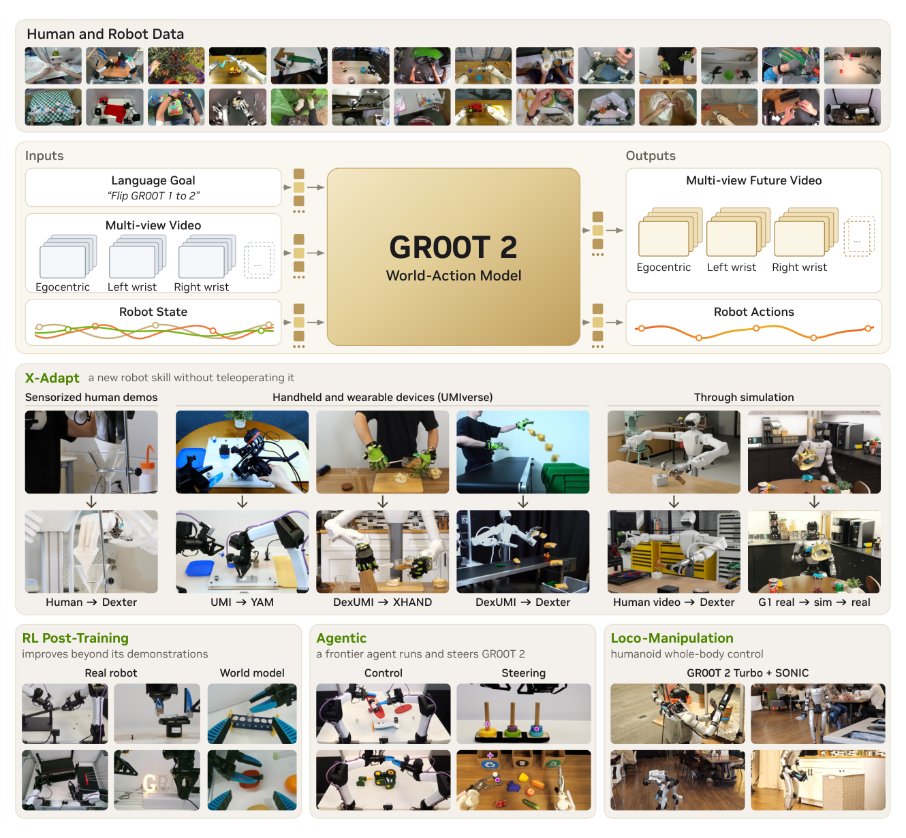

# GR00T 2 与具身智能

一本给**跨领域工程师**的中英对照学习手册：以 GR00T 2 这个**世界-动作模型（WAM）**为主线，串起具身智能、VLA 谱系、背后的技术栈与 AI 基础。

<figure></figure>

## 这本书解决什么问题

你写过多年的构建系统、分布式服务、云平台。现在你进入具身智能，做仿真，团队的研究方向是 GR00T 2 / WAM。你需要补的不是"AI 概论"，而是三样东西：

1. **一套能迁移的心智模型**——把你在 CI/CD、调度、可观测性、灰度发布里已经掌握的结构，映射到机器人学习里的对应物。这决定了你能不能快速"听懂"组里的讨论。
2. **一条最短的数学与算法补课路径**——Transformer、扩散、流匹配、VAE、强化学习。只补读懂这篇论文所必需的部分，不做无用功。
3. **一份可以反复查的原文底稿**——全文中英对照，英文段在前、中文段在后，随时回查原始表述与数字。

## 这本书怎么组织

| 部分 | 内容 | 你会得到 |
|---|---|---|
| 第一部分 入门 | [学习路线](00-学习路线.md)、[工程师视角](01-工程师视角.md)、[前置知识](02-前置知识.md) | 一条 10 周路径 + 概念映射表 + 最小数学集 |
| 第二部分 精读 | [论文导读](03-论文导读.md) 与第 04–11 章 | 逐章拆解算法、数据、训练、评测、部署、仿真 |
| 第二部分续 全景 | [具身智能全景](12-具身智能全景.md)、[技术谱系](13-技术谱系.md) | 知道 GR00T 2 在 VLA/WAM 谱系里的位置，以及它依赖的九个组件 |
| 第三部分 原文 | `paper/` 下 16 个中英对照章节 | 全文可检索的对照底稿 |
| 附录 | [术语表](appendix/术语表.md)、[抽取与翻译说明](appendix/抽取与翻译说明.md) | 术语定译 + 数据来源与已知缺陷 |

## 阅读约定

- **原文引用**：正文引用论文时给出页码与区块号，例如 `p.41 S786`。区块号是本书对原文的稳定编号（S=正文段，C=图注/表注，E=公式，H=小节），可在 `paper/` 对应页用浏览器查找定位。
- **中英对照**：`paper/` 下每个小节都是"英文段 → 中文段"交替。英文段与 PDF 抽取文本逐字一致，可用作核对。
- **术语**：全篇以[术语表](appendix/术语表.md)为唯一标准，例如 world-action model = 世界-动作模型、embodiment = 本体、teleoperation = 遥操作。
- **不猜**：公式一律以原图为准（`assets/equations/`），抽取不可靠处标注 `[存疑]` 或 `[公式原文见 p.X]`，详见[抽取与翻译说明](appendix/抽取与翻译说明.md)。

## 原文出处

> NVIDIA. **GR00T 2: Scaling Robot Foundation Models for Generalization, Dexterity, and Adaptation.** Whitepaper, November 2026.
> 项目页 <https://research.nvidia.com/labs/gear/gr00t-2>　·　PDF <https://research.nvidia.com/labs/gear/gr00t-2/assets/gr00t2_whitepaper.pdf>

本书底稿与官方 PDF 逐字节一致（SHA256 `A7316845D53AA61DB023DE15CA4F4FAD422ED071F256D9FA7E8801AA7376DD50`，135 页）。

## 关于这份材料的边界

- 这是一份**技术报告（whitepaper）**，不是同行评审论文：没有 arXiv 版本，模型权重计划 2026 年 12 月开放。书中所有数字都是 NVIDIA 自测结果。
- 书中"我的判断"与"论文的说法"会明确区分：前者写成点评，后者带页码区块号。
- 本材料仅用于个人学习，不作为对外发布物；引用原文请遵循 NVIDIA 的原始许可。

---

**开始读**：先看 [学习路线](00-学习路线.md)，再读 [工程师视角](01-工程师视角.md)。

## 目录结构与发布

```
gr00t2-book/
├── README.md / SUMMARY.md / .gitbook.yaml   # GitBook 入口与目录
├── 00–11-*.md                               # 12 个课程章节（学习层）
├── paper/                                   # 16 个中英对照章节（原文层）
├── appendix/                                # 术语表、抽取与翻译说明
├── assets/                                  # 106 张图表 + 7 张公式原图
├── source_map.json                          # 区块级索引（页码、类型、公式置信度）
├── tools/                                   # 生成脚本，可重跑
└── _build/                                  # 中间产物，不随书发布
```

**发布到 GitBook**：仓库根目录已有 `.gitbook.yaml`，指向 `README.md` 与 `SUMMARY.md`。在 GitBook 里导入该 Git 仓库即可，`_build/` 不在 SUMMARY 中，不会被发布。

**重新生成**（改了原文或译文之后）：

```powershell
python tools\assemble.py       # 合并译块 → _build\paper-annotated.md + source_map.json
python tools\make_gitbook.py   # 转成 paper\ 下的中英对照页
```

**完整性自检**：`paper/` 引用 113 张图片（106 图表 + 7 公式），磁盘上 113 张全部存在；书内链接 0 处失效；公式校验脚本 `--strict` 通过。

