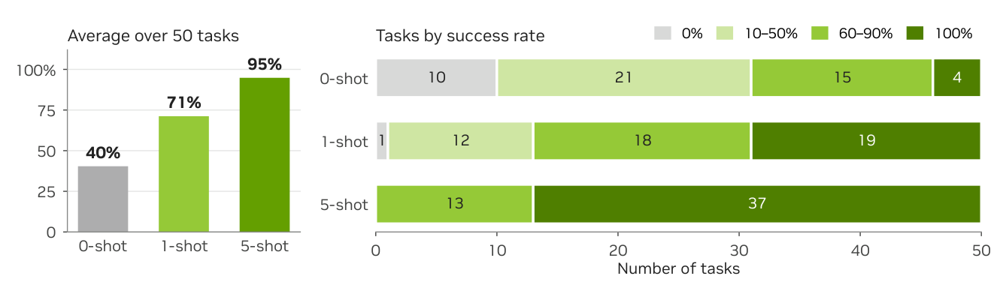

# 第 2 章 GR00T 2 总览

> **原文** 2. GR00T 2 Overview　·　起于 p.5　·　本页中英对照：英文段在前，中文段在后。

---

<!-- p.5 S058 -->

GR00T 2 is a world-action model (WAM): a single model that, given the robot’s visual and proprioceptive input and a user instruction, predicts both how the scene will unfold and the robot’s actions. One pretrained checkpoint covers parallel-gripper arms, dexterous hands, and a humanoid, and learns diverse source data sources including human egocentric videos, handheld UMI gripper data, and robot teleopration data. (Sec. 4.2).

GR00T 2 是一种世界-动作模型（WAM）：给定机器人的视觉与本体感知输入以及用户指令，由同一个模型同时预测场景将如何演化，以及机器人的动作。一个预训练检查点即可覆盖平行夹爪机械臂、灵巧手和人形机器人，并从多样的数据来源中学习，包括人类第一人称视角（egocentric）视频、手持式 UMI 夹爪数据以及机器人遥操作数据。(Sec. 4.2).

<!-- p.5 S059 -->

Inputs and outputs. At every control step, GR00T 2 receives (i) a 0.8s history of 224 × 320 images from up to four cameras at 5 fps, typically a head camera and one camera on each wrist, (ii) the robot’s proprioceptive state, and (iii) a natural-language instruction. It returns a chunk of future actions together with the predicted future frames of every camera. The robot executes the chunk through its own controller while the next chunk is computed (Sec. K.5).

输入与输出。在每个控制步，GR00T 2 接收 (i) 来自至多四台相机的 0.8 秒历史图像（224 × 320，5 fps，通常为一台头部相机加上每个腕部各一台）、(ii) 机器人的本体感知状态，以及 (iii) 一条自然语言指令。它返回一段未来动作块，以及每台相机的预测未来帧。机器人通过自身控制器执行该动作块，同时下一个动作块正在计算（Sec. K.5）。

<!-- p.5 S060 -->

Architecture. GR00T 2 is built on Cosmos-Predict2.5-2B, a video diffusion transformer pretrained for world simulation (NVIDIA et al., 2025a). Video, state, and action inputs become tokens in one sequence that a single 2B-parameter transformer processes (Fig. 1):

架构。GR00T 2 构建于 Cosmos-Predict2.5-2B 之上，后者是一个为世界仿真而预训练的视频扩散 Transformer（NVIDIA et al., 2025a）。视频、状态和动作输入被转换为同一序列中的 token，由单个 2B 参数的 Transformer 统一处理（Fig. 1）：

<!-- p.5 S061 -->

• Video. A frozen Wan 2.1 video VAE (Wan Team et al., 2025) compresses each camera stream 4× in time and 8× in each spatial dimension. The latents are split into patches, giving 280 tokens per latent frame and camera at 224 × 320. A learned view embedding tells the model which camera each token comes from. Past frames enter as context, and future frames are generated. • Language. A frozen Cosmos-Reason1 vision-language model (NVIDIA et al., 2025b) encodes the instruction, and the transformer reads it through cross-attention. • State and actions. Small embodiment-specific MLPs map the robot state and the noisy action chunk into the transformer’s width, and an embodiment-specific decoder maps the output tokens back to actions.

• 视频。一个冻结的 Wan 2.1 视频 VAE（Wan Team et al., 2025）将每路相机流在时间维度上压缩 4×、在每个空间维度上压缩 8×。潜变量被切分为图块（patch），在 224 × 320 分辨率下，每个潜变量帧、每路相机对应 280 个 token。一个可学习的视角嵌入（view embedding）告诉模型每个 token 来自哪台相机。过去的帧作为上下文输入，未来的帧则由模型生成。• 语言。一个冻结的 Cosmos-Reason1 视觉语言模型（NVIDIA et al., 2025b）对指令进行编码，Transformer 通过交叉注意力读取该编码。• 状态与动作。小型的本体专用 MLP 将机器人状态和带噪动作块映射到 Transformer 的宽度，本体专用解码器再将输出 token 映射回动作。

<!-- p.5 S062 -->

Inside the transformer, video tokens attend to one another across time and cameras, and action tokens attend to all video tokens, including the future frames being generated. Actions can therefore follow the future the model imagines. GR00T 2 is trained with flow matching (Lipman et al., 2023) on future video latents and actions together, with one loss for each. At inference, a few denoising steps suffice: one or two for video and two to four for actions in our deployments (Sec. I.1).

在 Transformer 内部，视频 token 在时间和相机之间相互注意，动作 token 则关注所有视频 token，包括正在生成的未来帧。因此，动作可以依循模型所想象的未来来展开。GR00T 2 使用流匹配（Lipman et al., 2023）在未来视频潜变量与动作上联合训练，二者各对应一项损失。推理时，几个去噪步即可满足需要：在我们的部署中，视频用一到两步，动作用两到四步（Sec. I.1）。

<!-- p.5 S063 -->

GR00T 2 Turbo: Efficient World-Action Modeling. While GR00T 2 already runs in real time when served from a workstation GPU (a median of 153 ms to predict an action chunk for Dexter from three camera views on a GeForce RTX 5090, Tab. 27), humanoid whole-body loco-manipulation sets a much stricter budget. The policy must react quickly to keep the whole body coordinated as the robot moves, and it must run onboard on

GR00T 2 Turbo：高效的世界-动作建模。虽然 GR00T 2 在工作站 GPU 上部署时已能实时运行（在 GeForce RTX 5090 上，利用三路相机视图为 Dexter 预测一个动作块的中位时延为 153 ms，见 Tab. 27），但人形机器人全身移动操作对时延预算的要求要严格得多。策略必须快速响应，才能在机器人运动时保持全身协调，并且它必须在机载端运行，

<!-- p.6 C002 · 图 F002 -->

Figure 2: Cross-embodiment transfer to Dexter with 0, 1, and 5 Dexter episodes. Results on the Dexter-50 tasks, which have no Dexter training data but appear in YAM teleoperation data, human video, or both. Zero-shot runs the pretrained model directly, while 1-shot and 5-shot fine-tune it with LoRA on 1 or 5 Dexter episodes. Left: average success rate over the 50 tasks. Right: number of tasks in each success-rate range. The tasks are those the model learns with five episodes (at least 80% success). Per-task results are in Fig. 24.

图 2：使用 0、1 和 5 个 Dexter episode 的跨本体迁移至 Dexter 的结果。结果基于 Dexter-50 任务集，这些任务在 Dexter 训练数据中没有出现，但出现在 YAM 遥操作数据、人类视频或二者之中。Zero-shot 直接运行预训练模型，而 1-shot 与 5-shot 则使用 LoRA 在 1 个或 5 个 Dexter episode 上进行微调。左图：50 个任务的平均成功率。右图：各成功率区间内的任务数量。这些任务是模型用五个 episode 即可学会的任务（成功率至少为 80%）。逐任务结果见 Fig. 24。

<!-- p.6 S078 -->

an edge GPU such as the NVIDIA Jetson AGX Thor, which has far less compute. We therefore design GR00T 2 Turbo to make the world-modeling objective itself even cheaper. Most of the tokens GR00T 2 predicts are future video, and video is highly redundant. Turbo keeps the 2B transformer that models video and actions jointly but encodes video with a higher-compression VAE, so it still predicts future observations and actions together, with far fewer visual tokens. This makes both training and inference faster. Turbo predicts in 124 ms on the onboard Jetson Thor of the Unitree G1, where it plans whole-body motion for the SONIC controller (Sec. 3.5 and 4.6.1). Turbo trails GR00T 2 on dexterous tasks but remains well above the baselines on bimanual and dexterous manipulation, and offers a favorable tradeoff between task performance and inference latency (Sec. 3.1 and Fig. 23).

例如 NVIDIA Jetson AGX Thor 这样的边缘 GPU，其算力要少得多。因此，我们设计了 GR00T 2 Turbo，使世界建模目标本身的开销进一步降低。GR00T 2 预测的大部分 token 是未来视频，而视频具有高度冗余性。Turbo 保留了联合建模视频与动作的 2B Transformer，但使用压缩率更高的 VAE 编码视频，因此它仍然同时预测未来观测与动作，只是视觉 token 数量少得多。这使训练与推理都更快。Turbo 在 Unitree G1 的机载 Jetson Thor 上以 124 ms 完成预测，并在此基础上为 SONIC 控制器规划全身运动（Sec. 3.5 and 4.6.1）。Turbo 在灵巧任务上落后于 GR00T 2，但在双臂与灵巧操作上仍远高于基线，并在任务性能与推理时延之间提供了有利的权衡（Sec. 3.1 and Fig. 23）。

<!-- p.6 S080 -->

Specifically, Turbo replaces the video VAE with the Wan 2.2 VAE (Wan Team et al., 2025), increasing spatial compression from 8× to 16× per dimension and producing a 4× smaller spatial latent grid. The latent input and output projections are adapted to the new VAE, while the action horizon remains unchanged.

具体而言，Turbo 将视频 VAE 替换为 Wan 2.2 VAE（Wan Team et al., 2025），将每个维度的空间压缩率从 8× 提高到 16×，使空间潜变量网格缩小 4×。潜变量的输入与输出投影层已适配新的 VAE，而动作时域（action horizon）保持不变。

<!-- p.6 S081 -->

Using GR00T 2 on a new robot. To bring up a robot, a practitioner maps its cameras to the head and wrist views, expresses its actions in a supported action space (or adds a new one), and post-trains GR00T 2 on demonstrations of the target tasks. Sec. 3 shows how few demonstrations this takes, and how to replace teleoperation with human or UMI demonstrations altogether.

在新机器人上使用 GR00T 2。要让一台机器人运行起来，实践者需要把它的相机映射到头部与腕部视角，将其动作表示为受支持的动作空间（或新增一个动作空间），然后在目标任务的演示数据上对 GR00T 2 进行后训练。第 3 节说明只需多少演示即可完成这一过程，以及如何完全用人类演示或 UMI 演示替代遥操作。
