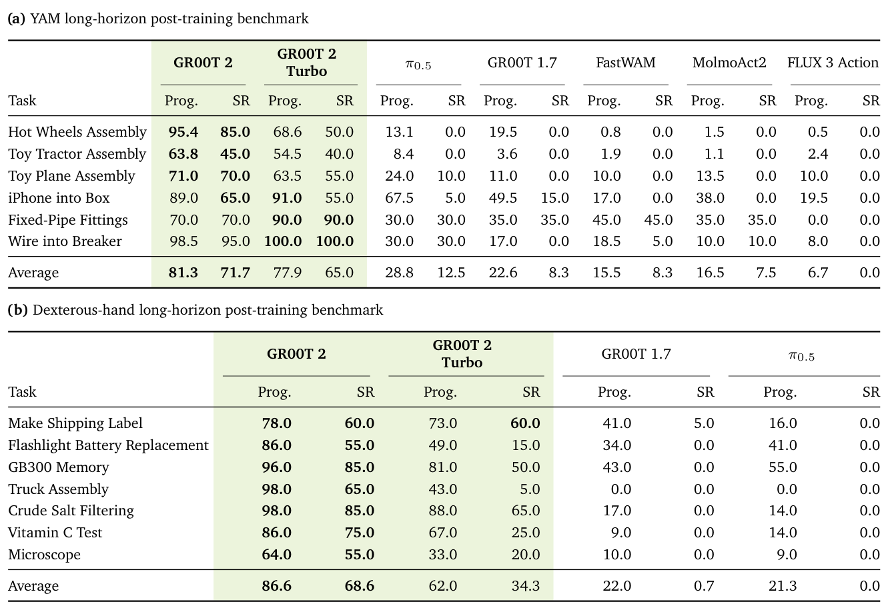
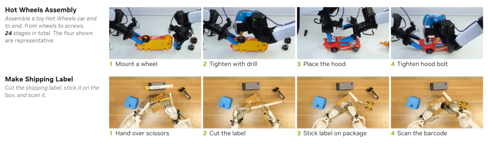
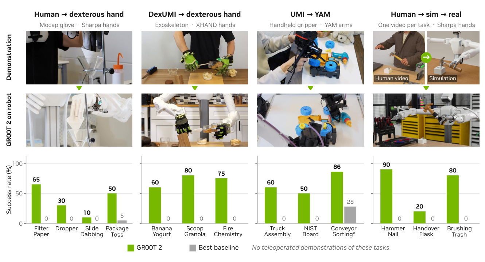
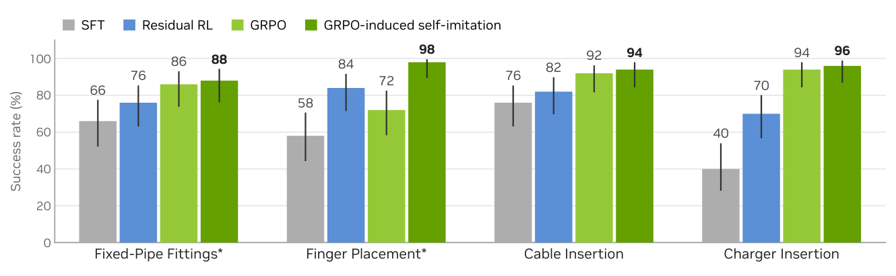
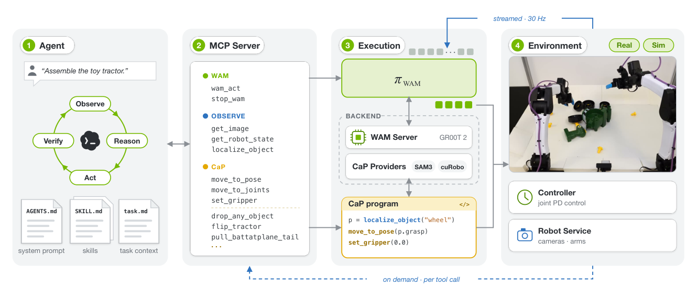
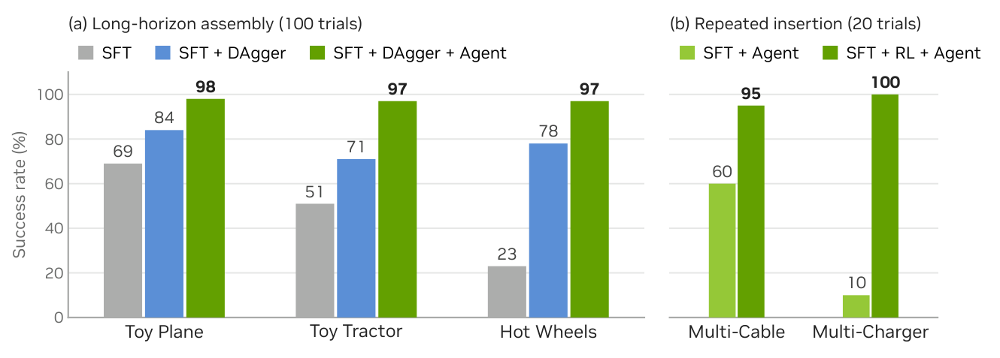
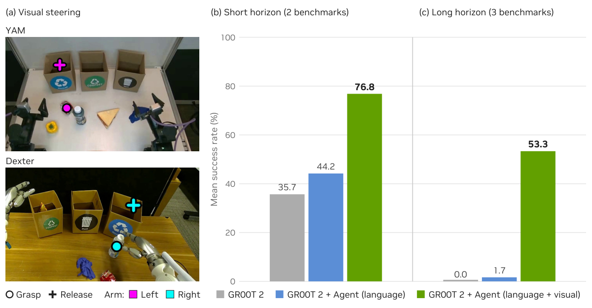
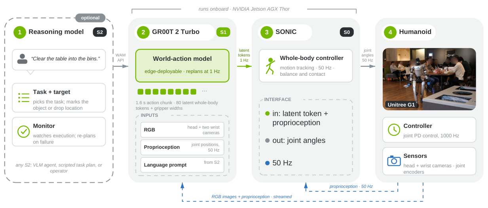

# 第 3 章 能力

> **原文** 3. GR00T 2 Capabilities　·　起于 p.6　·　本页中英对照：英文段在前，中文段在后。

---

<!-- p.6 S082 -->

We now present the capabilities of GR00T 2. Sec. 3.1 shows zero-shot deployment and few-shot adaptation on new tasks and post-training on long-horizon tasks that demand precision and dexterity, and Sec. 3.2 studies cross-embodiment transfer, in which GR00T 2 learns a skill on a robot without teleoperated demonstrations of that skill. Sec. 3.3 shows that reinforcement learning improves GR00T 2 beyond its demonstrations, Sec. 3.4 pairs GR00T 2 with a frontier agent for long-horizon tasks, and Sec. 3.5 extends GR00T 2 to whole-body humanoid loco-manipulation. We report the main results here and defer the full evaluations to the appendix.

下面介绍 GR00T 2 的能力。第 3.1 节展示其在新任务上的零样本部署与少样本适配，以及在要求精确与灵巧的长时序任务上的后训练；第 3.2 节研究跨本体迁移，即 GR00T 2 在某台机器人上学会一项技能，而无需该技能的遥操作演示。第 3.3 节表明，强化学习能使 GR00T 2 超越其演示数据；第 3.4 节将 GR00T 2 与前沿智能体配对，用于长时序任务；第 3.5 节将 GR00T 2 扩展到全身人形机器人移动操作。这里只报告主要结果，完整评测留待附录。

## 3.1. Fast Adaptation: Zero-Shot Generalization and Few-Shot Mastery · 3.1. 快速适配：零样本泛化与少样本精通

<!-- p.6 S083 -->

Zero-shot deployment on new tasks. Pretraining on teleoperation data from many robots and on Human-1M human video (Sec. 4.2) gives GR00T 2 an emergent ability to perform tasks it has never seen on the target robot. We test this on Dexter (Tianji robot + Sharpa hands), a bimanual robot with two 22-DoF dexterous hands, with 50 tasks that are absent from Dexter’s own data and appear only in YAM gripper data, human video, or both. Deployed out of the box and conditioned only on the language instruction, GR00T 2 succeeds in 40% of trials and completes 40 of the 50 tasks at least once (Fig. 2). Most failures come from a single step

在新任务上的零样本部署。在许多机器人的遥操作数据以及 Human-1M 人类视频上进行预训练（Sec. 4.2），使 GR00T 2 获得了一种涌现能力，能够在目标机器人上完成它从未见过的任务。我们在 Dexter（Tianji 机器人 + Sharpa 手）上检验这一能力。Dexter 是一台双臂机器人，配备两只 22-DoF 灵巧手。测试包含 50 个任务，这些任务不在 Dexter 自身的数据中，只出现在 YAM 夹爪数据、人类视频或二者之中。GR00T 2 开箱即用，仅以语言指令为条件，在 40% 的试次中成功，并且 50 个任务中至少完成一次的有 40 个（Fig. 2）。大多数失败来自一个步骤

<!-- p.7 C003 · 表 T001 -->

Table 1: Post-training benchmarks. For each model, Prog. is the average task progress score across all trials and SR is the success rate, both on a scale from 0 to 100. Bold marks the best Prog. and SR in each row, and the last row of each table averages its tasks. Each YAM result is based on up to 20 trials. On Truck Assembly, GR00T 2 and GR00T 2 Turbo were evaluated on a revised, easier set of start scenes, and on the original scenes GR00T 2 succeeds in 7 of 20 trials with a progress score of 94.0. Baselines: 𝜋0.5 (Physical Intelligence et al., 2025), GR00T 1.7 (NVIDIA, 2026a), FastWAM (Yuan et al., 2026), MolmoAct2 (Fang et al., 2026), and FLUX 3 Action (Black Forest Labs, 2026).

表 1：后训练基准测试。对每个模型，Prog. 为所有试次的平均任务进度得分，SR 为成功率，二者均取 0 到 100 的刻度。每行中最佳的 Prog. 与 SR 加粗标出，每个表的最后一行对其所有任务取平均。每个 YAM 结果基于至多 20 次试验。在 Truck Assembly 上，GR00T 2 与 GR00T 2 Turbo 是在修订后、更容易的一组起始场景上评测的；在原始场景上，GR00T 2 在 20 次试验中成功 7 次，进度得分为 94.0。基线：𝜋0.5（Physical Intelligence et al., 2025）、GR00T 1.7（NVIDIA, 2026a）、FastWAM（Yuan et al., 2026）、MolmoAct2（Fang et al., 2026）以及 FLUX 3 Action（Black Forest Labs, 2026）。

<!-- p.7 S088 -->

Hot Wheels Assembly 95.4 85.0 68.6 50.0 13.1 0.0 19.5 0.0 0.8 0.0 1.5 0.0 0.5 0.0 Toy Tractor Assembly 63.8 45.0 54.5 40.0 8.4 0.0 3.6 0.0 1.9 0.0 1.1 0.0 2.4 0.0 Toy Plane Assembly 71.0 70.0 63.5 55.0 24.0 10.0 11.0 0.0 10.0 0.0 13.5 0.0 10.0 0.0 iPhone into Box 89.0 65.0 91.0 55.0 67.5 5.0 49.5 15.0 17.0 0.0 38.0 0.0 19.5 0.0 Fixed-Pipe Fittings 70.0 70.0 90.0 90.0 30.0 30.0 35.0 35.0 45.0 45.0 35.0 35.0 0.0 0.0 Wire into Breaker 98.5 95.0 100.0 100.0 30.0 30.0 17.0 0.0 18.5 5.0 10.0 10.0 8.0 0.0

[存疑：抽取文本为表格行的扁平化结果，列结构丢失，无法确定各数值所属的列，以下按原始顺序保留。] 任务行依次为：Hot Wheels Assembly（Hot Wheels 组装）95.4 85.0 68.6 50.0 13.1 0.0 19.5 0.0 0.8 0.0 1.5 0.0 0.5 0.0；Toy Tractor Assembly（玩具拖拉机组装）63.8 45.0 54.5 40.0 8.4 0.0 3.6 0.0 1.9 0.0 1.1 0.0 2.4 0.0；Toy Plane Assembly（玩具飞机组装）71.0 70.0 63.5 55.0 24.0 10.0 11.0 0.0 10.0 0.0 13.5 0.0 10.0 0.0；iPhone into Box（将 iPhone 放入盒中）89.0 65.0 91.0 55.0 67.5 5.0 49.5 15.0 17.0 0.0 38.0 0.0 19.5 0.0；Fixed-Pipe Fittings（固定管路接头）70.0 70.0 90.0 90.0 30.0 30.0 35.0 35.0 45.0 45.0 35.0 35.0 0.0 0.0；Wire into Breaker（将线缆接入断路器）98.5 95.0 100.0 100.0 30.0 30.0 17.0 0.0 18.5 5.0 10.0 10.0 8.0 0.0。

<!-- p.7 S094 -->

Make Shipping Label 78.0 60.0 73.0 60.0 41.0 5.0 16.0 0.0 Flashlight Battery Replacement 86.0 55.0 49.0 15.0 34.0 0.0 41.0 0.0 GB300 Memory 96.0 85.0 81.0 50.0 43.0 0.0 55.0 0.0 Truck Assembly 98.0 65.0 43.0 5.0 0.0 0.0 0.0 0.0 Crude Salt Filtering 98.0 85.0 88.0 65.0 17.0 0.0 14.0 0.0 Vitamin C Test 86.0 75.0 67.0 25.0 9.0 0.0 14.0 0.0 Microscope 64.0 55.0 33.0 20.0 10.0 0.0 9.0 0.0

[存疑：抽取文本为表格行的扁平化结果，列结构丢失，无法确定各数值所属的列，以下按原始顺序保留。] 任务行依次为：Make Shipping Label（制作运输标签）78.0 60.0 73.0 60.0 41.0 5.0 16.0 0.0；Flashlight Battery Replacement（更换手电筒电池）86.0 55.0 49.0 15.0 34.0 0.0 41.0 0.0；GB300 Memory（GB300 内存模块）96.0 85.0 81.0 50.0 43.0 0.0 55.0 0.0；Truck Assembly（卡车组装）98.0 65.0 43.0 5.0 0.0 0.0 0.0 0.0；Crude Salt Filtering（粗盐过滤）98.0 85.0 88.0 65.0 17.0 0.0 14.0 0.0；Vitamin C Test（维生素 C 检测）86.0 75.0 67.0 25.0 9.0 0.0 14.0 0.0；Microscope（显微镜操作）64.0 55.0 33.0 20.0 10.0 0.0 9.0 0.0。

<!-- p.7 C004 · 图 F003 -->

Figure 3: Representative tasks from the two post-training benchmarks. Hot Wheels Assembly on YAM (top) and Make Shipping Label on Dexter (bottom).

图 3：两个后训练基准测试中的代表性任务。YAM 上的 Hot Wheels Assembly（上）与 Dexter 上的 Make Shipping Label（下）。

<!-- p.7 S096 -->

that falls short on precision within an otherwise correct execution. The ability grows with data, and zero-shot success on new Dexter tasks more than doubles as the amount of human video in pretraining increases (Fig. 10). On broader zero-shot suites for YAM and Dexter, GR00T 2 also leads the VLA baselines in success rate (Tabs. 2 and 3).

该步骤在精度上不足，而其余执行本身是正确的。这种能力随数据增长：随着预训练中人类视频数量的增加，Dexter 新任务上的零样本成功率增长超过一倍（Fig. 10）。在 YAM 与 Dexter 更广泛的零样本测试集上，GR00T 2 的成功率同样领先于 VLA 基线（Tabs. 2 and 3）。

<!-- p.7 S097 -->

Few-shot mastery with minutes of robot data. Because the pretrained model already knows how to approach

仅用几分钟机器人数据实现少样本精通。由于预训练模型已经知道如何接近

<!-- p.8 C005 · 图 F004 -->

Figure 4: Learning new tasks without teleoperation. Each column is one way to demonstrate a task without the target robot. It shows a demonstration, a GR00T 2 rollout on the robot, and the real-robot success rate per task. Best baseline is the highest success among the other models evaluated on that task (GR00T 1.7 (NVIDIA, 2026a), 𝜋0.5 (Physical Intelligence et al., 2025), LingBot-VA (Li et al., 2026)). *For Conveyor Sorting, the bars show the share of the 50 conveyor items sorted, not the share of successful trials. Full results are in Fig. 27 and Tabs. 4, 5 and 7.

图 4：不依赖遥操作学习新任务。每一列对应一种无需目标机器人即可演示任务的方式，展示了演示、GR00T 2 在机器人上的一次 rollout（轨迹采样），以及每个任务的真机成功率。Best baseline 指在该任务上其他被评测模型中的最高成功率（GR00T 1.7（NVIDIA, 2026a）、𝜋0.5（Physical Intelligence et al., 2025）、LingBot-VA（Li et al., 2026））。*对于 Conveyor Sorting，柱状图表示所分拣的 50 件传送带物品所占的比例，而非成功试次的比例。完整结果见 Fig. 27 和 Tabs. 4, 5 and 7。

<!-- p.8 S130 -->

these tasks, very little robot data closes the gap. One teleoperated episode per task lifts success to 71%, and five episodes, under three minutes of robot data, lift it to 95%, with 37 of the 50 tasks succeeding in every trial. The 50 tasks were chosen among those the model learns with five episodes (at least 80% success), so the five-episode rate is high partly by construction. Each adaptation is a LoRA fine-tune of about 30 minutes on a single RTX 5090, and merging the adapter into the weights means the adapted model is served exactly like the pretrained one (Sec. A.3).

这些任务上，极少量的机器人数据即可弥合差距。每个任务一个遥操作 episode 即可将成功率提升至 71%；五个 episode（不足三分钟的机器人数据）则将其提升至 95%，其中 50 个任务中有 37 个在每次试验中都成功。这 50 个任务是从模型用五个 episode 即可学会（成功率至少为 80%）的任务中挑选出来的，因此五个 episode 的成功率在一定程度上由挑选方式决定。每次适配都是在单张 RTX 5090 上约 30 分钟的 LoRA 微调；将适配器合并进权重后，适配后的模型与预训练模型的部署方式完全相同（Sec. A.3）。

<!-- p.8 S131 -->

Long-horizon tasks that demand precision and dexterity. The same pretraining pays off when GR00T 2 is post-trained on long-horizon tasks that chain many precise steps. On six YAM tasks, from assembling a toy car end to end in 24 stages to inserting a wire into a breaker, GR00T 2 reaches 71.7% average success, compared with at most 12.5% for the VLA and WAM baselines (Tab. 1a and Fig. 3). On seven dexterous-hand tasks, such as filtering crude salt, testing for vitamin C, and swapping a GB300 memory module, GR00T 2 reaches 68.6% average success, compared with at most 0.7% for GR00T 1.7 and 𝜋0.5 (Tab. 1b). Completing such tasks end to end, with dexterous hands and tight tolerances at every step, is a new capability for a generalist robot model. All tasks of both benchmarks are shown in Sec. A.1.

需要精确与灵巧的长时序任务。当 GR00T 2 在串联多个精细步骤的长时序任务上进行后训练时，同样的预训练也带来了收益。在六个 YAM 任务上（从分 24 个阶段端到端组装玩具汽车，到将线缆插入断路器），GR00T 2 的平均成功率达到 71.7%，而 VLA 与 WAM 基线至多为 12.5%（Tab. 1a and Fig. 3）。在七个灵巧手任务上（例如过滤粗盐、维生素 C 检测，以及更换 GB300 内存模块），GR00T 2 的平均成功率达到 68.6%，而 GR00T 1.7 与 𝜋0.5 至多为 0.7%（Tab. 1b）。在每一步都要求灵巧手与严苛公差的前提下端到端完成此类任务，对通用机器人模型而言是一项新能力。两个基准测试的全部任务均展示于 Sec. A.1。

<!-- p.8 S132 -->

GR00T 2 Turbo. Although Turbo is designed primarily for onboard deployment on edge devices (Sec. 2), it still retains much of GR00T 2 capability. In zero-shot evaluation, it stays close to GR00T 2 on YAM and ranks second among the evaluated models on Dexter (Tabs. 2 and 3). After post-training it gives up some success, reaching 65.0% on the YAM tasks and 34.3% on the dexterous-hand tasks, still well above the baselines. Fig. 23 shows the resulting trade-off between task progress and inference latency.

GR00T 2 Turbo。尽管 Turbo 主要为边缘设备上的机载部署而设计（Sec. 2），它仍保留了 GR00T 2 的大部分能力。在零样本评测中，它在 YAM 上与 GR00T 2 接近，在 Dexter 上在所评测模型中排名第二（Tabs. 2 and 3）。经过后训练后，它损失了一部分成功率：在 YAM 任务上达到 65.0%，在灵巧手任务上达到 34.3%，仍远高于基线。Fig. 23 展示了任务进度与推理时延之间由此产生的权衡。

## 3.2. X-Adaptability: Cross-Embodiment Skill Transfer · 3.2. 跨本体适配（x-adapt）：跨本体技能迁移

<!-- p.8 S133 -->

GR00T 2 can learn a new task on a robot without any task-specific teleoperated demonstration. Fig. 4 summarizes four ways to teach it such a task, from demonstrations recorded with a motion-capture glove, the DexUMI exoskeleton, or the handheld Gripper UMI, and from a single human video expanded in simulation.

GR00T 2 无需任何针对特定任务的遥操作演示，即可在机器人上学习新任务。图 4 总结了教授其此类任务的四种方式：演示数据分别来自动作捕捉手套、DexUMI 外骨骼或手持式 Gripper UMI，还有一种是将单段人类视频在仿真中扩展后得到的数据。

<!-- p.9 S134 -->

For the glove and Gripper UMI demonstrations, which come from a different embodiment than the robot, one recipe bridges the gap. Demonstrations recorded without the robot specify the task, task-agnostic play data from the target robot specify the embodiment, and cross-embodiment pretraining connects the two. Without this pretraining, the same post-training data yield substantially lower performance (Sec. B.1.5). For the glove, DexUMI, and Gripper UMI demonstrations, the baselines are post-trained on the same data as GR00T 2 (Fig. 27 and Tabs. 4 and 5). When teleoperated demonstrations are available, they complement rather than replace the human data (App. B).

对于手套和 Gripper UMI 的演示（它们来自与机器人不同的本体（embodiment）），一套方案即可弥合这一差距。脱离机器人采集的演示负责指定任务，目标机器人的任务无关 play 数据负责指定本体，跨本体预训练则将两者连接起来。若没有这一预训练，使用相同的后训练数据时性能会显著下降（Sec. B.1.5）。对于手套、DexUMI 和 Gripper UMI 演示，基线模型所用的后训练数据与 GR00T 2 相同（Fig. 27 及 Tabs. 4 和 5）。当遥操作演示可用时，它们是对人类数据的补充，而非替代（App. B）。

<!-- p.9 S135 -->

Transfer to dexterous hands. Two devices record dexterous demonstrations without the robot: a motioncapture glove worn on the bare hand, and the DexUMI exoskeleton, which replicates the robot hand’s joints and contact surfaces and records fingertip forces in the hand’s tactile format. With the glove, human demonstrations are recorded with head and wrist cameras, retargeted offline to the robot hand, and co-trained with play data of the target robot (Sec. B.1.3). On a bimanual robot with Sharpa hands, this recipe teaches precise chemistry-lab tasks and a fast conveyor toss that cannot be demonstrated through teleoperation. On one task, GR00T 2 trained without any teleoperated demonstration outperforms a baseline without cross-embodiment pretraining that receives ten (Fig. 27). DexUMI extends robot-free collection to tasks that depend on force and compliance: from its force recordings, GR00T 2 learns to predict the force to apply along with the motion, and the hand’s stiffness adapts to that force. Trained on DexUMI demonstrations alone, GR00T 2 slices a banana and unscrews a jar in a long-horizon breakfast task and lights a lamp with a struck match, with 60 to 80% success per task, whereas GR00T 1.7 and 𝜋0.5 complete none (Fig. 15 and Tab. 5). DexUMI demonstrations also transfer to a hand that the exoskeleton does not replicate. After retargeting to the 22-DoF Sharpa hand, GR00T 2 succeeds in 60% of trials on microscope slide dabbing and 65% on conveyor package selection and tossing, and the same two baselines succeed in none (Tab. 6).

迁移到灵巧手。两种设备可以在不使用机器人的情况下采集灵巧操作演示：一是戴在裸手上的动作捕捉手套，二是 DexUMI 外骨骼，它复现机器人手的关节和接触面，并以手部触觉格式记录指尖力。使用手套时，人类演示通过头部和腕部相机记录，离线重定向到机器人手上，并与目标机器人的 play 数据联合训练（Sec. B.1.3）。在搭载 Sharpa 灵巧手的双臂机器人上，这一方案教会了精确的化学实验室任务，以及无法通过遥操作演示的快速传送带抛掷动作。在某一任务上，未使用任何遥操作演示、仅依靠此方案训练的 GR00T 2，其表现优于未经跨本体预训练的基线，而后者接收了 ten（原文如此）（Fig. 27）。DexUMI 将无机器人采集扩展到依赖力与柔顺性（compliance）的任务：GR00T 2 从其力记录中学习，在预测运动的同时预测应施加的力，手部刚度随该力自适应。仅用 DexUMI 演示训练，GR00T 2 即可在一个长时序早餐任务中切香蕉、拧开罐子，并用划燃的火柴点亮台灯，每项任务成功率为 60% 至 80%；而 GR00T 1.7 和 π0.5 均未完成任何一项（Fig. 15 及 Tab. 5）。DexUMI 演示还可迁移到外骨骼未复现的手上。将其重定向到 22 自由度（DoF）的 Sharpa 手后，GR00T 2 在显微镜载玻片蘸取任务上的试次成功率为 60%，在传送带包裹挑选与抛掷任务上为 65%，而同样的两个基线均无成功（Tab. 6）。

<!-- p.9 S136 -->

Transfer to parallel-gripper robots. Demonstrations are recorded with the handheld Gripper UMI, in robot format through robot-style wrist cameras and a width encoder, and deployed on YAM, a robot that shares neither its cameras, nor its gripper, nor its workspace. GR00T 2 co-trains them with task-agnostic YAM play data that supply the embodiment and aligns them to YAM’s camera geometry and action space (Sec. 4.4.2). With 41 to 75 demonstrations per task and no teleoperation, GR00T 2 completes a long-horizon toy assembly and a board disassembly in 60% and 50% of trials and sorts 86% of the items off a moving conveyor, whereas the baselines complete neither long-horizon task (Tab. 4). As few as 10 to 20 demonstrations yield end-to-end success. Collection is thus decoupled from the robot, and human-speed motion makes dynamic skills learnable.

迁移到平行夹爪（parallel-gripper）机器人。演示使用手持式 Gripper UMI 采集，以机器人格式通过机器人风格的腕部相机和宽度编码器记录，并部署到 YAM 上。YAM 机器人与采集设备既不共享相机，也不共享夹爪或工作空间。GR00T 2 将这些演示与与任务无关的 YAM play 数据联合训练，后者提供本体信息，并使演示与 YAM 的相机几何和动作空间对齐（Sec. 4.4.2）。每项任务使用 41 至 75 条演示且不使用遥操作时，GR00T 2 在长时序玩具组装和板件拆卸任务中的试次成功率分别为 60% 和 50%，并能从移动的传送带上分拣出 86% 的物品；而基线在两项长时序任务上均未完成。仅 10 至 20 条演示即可实现端到端成功。因此，数据采集与机器人解耦，而人类速度的动作使动态技能变得可学习。

<!-- p.9 S137 -->

Transfer from a single human video through simulation. From one human video, we reconstruct the objects and the hand-object motion, train an RL expert in simulation, and fine-tune GR00T 2 on visually randomized rollouts of that expert. The resulting policy transfers zero-shot to the real robot and drives a nail in 9 of 10 trials, whereas GR00T 1.7 and 𝜋0.5 complete none of the real-world tasks (Sec. B.5).

通过仿真从单段人类视频迁移。我们从一段人类视频中重建物体及手与物体的运动，在仿真中训练 RL 专家策略，并在该专家策略的视觉随机化 rollout（轨迹采样）上微调 GR00T 2。所得策略以零样本方式迁移到真实机器人上，在 10 次试次中有 9 次成功将钉子敲入；而 GR00T 1.7 和 π0.5 在真实世界任务中均未完成（Sec. B.5）。

## 3.3. Robust Deployment through Reinforcement Learning · 3.3. 通过强化学习实现鲁棒部署

<!-- p.9 S138 -->

Supervised fine-tuning (SFT) equips GR00T 2 with manipulation skills, but contact-rich tasks remain sensitive to small errors in alignment and physical interaction. We apply real-world RL on top of SFT policy to further improve the reliability of GR00T 2 through real-world interaction and task-level success feedback.

监督微调（SFT）使 GR00T 2 具备了操作技能，但富接触任务对对齐和物理交互中的微小误差依然敏感。我们在 SFT 策略之上施加真实世界 RL，借助真实世界交互和任务级成功反馈，进一步提升 GR00T 2 的可靠性。

<!-- p.9 S139 -->

We evaluate four precision manipulation tasks: fixed-pipe fittings (the task of Tab. 1a, started from harder fitting poses), finger placement, cable insertion, and charger insertion (Fig. 5). We directly optimize GR00T 2 using Group Relative Policy Optimization (GRPO) (Shao et al., 2024) and further train on successful GRPO rollouts through GRPO-induced self-imitation. We also compare against residual RL, which learns corrections on top of a frozen GR00T 2 policy (Sec. 4.1).

我们评测了四项精密操作任务：固定管路接头（即 Tab. 1a 中的任务，但从更困难的接头姿态开始）、手指定位、线缆插入和充电器插入（Fig. 5）。我们使用 Group Relative Policy Optimization（GRPO）（Shao et al., 2024）直接优化 GR00T 2，并通过 GRPO 诱导的自模仿，在成功的 GRPO rollout 上进一步训练。我们还与残差 RL 进行了比较，后者在冻结的 GR00T 2 策略之上学习修正量（Sec. 4.1）。

<!-- p.9 S140 -->

GRPO-induced self-imitation achieves 88%, 98%, 94%, and 96% success on the four tasks, respectively, compared with 40 to 76% after SFT. Residual RL also improves performance, but without updating the underlying GR00T 2 model (Fig. 5). These results show that real-world RL improves the reliability of GR00T 2

GRPO 诱导的自模仿在四项任务上的成功率分别为 88%、98%、94% 和 96%，而 SFT 之后的成功率为 40% 至 76%。残差 RL 同样提升了性能，但它不更新底层的 GR00T 2 模型（Fig. 5）。这些结果表明，真实世界 RL 提升了 GR00T 2 的可靠性。

<!-- p.10 C006 · 图 F005 -->

Figure 5: Real-robot post-training on four contact-rich manipulation tasks. Labels report success rates, and whiskers are 95% Wilson intervals over 50 trials per bar. Bold marks each task’s best method. GRPO and GRPO-induced self-imitation update GR00T 2 directly, whereas residual RL learns a correction policy on top of a frozen GR00T 2. GRPO-induced self-imitation trains on successful GRPO rollouts. *Evaluated with CPS sampling noise.

图 5：四项富接触操作任务上的真机后训练。标签为成功率，误差线为每个柱体基于 50 次试次计算的 95% Wilson 区间。加粗表示各任务的最佳方法。GRPO 与 GRPO 诱导的自模仿直接更新 GR00T 2，而残差 RL 在冻结的 GR00T 2 之上学习修正策略。GRPO 诱导的自模仿在成功的 GRPO rollout 上训练。*使用保系数采样（CPS）的采样噪声进行评测。

<!-- p.10 C007 · 图 F006 -->

Figure 6: Agentic runtime architecture. System 2 monitors execution and invokes GR00T 2 and CaP tools through an observe-reason-act-verify loop. GR00T 2 or ASPIRE-generated program serves as execution backends with shared execution environment interface.

图 6：智能体化运行时架构。系统 2（S2）通过“观察-推理-行动-验证”循环监控执行，并调用 GR00T 2 与代码即策略（code-as-policy, CaP）工具。GR00T 2 或 ASPIRE 生成的程序均可作为执行后端，共享同一执行环境接口。

<!-- p.10 S190 -->

on contact-rich manipulation. The resulting skills can be integrated into agentic execution for more complex, long-horizon tasks (Sec. 3.4), as we will introduce next.

[存疑：文本从句中开始，句首缺失] 在接触密集型操作上。所得技能可以整合进智能体化执行，用于更复杂的长时序任务（Sec. 3.4），下文将对此作介绍。

## 3.4. Agentic GR00T 2 · 3.4. 智能体化 GR00T 2

<!-- p.10 S191 -->

A frontier multimodal agent and GR00T 2 address complementary parts of a task. The agent determines what to do: it decomposes long tasks, monitors progress, and writes code. GR00T 2 determines how to do it, performing the contact-rich manipulation that is difficult to script. The agent serves as System 2 and calls GR00T 2 as a tool alongside camera, state, and CaP tools (Fig. 6). It supports GR00T 2 in four ways. Augment: for tasks that need memory or explicit reasoning, the agent runs a task-level program that calls GR00T 2 for each manipulation step. Together with RL post-training, this puts GR00T 2 first on both the RoboCasa365 (Nasiriany et al., 2026) and RoboDojo (Chen et al., 2026a) leaderboards (Tab. 19). Assist: on real robots, the agent watches GR00T 2 and, when it sees a dropped part or stalled progress, repairs the state with a CaP skill and hands control back, lifting a post-trained GR00T 2 to near-perfect success on three cluttered assembly tasks (Fig. 7). Guide: beyond language, the agent can steer GR00T 2 with visual targets through the WAM API, described below. Improve: an autonomous research agent discovered the basis of the RL recipe we use to post-train GR00T 2 (Sec. 4.1

一个前沿多模态智能体与 GR00T 2 分别负责任务的互补部分。智能体决定做什么：它分解长任务、监控进展并编写代码。GR00T 2 决定怎样做，执行那些难以脚本化的富接触操作。智能体作为系统 2（S2），与相机、状态和 CaP 工具一并，将 GR00T 2 当作工具来调用（Fig. 6）。它以四种方式支持 GR00T 2。增强（Augment）：对于需要记忆或显式推理的任务，智能体运行一个任务级程序，为每个操作步骤调用 GR00T 2。结合 RL 后训练，这使 GR00T 2 在 RoboCasa365（Nasiriany et al., 2026）和 RoboDojo（Chen et al., 2026a）两个排行榜上均居首位（Tab. 19）。辅助（Assist）：在真实机器人上，智能体观察 GR00T 2 的执行过程，当其发现零件掉落或进展停滞时，用 CaP 技能修复状态并将控制权交还，使经过后训练的 GR00T 2 在三项杂乱装配任务上接近完美的成功率（Fig. 7）。引导（Guide）：除语言之外，智能体还可以通过 WAM API 用视觉目标引导 GR00T 2，下文将介绍。改进（Improve）：一个自主研究智能体发现了我们用于 GR00T 2 后训练的 RL 方案的基础（Sec. 4.1 [存疑：文本在此截断]

<!-- p.11 C008 · 图 F007 -->

Figure 7: Agentic assistance on real robots. (a) Successful trials out of 100 per method on three long-horizon assembly tasks on YAM. Before every trial a person randomly dumps all parts onto the table, a cluttered starting configuration never seen in post-training and much harder than the arranged layouts of Tab. 1a. A trial that needed human help counts as a failure. The agent lifts GR00T 2 after SFT + DAgger to at least 97% on all three tasks. (b) Full-task success over 20 repeated-insertion episodes with SFT and RL-post-trained GR00T 2 in the same agentic framework. RL post-training raises success from 60% to 95% on multi-cable and from 10% to 100% on multi-charger insertion.

图 7：真实机器人上的智能体辅助。(a) 在 YAM 上完成三项长时序装配任务时，每种方法 100 次试次中的成功次数。每次试次前，由人工随机将所有零件倒在桌面上，形成从未在后训练中出现过的杂乱起始配置，难度远高于 Tab. 1a 中整齐排列的布局。需要人工帮助的试次计为失败。经 SFT + DAgger 后的 GR00T 2 在智能体辅助下，三项任务均至少达到 97%。(b) 在同一智能体化框架中，使用 SFT 与经 RL 后训练的 GR00T 2，对 20 个重复插入回合的整任务成功率。RL 后训练将多线缆插入的成功率从 60% 提升至 95%，将多充电器插入的成功率从 10% 提升至 100%。

<!-- p.11 S199 -->

and F.2). We therefore recommend assigning manipulation to GR00T 2 and providing the agent with the task structure, success checks, and a small library of recovery skills (Sec. G.1).

[存疑：文本从句中开始，句首缺失] 和 F.2）。因此我们建议将操作交给 GR00T 2，并为智能体提供任务结构、成功检查以及一小套恢复技能库（Sec. G.1）。

<!-- p.11 S200 -->

Agentic Skill Composition and Recovery with Code-as-Policy. In simulation, we use ASPIRE (Lu et al., 2026) to discover task-level programs that compose GR00T 2 calls with perception, reasoning, and CaP primitives. These programs use GR00T 2 as a manipulation tool within more complex task sequences, while System 2 monitors execution and invokes online CaP recovery when unexpected failures occur. Combined with RL post-training, this approach achieves 88.0% success on RoboCasa365 and 75.8% on RoboDojo, evaluated on one of its three official layout banks, the highest reported success rates on both leaderboards as of November 6, 2026 (Tab. 19).

基于代码即策略的智能体化技能组合与恢复。在仿真中，我们使用 ASPIRE（Lu et al., 2026）发现任务级程序，这些程序将 GR00T 2 的调用与感知、推理和 CaP 原语组合在一起。它们把 GR00T 2 用作更复杂任务序列中的操作工具，而系统 2 监控执行过程，并在出现意外故障时调用在线 CaP 恢复。结合 RL 后训练，该方法在 RoboCasa365 上达到 88.0% 的成功率，在 RoboDojo 上达到 75.8%，评测基于其三个官方布局库中的一个。截至 2026 年 11 月 6 日，这是两个排行榜上报告的最高成功率（Tab. 19）。

<!-- p.11 S201 -->

On physical robots, GR00T 2 remains the primary executor, while the agent monitors progress and invokes CaP skills for targeted recovery. We stress-test this approach on three long-horizon assembly tasks on YAM, a Toy Plane, a Toy Tractor, and a Hot Wheels car (Fig. 55), under conditions much harder than the post-training benchmark in Tab. 1a. There, every trial starts from an arranged layout of the parts. Here, a person randomly dumps all parts onto the table before each trial, so every trial starts from a new cluttered configuration, with overlapping parts and arbitrary poses never seen in post-training, and each method runs 100 trials. The robot must find the parts, assemble them in order, fasten them with a toy drill, and recover from its own errors, all within a single trial that typically lasts 5 to 14 minutes. These numbers therefore measure robustness and are not directly comparable with Tab. 1a. For Hot Wheels Assembly, the benchmark reports 85% success from its fixed layout, while the SFT policy completes 23 of 100 trials once the parts are dumped. DAgger (Ross et al., 2011) raises the three tasks to 84, 71, and 78 successes out of 100, and with the agent repairing dropped parts and stalls before handing control back to GR00T 2, hybrid execution reaches 98, 97, and 97 successes out of 100 trials (Fig. 7). These results bring GR00T 2 closer to deployment-level reliability, with robust long-horizon manipulation from highly variable, unseen initial configurations.

在物理机器人上，GR00T 2 仍是主要执行者，而智能体监控进展，并在需要针对性恢复时调用 CaP 技能。我们在 YAM 上对三项长时序装配任务进行了压力测试，分别是玩具飞机（Toy Plane）、玩具拖拉机（Toy Tractor）和 Hot Wheels 小车（Fig. 55），其条件远比 Tab. 1a 中的后训练基准困难。在基准中，每次试次都从整齐排列的零件布局开始；而在这里，每次试次前都由人工将所有零件随机倒在桌面上，因此每次试次都从新的杂乱配置开始，零件相互重叠、姿态任意，这些情况在后训练中从未出现过，且每种方法各运行 100 次试次。机器人必须找到零件、按顺序装配、用玩具电钻紧固，并从自身错误中恢复，而这一切都要在通常持续 5 至 14 分钟的单次试次内完成。因此，这些数字衡量的是鲁棒性，不能与 Tab. 1a 直接比较。对于 Hot Wheels Assembly，基准在固定布局下报告的成功率为 85%，而 SFT 策略在零件倒下后仅完成了 100 次试次中的 23 次。DAgger（Ross et al., 2011）将三项任务的成功次数提升至 100 次中的 84、71 和 78 次；而在智能体修复掉落零件和停滞、再将控制权交还给 GR00T 2 的混合执行方式下，成功次数达到 100 次试次中的 98、97 和 97 次（Fig. 7）。这些结果使 GR00T 2 更接近部署级别的可靠性，能够在高度多变、未见过的初始配置下完成鲁棒的长时序操作。

<!-- p.11 S202 -->

Building on the RL-trained precision skills from Sec. 3.3, agentic execution composes these skills into longer tasks. In repeated cable and charger insertion, the robot must consecutively insert five Ethernet cables into a network switch or five chargers into selected outlets (Fig. 55). CaP handles object localization, grasping, and positioning, while RL-trained GR00T 2 performs the precision-critical insertions. The agent coordinates the sequence, verifies each insertion, and invokes CaP recovery when needed. Within the same agentic framework, replacing SFT policies with RL-post-trained GR00T 2 improves full-task success from 12/20 to 19/20 for cable insertion and from 2/20 to 20/20 for charger insertion (Fig. 7).

在 Sec. 3.3 中经 RL 训练的精密技能基础上，智能体化执行将这些技能组合成更长的任务。在重复的线缆和充电器插入中，机器人需要连续将五根以太网线缆插入网络交换机，或将五个充电器插入指定插座（Fig. 55）。CaP 负责物体定位、抓取与摆放定位，而经 RL 训练的 GR00T 2 完成对精度要求最高的插入动作。智能体负责协调整个序列，验证每一次插入，并在需要时调用 CaP 恢复。在同一智能体化框架内，将 SFT 策略替换为经 RL 后训练的 GR00T 2 后，线缆插入的整任务成功率由 12/20 提升至 19/20，充电器插入则由 2/20 提升至 20/20（Fig. 7）。

<!-- p.12 S204 -->

Agentic Steering. With the agent acting as System 2 and GR00T 2 as System 1, a central design question is what the interface between them should be, that is, what the agent sends to GR00T 2 for each step; we refer to this interface as the WAM API. Language is the natural choice, but grounding it in the scene is hard: GR00T 2 must itself find the objects and locations that an instruction refers to. We therefore explore guiding GR00T 2 with image-space grasp and release points in addition to language: the points specify directly which object to manipulate, where to place it, and which arm acts. We mid-train GR00T 2 to condition on these points, rendered as arm-colored markers on its camera image alongside the language instruction. Point supervision is generated automatically from the gripper and hand states in existing demonstrations, requiring neither additional manual annotation nor new robot demonstrations. Once mid-trained, GR00T 2 can be steered by agent-generated points without task-specific policy fine-tuning. During execution, GR00T 2 generates the robot’s actions, while the agent monitors progress and revises its guidance to advance, retry, or finish. In these experiments, the agent is used zero-shot, with one conversation per episode (Sec. G.2).

智能体化引导（Agentic Steering）。在智能体作为系统 2、GR00T 2 作为系统 1 的情况下，核心设计问题是两者之间的接口应是什么，也就是说，智能体在每一步向 GR00T 2 发送什么内容；我们将这一接口称为 WAM API。语言是自然的选择，但要将其锚定到场景中很困难：GR00T 2 必须自己找到指令所指的物体和位置。因此，除语言之外，我们还探索用图像空间中的抓取点和释放点来引导 GR00T 2：这些点直接指定要操作哪个物体、放置到哪里，以及由哪只手臂执行。我们对 GR00T 2 进行中期训练，使其以这些点为条件，这些点被渲染为相机图像上按手臂着色的标记，并与语言指令一同输入。点监督由现有演示中的夹爪和手部状态自动生成，无需额外的人工标注，也无需新的机器人演示。完成中期训练后，GR00T 2 无需针对特定任务的策略微调，即可由智能体生成的点来引导。执行过程中，GR00T 2 生成机器人的动作，而智能体监控进展，并修改其指导，以推进、重试或结束任务。在这些实验中，智能体以零样本方式使用，每个回合使用一次对话（Sec. G.2）。

<!-- p.12 C009 · 图 F008 -->

Figure 8: Higher average success with visual steering on both evaluation tiers. (a) Left- and right-hand steering examples. Circles mark grasp targets and crosses mark release targets, and colors identify the acting arm. (b, c) Equalweight means of benchmark success rates, not pooled trial rates. Short horizon averages two benchmarks (144 and 64 trials per configuration; the Dexter benchmark was obtained with an earlier implementation of the model), and long horizon averages three robot-task combinations: trash sorting on both robots (20 episodes each) and a YAM-only board-disassembly stress test (10 episodes). Robot-specific protocols and results are given in Sec. G.2.

图 8：在两个评测层级上，采用视觉引导（visual steering）均取得更高的平均成功率。(a) 左手与右手的引导示例。圆圈标记抓取目标，叉号标记释放目标，颜色标识执行动作的手臂。(b, c) 为基准成功率的等权平均值，而非汇总后的试次成功率。短时序结果取两个基准的平均值（每种配置分别为 144 和 64 次试次；Dexter 基准采用模型的早期实现获得）；长时序结果则平均三种机器人-任务组合：两台机器人上的垃圾分拣（各 20 个回合），以及仅在 YAM 上进行的板件拆卸压力测试（10 个回合）。各机器人的具体协议与结果见 Sec. G.2。

<!-- p.12 S218 -->

We evaluate this approach on two embodiments, YAM and Dexter, in two tiers: short-horizon benchmarks test only a few steps instruction following, while long-horizon benchmarks require completing an entire trash-sorting task on both robots, plus board disassembly on YAM as a stress test. Short-horizon instructions are organized by reference type to assess distinct grounding requirements (nominal, spatial, ordinal, cardinal, arm, and object-exclusion references) and execution requirements (action and grasp references). Sec. G.2 details this taxonomy together with the evaluation protocols, individual benchmarks, and instruction-category breakdowns. We compare three settings: GR00T 2 given the original task instruction, GR00T 2 given the agent’s language guidance, and the point-conditioned GR00T 2 given the agent’s language guidance and visual markers. Visual steering achieves the highest average success in both tiers: benchmark-mean success of 76.8% on short-horizon tasks and mean full-task success of 53.3% on long-horizon tasks, compared with 44.2% and 1.7% using the agent’s language guidance alone (Fig. 8).

我们在两种本体（embodiment）YAM 和 Dexter 上、以两个层级评测该方法：短时序基准仅测试少量步骤的指令遵循能力，而长时序基准要求在两台机器人上完成整个垃圾分拣任务，并在 YAM 上加测板件拆卸作为压力测试。短时序指令按指代类型组织，以评估不同的定位需求（名义、空间、序数、基数、手臂和排除物体指代），以及执行需求（动作指代与抓取指代）。Sec. G.2 详细介绍了该分类体系，以及评测协议、各个基准和指令类别的细分结果。我们比较了三种设置：给定原始任务指令的 GR00T 2、给定智能体语言指导的 GR00T 2，以及同时给定智能体语言指导与视觉标记、以点为条件的 GR00T 2。视觉引导在两个层级上均取得最高平均成功率：短时序任务的基准平均成功率为 76.8%，长时序任务的平均整任务成功率为 53.3%；而仅使用智能体语言指导时，分别为 44.2% 和 1.7%（Fig. 8）。

<!-- p.12 S219 -->

Despite these gains, grasp and release points cannot convey every task requirement. The markers specify spatial

尽管有这些收益，抓取点与释放点仍无法传达每一项任务要求。这些标记指定的是空间 [存疑：文本在此截断]

<!-- p.13 C010 · 图 F009 -->

Figure 9: Three-level stack for whole-body loco-manipulation. An optional reasoning model (S2) picks the task and the prompt. GR00T 2 Turbo (S1) reads RGB images and proprioception and predicts 1.6 s chunks of SONIC whole-body motion tokens at about 1 Hz. SONIC (S0) decodes the tokens into joint position targets at 50 Hz, which the robot’s PD controller tracks at 1000 Hz. S1 runs onboard on an NVIDIA Jetson AGX Thor, and S0 runs onboard on an NVIDIA Jetson Orin NX.

图 9：用于全身移动操作的三层堆栈。一个可选的推理模型（S2）负责选择任务与提示。GR00T 2 Turbo（S1）读取 RGB 图像与本体感知状态，并以约 1 Hz 的频率预测 1.6 秒长的 SONIC 全身运动 token 块。SONIC（S0）将这些 token 解码为 50 Hz 的关节位置目标，再由机器人的 PD 控制器以 1000 Hz 进行跟踪。S1 运行在机载的 NVIDIA Jetson AGX Thor 上，S0 运行在机载的 NVIDIA Jetson Orin NX 上。

<!-- p.13 S262 -->

targets, not a complete manipulation strategy: requirements such as placing an object on its side, pouring, or scooping still depend on language and GR00T 2’s learned skills. Richer guidance, including target 6D object poses, goal images, or affordance-based marking, could extend this interface.

[存疑：文本从句中开始，句首缺失] 目标，而不是完整的操作策略：诸如将物体侧放、倾倒或舀取等要求，仍然依赖语言以及 GR00T 2 习得的技能。更丰富的指导，包括目标 6D 物体位姿、目标图像或基于可供性（affordance）的标记，可以扩展这一接口。

## 3.5. Humanoid Loco-Manipulation · 人形机器人移动操作

<!-- p.13 S263 -->

Bipedal humanoid loco-manipulation poses additional challenges to robotic foundation models: the robot must stay balanced through every motion, which requires high-frequency whole-body control at 50 Hz. We bring GR00T 2 to this setting by pairing GR00T 2 Turbo with SONIC (Luo et al., 2026), a learned whole-body controller (Fig. 9). Turbo uses camera observations and proprioception to choose what motion to take next, and SONIC turns that desired motion into joint commands for execution. Both models run onboard the humanoid using a multi-layer stack (Sec. H.1).

双足人形机器人移动操作（loco-manipulation）给机器人基础模型带来了额外挑战：机器人在每个动作中都必须保持平衡，这需要以 50 Hz 运行高频全身控制。我们将 GR00T 2 用于这一场景的方式是，把 GR00T 2 Turbo 与 SONIC（Luo et al., 2026）配对使用，后者是一个经过学习的全身控制器（Fig. 9）。Turbo 利用相机观测与本体感知来选择接下来要执行的动作，SONIC 则把该期望动作转换为关节指令以便执行。两个模型都借助多层软件栈（multi-layer stack）（Sec. H.1）运行在人形机器人本体上。

<!-- p.13 S264 -->

Whole-body Loco-manipulation. Using SONIC’s whole-body motion latent interface as its action space, GR00T 2 Turbo coordinates the humanoid’s entire body for locomotion and manipulation. We evaluate the resulting policies on four real-world long horizon whole-body tasks. In popcorn serving, the robot holds a cup while scooping and pouring with the other hand. In table clean-up, it repeatedly grasps diverse objects, walks to the trash bins, and places them inside. In ground pick-up, it bends down to pick up diverse objects. In whole-body cleaning, it picks up a cup from the floor, wipes a spill with a towel under its foot, then kneels to retrieve and discard the towel. On popcorn serving, Turbo completes all 48 trials, compared with 83.3% for GR00T 1.7 using the same demonstrations and controller. Each trial requires two filled cups. Detailed results for all four real-world tasks are reported in Sec. H.2 and Tab. 25.

全身移动操作。GR00T 2 Turbo 以 SONIC 的全身运动潜变量接口作为其动作空间，协调人形机器人的整个身体完成移动与操作。我们在四个真实世界的长时序全身任务上评估所得策略。在“爆米花服务”任务中，机器人一只手托着杯子，另一只手舀取并倒入爆米花。在“桌面清理”任务中，它反复抓取各种物体，走到垃圾桶旁，将物体放入其中。在“地面拾取”任务中，它弯腰拾起各种物体。在“全身清洁”任务中，它从地上捡起杯子，用脚下的毛巾擦掉洒出的液体，然后跪下取回并丢弃毛巾。在爆米花服务任务上，Turbo 完成了全部 48 次试次，而使用相同演示数据和控制器的 GR00T 1.7 对应数值为 83.3%。每次试次需要两个装满的杯子。四个真实任务的详细结果见 Sec. H.2 和 Tab. 25。

<!-- p.13 S265 -->

Sim-and-real for Loco-manipulation. Whole-body teleoperation data is costly to collect, so we design a motion-centric real-to-sim pipeline that turns each recorded motion into demonstrations across varied scenes. We replay the motion through SONIC in simulation, keeping it fixed while fitting table and object placements so that the robot completes the pick, then render successful rollouts in diverse rooms. These demonstrations expand visual diversity while preserving the real robot’s controller and action representation (Sec. H.3). The WAM makes better use of this simulated data than the VLA baseline on out-of-distribution table pick-and-place: starting from the same 6.7% success with real data alone, co-training raises GR00T 2 Turbo to 63.3%, compared with 40.0% for GR00T 1.7, over 30 trials each (Tab. 26). Reusing real motions in simulation therefore provides a practical way to improve the WAM’s generalization without collecting additional teleoperated demonstrations.

移动操作的仿真与现实结合。全身遥操作数据采集成本高，因此我们设计了一条以动作为中心的现实到仿真（real-to-sim）流水线，将每段录制的动作转化为多种场景中的演示。我们在仿真中通过 SONIC 重放该动作，保持动作不变，同时调整桌面和物体的摆放位置，使机器人能够完成抓取，然后在多样化的房间中渲染成功的轨迹采样（rollout）。这些演示在保留真实机器人控制器和动作表示（Sec. H.3）的同时扩展了视觉多样性。在分布外（out-of-distribution）的桌面抓放任务上，WAM 比 VLA 基线更好地利用了这些仿真数据。两者在仅使用真实数据时同样以 6.7% 的成功率起步，经联合训练后，GR00T 2 Turbo 提升至 63.3%，而 GR00T 1.7 为 40.0%，每项各进行 30 次试次（Tab. 26）。因此，在仿真中复用真实动作，为提升 WAM 的泛化能力提供了一条实用途径，无需额外采集遥操作演示。
