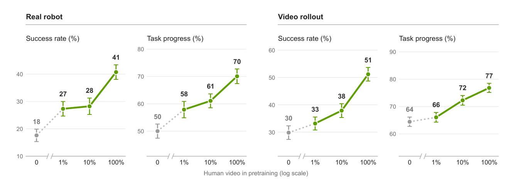
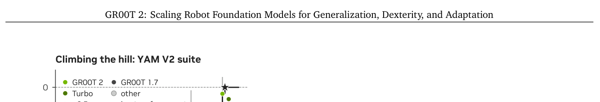
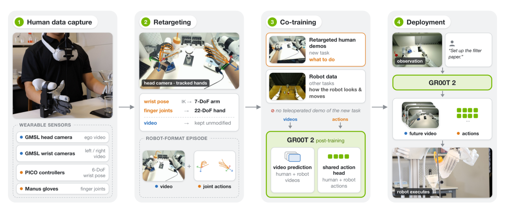
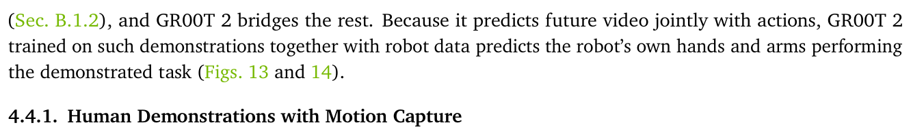
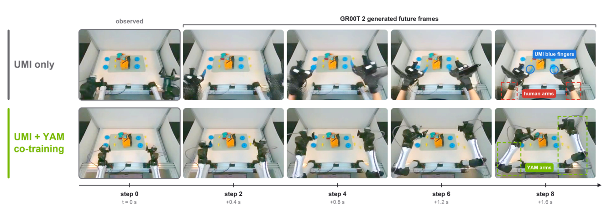
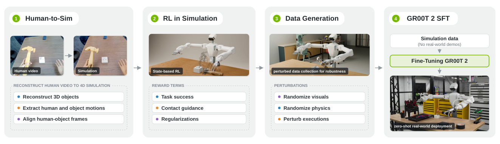
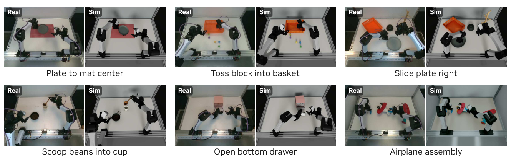
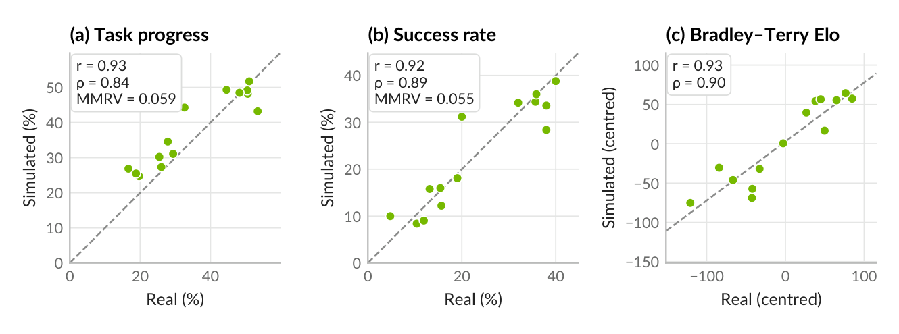
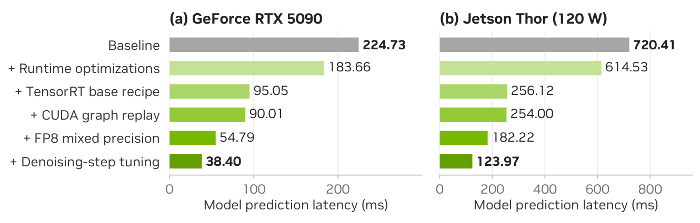
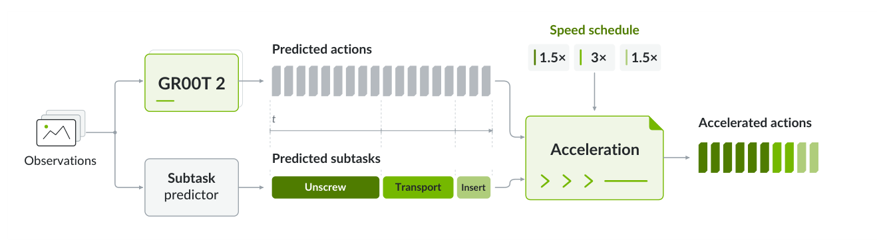

# 第 4 章 我们如何做出 GR00T 2

> **原文** 4. How We Made GR00T 2　·　起于 p.14　·　本页中英对照：英文段在前，中文段在后。

---

<!-- p.14 S266 -->

This section describes the methods behind GR00T 2, focusing on the key design decisions, while the appendix provides the full details. Sec. 4.1 presents the training recipe, from pretraining to RL post-training, and Sec. 4.2 the training data. Sec. 4.3 describes how we benchmark checkpoints against each other on real robots. Sec. 4.4 describes the capture devices and pipelines for learning without teleoperation, Sec. 4.5 the simulation and evaluation framework, Sec. 4.6 real-time deployment, and Sec. 4.7 the training and data infrastructure.

本节介绍 GR00T 2 背后的方法，重点讨论关键设计决策，完整细节见附录。Sec. 4.1 介绍从预训练到 RL 后训练的训练方案，Sec. 4.2 介绍训练数据。Sec. 4.3 描述如何在真实机器人上对检查点进行相互基准测试。Sec. 4.4 描述无需遥操作即可学习时所用的采集设备与流水线，Sec. 4.5 介绍仿真与评测框架，Sec. 4.6 介绍实时部署，Sec. 4.7 介绍训练与数据基础设施。

## 4.1. Training: Pre-Training and RL Post-Training · 4.1. 训练：预训练与强化学习后训练

<!-- p.14 S267 -->

Pre-training. We initialize GR00T 2 from the pretrained Cosmos-Predict2.5-2B video diffusion transformer. To turn this video model into a general-purpose robot policy, we need it both to understand how physical interactions unfold and to connect those dynamics to actions across embodiments. We therefore train on a diverse mixture of human and robot experience in three stages: we first adapt the video model to embodied interactions, then learn video and actions jointly, and finally place greater emphasis on robot data. This progression lets us draw on the breadth of human experience while focusing the resulting model on robot execution.

预训练。我们以预训练的 Cosmos-Predict2.5-2B 视频扩散 Transformer 初始化 GR00T 2。要把这个视频模型变成通用机器人策略，一方面需要它理解物理交互如何展开，另一方面需要它把这些动力学与跨本体的动作联系起来。为此，我们在人类与机器人经验的多样化数据配比上分三个阶段训练：先使视频模型适应具身交互（embodied interaction），再联合学习视频与动作，最后更加侧重机器人数据。这一递进式流程既利用了人类经验的广度，又使最终模型聚焦于机器人执行。

<!-- p.14 S268 -->

Stage 1: Single-view video pre-training. We first adapt the pretrained video model to embodied visual experience from egocentric human video, supplemented by robot data. Human demonstrations provide diverse examples of hands interacting with objects across tasks and environments, while robot observations introduce the visual conditions of robot manipulation. Each training example uses a single camera view, and the model is trained to predict future video from the observation history. The goal is to establish a visual dynamics prior for embodied interaction before training the model to generate actions.

第一阶段：单视角视频预训练。我们首先利用第一人称视角（egocentric）人类视频，辅以机器人数据，使预训练视频模型适应具身视觉经验。人类演示提供了跨任务与环境中手与物体交互的多样示例，机器人观测则引入了机器人操作的视觉条件。每个训练样本使用单一相机视角，模型被训练为基于观测历史预测未来视频。其目标是在训练模型生成动作之前，先为具身交互建立视觉动力学先验。

<!-- p.14 S269 -->

Stage 2: Multi-view video-action training. We next connect the learned visual dynamics to actions by extending the model with embodiment-specific state and action modules. We jointly train video and action prediction on human and robot data, using multi-view observations where available to capture interactions from complementary viewpoints. Robot trajectories provide embodiment-specific actions, while human demonstrations provide tracked hand-pose trajectories as action supervision. Video and action are trained with flow-matching objectives, and the action loss is applied when valid action supervision is available. The mixture increases the contribution of YAM and dexterous-hand sources while retaining substantial egocentric human data. Joint training is intended to bring experience from these different embodiments into a shared model that can predict both the evolution of a scene and actions for the target robot.

第二阶段：多视角视频-动作训练。接下来，我们为模型增加本体特定的状态模块与动作模块，从而将习得的视觉动力学与动作联系起来。我们在人类与机器人数据上联合训练视频与动作预测，并在可用时使用多视角观测，以从互补视角捕捉交互。机器人轨迹提供本体特定的动作，人类演示则提供追踪得到的手部姿态轨迹作为动作监督。视频与动作均采用流匹配目标进行训练，且仅在存在有效动作监督时才施加动作损失。该数据配比提高了 YAM 与灵巧手数据源的贡献，同时保留了大量第一人称视角的人类数据。联合训练旨在把来自这些不同本体的经验汇入同一个共享模型，使其既能预测场景的演化，也能预测目标机器人的动作。

<!-- p.14 S270 -->

Stage 3: Robot-upweighted video-action training. A broad mixture of human and robot data provides diverse physical experience, but the final policy must generate actions in the robot’s own action space. We therefore continue joint video-action training with a stronger emphasis on robot demonstrations, particularly YAM, while retaining dexterous-hand, egocentric human, and other data sources. This reweighting focuses training on the observations and control required for robot execution while continuing to draw on the broader experience acquired in the earlier stages.

第三阶段：提高机器人数据权重的视频-动作训练。广泛的人类与机器人数据混合提供了多样的物理经验，但最终策略必须在机器人自身的动作空间中生成动作。因此，我们以更强的侧重点继续联合视频-动作训练，尤其是 YAM 上的机器人演示，同时保留灵巧手、第一人称视角的人类数据及其他数据源。这种重新加权使训练聚焦于机器人执行所需的观测与控制，同时继续利用前几个阶段获得的更广泛经验。

<!-- p.14 S271 -->

The resulting model serves as the starting point for the task-specific adaptation and RL post-training described below. Details of the data sources are provided in Sec. 4.2.

得到的模型作为下文所述特定任务适配与 RL 后训练的起点。数据源的详细信息见 Sec. 4.2。

<!-- p.14 S272 -->

RL post-training. To explore, we replace GR00T 2’s deterministic action denoising with Coefficients-Preserving Sampling (CPS) (Wang and Yu, 2025) during rollouts, injecting noise only into the action denoising process while video denoising stays deterministic. Policy updates use a group-relative objective in the style of GRPO whose baseline also remembers each context’s past returns, so that groups in which every attempt succeeds, or every attempt fails, still carry a learning signal. The basis of this recipe was found by AutoRL, a research agent that iterated on the algorithm in simulation for about 35 days (Sec. F.2). Two complementary approaches are GRPO-induced self-imitation, which fine-tunes GR00T 2 on successful GRPO rollouts, and residual RL, which learns a small corrective policy on top of a frozen GR00T 2 (Sec. F.1.2). For RL without the real robot, we adapt the DreamDojo world model to the target tasks from rollouts of the initial policy and use a learned

RL 后训练。为了探索，我们在轨迹采样（rollout）期间，用保系数采样（Coefficients-Preserving Sampling, CPS）（Wang and Yu, 2025）替换 GR00T 2 的确定性动作去噪，仅向动作去噪过程注入噪声，视频去噪则保持确定性。策略更新采用仿照 GRPO 的组相对目标，其基线还会记住每个上下文过去的回报，因此即使一组中所有尝试都成功或都失败，该组仍能提供学习信号。这一方案的基础由研究智能体 AutoRL 发现，它在仿真中迭代该算法约 35 天（Sec. F.2）。两种互补的方法分别是：GRPO 诱导的自我模仿，即在成功的 GRPO 轨迹采样上微调 GR00T 2；以及残差 RL，即在冻结的 GR00T 2 之上学习一个小型纠正策略（Sec. F.1.2）。对于无需真实机器人的 RL，我们利用初始策略的轨迹采样，将 DreamDojo 世界模型适配到目标任务，并使用一个经过学习的

<!-- p.15 C011 · 图 F010 -->

Figure 10: Scaling human video in pretraining. Human-1M data pre-training (0%, 1%, 10%, or 100%) post-trained with Dexter teleoperation data and evaluated on 72 tasks. Real Robot: 3 rollout episodes per task. An operator grades binary success and a vision-language model scores task progress. Video rollout: autoregressive video generation from 3 recorded initial configurations per task and 10 generation seeds per configuration. A vision-language model judges success and scores task progress. We report % progress and success rate with ±1 SEM bars.

预训练中的人类视频规模扩展。在 Human-1M 数据上以 0%、1%、10% 或 100% 的比例进行预训练，再使用 Dexter 遥操作数据进行后训练，并在 72 个任务上评估。真实机器人：每个任务 3 个轨迹采样回合。由操作员判定二元成功，由视觉语言模型给出任务进度评分。视频轨迹采样：对每个任务，从 3 个记录的初始配置出发，每个配置使用 10 个生成种子进行自回归视频生成。由视觉语言模型判断成功并给出任务进度评分。我们报告任务进度（%）与成功率，误差线为 ±1 SEM。

<!-- p.15 S287 -->

completion detector as the reward (Sec. F.5). An online infrastructure coordinates robot interaction, training, and evaluation, and retains experience across interruptions (Sec. F.3).

完成检测器（completion detector）作为奖励（Sec. F.5）。一套在线基础设施负责协调机器人交互、训练与评测，并在中断之后保留经验（Sec. F.3）。

## 4.2. Data · 4.2 数据

<!-- p.15 S288 -->

GR00T 2 pretrains on human demonstrations, UMI demonstrations, and robot teleoperation, which play complementary roles. Egocentric human video from Human-1M provides broad coverage of physical interactions and environments, and robot performance grows with the amount of it (Sec. 4.2.1). UMI provides scalable, task-focused demonstrations with robot-compatible action representations (Sec. 4.2.2), and teleoperation grounds the model in embodiment-specific behaviors and executable actions (Sec. 4.2.3). Finally, Flora, our data engine, labels the subtask annotation of human and robot episodes at this scale (Sec. 4.2.4). App. C details the collection, processing, and curation of each source, and Sec. 4.7.3 describes the pipeline that converts raw data into training-ready format.

GR00T 2 在人类演示、UMI 演示和机器人遥操作数据上进行预训练，三者各自扮演互补的角色。来自 Human-1M 的第一人称人类视频广泛覆盖了物理交互与环境，并且机器人性能会随其数量增长（Sec. 4.2.1）。UMI 提供可扩展、面向任务的演示，并附带与机器人兼容的动作表示（Sec. 4.2.2）；遥操作则使模型扎根于特定本体的行为与可执行动作（Sec. 4.2.3）。最后，我们的数据引擎 Flora 在这一规模上为人类与机器人片段标注子任务（Sec. 4.2.4）。附录 C 详述了每个数据源的采集、处理与整理，Sec. 4.7.3 描述了把原始数据转换为可训练格式的流程。

<!-- p.15 S289 -->

4.2.1. Human Data

4.2.1. 人类数据

<!-- p.15 S290 -->

For a world action model, egocentric human experience captures the motion and visual diversity needed to achieve strong coverage across objects, affordances, tasks, scenes and environments. GR00T 2 leverages 402,730 hours across approximately 13.75 million episodes, spanning over 51,500 unique collectors and 123,000 scenes of high quality egocentric data filtered from Human-1M. The dataset is a 1 million hour egocentric human experience dataset of proficient human labor sensorized with egocentric cameras, dense language annotations, SLAM and 3D hand pose keypoints curated by NVIDIA, spanning demonstrations in both natural “in-the-wild” and controlled studio environments. Additional details on filters and dataset composition in Sec. C.1.

对于世界-动作模型（WAM）而言，第一人称人类经验能够捕捉实现对物体、可供性、任务、场景与环境之间强覆盖所需的运动与视觉多样性。GR00T 2 利用了从 Human-1M 中筛选出的高质量第一人称数据，共计 402,730 小时、约 1,375 万个片段，涵盖超过 51,500 名不同采集者与 123,000 个场景。该数据集是一个包含 100 万小时第一人称人类经验的数据集，记录了熟练的人类劳动，并通过第一人称相机进行传感化采集，附有密集的语言标注、SLAM 与 3D 手部姿态关键点，由 NVIDIA 整理，其演示既包括自然的“野外”（in-the-wild）环境，也包括受控的录影棚环境。筛选条件与数据集构成的更多细节见 Sec. C.1。

<!-- p.15 S291 -->

In-lab human data. To enable direct transfer to the target robot embodiment, GR00T 2 contains 3,000 hours of robot-aligned studio data, collected under a stricter protocol. The visual gap is mitigated by matching the egocentric and wrist camera viewpoints, while the motion gap is mitigated by matching demonstration speed with the robot. This data is demonstration-style where each task is demonstrated hundreds of times with a repeatable strategy (Sec. C.1.3).

实验室内人类数据。为了直接迁移到目标机器人本体，GR00T 2 包含 3,000 小时与机器人对齐的录影棚数据，采用更严格的协议采集。视觉差距通过匹配第一人称相机与腕部相机的视角来缓解，运动差距则通过使演示速度与机器人一致来缓解。该数据属于演示式数据，即每项任务都以可重复的策略被演示数百次（Sec. C.1.3）。

<!-- p.15 S292 -->

Human Data Scaling. Under the same GR00T 2 architecture, training recipe and post-training teleoperation data, we ablate four Human-1M data pre-training scales (0%, 1%, 10%, or 100%). We control training length in epochs. The 1%, 10%, and 100% models start from a shared human-video pretraining checkpoint and are each pretrained for about 0.5 epoch of their share, while the 0% model skips human-video pretraining entirely. The step from 0% to 1% therefore also includes this shared stage, and the 1%, 10%, and 100% models differ only in their share of human data and the matching training length. Here one epoch means the model passes once over every step of every 30 Hz trajectory. Every model is then trained on the same target Dexter teleoperation data, co-trained with its human share, for the same 3 epochs of that robot data. We measure real robot and video rollout success rate (%) and task progress (%) on 72 Dexter tasks, 22 out-of-distribution tasks with new kinds of instructions and 50 tasks absent from Dexter’s training data. Across all four settings, we see positive scaling in performance as human data is scaled (Fig. 10). Real robot success rates increase from 18% to 41% from 0% human data pre-training to 100%. Video rollout success rates similarly increase from 30% to 51%. Together, these results show that what GR00T 2 learns from human video transfers to the robot. With the robot data held fixed, pretraining on all of the multi-view human video more than doubles real-robot success on new tasks, and none of the metrics levels off at 100%, which suggests that more human video will keep improving robot performance (Sec. C.1.5).

人类数据规模化。在相同的 GR00T 2 架构、训练方案以及后训练遥操作数据下，我们消融了四种 Human-1M 数据预训练规模（0%、1%、10% 或 100%）。训练长度以 epoch 数控制。1%、10% 与 100% 的模型都从一个共享的人类视频预训练检查点出发，并各自对其所占份额预训练约 0.5 个 epoch；而 0% 的模型则完全跳过人类视频预训练。因此，从 0% 到 1% 的变化也包含了这一共享阶段，而 1%、10% 与 100% 的模型仅在人类数据占比及相应的训练长度上有所不同。这里一个 epoch 指模型遍历每条 30 Hz 轨迹的每一步一次。随后，每个模型都在相同的目标 Dexter 遥操作数据上训练，并与其人类数据份额联合训练，对该机器人数据训练相同的 3 个 epoch。我们在 72 个 Dexter 任务、22 个具有新指令类型的分布外任务，以及 50 个 Dexter 训练数据中未出现的任务上，测量了真实机器人与视频 rollout（轨迹采样）的成功率（%）和任务进度（%）。在全部四种设置下，性能都随人类数据规模的扩大而呈现正向扩展（图 10）。从 0% 人类数据预训练到 100%，真实机器人的成功率由 18% 提升至 41%；视频 rollout 的成功率同样由 30% 提升至 51%。综合来看，这些结果表明，GR00T 2 从人类视频中学到的内容能够迁移到机器人上。在机器人数据保持不变的情况下，对全部多视角人类视频进行预训练，使新任务上的真实机器人成功率提高了一倍以上，并且所有指标在 100% 时都未趋于平稳，这表明更多的人类视频可能会继续提升机器人性能（Sec. C.1.5）。

<!-- p.16 S294 -->

4.2.2. UMI Data

4.2.2. UMI 数据

<!-- p.16 S295 -->

UMI-10K, recorded with the handheld UMI device (App. E), contributes 942k quality-controlled episodes and 10,184 hours of bimanual parallel-gripper demonstrations across 2,897 tasks. The dataset is extremely diverse with no single task contributing more than 1.2% of hours. The instructions span 356 object categories and 49 dextrous skills. The corpus covers 2,798 distinct skill-object combinations, including dynamic, articulated, and deformable manipulation that teleoperation rarely captures. Many tasks contain counterfactual pairs, which is aimed to improve policy instruction following (Sec. C.2).

UMI-10K 由手持 UMI 设备录制（附录 E），贡献了 942k 条经质量控制的片段，以及横跨 2,897 项任务的 10,184 小时双臂平行夹爪演示。该数据集非常多样，没有任何单一任务的时长占比超过 1.2%。指令涵盖 356 个物体类别与 49 种灵巧技能。语料覆盖 2,798 种不同的技能-物体组合，包括遥操作很少涉及的动态、关节式与可变形物体操作。许多任务包含反事实配对，旨在提升策略的指令遵循能力（Sec. C.2）。

<!-- p.16 S296 -->

4.2.3. Teleoperation Data

4.2.3. 遥操作数据

<!-- p.16 S297 -->

Cross-embodiment teleoperated demonstrations provide robot action supervision for GR00T 2. The pre-training mixture contains a total of 23.5k hours and 1.16M episodes of teleoperation data including:

跨本体遥操作演示为 GR00T 2 提供机器人动作监督。预训练数据混合包含共计 23.5k 小时、1.16M 个片段的遥操作数据，具体包括：

<!-- p.16 S298 -->

• Bimanual YAM arms with parallel grippers (18.7k hours, including ABC-130k (XDOF, 2026)), • Bimanual arms with Sharpa hands (2.9k hours), • Bimanual arms with Wuji hands (1.3k hours), • The Unitree G1 humanoid (275 hours), • The single-arm Franka Panda from DROID (Khazatsky et al., 2024).

• 配备平行夹爪的双臂 YAM 机械臂（18.7k 小时，包括 ABC-130k (XDOF, 2026)），• 配备 Sharpa 手的双臂机械臂（2.9k 小时），• 配备 Wuji 手的双臂机械臂（1.3k 小时），• Unitree G1 人形机器人（275 小时），• 来自 DROID 的单臂 Franka Panda（Khazatsky et al., 2024）。

<!-- p.16 S299 -->

Additional details are provided in Sec. C.3.

更多细节见 Sec. C.3。

<!-- p.16 S300 -->

4.2.4. Data Annotation with Flora

4.2.4. 使用 Flora 进行数据标注

<!-- p.16 S301 -->

GR00T 2 pretraining uses dense timestamped language annotations for language conditioning, filtering and rebalancing. GR00T 2 RL post-training additionally requires process rewards, while policy evaluation requires outcome labelling. At the scale of Human-1M and our robot corpora, human labeling is too slow and frontier API models are too expensive. To provide these dense labels, we leverage Flora (Leng et al., 2026), the data engine that annotates training and evaluation data for GR00T 2. Flora consists of three models that identify action boundaries, annotate each action with a self-contained imperative instruction, and generate outcome, dense, and rubric-based rewards. On WGO-Bench (Macrodata Labs, 2026), Flora achieves a temporal segmentation F1 of 50.3, compared to 46.0 for the next-best model, GPT-6 Astra (OpenAI, 2026). Additional details are provided in Sec. C.4.

GR00T 2 的预训练使用密集的带时间戳语言标注，用于语言条件化、过滤与重新配比。GR00T 2 的强化学习（RL）后训练还需要过程奖励，而策略评测则需要结果标注。在 Human-1M 与我们的机器人语料规模下，人工标注太慢，前沿 API 模型又过于昂贵。为获得这些密集标签，我们利用了 Flora（Leng et al., 2026），这是为 GR00T 2 标注训练与评测数据的数据引擎。Flora 由三个模型组成，分别用于识别动作边界、为每个动作标注一条自包含的祈使式指令，以及生成结果奖励、密集奖励和基于评分准则（rubric）的奖励。在 WGO-Bench（Macrodata Labs, 2026）上，Flora 的时序分割 F1 达到 50.3，而次优模型 GPT-6 Astra（OpenAI, 2026）为 46.0。更多细节见 Sec. C.4。

## 4.3. Real-World Benchmarking: Mapping the Hill We Climb · 4.3 真实世界基准测试：绘制“我们攀登的山丘”

<!-- p.16 S302 -->

Every GR00T 2 candidate earned its place in blinded head-to-head matches on real robots, accumulated into a single leaderboard that tells us which checkpoint is better, by how much, and how sure we can be.

每一个 GR00T 2 候选模型都是通过真实机器人上的盲测正面对决赢得席位的，这些结果汇总进同一个排行榜，它告诉我们哪个检查点更好、优势有多大，以及我们对此有多大把握。

<!-- p.16 S303 -->

Why head-to-head. Real-robot evaluation is expensive, but its results accumulate, and months of evaluations are only worth keeping if they stay comparable. Absolute success rates do not: they drift with the station, the operator, the hardware, and the day, so a score from one session cannot be compared with a score from another.

为何采用正面对决。真实机器人评测成本高昂，但其结果会不断累积，而数月的评测只有保持可比时才值得保留。绝对成功率做不到这一点：它们会随工位、操作员、硬件和当天情况而漂移，因此某一次会话的得分无法与另一次会话的得分相比。

<!-- p.17 S305 -->

GR00T 2 Turbo other best so far 90% CI (new bests)

GR00T 2 Turbo；其他迄今最佳；90% CI（新最佳）

<!-- p.17 C012 · 图 F011 -->

Figure 11: Mapping the hill we climb. Every checkpoint on the current YAM suite, rated relative to the A/B reference (⋆, the board’s top-rated checkpoint, here a GR00T 2 Turbo checkpoint) and placed at the date it was saved. The line tracks the best checkpoint so far, and bars are paired 90% bootstrap intervals for the checkpoints that set a new best. Evidence: the 6,035 blinded A/B comparisons of this suite, from 122 campaigns.

图 11：绘制我们攀登的山丘。当前 YAM 套件上的每个检查点都相对于 A/B 参考（⋆，即排行榜上评级最高的检查点，此处为一个 GR00T 2 Turbo 检查点）进行评级，并按其保存日期放置。折线追踪迄今最佳的检查点，柱条为创下新最佳的检查点所对应的配对 90% 自助法（bootstrap）区间。依据：本套件共 122 个评测批次中的 6,035 次盲测 A/B 比较。

<!-- p.17 S308 -->

Elo vs. reference ★

相对参考 ★ 的 Elo

<!-- p.17 S314 -->

Jul Aug Sep Oct Nov checkpoint date (2026)

7 月、8 月、9 月、10 月、11 月；检查点日期（2026）

<!-- p.17 S316 -->

A blinded A/B trial runs two to four checkpoints in randomized order on the same scene, by the same operator, within minutes, so the drift is shared and cancels in the comparison. GearArena, our real-robot leaderboard, pools every such trial. By the snapshot used here it held 195 A/B campaigns with 16,044 graded robot episodes and 11,767 pairwise comparisons, collected on 10 YAM stations by more than 20 operators between July and November 2026, rating 71 checkpoints.

一次盲测 A/B 试次会在几分钟之内，由同一名操作员，在同一场景中以随机顺序运行两到四个检查点，因此漂移是共有的，会在比较中相互抵消。GearArena 是我们的真实机器人排行榜，汇集了所有此类试次。截至本文所用的快照，它包含 195 个 A/B 评测批次、16,044 个带评分的机器人片段，以及 11,767 次成对比较，这些数据于 2026 年 7 月至 11 月间在 10 个 YAM 工位上采集，由 20 多名操作员完成，对 71 个检查点进行了评级。

<!-- p.17 S317 -->

Tasks from first principles. We design evaluation tasks by asking what the robot should be able to do, then choosing tasks that expose those capabilities, and finally gauging them on real checkpoints: a task every checkpoint completes is archived, and one no checkpoint completes is shelved until models catch up, since neither separates anything. Two suites resulted: a first suite of general and dexterous manipulation tasks and the current suite of 38 language-following and motion-primitive tasks, each run with partial-credit rubrics.

从第一性原理出发设计任务。我们先问机器人应当能够做什么，再选择能够暴露这些能力的任务，最后在真实检查点上对其进行评估：所有检查点都能完成的任务会被归档，没有任何检查点能完成的任务则被搁置，直到模型追上来，因为这两类任务都无法区分模型。由此形成两套套件：第一套是通用与灵巧操作任务，当前套件则包含 38 个语言跟随与运动基元任务，每项任务都采用部分得分评分准则（rubric）进行评估。

<!-- p.17 S318 -->

From matches to a map. Every pair of checkpoints in a trial forms one comparison, decided by the operator’s explicit ranking (equal grades count as ties). A Bradley-Terry model (Bradley and Terry, 1952), fit jointly to all comparisons, gives each checkpoint an Elo rating. Within each head-to-head, every task carries equal weight, and confidence intervals come from a bootstrap that resamples tasks rather than trials. Every new checkpoint is first matched against the A/B reference, the best-rated checkpoint on the board, which keeps all ratings on one connected scale (App. D).

从对决到地图。试次中的每一对检查点构成一次比较，由操作员明确给出的排名决定（同等评级计为平局）。对所有比较联合拟合的 Bradley-Terry 模型（Bradley and Terry, 1952）为每个检查点给出一个 Elo 评分。在每一次正面对决中，每项任务权重相等，置信区间则来自对任务而非试次进行重采样的自助法。每个新检查点都会先与 A/B 参考对比，即排行榜上评级最高的检查点，这使所有评分处于同一个相互连通的尺度上（App. D）。

<!-- p.17 S319 -->

What it bought us. Arena turned close calls into decisions. GR00T 2 outrates 𝜋0.5 by 236 Elo (95% CI 171 to 325), an expected 80% head-to-head win rate, and GR00T 1.7 by 95 Elo (CI 50 to 148), both in all 500 bootstrap resamples (Tab. 13). On our YAM V2 task suite, which focuses on foundational skills such as language following and motion primitives (Tab. 2), GR00T 2 Turbo is statistically indistinguishable from GR00T 2 in skill while running each inference about three times faster (52 vs. 171 ms per served call on a GeForce RTX 5090 workstation, Fig. 23). Over four months, the best checkpoint on the current suite climbed 206 Elo, from a June model that today’s top checkpoint would beat 77% of the time (Fig. 11). Simulated evaluations reproduce Elo ratings fit to blinded A/B trials of this kind with Pearson 𝑟= 0.93 (Sec. 4.5.2). App. D details the task design, the rating model, the A/B infrastructure, and the full results.

它带来的价值。Arena 把难以分辨的情况变成了明确的决策。GR00T 2 以 236 Elo 的优势（95% CI 171 至 325）超过 π0.5，对应期望的 80% 正面对决胜率；以 95 Elo（CI 50 至 148）超过 GR00T 1.7，两者在全部 500 次自助法重采样中均成立（Tab. 13）。在我们侧重语言跟随与运动基元等基础技能的 YAM V2 任务套件上（Tab. 2），GR00T 2 Turbo 在技能上与 GR00T 2 没有统计学差异，而每次推理的速度约快三倍（在 GeForce RTX 5090 工作站上，每次服务调用分别为 52 毫秒与 171 毫秒，Fig. 23）。经过四个月，当前套件上的最佳检查点提升了 206 Elo，从一个 6 月份的模型起步，如今的最佳检查点对其的胜率为 77%（Fig. 11）。模拟评测以皮尔逊相关系数 $r=0.93$ 复现了由此类盲测 A/B 试次拟合出的 Elo 评分（Sec. 4.5.2）。附录 D 详述了任务设计、评分模型、A/B 基础设施与完整结果。

## 4.4. Learning without Teleoperation: Devices and Pipelines · 无遥操作学习：设备与流程

<!-- p.17 S320 -->

GR00T 2 learns a skill on a robot from demonstrations recorded without that robot (Sec. 3.2). In all four sources below, the demonstrations specify the task. For human motion capture and the Gripper UMI, whose devices differ from the robot, task-agnostic data from the target robot specify the embodiment, and cross-embodiment pretraining connects the two. The DexUMI exoskeleton replicates the robot hand it is built for, so on that hand its demonstrations need no robot play data (Sec. 4.4.3). Capture and conversion remove what can be removed before training, namely differences in camera geometry (Sec. C.1.3), kinematics, and action semantics

GR00T 2 从未操作该机器人时录制的演示中学习技能（见第 3.2 节）。下列四种来源中，演示都指明了任务。对于人体动作捕捉和 Gripper UMI 这两种与机器人设备不同的来源，目标机器人的任务无关数据用于指定本体（embodiment），跨本体预训练则把两者连接起来。DexUMI 外骨骼复刻了其所适配的机器人手，因此在该手上，其演示无需机器人自由操作数据（robot play data）（见第 4.4.3 节）。采集与转换环节会在训练前尽量消除可消除的差异，即相机几何（见第 C.1.3 节）、运动学以及动作语义上的差异。

<!-- p.18 C013 · 图 F012 -->

Figure 12: GR00T 2 learns new robot tasks from human demonstrations. (1) A person performs the task wearing GMSL head and wrist cameras at robot-matched poses, PICO controllers that track 6-DoF wrist poses, and Manus gloves that track finger joints. (2) Retargeting maps each wrist pose to the 7-DoF arm and each hand pose to the 22-DoF hand, and the video stays unmodified. (3) GR00T 2 co-trains on the retargeted human demonstrations and on robot data of other tasks: videos supervise video prediction, and human and robot actions train one shared action head. (4) On the robot, GR00T 2 takes the observation and the instruction, predicts a sequence of future frames, and outputs the actions the robot executes. No teleoperated demonstration of the new task enters training.

图 12：GR00T 2 从人类演示中学习新的机器人任务。(1) 人员佩戴与机器人姿态匹配的 GMSL 头部与腕部相机，同时手持追踪 6-DoF 腕部位姿的 PICO 控制器，并戴上追踪手指关节的 Manus 手套来完成任务。(2) 重定向把每个腕部位姿映射到 7-DoF 手臂，把每个手部位姿映射到 22-DoF 手，视频保持不修改。(3) GR00T 2 在重定向后的人类演示与其他任务的机器人数据上联合训练：视频用于监督视频预测，人类动作与机器人动作共同训练同一个动作头。(4) 在机器人上，GR00T 2 接收观测与指令，预测未来若干帧的序列，并输出机器人执行的动作。训练中不包含新任务的任何遥操作演示。

<!-- p.18 S324 -->

A person performs the task wearing head and wrist cameras at robot-matched poses, a motion-capture glove, and a 6-DoF tracker on each wrist (Fig. 12). With the head camera at the robot’s head-camera pose, the wrists are anchored in the robot base frame, and a closed-form inverse-kinematics solver (Chen et al., 2026b; Kong et al., 2026) retargets them offline to the 7-DoF arms and 22-DoF Sharpa hands, placing the robot fingertips at the human fingertips to preserve the pinch geometry. The video stays unmodified. At about 118,000 bimanual solves per second, the same solver also drives teleoperation, which collects task-agnostic play data on the target robot. One play pool, sampled 1:1 with the human demonstrations, serves every task (Sec. B.1.1 to B.1.3 and C.3.1). For tasks that only humans demonstrated, GR00T 2 then predicts the robot’s own hands completing each step (Fig. 13).

人员佩戴头部与腕部相机，并在每只腕部佩戴一副动作捕捉手套和一个 6-DoF 追踪器，以与机器人姿态匹配的方式完成任务（见图 12）。头部相机处于机器人的头部相机姿态时，腕部被锚定在机器人基座坐标系中，随后由闭式逆运动学求解器（Chen et al., 2026b; Kong et al., 2026）离线将其重定向到 7-DoF 手臂和 22-DoF 的 Sharpa 手上，并使机器人指尖对准人类指尖，以保留捏取几何。视频保持不修改。该求解器每秒可完成约 118,000 次双臂求解，同样也驱动遥操作，用于在目标机器人上采集与任务无关的自由操作数据（play data）。一个自由操作数据池与人类演示按 1:1 采样，服务于所有任务（见第 B.1.1 至 B.1.3 节与第 C.3.1 节）。对于仅由人类演示过的任务，GR00T 2 随后预测机器人自己的手完成每个步骤（见图 13）。

<!-- p.18 S325 -->

Filter Paper Setup

滤纸装配

<!-- p.18 S326 -->

1 Place filter 2 Secure it 3 Wet it Dropper-to-Beaker Dispensing

1 放置滤纸 2 固定滤纸 3 润湿滤纸 滴管至烧杯分液

<!-- p.18 S327 -->

1 Grasp pipette 2 Draw liquid 3 Dispense

1 抓取移液管 2 吸取液体 3 分液

<!-- p.18 S328 -->

Human demo

人类演示

<!-- p.18 S329 -->

Human demo training data training data real input real input prediction prediction

人类演示 训练数据 训练数据 真实输入 真实输入 预测 预测 [存疑：抽取文本中词语重复，疑为图中标签]

<!-- p.18 C014 · 图 F013 -->

Figure 13: Human demonstrations and GR00T 2 predictions. Two tasks that only humans demonstrated. Given one robot start frame and the instruction, GR00T 2 predicts the robot’s ego view. Times are measured from the start frame. Human demonstrations (top rows) appear only in training. All four tasks are shown in Fig. 28.

图 13：人类演示与 GR00T 2 预测。两个仅由人类演示过的任务。给定一帧机器人起始画面与指令，GR00T 2 预测机器人的第一人称视角。时间以起始帧为起点计算。人类演示（上方各行）仅出现在训练中。全部四个任务见图 28。

<!-- p.19 C015 · 图 F014 -->

Figure 14: GR00T 2-generated future frames on YAM, without and with YAM co-training. Both models observe the same YAM top-camera frame (left) and predict eight future steps of Toy Dumptruck Assembly, a task demonstrated only with Gripper UMI. Trained on UMI data alone (top), GR00T 2 renders human arms and the blue UMI fingers entering the scene. Co-trained with task-agnostic YAM data (bottom), it renders YAM’s own arms. The co-training data supply the robot’s appearance as well as its action statistics.

图 14：GR00T 2 在 YAM 上生成的未来帧，分别为未经 YAM 联合训练与经过 YAM 联合训练的结果。两个模型观测到相同的 YAM 顶部相机画面（左），并预测 Toy Dumptruck Assembly 任务的八个未来步。该任务仅用 Gripper UMI 演示。仅用 UMI 数据训练时（上方），GR00T 2 渲染出人手与蓝色 UMI 手指进入画面。与任务无关的 YAM 数据联合训练后（下方），它渲染出的是 YAM 自身的手臂。联合训练数据既提供了机器人的外观，也提供了其动作统计特性。

<!-- p.19 C016 · 图 F015 -->

Figure 15: DexUMI demonstration and GR00T 2 rollout. Prepare Banana Yogurt, with keyframes numbered by subtask: a person demonstrating the task with the DexUMI exoskeletons (top) and a GR00T 2 rollout on a Tianji robot with XHAND1 Pro-U hands (bottom). The task is demonstrated only with DexUMI. All three DexUMI tasks are shown in Fig. 30.

图 15：DexUMI 演示与 GR00T 2 的 rollout（轨迹采样）。Prepare Banana Yogurt 任务，关键帧按子任务编号：上方为人员佩戴 DexUMI 外骨骼演示该任务，下方为 GR00T 2 在搭配 XHAND1 Pro-U 手的 Tianji 机器人上的 rollout。该任务仅用 DexUMI 演示。全部三个 DexUMI 任务见图 30。

<!-- p.19 S346 -->

4.4.2. Gripper UMI

4.4.2 Gripper UMI

<!-- p.19 S347 -->

Gripper UMI is a handheld parallel gripper in the lineage of UMI (Chi et al., 2024). We use our open-source GEAR UMI (NVIDIA GEAR Team, 2026): its robot-style wrist cameras and width encoder record human demonstrations in robot coordinates without a robot (Sec. E.1), and it also yields the UMI-10K pretraining corpus (Sec. 4.2.2). A robot end-effector that reproduces the handheld’s cameras and fingers removes the sensing and gripper gaps by construction (Sec. E.2). For an off-the-shelf robot such as YAM, which shares none of them, three findings make the transfer work. (1) Co-training with task-agnostic YAM data closes the appearance and scene gap: GR00T 2 then predicts YAM’s arms performing the handheld-demonstrated task (Fig. 14). (2) The model absorbs appearance but not geometry, so the fisheye wrist view is re-rendered to imitate YAM’s wrist camera, and a rough match of field of view and viewing direction suffices. (3) Handheld actions are re-expressed in YAM’s action space and decoded by its own action head. With cross-embodiment pretraining, 41 to 75 handheld episodes per task reach high success rates, and 10 to 20 already yield end-to-end success. The rarest subskill, not the task length, sets this number (Sec. B.2 and E.3).

Gripper UMI 是一种手持式平行夹爪，属于 UMI（Chi et al., 2024）这一脉络。我们使用开源的 GEAR UMI（NVIDIA GEAR Team, 2026）：其机器人式腕部相机与宽度编码器可在没有机器人的条件下，以机器人坐标记录人类演示（见第 E.1 节），同时它还能产出 UMI-10K 预训练语料（见第 4.2.2 节）。让机器人末端执行器复刻手持设备的相机与手指，可以在构造上消除感知与夹爪两方面的差距（见第 E.2 节）。对于 YAM 这类现成机器人，它与手持设备一样都不具备上述特征，三项发现使迁移得以成立。(1) 与任务无关的 YAM 数据联合训练弥合了外观与场景差距：此后 GR00T 2 可以预测 YAM 的手臂执行手持设备所演示任务的过程（见图 14）。(2) 模型能够吸收外观，却吸收不了几何，因此鱼眼腕部视角被重新渲染，以模仿 YAM 的腕部相机，视场角与观察方向只需大致匹配即可。(3) 手持动作被重新表达到 YAM 的动作空间中，并由其自身的动作头解码。借助跨本体预训练，每个任务 41 至 75 条手持设备采集的片段即可达到较高成功率，10 至 20 条片段便已能实现端到端成功。决定这一数字的是最稀少的子技能，而不是任务长度（见第 B.2 节与第 E.3 节）。

<!-- p.19 S349 -->

4.4.3. DexUMI

4.4.3 DexUMI

<!-- p.19 S350 -->

DexUMI (Xu et al., 2025) extends robot-free collection from parallel grippers to five-fingered hands. We use our open-source GEAR DexUMI (NVIDIA GEAR Team, 2026): the wearable exoskeleton replicates the kinematics of the target XHAND1 Pro-U hand, with its 16 degrees of freedom mapped one-to-one onto the

DexUMI（Xu et al., 2025）将无机器人采集从平行夹爪扩展到了五指手。我们使用开源的 GEAR DexUMI（NVIDIA GEAR Team, 2026）：可穿戴外骨骼复刻目标 XHAND1 Pro-U 手的运动学，其 16 个自由度一一映射到

<!-- p.20 C017 · 图 F016 -->

Figure 16: Human-to-sim-to-real transfer for GR00T 2. (1) Human-to-sim reconstructs assets and motions from one human demonstration. (2) RL trains a state-based manipulation policy in simulation. (3) Data collection under perturbations expands state coverage and captures recovery behavior. (4) GR00T 2 is fine-tuned exclusively on simulation data and deployed zero-shot in the real world.

图 16：GR00T 2 的人类到仿真再到现实的迁移（Human-to-sim-to-real）。(1) 人到仿真环节从一次人类演示中重建资产与运动。(2) 强化学习在仿真中训练基于状态的操作策略。(3) 在扰动下采集数据，扩展状态覆盖范围并捕获恢复行为。(4) GR00T 2 仅在仿真数据上微调，并以零样本方式部署到真实世界。

<!-- p.20 S372 -->

robot joints, and matches the hand’s contact surfaces, wrist-camera mount, and tactile format (Sec. E.4). Two choices adapt GR00T 2 to these data. First, the exoskeleton is handled in training rather than by editing video: its green parts are segmented by color, and their appearance is randomized consistently in the conditioning and predicted frames, which removes the earlier step of replaying each demonstration on a robot hand for inpainting (Sec. E.6). Second, following the Adaptive Compliance Policy (Hou et al., 2025), fingertip forces are projected onto the hand joints as torques and added to the action. At execution, the predicted torque lowers each joint’s stiffness and offsets its position target, so that the hand applies the predicted force and remains robust to positional uncertainty (Sec. B.3). Because the exoskeleton replicates the hand, no robot play data are needed: post-trained on DexUMI demonstrations alone, GR00T 2 performs long-horizon tool use with both hands (Fig. 15).

机器人关节，并匹配手的接触表面、腕部相机安装位与触觉格式（见第 E.4 节）。有两项选择使 GR00T 2 适配这些数据。第一，外骨骼在训练中处理，而不是通过编辑视频来处理：其绿色部件按颜色分割，其外观在条件帧与预测帧中被一致地随机化，这样就省去了此前将每条演示在机器人手上重放以进行补全（inpainting）的步骤（见第 E.6 节）。第二，遵循自适应柔顺策略（ACP）（Hou et al., 2025），指尖受力被投影为各手部关节的扭矩，并加入动作中。执行时，预测的扭矩会降低每个关节的刚度并偏移其位置目标，使手施加预测的力，同时对位置不确定性保持鲁棒（见第 B.3 节）。由于外骨骼复刻了手，因此不需要机器人自由操作数据（robot play data）：仅在 DexUMI 演示上进行后训练，GR00T 2 即可用双手完成长时序的工具使用（见图 15）。

<!-- p.20 S373 -->

DexUMI demonstrations can also be converted for a hand that the exoskeleton does not replicate. For the 22-DoF Sharpa hand, we compute the XHAND fingertip positions from the recorded joint angles and retarget them with the closed-form solver used for glove teleoperation (Sec. B.1.2). As with Gripper UMI, we warp each DexUMI wrist frame to match the Sharpa wrist camera, which sits at a different pose. The demonstrations are co-trained with Sharpa play data in the robot’s action space and with its normalization statistics (Sec. B.4).

DexUMI 演示也可以转换给外骨骼并未复刻的手。对于 22-DoF 的 Sharpa 手，我们根据记录的关节角计算 XHAND 指尖位置，并使用手套遥操作所用的闭式求解器对其进行重定向（见第 B.1.2 节）。与 Gripper UMI 一样，我们将每个 DexUMI 腕部帧做变换，以匹配位于不同位姿的 Sharpa 腕部相机。这些演示与 Sharpa 自由操作数据在机器人动作空间中联合训练，并使用后者的归一化统计量（见第 B.4 节）。

<!-- p.20 S374 -->

4.4.4. Human-to-Sim-to-Real

4.4.4 人类到仿真再到现实

<!-- p.20 S375 -->

Contact-rich skills such as in-hand reorientation and forceful tool use remain difficult for WAMs to learn, and recovery behaviors are difficult to demonstrate. Reinforcement learning in simulation supplies them from a single human video (Fig. 16). The NVIDIA Video to Data pipeline (NVIDIA, 2026b) reconstructs the object assets and the hand and object motion. A state-based RL expert, trained with CHORD (Zhu et al., 2026) under identified robot dynamics and randomized physics, learns to track the object motion and complete the task. Its rollouts become image-based training data, perturbed by random action bursts and teleports so that they contain corrections, and rendered in Isaac Lab with randomized appearance, lighting, and camera calibration. GR00T 2 is fine-tuned on 1.5k such episodes per task with training-time real-time chunking (Sec. 4.6.2) and deployed on the real robot without any real-world robot data (Sec. B.5).

富接触技能（如手内姿态调整与高力度工具使用）对 WAM 而言仍然难以学习，而恢复行为也难以通过演示来展示。仿真中的强化学习可以从单段人类视频中提供这些技能（见图 16）。NVIDIA Video to Data 流程（NVIDIA, 2026b）重建物体资产以及手与物体的运动。一个基于状态的 RL 专家在已辨识的机器人动力学与随机化物理条件下，使用 CHORD（Zhu et al., 2026）训练，学会跟踪物体运动并完成任务。其 rollout 被转化为基于图像的训练数据，并通过随机动作脉冲与瞬移加以扰动，使其包含修正行为，然后在 Isaac Lab 中以随机化的外观、光照与相机标定进行渲染。GR00T 2 在每个任务 1.5k 条此类片段上微调，并使用训练时实时分块（见第 4.6.2 节），随后部署到真实机器人上，且不使用任何真实世界机器人数据（见第 B.5 节）。

## 4.5. Simulation and Evaluation · 4.5 仿真与评测

<!-- p.20 S376 -->

Simulation serves GR00T 2 in two roles. Physics simulation of digital twins of our real-world tasks provides a fast, repeatable, and calibrated proxy for real-robot evaluation, which we use throughout development (Sec. 4.5.1 and 4.5.2). Neural simulation with a learned world model, adapted from recorded rollouts, provides an environment for reinforcement learning (Sec. 4.5.3). We also evaluate GR00T 2 on five public simulation benchmarks (Sec. 4.5.4).

仿真在 GR00T 2 的研发中承担两种角色。针对真实任务构建的数字孪生（digital twin）物理仿真，为真机评测提供了快速、可重复且经过校准的代理，我们在整个开发过程中都在使用它（见 Sec. 4.5.1 和 4.5.2）。基于学习得到的世界模型、并利用录制的轨迹采样（rollout）数据加以适配的神经仿真，为强化学习提供了环境（见 Sec. 4.5.3）。我们还在五个公开仿真基准测试上评估了 GR00T 2（见 Sec. 4.5.4）。

<!-- p.21 C018 · 图 F017 -->

Figure 17: Real-world tasks and their simulated counterparts. Each pair shows the real workcell’s top camera (Real) and the same moment when the recorded robot commands are replayed in simulation (Sim), for five general manipulation tasks and one stage of the multi-stage airplane assembly. More tasks are shown in Fig. 61.

真实任务及其仿真对应物。每组图像展示真实工作单元（workcell）的顶部相机画面（Real），以及同一时刻将录制的机器人指令在仿真中回放的画面（Sim），涵盖五项通用操作任务，以及多阶段飞机装配中的一个阶段。更多任务见 Fig. 61。

<!-- p.21 C019 · 图 F018 -->

Figure 18: Simulated vs. real-world performance per policy. (a) Task progress (mean rubric score) and (b) success rate, averaged over 25 tasks (dashed: y = x). (c) Bradley-Terry Elo ratings fitted separately to pairwise outcomes in simulation and in real-world A/B evaluations (dashed: least-squares fit, since the two Elo scales differ). r: Pearson, 𝜌: Spearman, MMRV: mean maximum rank violation. Each point is a generalist checkpoint of GR00T 2 trained for the YAM embodiment.

按策略划分的仿真与真实世界表现对比。(a) 任务进度（平均评分标准得分，mean rubric score）与 (b) 成功率，均在 25 项任务上取平均（虚线：y = x）。(c) 分别依据仿真中与真实世界 A/B 评测中的成对结果拟合的 Bradley-Terry Elo 评分（虚线：最小二乘拟合，因为两套 Elo 尺度不同）。r：Pearson 相关系数，𝜌：Spearman 秩相关系数，MMRV：平均最大秩违例（mean maximum rank violation）。每个点都是针对 YAM 本体训练的 GR00T 2 通用检查点。

<!-- p.21 S407 -->

4.5.1. Real-to-Sim Task Construction

4.5.1. 现实到仿真（real-to-sim）的任务构建

<!-- p.21 S408 -->

We recreate in simulation the real-world tasks used to develop GR00T 2, from general manipulation tasks evaluated zero-shot to multi-stage assembly, with rigid and articulated objects, deformable materials, and particles (Fig. 17). The aim is to reproduce both the visual setup and the physical interactions that determine whether a task succeeds. Agent-assisted workflows build the environments: agents use inputs such as real robot videos, 3D scans, and photographs, along with tools from SimFoundry (Ranawaka et al., 2026), to handle scene and asset reconstruction, including geometry, appearance, and collision modeling. Human experts review the resulting content and provide feedback to guide refinement. The simulation environments run in Isaac Lab Arena (NVIDIA Isaac Lab-Arena Contributors, 2025) on Newton (The Newton Contributors, 2025) with the MuJoCo Warp solver (Google DeepMind and NVIDIA, 2025). Environments are validated through several means including grasp and drop tests (for assets), replaying real robot demonstrations, and for assembly environments, testing assembly without a robot (Sec. J.1). For the humanoid, a separate motion-centric pipeline turns teleoperated whole-body motions into simulated demonstrations (Sec. 3.5).

我们在仿真中复现了用于开发 GR00T 2 的真实任务，既包括以零样本方式评测的通用操作任务，也包括多阶段装配任务，涉及刚性与铰接物体、可形变材料和粒子（见 Fig. 17）。目标是同时复现视觉布置与决定任务能否成功的物理交互。智能体辅助的工作流负责构建环境：智能体利用真实机器人视频、3D 扫描和照片等输入，并借助 SimFoundry（Ranawaka et al., 2026）的工具，完成场景与资产重建，包括几何、外观和碰撞建模。人类专家审核生成的内容，并提供反馈以指导修正。仿真环境在 Newton（The Newton Contributors, 2025）上通过 Isaac Lab Arena（NVIDIA Isaac Lab-Arena Contributors, 2025）运行，求解器为 MuJoCo Warp（Google DeepMind and NVIDIA, 2025）。环境通过多种方式验证，包括针对资产的抓取与跌落测试、回放真实机器人演示，以及对于装配环境，在不使用机器人的情况下测试装配过程（见 Sec. J.1）。对于人形机器人，一条独立的、以运动为中心的流程将遥操作的全身运动转换为仿真演示（见 Sec. 3.5）。

<!-- p.21 S409 -->

4.5.2. Simulation as a Proxy for Real-World Evaluation

4.5.2. 以仿真作为真实世界评测的代理

<!-- p.21 S410 -->

Policies trained on real data are evaluated in these environments directly, without fine-tuning or co-training on simulation data. On 25 YAM tasks, 14 GR00T 2 checkpoints evaluated in both settings, with 5 blinded A/B trials on the real robot and 10 simulated trials per task, give Pearson correlations of 0.93 for task progress, 0.92 for success rate, and 0.93 for Bradley-Terry Elo ratings. These values are 95 to 99% of the correlation that a perfect simulator would reach with the same number of trials (Figs. 18 and 65). Environments reconstructed from DROID setups reach 0.98, 0.95, and 0.97 for five generalist checkpoints. This calibration makes simulation a development tool: during pretraining, simulated evaluations tracked intermediate checkpoints and narrowed the final model candidates to three, which we then compared on real robots. We tested changes to the data pipeline, such as sequence packing and mixed-shard sampling, with small-scale training and closed-loop simulation before adopting them in pretraining. Inference settings were screened in simulation before robot tests. Beyond success rate, simulation testing revealed how inference settings affect motion smoothness, and we confirmed this finding in physical trials. Simulation also served to develop the agent’s recovery skills on the toy plane assembly task (Sec. 3.4). While physical-robot evaluation remains the final validation for every design choice (Sec. J.2), simulation evaluation significantly increased development speed and iteration frequency.

训练于真实数据的策略直接在这些环境中评测，无需在仿真数据上进行微调或联合训练。在 25 项 YAM 任务上，14 个 GR00T 2 检查点在两种设置下均进行了评测：每项任务在真机上进行 5 次盲测 A/B 试验，仿真中进行 10 次试验，所得任务进度的 Pearson 相关系数为 0.93，成功率为 0.92，Bradley-Terry Elo 评分为 0.93。这些数值达到了使用相同试验次数时，完美仿真器所能达到相关性的 95% 至 99%（见 Figs. 18 和 65）。从 DROID 设置复现的环境，对五个通用检查点的相关系数分别为 0.98、0.95 和 0.97。这一校准使仿真成为一种开发工具：在预训练期间，仿真评测跟踪了中间检查点，并将最终模型候选缩小到三个，随后我们在真实机器人上对这三个候选进行了比较。在预训练中采纳数据流程的改动之前，例如序列打包（sequence packing）与混合分片采样（mixed-shard sampling），我们先用小规模训练和闭环仿真对其进行了测试。推理设置在真机测试之前已在仿真中筛选。除成功率外，仿真测试还揭示了推理设置如何影响动作平滑度，我们在实机试验中证实了这一发现。仿真还用于在玩具飞机装配任务上开发智能体的恢复技能（见 Sec. 3.4）。尽管实机评测仍是每项设计选择的最终验证（见 Sec. J.2），仿真评测显著提高了开发速度和迭代频率。

<!-- p.22 S412 -->

4.5.3. Neural Simulation

4.5.3. 神经仿真

<!-- p.22 S413 -->

Physics simulation requires reconstructing each task, whereas a learned world model can be built from recorded robot interaction. We turn DreamDojo (Gao et al., 2026), a world model initialized from pretrained video priors, into an environment in which GR00T 2 collects RL experience (Sec. 4.1). DreamDojo is first mid-trained on multi-view robot episodes, 8,310 from YAM (about 227 hours, including failed attempts and recoveries) and 57,773 from DROID (about 273 hours), with the camera views tiled into one video canvas so that they are predicted jointly. It is then adapted to the target tasks from a few hundred successful and failed rollouts of the initial policy per task. In closed loop, GR00T 2 predicts an action chunk, the world model predicts the multi-view frames that result from executing it, and these frames become GR00T 2’s next observation. The world model carries its history in latent space, and the last commanded action stands in for the robot state. Because each episode chains many short predictions, the world model conditions on its own imperfect outputs. For the model used in RoboLab, perturbing the conditioning latents with noise during training exposes it to such histories. Rewards come from compact video classifiers that detect task success, trained offline on labels that a vision-language model proposes and humans review. A sparse success reward is used because dense progress scores are expensive to annotate and can be exploited by the policy. RL in this environment raises the success of GR00T 2 from 43% to 72% on average over four real-world tasks (peg insertion, rack-hole insertion, and bun placement on two cups; Fig. 52) and from 51% to 71% on ten RoboLab tasks, both measured outside the learned environment (Sec. F.5).

物理仿真需要对每项任务分别进行重建，而学习得到的世界模型可以从录制的机器人交互数据中构建。我们将 DreamDojo（Gao et al., 2026）改造为一个环境，GR00T 2 在其中收集强化学习（RL）经验（见 Sec. 4.1）。DreamDojo 是一个以预训练视频先验初始化的世界模型，首先在多视角机器人回合（episode）上进行中期训练：来自 YAM 的 8,310 个回合（约 227 小时，包括失败尝试与恢复过程），以及来自 DROID 的 57,773 个回合（约 273 小时）。各相机视角被平铺到一张视频画布（video canvas）上，从而被联合预测。随后，针对每项目标任务，使用初始策略的数百条成功与失败轨迹采样（rollout）对其进行适配。在闭环中，GR00T 2 预测一个动作块，世界模型预测执行该动作块所产生的多视角帧，这些帧随即成为 GR00T 2 的下一次观测。世界模型在潜空间中保存其历史，并以最后一条下发的动作代替机器人状态。由于每个回合都由许多短预测串联而成，世界模型会以自身不完美的输出作为条件。对于 RoboLab 中使用的模型，训练时对条件潜变量施加噪声扰动，使其接触到此类历史。奖励来自紧凑的视频分类器，它们用于检测任务是否成功，并在离线状态下训练，标签由视觉语言模型（VLM）提出、经人工审核。之所以采用稀疏的成功奖励，是因为稠密的进度评分标注成本高，并且可能被策略利用。在该环境中进行强化学习后，GR00T 2 在四项真实任务（插销插入 peg insertion、机架孔插入 rack-hole insertion，以及将面包卷 bun 放置于两个杯子上；见 Fig. 52）上的平均成功率从 43% 提升至 72%，在十项 RoboLab 任务上则从 51% 提升至 71%。两项结果均在学习得到的环境之外测得（见 Sec. F.5）。

<!-- p.22 S414 -->

4.5.4. Simulation Benchmarks

4.5.4. 仿真基准测试

<!-- p.22 S415 -->

We evaluate GR00T 2 on five public benchmarks with their official task sets, episode budgets, and success criteria, using for each a single checkpoint post-trained from the same pretrained model (Sec. J.3). Baseline results are taken from the official leaderboards as of November 6, 2026, except GR00T 1.7, which we retrain and evaluate ourselves. Among VLA and WAM policies on the public leaderboards, GR00T 2 achieves the highest success rate on RoboCasa365 (Nasiriany et al., 2026), a single-arm mobile manipulation benchmark (67.2%, 2.8 points above the best prior entry), and on RoboDojo (Chen et al., 2026a), a bimanual benchmark (35.5%). On RoboLab (Yang et al., 2026) and MolmoSpaces (Kim et al., 2026), it places third (47.4%) and second (45.1%) after post-training only on real DROID data, so both evaluations are zero-shot real-to-sim transfer. On the G1 Factory humanoid benchmark (NVIDIA, 2026c), it reaches 84.7% success against 69.4% for GR00T 1.7. With RL post-training and agentic execution, GR00T 2 ranks first on the RoboCasa365 and RoboDojo leaderboards, the latter evaluated on one of its three official layout banks (Sec. 3.4 and Tab. 19).

我们在五个公开基准测试上评估 GR00T 2，每个基准测试都使用其官方任务集、回合预算和成功标准，并且每个基准测试都使用由同一预训练模型后训练得到的单个检查点（见 Sec. J.3）。基线结果取自截至 2026 年 11 月 6 日的官方排行榜，GR00T 1.7 除外，它由我们自行重新训练并评测。在公开排行榜上的 VLA 与 WAM 策略中，GR00T 2 在 RoboCasa365（Nasiriany et al., 2026）上取得最高成功率，该基准为单臂移动操作基准测试，成功率为 67.2%，比此前最佳记录高出 2.8 个百分点；在 RoboDojo（Chen et al., 2026a）上，这一双臂基准测试的成功率为 35.5%。在 RoboLab（Yang et al., 2026）和 MolmoSpaces（Kim et al., 2026）上，GR00T 2 分别排名第三（47.4%）和第二（45.1%），且仅在真实 DROID 数据上进行后训练，因此这两项评测都属于零样本的真实到仿真迁移。在 G1 Factory 人形机器人基准测试（NVIDIA, 2026c）上，它的成功率达到 84.7%，而 GR00T 1.7 为 69.4%。借助强化学习后训练与智能体化执行，GR00T 2 在 RoboCasa365 和 RoboDojo 排行榜上排名第一，其中后者的评测在其三个官方布局库（layout bank）之一上进行（见 Sec. 3.4 与 Tab. 19）。

## 4.6. Deployment and Real-Time Inference · 4.6. 部署与实时推理

<!-- p.22 S417 -->

Deployment requires timely predictions, continuous motion, and efficient task completion, both on workstation GPUs and on edge hardware with limited compute, memory, and power. Compared with VLA policies, these requirements are more difficult to meet for a world-action model: GR00T 2 encodes multi-camera video and

部署需要及时的预测、连续的运动以及高效的任务完成，无论是在工作站 GPU 上，还是在算力、内存与功耗都有限的边缘硬件上。与 VLA 策略相比，这些要求对世界-动作模型而言更难满足：GR00T 2 对多相机视频和

<!-- p.23 C020 · 图 F019 -->

Figure 19: Model-prediction latency for GR00T 2 Turbo on G1 using (a) a GeForce RTX 5090 and (b) Jetson Thor in 120 W mode. Bars show medians of 500 predictions after 20 warmup requests, using the same checkpoint weights and input observations. The panels use independent horizontal scales. Denoising-step tuning changes 2v4a to 1v2a.

图 19：GR00T 2 Turbo 在 G1 上的模型预测时延，分别使用 (a) GeForce RTX 5090 和 (b) 处于 120 W 模式的 Jetson Thor。柱状图为 500 次预测的中位数，预测前先进行 20 次预热请求，所用检查点权重与输入观测相同。两个子图使用各自独立的水平刻度。去噪步数调优会将 2v4a 改为 1v2a。

<!-- p.23 S440 -->

iteratively denoises video and action latents, and in our setting it incurs higher inference latency. We address them with accelerated inference (Sec. 4.6.1), training-time real-time chunking for smooth execution under the remaining delay (Sec. 4.6.2), and phase-conditioned action chunk transforms that enables faster than demonstration task completion throughput (Sec. 4.6.3).

迭代地对视频与动作潜变量进行去噪，在我们的设定中，这会带来更高的推理时延。我们通过加速推理（Sec. 4.6.1）、在剩余时延下实现平滑执行的训练时实时分块（Sec. 4.6.2），以及能够实现快于演示的任务完成吞吐量的阶段条件化动作块变换（Sec. 4.6.3）来应对这些问题。

<!-- p.23 S441 -->

4.6.1. Policy Serving and Accelerated Inference

4.6.1. 策略服务与加速推理

<!-- p.23 S442 -->

GR00T 2 is served through a client-server interface: a robot client sends the camera history, robot state, and instruction, and the server returns an action chunk, which the client buffers and executes at the controller’s rate while it requests the next one (Sec. K.5). The server first removes repeated computation. It reuses the text features while the instruction is unchanged, precomputes the timestep conditioning, and lets action-only denoising steps reuse the attention keys and values of the latest video step. It then compiles the video encoder and the transformer into TensorRT engines replayed with CUDA graphs, for supported checkpoints applies FP8 to selected projection and feed-forward layers after calibration on robot observations, and reduces the number of denoising steps where task success and smoothness allow. On the serving path, streaming and prefetching move video encoding ahead of the prediction request. For GR00T 2 Turbo on the G1, TensorRT compilation gives the largest single reduction on both GPUs (Fig. 19). Together, these optimizations reduce median prediction latency by 2.9× to 7.2× relative to eager BF16 execution of the same checkpoint (Tab. 27). On a DGX Station GB300, GR00T 2 predicts in 48 ms on Dexter and 54 ms on YAM, with video encoding prefetched. For the Unitree G1, GR00T 2 Turbo predicts in 38 ms on a GeForce RTX 5090 and in 124 ms on the robot’s onboard Jetson Thor, where it plans 1.6 s chunks of whole-body motion tokens about once per second for the SONIC controller to execute at 50 Hz (Fig. 9). Numerical comparisons with eager BF16 execution help identify changes in predicted actions, but prediction error alone does not establish task success in closed-loop control. We make deployment decisions to screen inference changes and make deployment decisions through evaluation on the physical robot, considering task success, completion time, and motion quality together (Sec. I.1).

GR00T 2 通过客户端-服务器接口提供服务：机器人客户端发送相机历史、机器人状态和指令，服务器返回一个动作块，客户端将其缓存并以控制器的频率执行，同时请求下一个动作块（Sec. K.5）。服务器首先消除重复计算：指令不变时复用文本特征，预先计算时间步条件，并让仅动作的去噪步复用最新视频步的注意力 key 与 value。随后，它将视频编码器和 Transformer 编译为 TensorRT 引擎，并通过 CUDA graph 回放；对于支持的检查点，在使用机器人观测完成校准后，对选定的投影层和前馈层应用 FP8；并在任务成功率与运动平滑性允许的情况下减少去噪步数。在服务路径上，流式传输与预取会把视频编码提前到预测请求之前完成。对于 G1 上的 GR00T 2 Turbo，TensorRT 编译在两种 GPU 上都带来了最大的单项降幅（图 19）。综合这些优化，相较于同一检查点的 eager BF16 执行，中位预测时延降低了 2.9× 至 7.2×（表 27）。在 DGX Station GB300 上，GR00T 2 在 Dexter 上的预测耗时为 48 ms，在 YAM 上为 54 ms（视频编码已预取）。对于 Unitree G1，GR00T 2 Turbo 在 GeForce RTX 5090 上的预测耗时为 38 ms，在机器人自带的 Jetson Thor 上为 124 ms；后者约每秒规划一次 1.6 s 的全身运动 token 块，由 SONIC 控制器以 50 Hz 执行（图 9）。与 eager BF16 执行的数值比较有助于识别预测动作的变化，但在闭环控制中，仅凭预测误差无法证明任务成功。我们借助数值比较来筛查推理变更，并通过实体机器人上的评测做出部署决策，同时综合考虑任务成功率、完成时间与运动质量（Sec. I.1）。

<!-- p.23 S443 -->

4.6.2. Smooth Execution with Real-Time Chunking

4.6.2. 借助实时分块实现平滑执行

<!-- p.23 S444 -->

Some delay remains after acceleration, and the robot must keep moving while the next chunk is computed. Waiting for each prediction interrupts the motion, and executing predictions asynchronously without accounting for the delay creates discontinuities between successive chunks. Training-time real-time chunking (RTC) (Black et al., 2025) conditions each prediction on the prefix of actions already committed for execution. In our setting, conditioning on a clean prefix improves continuity but lowers task success at the shorter delay. We therefore use noisy-prefix RTC: during fine-tuning, the conditioning prefix is perturbed with Gaussian noise, which is intended to reduce reliance on the previous plan while retaining the context needed for a smooth continuation,

加速之后仍存在一定时延，而机器人必须在计算下一个动作块的同时持续运动。等待每次预测会打断运动，而在不考虑时延的情况下异步执行预测，则会使相邻动作块之间出现不连续。训练时实时分块（RTC）（Black et al., 2025）让每次预测以已确定用于执行的动作前缀为条件。在我们的设定中，以干净前缀为条件可以改善连续性，但在较短时延下会降低任务成功率。因此，我们采用带噪前缀实时分块（noisy-prefix RTC）：在微调期间，条件前缀被施加高斯噪声扰动，目的是在保留平滑衔接所需上下文的同时，降低对先前规划的依赖，

<!-- p.24 C021 · 图 F020 -->

Figure 20: Phase-conditioned task-completion throughput acceleration of GR00T 2. GR00T 2 predicts a future action chunk, while a subtask predictor identifies its task phases. Using a phase-specific speed schedule, we transform the original action chunk to accelerate execution and boost task-completion throughput while preserving success rates.

图 20：GR00T 2 的阶段条件化任务完成吞吐量加速。GR00T 2 预测未来的一个动作块，同时子任务预测器识别其所处的任务阶段。借助阶段特定的速度调度，我们对原始动作块进行变换，在保持成功率的同时加快执行并提升任务完成吞吐量。

<!-- p.24 S456 -->

and at inference the policy conditions on the clean committed actions. A short fine-tuning stage of 5k steps on a post-trained policy captures most of the continuity benefit, so RTC does not require repeating the full training pipeline. On eight RoboDojo precision tasks with simulated inference delays, noisy-prefix RTC raises success over asynchronous execution of the same weights from 32.8% to 34.8% at a 160 ms delay and from 15.0% to 21.4% at 320 ms. It reduces peak commanded jerk by 69% at 160 ms and the 95th-percentile cross-chunk jerk by 87% at 320 ms, whereas clean-prefix RTC lowers success at 160 ms to 30.7% (Sec. I.2).

而在推理时，策略以干净的已提交动作为条件。在经过后训练的策略上进行 5k 步的短程微调，即可获得大部分连续性收益，因此 RTC 无需重复完整的训练流程。在八个带模拟推理时延的 RoboDojo 精细任务上，相较于使用同一权重的异步执行，带噪前缀 RTC 将 160 ms 时延下的成功率从 32.8% 提升至 34.8%，将 320 ms 时延下的成功率从 15.0% 提升至 21.4%。在 160 ms 时延下，它使峰值指令加加速度（jerk）降低 69%；在 320 ms 时延下，它使跨块加加速度的第 95 百分位数降低 87%。相比之下，干净前缀 RTC 在 160 ms 时延下的成功率降至 30.7%（Sec. I.2）。

<!-- p.24 S457 -->

4.6.3. Accelerating Task Throughput Beyond Demonstrations

4.6.3. 超越演示的任务吞吐量加速

<!-- p.24 S458 -->

Continuous execution and low latency do not by themselves boost task completion throughput, which remains bound to the pace of the demonstrations. We therefore retime GR00T 2’s action chunks by task phase. A task is decomposed into semantically meaningful phases, such as reaching, grasping, transporting, and screwing, which tolerate different degrees of acceleration. An agent searches for a per-phase speed schedule by evaluating accelerated rollouts and refining the schedule after observed failures. At deployment, a lightweight subtask predictor, trained on phase annotations generated by an agent, predicts from the current observation the phases spanned by each action chunk, and the chunk is retimed according to the schedule (Fig. 20). Because retiming changes the timing between successive chunks, temporal chunk alignment and cross-chunk jerk smoothing keep the execution continuous (Sec. I.3).

连续执行与低时延本身并不能提升任务完成吞吐量，后者仍受限于演示的节奏。因此，我们按任务阶段对 GR00T 2 的动作块进行时间重标定。任务被分解为若干语义上有意义的阶段，例如接近、抓取、搬运和拧螺丝，这些阶段能够容忍不同程度的加速。智能体通过评估加速后的 rollout（轨迹采样），并在观察到失败后细化调度，为每个阶段搜索逐阶段的速度调度。部署时，一个轻量级子任务预测器根据当前观测预测每个动作块所覆盖的阶段；该预测器基于由智能体生成的阶段标注训练。随后，动作块按照调度进行重标定（图 20）。由于重标定会改变相邻块之间的时间关系，时间块对齐与跨块加加速度平滑可以保证执行的连续性（Sec. I.3）。

## 4.7. Infrastructure · 4.7. 基础设施

<!-- p.24 S459 -->

Training GR00T 2 runs a joint video-action model over multi-camera video from human, UMI, and robot sources. Its infrastructure must provide the memory and compute for this model at scale, deliver decoded video windows to every GPU without stalling synchronous training, and turn raw recordings into training-ready data at the scale of the pretraining corpus. We describe the pretraining compute and distributed training runtime (Sec. 4.7.1), the training data loader (Sec. 4.7.2), and the multimodal data processing pipeline (Sec. 4.7.3).

GR00T 2 的训练运行一个联合视频-动作模型，其输入来自人类、UMI 与机器人等多个来源的多相机视频。其基础设施必须为这一规模的模型提供所需的内存与算力，将解码后的视频窗口送达每个 GPU 而不阻塞同步训练，并将原始录制数据转换为可直接用于训练的数据，且规模要与预训练语料相当。我们依次介绍预训练算力与分布式训练运行时（Sec. 4.7.1）、训练数据加载器（Sec. 4.7.2）以及多模态数据处理流水线（Sec. 4.7.3）。

<!-- p.24 S460 -->

Policy serving is described with deployment (Sec. 4.6.1), and the online RL infrastructure with RL post-training (Sec. 4.1).

策略服务在部署部分中说明（Sec. 4.6.1），在线 RL 基础设施则在 RL 后训练部分中说明（Sec. 4.1）。

<!-- p.24 S461 -->

4.7.1. Pretraining Compute and Distributed Training

4.7.1. 预训练算力与分布式训练

<!-- p.24 S462 -->

GR00T 2 is pretrained on NVIDIA GB300 NVL72 systems, chosen for GPU memory capacity, Tensor Core throughput, and acceleration of collective communication. Each Blackwell Ultra GPU provides up to 288 GB of HBM3e with 8 TB/s of bandwidth and about 2.5 PFLOPS of dense BF16/FP16 Tensor Core compute. A rack connects 72 GPUs into one NVLink domain with 1.8 TB/s of bidirectional bandwidth per GPU, in which NVLink SHARP offloads reductions to the switches, and racks communicate over a RoCE fabric with one 800 Gb/s ConnectX-8 SuperNIC per GPU. The cluster has 2,016 GPUs in 28 racks, and the main pretraining run used 1,024 of them, while the rest ran other training experiments concurrently (Sec. K.2.1).

GR00T 2 在 NVIDIA GB300 NVL72 系统上进行预训练，选择该平台是因为其 GPU 显存容量、Tensor Core 吞吐量以及对集合通信的加速能力。每块 Blackwell Ultra GPU 提供最高 288 GB 的 HBM3e 显存，带宽为 8 TB/s，并具有约 2.5 PFLOPS 的稠密 BF16/FP16 Tensor Core 算力。一个机架将 72 块 GPU 连接为一个 NVLink 域，每块 GPU 的双向带宽为 1.8 TB/s，其中 NVLink SHARP 将归约操作卸载到交换机上；机架之间则通过 RoCE 网络互连，每块 GPU 配备一块 800 Gb/s 的 ConnectX-8 SuperNIC。集群共有 2,016 块 GPU，分布在 28 个机架中，主预训练运行使用其中 1,024 块，其余 GPU 同时运行其他训练实验（Sec. K.2.1）。

<!-- p.25 S463 -->

Training uses synchronous data parallelism with DeepSpeed ZeRO-2: every GPU holds the full weights, gradients and optimizer state are partitioned across ranks, and BF16 gradient synchronization overlaps with computation. Because the model fits without pipeline parallelism, the GPU memory keeps the parameters, each rank’s optimizer partition, and the activations of a per-device batch of 16 resident, and the large per-device batch gives the Tensor Cores more matrix-multiplication work and amortizes kernel-launch overhead. Part of each step runs in frozen feature encoders rather than the trainable model. Depending on the recipe, the runtime uses TensorRT for video encoding, fused text-encoder operations, efficient attention kernels that keep the model’s masking rules, PyTorch compilation, and activation recomputation, and it can encode the next batch’s features while the current batch synchronizes gradients and updates the optimizer. We judge efficiency across the whole step, from input retrieval and feature encoding to gradient synchronization and the optimizer update. A hardware-counter-based utilization metric, Overall FLOP Utilization (Pedersen et al., 2026), is monitored alongside step time, but elapsed time and model quality decide whether a change is kept, since an optimization can shorten the step without moving the utilization signal (Sec. K.4).

训练采用同步数据并行与 DeepSpeed ZeRO-2：每块 GPU 持有完整权重，梯度与优化器状态在各 rank 之间分片，BF16 梯度同步与计算重叠进行。由于模型无需流水线并行即可装下，GPU 显存中常驻的内容包括参数、每个 rank 的优化器分片，以及每设备批量为 16 的激活值。这种较大的每设备批量能为 Tensor Core 提供更多矩阵乘法工作，并摊销内核启动开销。每一步的一部分计算在冻结的特征编码器中完成，而非在可训练模型中进行。根据训练配方的不同，运行时会使用 TensorRT 进行视频编码、融合文本编码器运算、保留模型掩码规则的高效注意力内核、PyTorch 编译以及激活重计算，并且可以在当前批次同步梯度、更新优化器的同时，对下一批次的特征进行编码。我们从整体上衡量每一步的效率，涵盖从输入读取、特征编码到梯度同步和优化器更新的全过程。我们同时监控一个基于硬件计数器的利用率指标，即整体 FLOP 利用率（Overall FLOP Utilization）（Pedersen et al., 2026），并与单步耗时一同观察；但是否保留某项改动，取决于实际耗时与模型质量，因为一项优化可能缩短单步耗时，却不会改变该利用率信号（Sec. K.4）。

<!-- p.25 S464 -->

4.7.2. Training Data Loading

4.7.2. 训练数据加载

<!-- p.25 S465 -->

Training data are stored in LanceDS, built on the Lance columnar format (Pace et al., 2025; Lance Contributors, 2026). Each dataset holds a step table with state, actions, annotations, and quality-control (QC) signals, an episode table, and a media table with the original videos. Lance versioning preserves earlier snapshots when episodes are added or annotations and QC signals change, and new QC columns are added without rewriting existing ones. A training run pins one snapshot per dataset, so its data, normalization statistics, and metadata are reproduced together. All datasets share one schema, and the recipe’s embodiment tag selects at read time the state and action groups, cameras, annotations, and normalization statistics of that embodiment, as well as the model’s embodiment-specific projection layers. QC rules are not applied in the loading path: they are evaluated offline over the temporal window that each training sample reads, its observations and its action targets, and stored as views of the eligible sample starts. The views are rebuilt with every new snapshot and carry normalization statistics computed over the samples they keep. Sampling is drawn on demand from deterministic per-rank seeds and mixes shards so that each global step follows the recipe’s dataset proportions. Batch preparation runs in three asynchronous stages: video shards are prefetched from shared storage to node-local NVMe, frames are decoded (about 90% of preparation time in a three-view shard benchmark), and samples are augmented, collated, and copied to the GPU from pinned memory. Variable-length token packing reduces padding. Over 100 steady-state pretraining steps on 1,024 GB300 GPUs, reading 25 dataset stores with 15.6 million episode records and 46.2 billion time steps, the loader delivered about 12,000 sample windows per second, and the mean exposed wait for input was 0.37 ms (0.61 ms at the 99th percentile), or 0.049% of the measured step time (Tab. 35). These numbers characterize input delivery, not the model’s FLOP utilization. In the measured run, packing filled 94.5% of the positions in 32,768-token rows. Loader changes are validated in closed-loop simulation before adoption (Sec. 4.5.2), and Sec. K.4.3 details the loader.

训练数据存储在 LanceDS 中，它构建于 Lance 列式格式之上（Pace et al., 2025；Lance Contributors, 2026）。每个数据集包含一张 step 表（记录状态、动作、标注以及质量控制（QC）信号）、一张 episode 表，以及一张保存原始视频的 media 表。当新增 episode，或标注与 QC 信号发生变化时，Lance 版本管理会保留更早的快照；新增的 QC 列无需重写已有列。一次训练运行会为每个数据集固定一个快照，因此其数据、归一化统计量与元数据能够被一并复现。所有数据集共享同一套 schema，配方中的本体标签（embodiment tag）会在读取时选定该本体对应的状态与动作组、相机、标注和归一化统计量，以及模型中特定于本体的投影层。QC 规则不在加载路径中应用：它们以离线方式在每个训练样本所读取的时间窗口（即其观测与动作目标）上评估，并存储为合格样本起点的视图。每当生成新快照时，这些视图都会被重建，并携带基于其所保留样本计算的归一化统计量。采样按需从确定性的逐 rank 随机种子中抽取，并混合各分片，使每个全局步都遵循配方规定的数据集比例。批次准备分为三个异步阶段：视频分片从共享存储预取到节点本地 NVMe，帧被解码（在三视角分片基准测试中，解码约占准备时间的 90%），样本经过数据增广、整理（collate）后，从锁页内存复制到 GPU。变长 token 打包减少了填充。在 1,024 块 GB300 GPU 上进行的 100 个稳态预训练步中，加载器读取了 25 个数据集存储，共包含 1,560 万条 episode 记录和 462 亿个时间步，平均每秒交付约 12,000 个样本窗口；输入等待的平均暴露时间为 0.37 ms（第 99 百分位为 0.61 ms），占实测单步耗时的 0.049%（Tab. 35）。这些数字刻画的是输入交付的情况，而非模型的 FLOP 利用率。在实测运行中，打包使 32,768 token 行中 94.5% 的位置被填充。加载器的改动会先经闭环仿真验证再被采用（Sec. 4.5.2），Sec. K.4.3 则详细介绍了加载器。

<!-- p.25 S466 -->

4.7.3. Multi-Modal Data Processing

4.7.3. 多模态数据处理

<!-- p.25 S467 -->

Before they can be loaded, raw human demonstration recordings are converted into training-ready data. Multi-camera video is retrieved, decoded, and resized. Motion records are transformed and, where needed, retargeted to the training hand representation. Observations, actions, and annotations are then aligned in time and packaged as indexed episodes in training-ready shards. The pipeline processes petabyte-scale input each month, with individual production jobs using nearly 10,000 vCPUs. The central difficulty is that these conversions share inputs and compete for limited working storage. A long video can contain many episodes, and one episode can depend on several camera files and separately stored motion records, so a shared input can be reclaimed only after its slowest consumer finishes, and a slow conversion or upload can block the retrieval of unrelated inputs and leave workers idle. The pipeline therefore ties the lifetime of each input to execution progress. Files stream from object storage directly to the processing nodes, without staging on a shared filesystem, so conversion starts before a collection has been fully retrieved. New inputs are admitted against each node’s storage budget, counting resident files, pending transfers, and output headroom, and work is dispatched to the node that holds its inputs. An episode releases its claim on an input only after its outputs are uploaded, so the completion of consumers, rather than prefetching, governs when new inputs enter. After an interruption, lost inputs are rebuilt through the same admission path, and durable checkpoints let the resumed job reuse completed conversions and published shards. In three production jobs on 100 nodes with 96 vCPUs each, the pipeline processed 722 to 780 demonstration-hours of recordings per hour, published the first training-ready shard within 28 minutes, and averaged 97.8% CPU utilization during conversion. Across five interrupted jobs, 92.4% of the completed conversion time went to work that did not have to be repeated, and publication resumed 2.4 to 5.3 minutes after a restart (Sec. K.6 and Tab. 36).

原始人类演示录制数据需先转换为可用于训练的数据，才能被加载。多相机视频被读取、解码并缩放。运动记录被变换，并在需要时重定向到训练所用的手部表示。随后，观测、动作与标注在时间上对齐，并作为带索引的 episode 打包成训练就绪的分片。该流水线每月处理 PB 级输入，单个生产作业使用接近 10,000 个 vCPU。核心难点在于，这些转换会共享输入，并争用有限的工作存储。一段长视频可能包含许多 episode，而一个 episode 可能依赖多个相机文件以及单独存储的运动记录，因此共享输入只有在其最慢的消费者完成后才能被回收；转换或上传缓慢还会阻塞无关输入的读取，使工作节点空转。为此，该流水线将每个输入的生命周期与执行进度绑定。文件直接从对象存储流式传输到处理节点，无需在共享文件系统上暂存，因此转换可以在一次采集完全读取之前就开始。新输入的准入需对照每个节点的存储预算进行判断，预算计入常驻文件、待处理传输以及输出余量；工作则被分派到持有其输入的节点。一个 episode 只有在其输出上传完成后才释放对某个输入的占用，因此新输入何时进入，取决于消费者的完成情况，而非预取。中断之后，丢失的输入会通过同一准入路径重新构建；持久化检查点则让恢复后的作业能够复用已完成的转换与已发布的分片。在 100 个节点（每节点 96 个 vCPU）上的三个生产作业中，该流水线每小时处理 722 至 780 个演示小时的录制数据，在 28 分钟内发布了第一个训练就绪分片，转换期间的 CPU 平均利用率为 97.8%。在五次中断的作业中，已完成的转换时间中有 92.4% 用于不必重复的工作，重启后发布恢复耗时 2.4 至 5.3 分钟（Sec. K.6 与 Tab. 36）。
