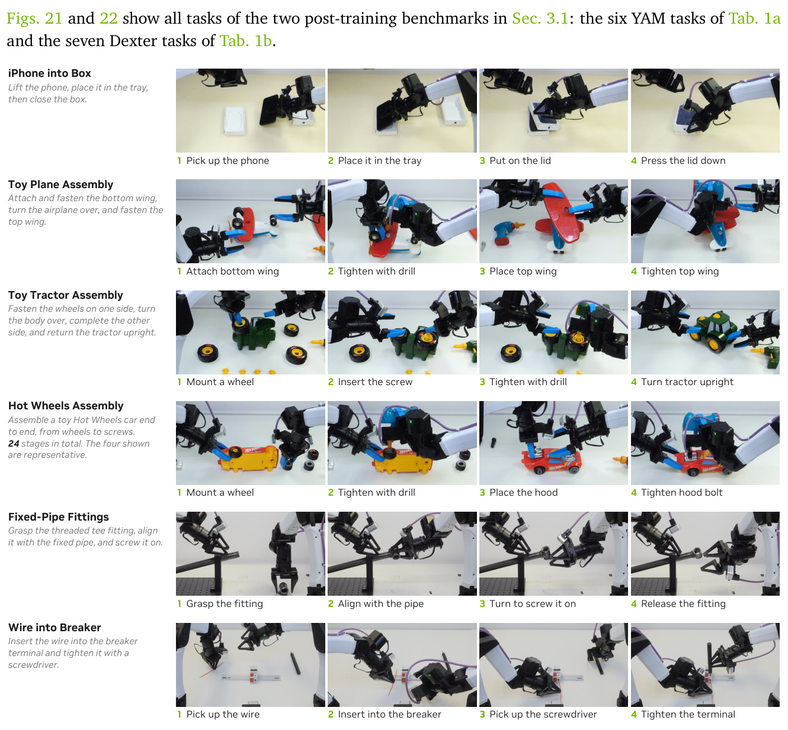
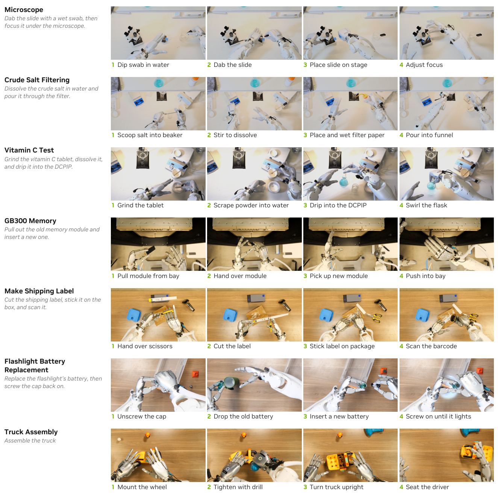
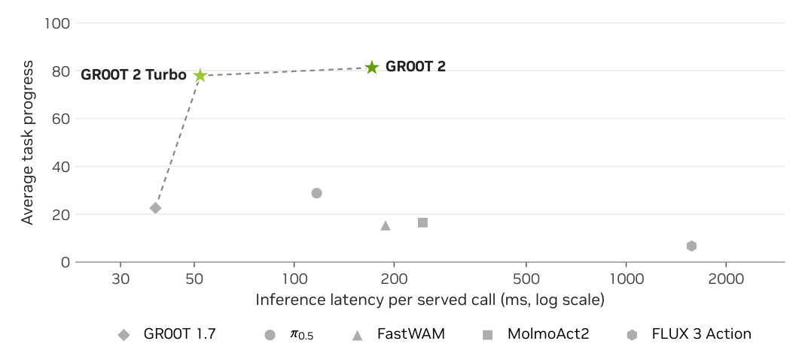
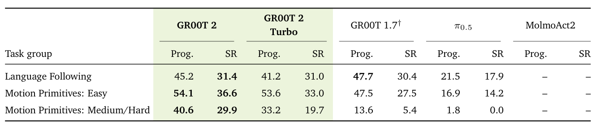
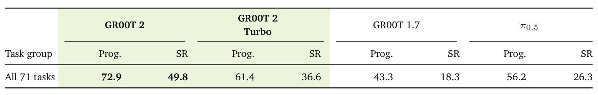
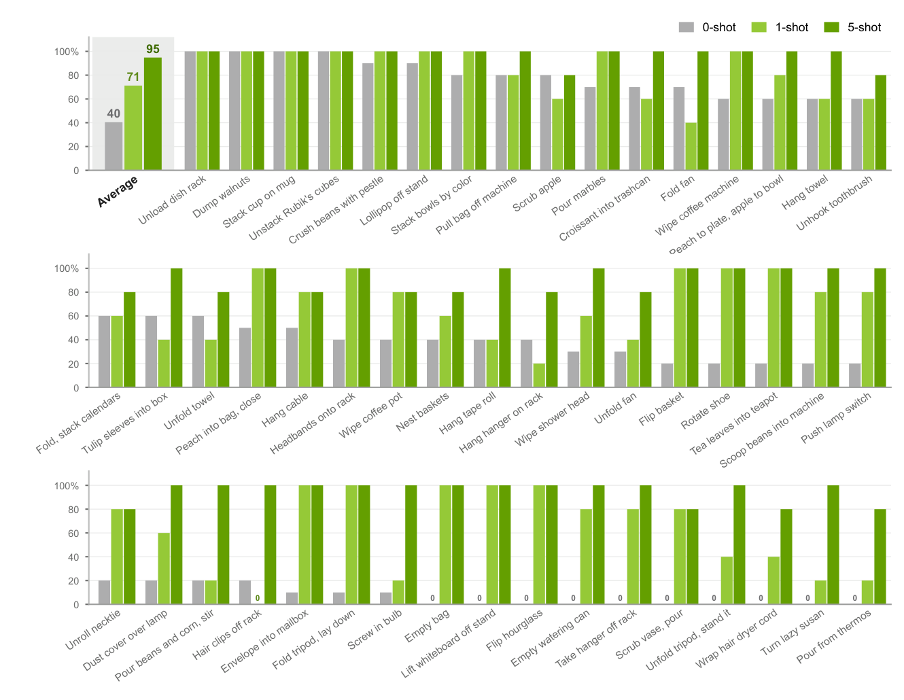

# 附录 A 快速适配

> **原文** A. Fast-Adapt with GR00T 2　·　起于 p.38　·　本页中英对照：英文段在前，中文段在后。

---
## A.1. Benchmark Tasks · A.1 基准任务

<!-- p.38 C022 · 图 F021 -->

Figure 21: YAM post-training benchmark tasks. The six tasks of Tab. 1a, one per row. Left: task name and a short description. Right: key frames from four representative stages of each task, which has more stages than shown (Hot Wheels Assembly has 24).

图 21：YAM 后训练基准任务。Tab. 1a 中的六个任务，每行一个。左：任务名称与简短描述。右：每个任务四个代表性阶段的关键帧；任务实际阶段多于所示（Hot Wheels Assembly 共 24 个阶段）。

<!-- p.39 C023 · 图 F022 -->

Figure 22: Dexter post-training benchmark tasks. The seven tasks of Tab. 1b, one per row. Left: task name and a short description. Right: key frames from four representative stages of each task.

图 22：Dexter 后训练基准任务。Tab. 1b 中的七个任务，每行一个。左：任务名称与简短描述。右：每个任务四个代表性阶段的关键帧。

<!-- p.39 S768 -->

Fig. 23 plots the average task progress of each model in Tab. 1a against its inference latency.

Fig. 23 把 Tab. 1a 中每个模型在六项任务上的平均任务进度对其推理时延作图。

<!-- p.40 C024 · 图 F023 -->

Figure 23: YAM post-training Pareto frontier. Average task progress across the six tasks in Tab. 1a versus inference latency per served call on a GeForce RTX 5090 workstation. The dashed line indicates the Pareto frontier.

图 23：YAM 后训练的帕累托前沿。Tab. 1a 六项任务的平均任务进度，对比在 GeForce RTX 5090 工作站上每次服务调用的推理时延。虚线标出帕累托前沿。

## A.2. Zero-Shot Generalization with GR00T 2 · A.2 GR00T 2 的零样本泛化

<!-- p.40 S773 -->

YAM Zero-Shot Benchmark. We evaluate the pretrained policies without task-specific post-training on the YAM V2 benchmark. For 𝜋0.5, we use a checkpoint adapted on in-domain data. We report results for the three unseen evaluation pools: Language Following, Motion Primitives (Easy), and Motion Primitives (Medium/Hard), comprising 14, 10, and 14 tasks, respectively. The benchmark evaluates language grounding and a range of manipulation motions, including actions beyond pick-and-place (Tab. 2).

YAM 零样本基准。我们在 YAM V2 基准上评测未经任务特定后训练的预训练策略。对 𝜋0.5，我们使用在域内数据上适配过的检查点。我们报告三个未见评测池的结果：语言跟随、运动基元（简单）、运动基元（中/难），分别包含 14、10 和 14 项任务。该基准评测语言落地能力以及一系列操作运动，包括超出抓取-放置范畴的动作（Tab. 2）。

<!-- p.40 C025 · 表 T002 -->

Table 2: YAM V2 zero-shot evaluation. For each model, Prog. is the average task score and SR is the success rate, both on a 0 to 100 scale. We pool graded trials across available evaluations and weight tasks equally within each group. Trial counts vary across tasks and models, and results include graded trials from ongoing evaluations. †GR00T 1.7 results are preliminary. –: no result available. Bold marks the best Prog. and SR in each row.

表 2：YAM V2 零样本评测。对每个模型，Prog. 是平均任务得分，SR 是成功率，均采用 0 至 100 的刻度。我们汇总现有各次评测中已评分的试次，并在每组内对任务等权。各任务与各模型的试次数不同，结果包含仍在进行的评测中已评分的试次。†GR00T 1.7 的结果为初步结果。–：无可用结果。粗体标出每行中最好的 Prog. 与 SR。

<!-- p.40 S780 -->

Dexter Zero-Shot Benchmark. We further evaluate zero-shot transfer on Dexter, a bimanual robot with two dexterous hands, again without task-specific post-training. The evaluation covers 71 tasks: 49 dexterous manipulation tasks and 22 out-of-distribution instruction tasks that probe language grounding through color, size, ordinal position, negation, spatial relations, counting, and named targets. Each model is run for three trials per task, and we report results pooled over all tasks (Tab. 3).

Dexter 零样本基准。我们进一步在 Dexter（一台配备两只灵巧手的双臂机器人）上评测零样本迁移，同样不做任务特定后训练。评测覆盖 71 项任务：49 项灵巧操作任务，以及 22 项分布外指令任务，后者通过颜色、尺寸、序数位置、否定、空间关系、计数和具名目标来考察语言落地能力。每个模型在每项任务上运行三次试次，我们报告在全部任务上汇总的结果（Tab. 3）。

<!-- p.41 C026 · 表 T003 -->

Table 3: Dexter zero-shot evaluation. For each model, Prog. is the average task progress and SR is the success rate, both on a 0 to 100 scale, pooled over 71 tasks (49 manipulation tasks and 22 out-of-distribution instruction tasks) with three trials per task. The four models run interleaved in the same sessions, and the operator who labels success is not told which model is running. Task progress is rated per episode by a vision-language model from the head and wrist camera videos. Bold marks the best Prog. and SR in each row.

表 3：Dexter 零样本评测。对每个模型，Prog. 是平均任务进度，SR 是成功率，均采用 0 至 100 的刻度，在 71 项任务（49 项操作任务与 22 项分布外指令任务）上汇总，每项任务三次试次。四个模型在同一批会话中交错运行，负责判定成功的操作员不知道当前运行的是哪个模型。任务进度由视觉语言模型依据头部与腕部相机视频逐 episode 评定。粗体标出每行中最好的 Prog. 与 SR。

## A.3. Dexter-50: Emergent Cross-Embodiment Zero-Shot and Few-Shot Transfer. · A.3 Dexter-50：涌现的跨本体零样本与少样本迁移

<!-- p.41 S785 -->

GR00T 2 transfers tasks across embodiments. We evaluate it on Dexter, a bimanual robot with two 7-DoF arms and two 22-DoF Sharpa hands, on Dexter-50: 50 tasks that never appear in Dexter’s training data but do appear in data from other embodiments, namely YAM parallel-gripper teleoperation, human video, or both. In the zero-shot setting, the pretrained model receives only the task instruction. In the few-shot setting, we adapt the same checkpoint to each task with 1 or 5 teleoperated Dexter episodes, a few minutes of robot data. We train rank-32 LoRA adapters on every linear layer of the transformer and keep the text encoder, video VAE, action and state heads, and all pretrained weights frozen. The adapters receive the same joint video and action flow-matching loss used in pretraining. We cut each episode into 100 evenly spaced training windows and sample them in proportion to the frozen model’s loss on each window, so that updates concentrate on the hard phases of the task, such as grasping or insertion. All tasks share the same hyperparameters, with no per-task tuning. One run fits on a single RTX 5090 and takes about 30 minutes. We merge the adapters into the base weights after training, so the adapted model is served exactly like the pretrained one.

GR00T 2 能跨本体迁移任务。我们在 Dexter（一台配两条 7-DoF 手臂和两只 22-DoF Sharpa 手的双臂机器人）上，用 Dexter-50 评测这一能力：这 50 项任务从未出现在 Dexter 的训练数据中，但出现在其他本体的数据里，即 YAM 平行夹爪遥操作数据、人类视频，或两者兼有。在零样本设置下，预训练模型只接收任务指令。在少样本设置下，我们用 1 条或 5 条 Dexter 遥操作 episode（数分钟机器人数据）把同一检查点适配到每项任务。我们在 Transformer 的每个线性层上训练秩为 32 的 LoRA 适配器，并冻结文本编码器、视频 VAE、动作头与状态头以及全部预训练权重。适配器接收与预训练相同的视频-动作联合流匹配损失。我们把每条 episode 切成 100 个等距训练窗口，并按冻结模型在各窗口上的损失成比例采样，使更新集中在任务的困难阶段，例如抓取或插入。所有任务共享同一组超参数，不做逐任务调参。一次运行可在单张 RTX 5090 上完成，耗时约 30 分钟。训练后我们把适配器合并进基础权重，因此适配后的模型的服务方式与预训练模型完全一致。

<!-- p.41 S786 -->

Across the 50 tasks, GR00T 2 succeeds 40% of the time zero-shot, 71% with one episode, and 95% with five (Fig. 24). Zero-shot, it completes 40 of the 50 tasks at least once and succeeds in every trial of four, such as unloading a dish rack and unstacking Rubik’s cubes, skills it has seen only on a parallel-gripper robot or in human video. With five episodes, 37 of the 50 tasks reach 100%, including tasks the zero-shot model never completes, such as emptying a bag, turning a lazy susan, and unfolding a tripod. In most of the failures shown in Fig. 25, the zero-shot model goes for the right steps, but its new hands fail at one of them, such as lifting a teapot lid or opening a drawstring bag. One or five Dexter episodes fix this.

在这 50 项任务上，GR00T 2 零样本成功率 40%，给定一条 episode 后为 71%，给定五条后为 95%（Fig. 24）。零样本时，它在 50 项任务中有 40 项至少成功一次，并有四项在每次试次中都成功，例如卸下碗架、叠放魔方——这些技能它只在平行夹爪机器人上或人类视频中见过。给定五条 episode 后，50 项任务中有 37 项达到 100%，其中包括零样本模型从未完成的任务，例如清空袋子、转动转盘、展开三脚架。在 Fig. 25 所示的大多数失败中，零样本模型走的是正确的步骤，但它新换的双手在其中某一步失败，例如提起茶壶盖或拉开抽绳袋。一条或五条 Dexter episode 就能修正这一点。

<!-- p.42 C027 · 图 F024 -->

Figure 24: Cross-embodiment transfer to Dexter with 0, 1, and 5 Dexter episodes, per task. Success rate on the Dexter-50 tasks, which have no Dexter training data but appear in YAM teleoperation data, human video, or both, sorted by zero-shot success. Zero-shot runs the pretrained model directly, while 1-shot and 5-shot fine-tune it with LoRA on 1 or 5 Dexter episodes. The first group (gray band) is the average over all 50 tasks. Tasks are those the model learns with five episodes (at least 80% success).

图 24：给定 0、1、5 条 Dexter episode 时向 Dexter 的跨本体迁移，逐任务结果。Dexter-50 任务的成功率——这些任务没有 Dexter 训练数据，但出现在 YAM 遥操作数据、人类视频或两者中——按零样本成功率排序。零样本直接运行预训练模型，1-shot 与 5-shot 则用 LoRA 在 1 条或 5 条 Dexter episode 上微调。第一组（灰带）是全部 50 项任务的平均。任务集合为模型用五条 episode 即可学会（成功率至少 80%）的那些任务。
