# 附录 B 跨本体适配

> **原文** B. X-Adapt with GR00T 2　·　起于 p.42　·　本页中英对照：英文段在前，中文段在后。

---

<!-- p.42 S844 -->

This section details the cross-embodiment transfer summarized in Sec. 3.2 and the devices and pipelines described in Sec. 4.4.

本附录详述 Sec. 3.2 概述的跨本体迁移，以及 Sec. 4.4 描述的采集设备与流程。

## B.1. Human →Tianji + Sharpa · B.1 人类 →Tianji + Sharpa

<!-- p.42 S845 -->

GR00T 2 can also learn a dexterous task on a robot from human demonstrations alone. Here every task-specific demonstration comes from a person recorded with our human data capture pipeline, which pairs head and wrist cameras with wrist trackers and data gloves, and the resulting policy runs on the Tianji, a bimanual robot with two 7-DoF arms and two 22-DoF Sharpa hands. The embodiment gap now centers on the hand. Appearance differs because the cameras observe a human hand during demonstration and a robot hand at deployment. Kinematics differ because the larger Sharpa hand does not share the size or joint structure of the human hand, so retargeting must map every finger motion onto the 22-DoF robot hand. Dynamics differ because the human moves at natural speed, which teleoperation cannot reproduce on the robot. Three components bridge these gaps: the capture pipeline records robot-aligned views (Sec. B.1.1), a geometric retargeter converts every demonstration into robot actions (Sec. B.1.2), and co-training with task-agnostic play data, collected with our teleoperation system (Sec. C.3.1), grounds the model in the robot (Sec. B.1.3).

GR00T 2 也能仅凭人类演示就在机器人上学会灵巧任务。这里每一条任务特定演示都来自一个人，由我们的人类数据采集流程录制：该流程把头戴与腕部相机与腕部跟踪器、数据手套配对；由此得到的策略运行在 Tianji 上——一台配两条 7-DoF 手臂和两只 22-DoF Sharpa 手的双臂机器人。此时本体差距集中在手上。外观不同，因为演示时相机看到的是人手，部署时看到的是机器手。运动学不同，因为更大的 Sharpa 手与人手在尺寸和关节结构上都不一致，所以重定向必须把每一根手指的运动映射到 22-DoF 的机器手上。动力学不同，因为人以自然速度运动，而遥操作无法在机器人上复现这一速度。三个组件弥合这些差距：采集流程录制与机器人对齐的视角（Sec. B.1.1）；几何重定向器把每条演示转换为机器人动作（Sec. B.1.2）；与任务无关的 play 数据（用我们的遥操作系统采集，Sec. C.3.1）联合训练，把模型锚定在机器人上（Sec. B.1.3）。

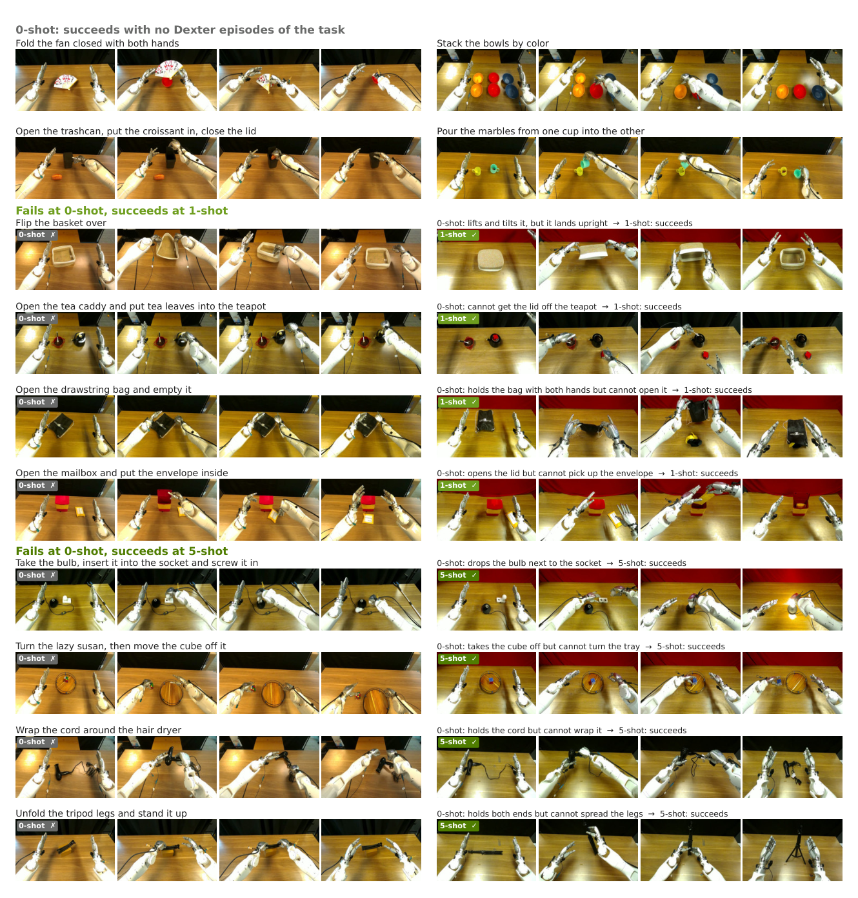

<!-- p.43 C028 · 图 F025 -->

Figure 25: Example Dexter rollouts. Top: zero-shot successes. Middle and bottom: tasks the zero-shot model attempts but fails, mostly at a step its new hands cannot yet do (left, with the failure noted above each row), and completes after fine-tuning on one or five Dexter episodes (right). Rollouts ran on different Dexter stations, so the backgrounds differ.

图 25：Dexter rollout 示例。上：零样本成功案例。中与下：零样本模型尝试但失败的任务，失败大多发生在它新换的双手尚不能完成的某一步（左列，每行上方标注失败点），以及在一或五条 Dexter episode 上微调后完成该任务的情形（右列）。各次 rollout 在不同 Dexter 工位上运行，因此背景不同。

<!-- p.43 S866 -->

We evaluate on four tasks (Fig. 26). Filter Paper Setup, Dropper-to-Beaker Dispensing, and Microscope Slide Dabbing are chemistry-lab tasks that handle small, often transparent labware and leave little tolerance for fingertip error. Conveyor Package Tossing is a dynamic task: the robot grasps each package from a moving belt and throws it over the belt into the bin assigned to that package, a targeted throw that teleoperation cannot demonstrate. For each task, we co-train the retargeted human demonstrations with task-agnostic Tianji play data. The play data contain no demonstrations of the target tasks. All models are post-trained with an identical data recipe and number of optimization steps. Without a single teleoperated demonstration of the target tasks, GR00T 2 succeeds in 65%, 30%, 10%, and 50% of 20 trials on the four tasks, whereas GR00T 1.7 and GR00T 2 without cross-embodiment pretraining fail every chemistry-lab trial and reach only 5% and 20% on tossing (Fig. 27). Adding 10 teleoperated demonstrations raises GR00T 2 to 95%, 70%, and 50% on the chemistry-lab tasks, against 45%, 40%, and 30% without cross-embodiment pretraining and 0% for GR00T 1.7. One hundred human demonstrations per task therefore suffice to deploy precise and dynamic dexterous tasks on a robot that has never been teleoperated for them. Sec. B.1.4 details the protocol, and Sec. B.1.5 analyzes why the transfer works.

我们在四项任务上评测（Fig. 26）。滤纸准备、滴管到烧杯的移液、载玻片涂抹属于化学实验室任务，操作的是小型且往往透明的实验器皿，对指尖误差几乎没有容忍度。传送带包裹抛掷是动态任务：机器人从运动中的传送带上抓取每个包裹，越过传送带把它抛进该包裹对应的料箱——这是一种遥操作无法演示的定向抛掷。对每项任务，我们把重定向后的人类演示与任务无关的 Tianji play 数据联合训练。play 数据中不含目标任务的任何演示。所有模型用完全相同的数据配方和优化步数做后训练。在完全没有目标任务的遥操作演示的情况下，GR00T 2 在四项任务各 20 次试次中成功率为 65%、30%、10% 和 50%；而 GR00T 1.7 与未做跨本体预训练的 GR00T 2 在全部化学实验室试次中均失败，抛掷任务上仅达 5% 与 20%（Fig. 27）。加入 10 条遥操作演示后，GR00T 2 在化学实验室任务上提升到 95%、70% 和 50%，未做跨本体预训练的版本为 45%、40% 和 30%，GR00T 1.7 为 0%。因此，每项任务约一百条人类演示，就足以在一台从未为该任务遥操作过的机器人上部署精确且动态的灵巧任务。Sec. B.1.4 详述协议，Sec. B.1.5 分析迁移为何有效。

<!-- p.44 S869 -->

B.1.1. Human Data Capture and Conversion

B.1.1 人类数据的采集与转换

<!-- p.44 S870 -->

Human data capture. Each demonstration is recorded with a lightweight egocentric rig: a head-mounted camera provides the ego view, wrist-mounted cameras provide close-up views of hand-object contact, and the hands are tracked by a motion-capture glove (Manus) paired with a 6-DoF tracker (PICO) rigidly attached to each wrist. The glove provides per-finger joint angles, while the tracker provides the global wrist pose. Together they yield a full 3D hand pose at every timestep without any robot in the loop. Because the tracker’s IMU does not coincide with the anatomical wrist, we calibrate the tracker-to-wrist rigid transform per session: an annotator clicks fingertip locations in a handful of frames spanning diverse hand poses, and we solve for the transform that minimizes the reprojection error of the glove-predicted fingertips. Camera intrinsics and extrinsics are verified in the same tool by overlaying the tracked controller pose onto the video, so that calibration errors are caught before any data is converted. The raw stream (ego and wrist video, wrist poses, finger joints, and language annotations) is captured at 60 Hz, stored in a time-synchronized format and quality-checked by visualizing the reconstructed hand trajectory against the video.

人类数据采集。每条演示都用一套轻量第一人称设备录制：头戴相机提供第一人称视角，腕戴相机提供手-物接触的近景视角，手部由动捕手套（Manus）跟踪，并配一个刚性固定在每个腕部的 6-DoF 跟踪器（PICO）。手套给出每根手指的关节角，跟踪器给出全局腕部位姿。两者结合，可在每个时间步得到完整的三维手部位姿，全程无需机器人在环。由于跟踪器的 IMU 与解剖学意义上的腕部并不重合，我们逐次会话标定"跟踪器到腕部"的刚体变换：标注员在若干覆盖多样手部姿态的帧里点击指尖位置，我们求解使手套预测指尖重投影误差最小的变换。相机内参与外参在同一工具中校验——把跟踪到的控制器位姿叠加到视频上，从而在任何数据被转换之前就发现标定错误。原始数据流（第一人称与腕部视频、腕部位姿、手指关节、语言标注）以 60 Hz 采集，以时间同步格式存储，并通过把重建的手部轨迹与视频叠加可视化来做质量检查。

<!-- p.44 S871 -->

From human data to robot data. The captured human trajectories are converted into robot-space supervision in a single offline pass, with no task-specific robot teleoperation. First, each wrist pose is anchored globally in the gravity-aligned robot base frame: the human’s head camera is placed at the robot’s head camera, and a per-task offset shifts the hands into the robot workspace. The converted trajectories therefore carry absolute wrist poses in the robot frame, not wrist displacements alone. Second, the human finger configuration is retargeted to the robot hand via inverse kinematics on fingertip targets, producing joint commands that respect the robot’s kinematic limits while preserving the task-relevant contact geometry rather than the literal human pose. Third, the ego and wrist camera streams are kept as the policy’s visual inputs, so that the resulting episodes, downsampled to 30 Hz, have the same observation and action schema as native robot data. During post-training, we sample converted human episodes and generic, non-task-specific robot play data with equal probability. This co-training grounds the model in the robot’s appearance and dynamics, while human demonstrations provide all task-specific supervision.

从人类数据到机器人数据。采集到的人类轨迹在一次离线处理中转换为机器人空间中的监督信号，不需要任何任务特定的机器人遥操作。第一，每个腕部位姿被全局锚定在重力对齐的机器人基座坐标系中：把人的头戴相机放置在机器人头部相机处，再用一个逐任务的偏移把手移入机器人工作空间。因此转换后的轨迹携带的是机器人坐标系下的绝对腕部位姿，而不只是腕部位移。第二，通过以指尖为目标的逆运动学，把人手的手指构型重定向到机器手，产生既遵守机器人运动学极限、又保留任务相关接触几何（而非照搬人手姿态）的关节指令。第三，第一人称与腕部相机流保留为策略的视觉输入，因此所得 episode（降采样到 30 Hz）与原生机器人数据具有相同的观测与动作 schema。后训练时，我们以相等概率采样转换后的人类 episode 与通用的、非任务特定的机器人 play 数据。这种联合训练把模型锚定在机器人的外观与动力学上，而人类演示提供全部任务特定的监督。

<!-- p.44 S872 -->

B.1.2. Geometric Retargeting

B.1.2 几何重定向

<!-- p.44 S873 -->

The role of our retargeting solver is to bring sub-millimeter accuracy to robot finger tips with kHz computation speed. Given that the conversion is solely offline without human supervision, we ask for automated singularity handling near workspace boundary and robust redundancy DoF management. To achieve this we make use of a closed-form geometric inverse kinematic solving technique introduced in Chen et al. (2026b) and Kong et al. (2026) to handle both the 7-DoF arms and 22 DoF robot hands. Given 6D pose data of ego camera and left / right wrist mount, we first find the ideal placement of human data in robot frame for each task. The solver then retargets the hands before the arm, and both stages track fingertip targets. A unified “palm-box” hand frame introduced in Kong et al. (2026), anchored at the index fingertip, aligns human and robot hands. The 22-DoF hand solver places the robot thumb tip relative to the solved index fingertip, which preserves the pinch geometry, while the other fingers follow the human bone directions. The arm’s geometric inverse-kinematics solver then tracks the palm-box origin, so the robot index fingertip lands on the human index fingertip.

我们的重定向求解器的作用，是以 kHz 级计算速度把机器人指尖精度带到亚毫米级。考虑到转换完全离线且无人工监督，我们要求能自动处理工作空间边界附近的奇异位形，并对冗余自由度做稳健管理。为此我们采用 Chen et al. (2026b) 与 Kong et al. (2026) 提出的闭式几何逆运动学求解技术，同时处理 7-DoF 手臂与 22 自由度机器手。给定第一人称相机与左/右腕部安装座的 6D 位姿数据，我们首先为每项任务找出人类数据在机器人坐标系中的理想放置。随后求解器先重定向手、再重定向臂，两个阶段都跟踪指尖目标。Kong et al. (2026) 提出的统一"掌盒"（palm-box）手部坐标系以食指指尖为锚点，用于对齐人手与机器手。22-DoF 手求解器把机器拇指指尖相对已求解的食指指尖放置，从而保留捏合几何，其余手指则沿人骨方向跟随。随后手臂的几何逆运动学求解器跟踪掌盒原点，使机器食指指尖落到人的食指指尖上。

<!-- p.44 S875 -->

Our combined arm-hand solver achieves approximately 118,000 bimanual solves per second on a single core of an Intel Core Ultra 9 285K CPU, with a mean native computation time of 8.48 𝜇s, excluding Python interface overhead. Across 1,024 synthetic in-range wrist targets, maximum forward-kinematics-verified pose errors remain below 10−15 m and 10−15 rad. This throughput supports real-time teleoperation (Sec. C.3.1) and offline human-data conversion.

我们的臂-手联合求解器在 Intel Core Ultra 9 285K 的单核上达到约每秒 118,000 次双臂求解，原生平均计算时间 8.48 𝜇s（不含 Python 接口开销）。在 1,024 个合成的射程内腕部目标上，经正运动学验证的最大位姿误差保持在 $10^{-15}$ m 与 $10^{-15}$ rad 以下。这一吞吐量同时支持实时遥操作（Sec. C.3.1）与离线人类数据转换。

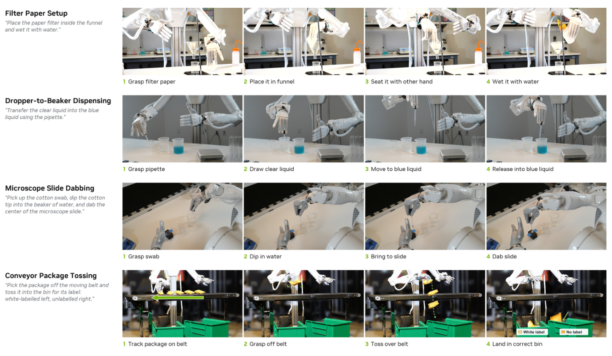

<!-- p.45 C029 · 图 F026 -->

Figure 26: Sensorized human transfer benchmark tasks. Each row shows the ordered stages of one task, with the language instruction that GR00T 2 receives.

图 26：带传感器人类演示迁移的基准任务。每行展示一项任务的有序阶段，以及 GR00T 2 接收到的语言指令。

<!-- p.45 S876 -->

B.1.3. Co-Training with Robot Play Data

B.1.3 与机器人 play 数据联合训练

<!-- p.45 S877 -->

GR00T 2 turns retargeted human demonstrations into a robot policy by co-training them with robot play data. Starting from its cross-embodiment pretrained checkpoint, GR00T 2 fine-tunes on two complementary sources: retargeted human demonstrations of the target task, which contain the task but not the robot, and task-agnostic play data from the target robot, collected with the teleoperation system of Sec. C.3.1, which contain the robot but not the task. Human data teach GR00T 2 what to do: the task intent, the object interactions, and the motion strategy, such as which hand leads, which fingers make contact, and how fast the wrist moves. Play data teach GR00T 2 how this robot looks and moves: its appearance, kinematics, and dynamics, which stay the same across tasks, so one play pool serves every task. Without teleoperation, the play data are the only robot data in post-training. Each new task therefore adds only cheap human demonstrations.

GR00T 2 通过把重定向后的人类演示与机器人 play 数据联合训练，把前者变成机器人策略。从跨本体预训练检查点出发，GR00T 2 在两个互补来源上微调：目标任务的、重定向后的人类演示——它包含"任务"但不含"机器人"；以及来自目标机器人的任务无关 play 数据（用 Sec. C.3.1 的遥操作系统采集）——它包含"机器人"但不含"任务"。人类数据教 GR00T 2 做什么：任务意图、物体交互、运动策略，例如哪只手先动、哪些手指接触、腕部移动多快。play 数据教 GR00T 2 这台机器人长什么样、怎么动：它的外观、运动学与动力学，这些跨任务不变，因此一个 play 池可服务所有任务。在没有遥操作的情况下，play 数据就是后训练中唯一的机器人数据。于是每新增一个任务，只需追加廉价的人类演示。

<!-- p.45 S878 -->

Human and robot episodes share one data format, so the two sources mix freely within a training batch. Both provide three camera views (ego and two wrists) at 30 Hz, a 62-D state of absolute wrist poses in the robot base frame and hand-joint positions, and a 62-D action chunk of wrist poses relative to the current state and absolute hand-joint positions.

人类 episode 与机器人 episode 共用一种数据格式，因此两个来源可以在同一训练批次内自由混合。两者都提供 30 Hz 的三路相机视角（第一人称与两个腕部）、一个 62 维状态（机器人基座坐标系下的绝对腕部位姿与手部关节位置），以及一个 62 维动作块（相对当前状态的腕部位姿与绝对手部关节位置）。

<!-- p.45 S879 -->

B.1.4. Learning New Tasks without Teleoperation

B.1.4 无遥操作地学习新任务

<!-- p.45 S880 -->

GR00T 2 learns new robot tasks from human demonstrations alone. Four tasks on the Tianji, a bimanual robot with two 7-DoF arms and two 22-DoF Sharpa hands, test this claim and stress two parts of the embodiment gap. Three chemistry-lab tasks handle small, often transparent labware and test precision under the kinematic gap, where retargeting error and the larger robot hand both consume the tolerance. The dynamic task tests the kinodynamic gap on a fast, targeted throw that teleoperation cannot demonstrate (Fig. 26).

GR00T 2 仅凭人类演示就能学会新的机器人任务。Tianji（一台配两条 7-DoF 手臂和两只 22-DoF Sharpa 手的双臂机器人）上的四项任务检验这一主张，并分别施压本体差距的两个方面。三项化学实验室任务操作小型且往往透明的实验器皿，检验运动学差距下的精度——在这里重定向误差与更大的机器手共同消耗容忍度。动态任务检验运动动力学差距，形式是遥操作无法演示的快速定向抛掷（Fig. 26）。

<!-- p.45 S881 -->

Tasks and metrics. A rubric splits each task into 𝐾ordered stages, and we grade each trial by the number of stages 𝑘it completes in order. A trial succeeds when 𝑘= 𝐾, its task progress is 𝑘/𝐾, and any human intervention counts as a failure.

任务与指标。评分细则把每项任务拆成 $K$ 个有序阶段，我们按一次试次按序完成的阶段数 $k$ 来评分。当 $k=K$ 时试次成功，其任务进度为 $k/K$，任何人工干预都计为失败。

<!-- p.45 S882 -->

• Filter Paper Setup (𝐾=6): grasp the filter paper, place it in the funnel, unfold and seat it in the funnel,

• 滤纸准备（$K=6$）：抓起滤纸，放入漏斗，将其展开并安置在漏斗中，

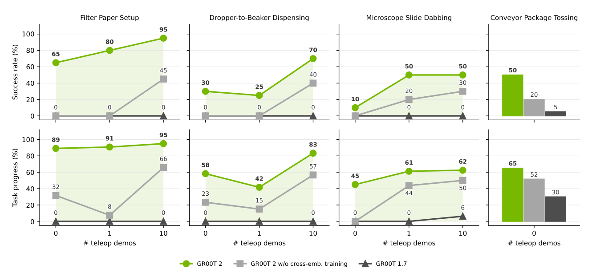

<!-- p.46 C030 · 图 F027 -->

Figure 27: Learning new tasks with zero or few teleoperated demonstrations. Success rate (top) and task progress (bottom) over 20 trials per point, with 0, 1, or 10 teleoperated demonstrations of the target task added to post-training. At

图 27：在零条或少量遥操作演示下学习新任务。每个数据点为 20 次试次上的成功率（上）与任务进度（下），横轴为后训练中加入的目标任务遥操作演示条数：0、1 或 10。在

<!-- p.46 S892 -->

0, no training data contain a robot trajectory of the task. All models share the human demonstrations, robot data, and post-training recipe. Each baseline changes one factor relative to GR00T 2, either the model formulation (GR00T 1.7, a VLA) or the pretraining data (GR00T 2 w/o cross-embodiment pretraining, pretrained on target-robot data alone, Sec. B.1.5). Conveyor Package Tossing is evaluated at 0 only, since teleoperation cannot demonstrate its fast, targeted throw.

0 条时，没有任何训练数据包含该任务的机器人轨迹。所有模型共享相同的人类演示、机器人数据与后训练配方。每个基线相对 GR00T 2 只改变一个因素：或改变模型形式（GR00T 1.7，一个 VLA），或改变预训练数据（GR00T 2 w/o cross-embodiment pretraining，仅在目标机器人数据上预训练，Sec. B.1.5）。传送带包裹抛掷仅在 0 条设置下评测，因为遥操作无法演示其快速定向抛掷。

<!-- p.46 S893 -->

grasp the water bottle, wet the filter paper, and put the bottle back. • Dropper-to-Beaker Dispensing (𝐾=3): grasp the pipette, draw the clear liquid, and release it into the blue liquid. • Microscope Slide Dabbing (𝐾=4): grasp the swab, dip it into the water, bring it to the slide, and dab the slide. • Conveyor Package Tossing (𝐾=3): grasp a package from the moving belt, toss it over the belt, and land it in the bin assigned to that package.

抓起水瓶，润湿滤纸，再把瓶子放回。• 滴管到烧杯移液（$K=3$）：抓起移液管，吸取澄清液体，并将其释放到蓝色液体中。• 载玻片涂抹（$K=4$）：抓起棉签，蘸水，移到载玻片上，涂抹载玻片。• 传送带包裹抛掷（$K=3$）：从运动中的传送带上抓起一个包裹，越过传送带抛出，使其落入该包裹对应的料箱。

<!-- p.46 S894 -->

All models post-train on one mixture, retargeted human demonstrations and robot play data sampled 1:1, with one recipe and step budget and no per-task tuning or checkpoint selection. To measure what teleoperation still adds, we also add 1 or 10 teleoperated demonstrations of the target task to the mixture. Each point averages 20 trials.

所有模型都在同一数据配比上后训练：重定向后的人类演示与机器人 play 数据按 1:1 采样，使用同一配方与步数预算，不做逐任务调参或检查点挑选。为衡量遥操作仍能带来什么，我们还在配比中加入 1 条或 10 条目标任务的遥操作演示。每个数据点平均 20 次试次。

<!-- p.46 S895 -->

Learning without teleoperation. Without a single teleoperated demonstration, GR00T 2 succeeds in 65%, 30%, 10%, and 50% of trials on Filter Paper Setup, Dropper-to-Beaker Dispensing, Microscope Slide Dabbing, and Conveyor Package Tossing (Fig. 27). Both baselines fail every chemistry-lab trial in the same setting and succeed only on tossing, with 20% without cross-embodiment pretraining and 5% for GR00T 1.7. The human demonstrations carry the task: without them, the same GR00T 2 recipe succeeds in 0% of trials on every task. Tossing shows that this transfer extends beyond teleoperation: GR00T 2 learns the throw entirely from humans.

无需遥操作的学习。在没有任何一条遥操作演示的情况下，GR00T 2 在 Filter Paper Setup、Dropper-to-Beaker Dispensing、Microscope Slide Dabbing 和 Conveyor Package Tossing 四项任务上的试次成功率分别为 65%、30%、10% 和 50%（Fig. 27）。两个基线在同一设置下的每个化学实验室试次中均告失败，仅在抛掷任务上取得成功：不做跨本体预训练的基线成功率为 20%，GR00T 1.7 为 5%。承担任务的是人类演示：去掉它们后，同一套 GR00T 2 配方在每项任务上的成功率均为 0%。抛掷任务表明，这种迁移并不局限于遥操作：GR00T 2 完全从人类那里学会了抛掷动作。

<!-- p.46 S896 -->

Teleoperation adds to human data. Teleoperated demonstrations refine the task that human demonstrations teach rather than replace them. With 10 demonstrations, GR00T 2 succeeds in 95%, 70%, and 50% of chemistry-lab trials, compared with 45%, 40%, and 30% without cross-embodiment pretraining and 0% for GR00T 1.7. On Filter Paper Setup, GR00T 2 without teleoperation already outperforms the baseline trained with 10 teleoperated demonstrations.

遥操作对人类数据起补充作用。遥操作演示细化的是人类演示所教授的任务，而不是取代它们。使用 10 条演示时，GR00T 2 在化学实验室试次上的成功率分别为 95%、70% 和 50%；不做跨本体预训练时分别为 45%、40% 和 30%，GR00T 1.7 为 0%。在 Filter Paper Setup 上，不使用遥操作的 GR00T 2 已经超过使用 10 条遥操作演示训练的基线。

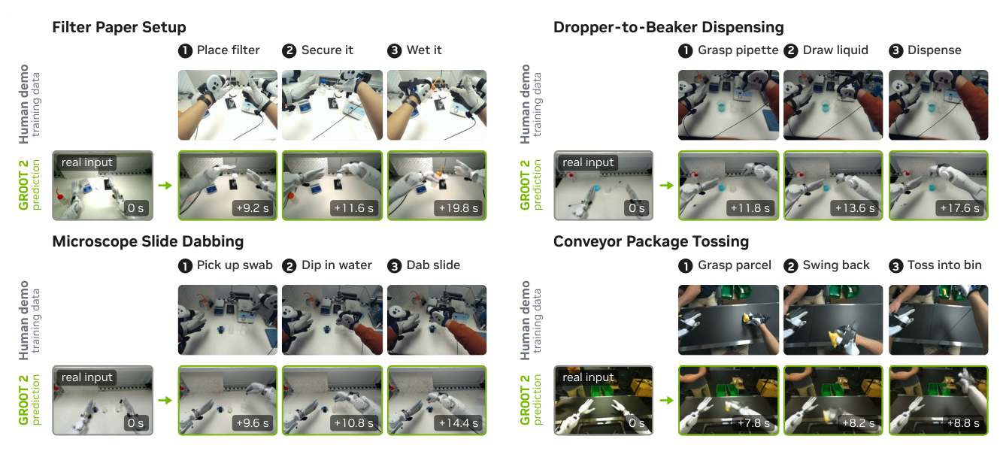

<!-- p.47 C031 · 图 F028 -->

Figure 28: Predicted futures for tasks that only humans demonstrated. Given one robot start frame and the instruction, GR00T 2 predicts the robot’s ego view autoregressively. Each GR00T 2 row comes from a single rollout that starts at the first frame of an evaluation episode, and times are measured from that frame. Human demonstrations (top rows) appear only in training.

图 28：仅由人类演示的任务的预测未来画面。给定一个机器人起始帧和指令，GR00T 2 以自回归方式预测机器人的第一人称视角画面。每一行 GR00T 2 结果都来自一次 rollout（轨迹采样），其起点为某个评测片段的第一帧，时间自该帧起算。人类演示（顶部几行）仅出现在训练中。

<!-- p.47 S939 -->

B.1.5. Why GR00T 2 Learns without Teleoperation

B.1.5. 为什么 GR00T 2 无需遥操作也能学习

<!-- p.47 S940 -->

Two baselines test the two properties that let GR00T 2 learn without teleoperation (Fig. 27). Each replaces one component of GR00T 2, the model formulation or the pretraining data, and keeps the post-training data, sampling weights, step budget, and evaluation protocol fixed.

两个基线分别检验让 GR00T 2 无需遥操作即可学习的两项特性（Fig. 27）。每个基线替换 GR00T 2 的一个组件，即模型形式或预训练数据，同时保持后训练数据、采样权重、步数预算和评测协议不变。

<!-- p.47 S941 -->

World-action model. GR00T 2 learns from human-only task data because it is a world-action model. Unlike a VLA that must learn task and embodiment in one observation-to-action map, from human-hand observations paired with retargeted actions, GR00T 2 factorizes the problem into two parts. Future-video prediction learns what should happen to the scene, a change that human and robot largely share, while action prediction learns how this robot produces that change, from robot play data. To test the formulation, we compare GR00T 2 with GR00T 1.7, a VLA pretrained on the same data and post-trained with the same recipe. The two models also differ in backbone and initialization, so the comparison tests the WAM design as a whole rather than the prediction target alone. GR00T 1.7 fails every chemistry-lab trial, even with 10 teleoperated demonstrations: under the same data and step budget, the VLA learns these precise tasks neither from human demonstrations nor from a few robot demonstrations. The factorization also makes a direct prediction: for a task that only humans demonstrated, GR00T 2 should predict robot hands rather than human hands. Conditioned on one robot start frame, GR00T 2 predicts the robot’s own hands reaching each milestone of all four tasks (Fig. 28).

世界-动作模型（WAM）。GR00T 2 仅从人类任务数据中学习，是因为它是一个世界-动作模型。与视觉-语言-动作（VLA）模型不同，后者必须在一个观测到动作的映射中同时学习任务和本体，而该映射的训练数据是人手观测与重定向动作的配对；GR00T 2 则把问题分解为两部分。未来视频预测学习场景应当如何变化，这一变化在人类与机器人之间大体相同；动作预测则从机器人自由操作数据中学习该机器人如何产生这种变化。为检验这一形式，我们将 GR00T 2 与 GR00T 1.7 进行比较。GR00T 1.7 是一个在同样数据上预训练、并用相同配方后训练的 VLA。两个模型在主干网络和初始化上也有差异，因此该比较检验的是 WAM 设计的整体，而不仅是预测目标。即使使用 10 条遥操作演示，GR00T 1.7 在每个化学实验室试次上仍告失败：在相同的数据和步数预算下，该 VLA 既无法从人类演示中学会这些精细任务，也无法从少量机器人演示中学会。这种分解还带来一个直接预测：对于只由人类演示过的任务，GR00T 2 应当预测机器人的手，而不是人手。给定一个机器人起始帧，GR00T 2 预测的是机器人自身的手在四项任务的每个里程碑处伸出的画面（Fig. 28）。

<!-- p.47 S942 -->

Cross-embodiment pretraining. GR00T 2 transfers task knowledge from the human hand to the robot hand because it pretrains across embodiments. Unlike target-only pretraining that ties task knowledge to one body, cross-embodiment pretraining teaches GR00T 2 to express one task through many bodies. To test this property, we fix the GR00T 2 model and its post-training and replace the full pretraining mixture with target-robot data alone, at a matched pretraining budget. The full mixture adds robot embodiments, human data, and scale at once, so this comparison measures the value of the GR00T 2 mixture as a whole. Without cross-embodiment pretraining, GR00T 2 fails every chemistry-lab trial without teleoperation and trails the full model at every number of teleoperated demonstrations, 45%, 40%, and 30% against 95%, 70%, and 50% at 10.

跨本体预训练。GR00T 2 能把任务知识从人手迁移到机器人手上，是因为它在多种本体上进行预训练。与只针对目标本体预训练、把任务知识绑定到单一身体上的做法不同，跨本体预训练让 GR00T 2 能够通过多种身体表达同一项任务。为检验这一特性，我们固定 GR00T 2 模型及其后训练，仅把完整预训练混合数据替换为目标机器人数据，且预训练预算保持一致。完整混合数据同时增加了机器人本体、人类数据和数据规模，因此该比较衡量的是 GR00T 2 数据混合的整体价值。去掉跨本体预训练后，GR00T 2 在不使用遥操作时的每个化学实验室试次中均告失败，并且在每一种遥操作演示数量下都落后于完整模型：分别为 45%、40% 和 30%，完整模型则为 95%、70% 和 50%（最后一组对应 10 条演示）。

<!-- p.47 S943 -->

Human-level motion beyond teleoperation. GR00T 2 achieves human-level motion agility, because learning directly from human demonstrations removes the speed ceiling that teleoperation imposes on robot data. A teleoperator perceives the scene through delayed video, feels no contact, and acts through a mismatched impedance, so teleoperated demonstrations are inherently slower and more conservative than natural human motion, and policies trained on them inherit this limit. Conveyor Package Tossing tests this directly: it is a targeted throw, not a simple toss. The robot must identify each package, grasp it from the moving belt, and release it at the correct phase of a fast arm swing so that it lands in the bin assigned to that package, a skill that is impractical to teleoperate. The demonstrator performs the task at natural speed in the capture rig, and GR00T 2 learns it from the converted demonstrations and robot play data alone, with no task-specific robot data, succeeding in 50% of trials. Removing the teleoperator thus does more than lower collection cost: it expands the set of behaviors a robot can learn to those that require human-level speed.

超越遥操作的人类水平动作。GR00T 2 实现了人类水平的动作敏捷性，因为直接从人类演示中学习，消除了遥操作施加在机器人数据上的速度上限。遥操作者通过有延迟的视频感知场景，无法感受接触，并以不匹配的阻抗进行操作，因此遥操作演示天生比自然的人类动作更慢、更保守，而在其上训练的策略也继承了这一限制。Conveyor Package Tossing 对此做了直接检验：它是一次有目标的抛掷，而不是简单的扔。机器人必须识别每个包裹，从移动的传送带上抓起它，并在手臂快速摆动的正确阶段松开，使包裹落入分配给它的箱子中，这种技能很难通过遥操作完成。示范者在采集装置中以自然速度完成该任务，GR00T 2 仅从转换后的演示和机器人自由操作数据中学习，没有任何任务专用的机器人数据，成功率达到 50%。因此，去掉遥操作者不只是降低了采集成本，还扩展了机器人可以学会的行为范围，使其包括那些需要人类水平速度的行为。

## B.2. UMI →YAM · B.2 节：从 UMI 到 YAM 的迁移

<!-- p.48 S945 -->

Suppose a bimanual gripper robot must learn to take apart an electronics assembly on a factory bench it has never seen: unscrew a nut, lift out a gear and two housings, unplug the connectors and cables, and place every part in a tray. No teleoperation data exist for this robot, and collecting them would tie up the robot, a station, and an operator for the full campaign. With GR00T 2 the task can instead be demonstrated with Gripper UMI, a handheld parallel gripper in the lineage of the Universal Manipulation Interface (UMI, Chi et al., 2024 and Sec. E.2): a person holding the device performs the job with natural motions at natural speed, while robot-style wrist cameras and a width encoder record the demonstration in robot coordinates, with no robot in the loop (Sec. E.1). The difficulty is that the handheld device and the robot are different embodiments. Whereas prior

设想一台双臂夹爪机器人需要在一张从未见过的工厂工作台上拆解电子组件：拧下螺母，取出一个齿轮和两个外壳，拔下连接器和线缆，并把每个零件放进托盘。这台机器人没有遥操作数据，而采集这些数据会让一台机器人、一个工位和一名操作员在整个评测批次中都被占用。借助 GR00T 2，这项任务可以改用 Gripper UMI 来演示。Gripper UMI 是一款手持平行夹爪，属于 Universal Manipulation Interface（UMI，Chi et al., 2024 and Sec. E.2）的技术谱系：持设备的人以自然动作、自然速度完成工作，同时类机器人的腕部相机和宽度编码器以机器人坐标记录演示，全程无需机器人参与（Sec. E.1）。难点在于，手持设备与机器人是不同的本体。而此前的 [存疑：句子在第 48 页截断，续句见 S946]

<!-- p.48 S946 -->

UMI deployments avoid this by construction, with a robot end-effector that reproduces the handheld device’s cameras and fingers (Chi et al., 2024), the target robot here, YAM, shares none of these components, and the two embodiments differ in all three respects at once: in sensing because YAM’s wrist cameras share neither the lens nor the viewpoint of the handheld device, in actuation because YAM’s arm, gripper, and control space have no counterpart in handheld data, and in environment because the demonstrations are collected in the wild and the policy runs in a robot cell the demonstrations never show (Fig. 42).

以往的 UMI 部署通过构造规避了这一问题，即采用一个复现手持设备相机和手指的机器人末端执行器（Chi et al., 2024）。而这里的目标机器人 YAM 不与手持设备共享这些组件，两种本体在三个方面同时存在差异：在感知上，YAM 的腕部相机与手持设备既不共用镜头，也不共用视点；在驱动上，YAM 的机械臂、夹爪和控制空间在手持数据中没有对应项；在环境上，演示是在野外采集的，而策略运行于演示中从未出现过的机器人工作单元（robot cell）中（Fig. 42）。

<!-- p.48 S947 -->

Closing this gap decouples data collection from the deployment platform, and the decoupling pays off along three axes. The first is generality: the same handheld demonstrations transfer to off-the-shelf robots with their own cameras, grippers, and controllers, so a task collected once need not be re-collected for each platform. The second is capability: the handheld device records motion at human speed with natural contact feedback, so dynamic skills such as tossing, which teleoperation renders slow and conservative, become learnable. The third is efficiency: adding a task requires no robot, no instrumented cell, and no operator training. Demonstrations are recorded in the wild after a few dozen minutes of setup, whereas teleoperation ties up a robot, a station, and a trained operator for the entire collection. The demonstration budget itself is small: with roughly 20 handheld episodes, the policy still completes Toy Dumptruck Assembly end to end (10% success, 81 progress) and still sorts 84% of the conveyor items on Conveyor Belt Sorting and Tossing, and even 10 episodes sort 70% (Tab. 17).

弥合这一差距使数据采集与部署平台解耦，而解耦的收益体现在三个方面。第一是通用性：同一套手持演示可以迁移到带有自身相机、夹爪和控制器的现成机器人上，因此一项任务只需采集一次，无需为每个平台重新采集。第二是能力：手持设备以人类速度记录动作，并保留自然的接触反馈，因此抛掷这类动态技能变得可以学习，而遥操作会使其变得缓慢而保守。第三是效率：增加一项任务不需要机器人、带仪器的工作单元，也不需要培训操作员。演示可以在几十分钟的准备之后，在野外录制；而遥操作会在整个采集过程中占用一台机器人、一个工位和一名受过训练的操作员。演示预算本身也很小：仅用约 20 个手持片段，策略仍能端到端完成 Toy Dumptruck Assembly（成功率 10%，进度 81），仍能分拣 Conveyor Belt Sorting and Tossing 中 84% 的传送带物品，即使只有 10 个片段也能分拣 70%（Tab. 17）。

<!-- p.48 S948 -->

What makes the transfer work. Three design choices carry the transfer, each closing one gap, and Sec. E.3 ablates all of them.

使迁移成功的关键。三项设计选择承担了迁移，每一项弥合一种差距，Sec. E.3 对它们逐一做了消融。

<!-- p.48 S949 -->

• Co-training with task-agnostic robot data closes the embodiment and scene gap. GR00T 2 is post-trained on the UMI demonstrations together with YAM teleoperation data from four general in-lab corpora that contain no episode of the target tasks, typically at a 0.6 : 0.4 ratio: the YAM data supply the embodiment and the scene, the UMI data supply the task. The effect is visible in the model’s own predictions, which render YAM’s arms rather than the demonstrator’s once YAM data are present (Fig. 14). • Aligning the wrist view closes the geometric part of the sensing gap. We re-render the UMI fisheye as a virtual pinhole camera that imitates YAM’s wrist view, fitted in Isaac Sim on 112 paired renders (Fig. 43). The alignment is only approximate, yet without it end-to-end success falls to 0% on both long-horizon tasks. • Sharing the action head grounds the task in the robot’s own action space. UMI actions are re-expressed in YAM’s semantics and decoded by YAM’s weights, so the task evidence lands directly in the statistics

• 与任务无关的机器人数据的联合训练弥合了本体与场景差距。GR00T 2 在 UMI 演示之外，还与 YAM 遥操作数据一同进行后训练；这些数据来自四个通用的实验室内语料库，不包含任何目标任务片段，通常按 0.6 : 0.4 的比例混合：YAM 数据提供本体与场景，UMI 数据提供任务。这一效果可以从模型自身的预测中看出：一旦加入 YAM 数据，模型渲染出的是 YAM 的机械臂，而非演示者的手臂（Fig. 14）。• 对齐腕部视角弥合了感知差距中的几何部分。我们把 UMI 鱼眼图像重新渲染为一台模拟 YAM 腕部视角的虚拟针孔相机，并在 Isaac Sim 中利用 112 组成对渲染图进行拟合（Fig. 43）。这一对齐只是近似的，但若没有它，两项长时序任务的端到端成功率都会降至 0%。• 共享动作头使任务落在机器人自身的动作空间中。UMI 动作被重新表达为 YAM 的语义，并由 YAM 的权重解码，因此任务证据直接落入

<!-- p.49 C032 · 图 F029 -->

Figure 29: Zero-teleop transfer from UMI to YAM. Each row shows one task with the language instruction GR00T 2 receives and six keyframes of a YAM rollout, numbered by stage: Toy Dumptruck Assembly, NIST Board Disassembly, and Conveyor Belt Sorting and Tossing. Every task is demonstrated only with the handheld Gripper UMI, and YAM has no teleoperation data of these tasks.

图 29：从 UMI 到 YAM 的零遥操作迁移。每一行展示一项任务，包括 GR00T 2 接收到的语言指令，以及一次 YAM rollout（轨迹采样）中按阶段编号的六个关键帧，任务依次为 Toy Dumptruck Assembly、NIST Board Disassembly，以及 Conveyor Belt Sorting and Tossing。每项任务都只通过手持 Gripper UMI 演示，而 YAM 没有这些任务的遥操作数据。

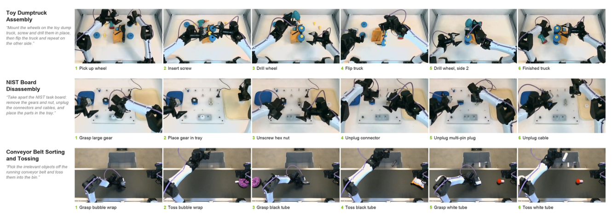

<!-- p.49 S950 -->

the controller executes.

控制器执行。 [存疑：抽取断句，为 S949 的续句]

<!-- p.49 S951 -->

Tasks and protocol. We evaluate on three tasks (Fig. 29): Toy Dumptruck Assembly and NIST Board Disassembly, two long-horizon tasks, an assembly and a disassembly, that chain unscrewing, part removal, flipping, and drilling, and Conveyor Belt Sorting and Tossing, a dynamic task paced by the belt. Each task is demonstrated with 41 to 75 handheld episodes and co-trained with YAM teleoperation data that contain no episode of the target tasks. All models share the post-training recipe and step budget, and the policy predicts 48-step action chunks, of which 30 are executed.

任务与协议。我们在三项任务上进行评测（Fig. 29）：Toy Dumptruck Assembly 与 NIST Board Disassembly 是两项长时序任务，分别为装配与拆解，串联了拧螺丝、取出零件、翻转和钻孔；Conveyor Belt Sorting and Tossing 则是由传送带节奏限定的动态任务。每项任务使用 41 至 75 条手持片段进行演示，并与不包含任何目标任务片段的 YAM 遥操作数据联合训练。所有模型共享相同的后训练配方与步数预算，策略预测 48 步的动作块，其中 30 步被执行。

<!-- p.49 C033 · 表 T004 -->

Table 4: Zero-teleop transfer from UMI to YAM. For each model, Prog. is the average substage score and SR the end-to-end success rate on YAM, both on a 0 to 100 scale. Every task is demonstrated only with Gripper UMI (41 to 75 episodes) and co-trained with task-agnostic YAM teleoperation data. All models share the post-training recipe and step budget. GR00T 2 w/o UMI pretraining starts from an earlier GR00T 2 pretraining checkpoint whose mixture contains no UMI data (Sec. E.2). Toy Dumptruck Assembly and NIST Board Disassembly use 10 trials. Conveyor Belt Sorting and Tossing scores each of 50 items as sorted or missed, so its SR is the share of items sorted and it has no separate progress score. The last row averages SR over the three tasks and therefore mixes this per-item rate with the per-trial success rates of the two long-horizon tasks. Bold marks the best Prog. and SR in each row.

表 4：从 UMI 到 YAM 的零遥操作迁移。对每个模型，任务进度（Prog.）为其在 YAM 上的平均子阶段得分，成功率（SR）为 YAM 上的端到端成功率，两者均采用 0 至 100 的标度。每项任务仅用 Gripper UMI 演示（41 至 75 条片段），并与不针对任务的 YAM 遥操作数据联合训练。所有模型共享相同的后训练配方与步数预算。GR00T 2 w/o UMI pretraining 从较早的 GR00T 2 预训练检查点开始，其混合数据不含 UMI 数据（Sec. E.2）。Toy Dumptruck Assembly 与 NIST Board Disassembly 使用 10 次试次。Conveyor Belt Sorting and Tossing 将 50 个物品各自计为已分拣或已遗漏，因此其成功率为已分拣物品的比例，且没有单独的任务进度得分。最后一行对三项任务的成功率取平均，因此把该任务的逐物品比例与两项长时序任务的逐试次成功率混在了一起。每行中最佳的任务进度与成功率以粗体标出。

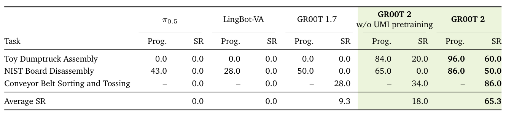

<!-- p.49 S956 -->

Results. With 41 to 75 handheld episodes per task, GR00T 2 reaches 60% and 50% end-to-end success on the two long-horizon tasks, with progress scores of 96 and 86, and sorts 86% of the 50 conveyor items, on a robot never teleoperated for any of these tasks, whereas the baselines 𝜋0.5, LingBot-VA, and GR00T 1.7 complete neither long-horizon task and sort at most 28% of the conveyor items (Tab. 4). The decisive ingredient lies upstream of the recipe: starting from a pretraining checkpoint without UMI data, with identical post-training data, drops success to 20% and 0% on the long-horizon tasks and the share of conveyor items sorted to 34%. A few dozen handheld demonstrations therefore suffice because the embodiments were aligned before post-training began. Sec. E.3 quantifies the three gaps and ablates each component of the recipe.

结果。每项任务使用 41 至 75 条手持片段，GR00T 2 在两项长时序任务上分别达到 60% 和 50% 的端到端成功率，进度得分分别为 96 与 86，并在 50 个传送带物品中分拣出 86%。这台机器人从未针对这些任务接受过遥操作。相比之下，基线 𝜋0.5、LingBot-VA 和 GR00T 1.7 在两项长时序任务上均未完成，分拣的传送带物品至多为 28%（Tab. 4）。决定性因素位于配方的上游：若从不含 UMI 数据的预训练检查点开始，并使用完全相同的后训练数据，则长时序任务的成功率降至 20% 和 0%，分拣比例降至 34%。因此，几十条手持演示就已足够，原因在于各本体在后训练开始之前已经对齐。Sec. E.3 量化了三类差距，并对配方的每个组件做了消融。

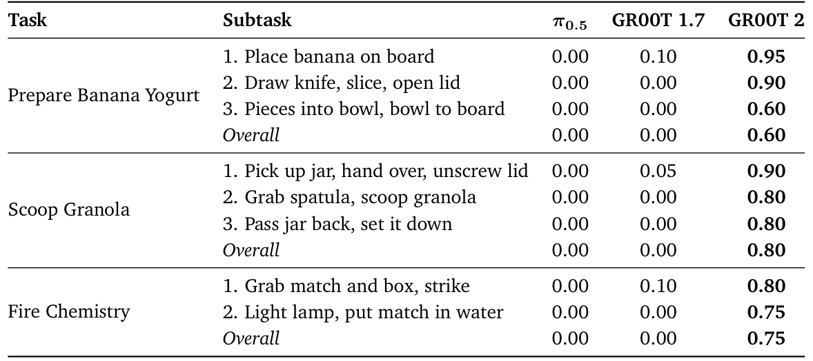

<!-- p.50 C034 · 表 T005 -->

Table 5: DexUMI post-training results. Fraction of real-robot trials that reach the end of each subtask. Overall is the fraction that completes the whole task.

表 5：DexUMI 后训练结果。表示真实机器人试次中到达每个子任务终点的比例。Overall 表示完成整个任务的比例。

## B.3. DexUMI for Complex, Long-Horizon, and Dynamic Post-Training · 面向复杂、长时序与动态后训练的 DexUMI

<!-- p.50 S964 -->

DexUMI (Xu et al., 2025) extends UMI from parallel grippers to five-fingered hands. We use the GEAR DexUMI exoskeleton (NVIDIA GEAR Team, 2026), which replicates the kinematics, contact surfaces, and camera mount of the XHAND1 Pro-U robot hand, so that every recorded finger joint, fingertip force, and camera view has a robot counterpart. Unlike the original DexUMI, which sensed force with force-sensitive resistors and removed the exoskeleton from video with SAM2 and ProPainter, GEAR DexUMI maps its 16 degrees of freedom one-toone onto the robot’s joints (Sec. E.4), measures three-axis fingertip force in the robot hand’s own tactile format, and leaves the video unedited (Sec. E.6). DexUMI provides post-training data for complex, long-horizon, and dynamic dexterous tasks, which GR00T 2 learns with compliance labels derived from fingertip force (Eqs. (1) and (3)).

DexUMI（Xu et al., 2025）把 UMI 从平行夹爪扩展到了五指手。我们使用 GEAR DexUMI 外骨骼（NVIDIA GEAR Team, 2026），它复现了 XHAND1 Pro-U 机器人手的运动学、接触面和相机安装件，因此每一个被记录的手指关节、指尖力和相机视角都在机器人上有对应量。原版 DexUMI 用力敏电阻感知力，并用 SAM2 和 ProPainter 从视频中去除外骨骼；与之不同，GEAR DexUMI 将其 16 个自由度一一映射到机器人关节上（Sec. E.4），以机器人手自身的触觉格式测量三轴指尖力，并保持视频不做编辑（Sec. E.6）。DexUMI 为复杂、长时序且动态的灵巧任务提供后训练数据，GR00T 2 利用由指尖力推导出的柔顺性标签（Eqs. (1) and (3)）来学习这些任务。

<!-- p.50 S965 -->

Because the exoskeleton replicates the robot hand, we post-train GR00T 2 from the GR00T 2 pretraining checkpoint (Sec. E.5) on DexUMI demonstrations alone, without robot play data, and evaluate it on three bimanual tasks on a Tianji robot with two 7-DoF arms and two XHAND1 Pro-U hands (Fig. 30). Prepare Banana Yogurt and Scoop Granola are the two halves of a long make-breakfast task. One policy learns both, and each half is evaluated separately. Fire Chemistry is a short, dynamic tool task: the robot strikes a match, lights a lamp under a flask with it, and puts the match out in water. Each task is scored by subtask:

由于外骨骼复现了机器人手，我们仅使用 DexUMI 演示数据、不使用机器人 play 数据（自由操作数据），从 GR00T 2 预训练检查点（Sec. E.5）出发对 GR00T 2 进行后训练，并在一台配备两条 7 自由度手臂和两只 XHAND1 Pro-U 手的 Tianji 机器人上，评测三项双臂任务（Fig. 30）。准备香蕉酸奶（Prepare Banana Yogurt）与舀取格兰诺拉麦片（Scoop Granola）是一个长时序“做早餐”任务的两半，同一个策略同时学习这两部分，并分别进行评测。火焰化学（Fire Chemistry）是一个短时、动态的工具任务：机器人划燃火柴，用火柴点亮灯下的烧瓶，然后把火柴丢进水中熄灭。每项任务按子任务逐项计分：

<!-- p.50 S966 -->

• Prepare Banana Yogurt: (1) place a banana on the cutting board, (2) draw a knife from the knife block, slice the banana, set the knife down, and lift the lid off a bowl of yogurt, (3) drop the banana pieces into the bowl and move the bowl onto the board in the center of the table. • Scoop Granola: (1) pick up the granola jar, pass it to the other hand, and unscrew its lid, (2) grab a spatula and scoop granola from the jar into the bowl, (3) pass the jar back and set it down on the table. • Fire Chemistry: (1) pull a long match from its holder, pick up the matchbox with the other hand, and strike the match on it, (2) light the lamp with the match and put the match out in a cup of water.

• 准备香蕉酸奶：（1）把香蕉放在切菜板上，（2）从刀座中抽出刀，切开香蕉，放下刀，再掀开一碗酸奶的盖子，（3）把香蕉块放入碗中，并把碗移到桌子中央的切菜板上。• 舀取格兰诺拉麦片：（1）拿起格兰诺拉麦片罐，递给另一只手，并拧开罐盖，（2）拿起铲子，把麦片从罐中舀进碗里，（3）把罐子递回去，放在桌上。• 火焰化学：（1）从火柴架上抽出一根长火柴，另一只手拿起火柴盒，并在盒上划燃火柴，（2）用火柴点亮灯，然后把火柴放入一杯水中熄灭。

<!-- p.50 S967 -->

The tasks combine tool use (a knife, a spatula, and a match), hand-to-hand transfers, contact-rich twisting to unscrew a lid, and a fast strike that must ignite the match.

这些任务综合了工具使用（小刀、铲子和火柴）、手与手之间的传递、用于拧开盖子的富接触旋拧动作，以及必须能点燃火柴的快速击划动作。

<!-- p.50 S968 -->

Baselines and evaluation. We compare GR00T 2 with two vision-language-action models, GR00T 1.7 and 𝜋0.5 (Physical Intelligence et al., 2025). Each starts from its own pretrained model and is post-trained on DexUMI demonstrations of the same tasks with GR00T 2’s data recipe: the same action space, normalization, and prompts. We report the fraction of trials that reach the end of each subtask and the fraction that completes the whole task (Tab. 5).

基线与评测。我们将 GR00T 2 与两个视觉-语言-动作（VLA）模型 GR00T 1.7 和 π0.5（Physical Intelligence et al., 2025）进行比较。每个基线都从其各自的预训练模型出发，并使用 GR00T 2 的数据配方，即相同的动作空间、归一化方式和提示词，在相同任务的 DexUMI 演示数据上进行后训练。我们报告到达每个子任务终点的试次比例，以及完成整个任务的试次比例（Tab. 5）。

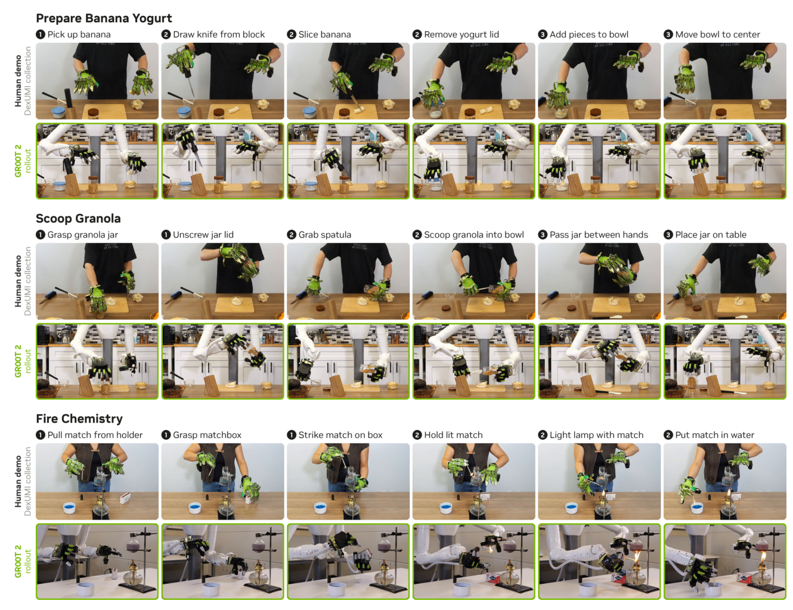

<!-- p.51 C035 · 图 F030 -->

Figure 30: DexUMI tasks. Each block shows one task with six keyframes, numbered by subtask as in Tab. 5: a person demonstrating the task with the DexUMI exoskeletons (top) and a GR00T 2 rollout on a Tianji robot with XHAND1 Pro-U hands (bottom). Prepare Banana Yogurt and Scoop Granola are the two halves of one continuous make-breakfast demonstration and rollout, and every task is demonstrated only with DexUMI.

Figure 30：DexUMI 任务。每个区块展示一项任务的六个关键帧，按 Tab. 5 中的子任务编号排列：上排为人使用 DexUMI 外骨骼演示该任务，下排为 GR00T 2 在配备 XHAND1 Pro-U 手的 Tianji 机器人上的 rollout（轨迹采样）。准备香蕉酸奶与舀取格兰诺拉麦片是一段连续“做早餐”演示与 rollout 的两半，且每项任务都只用 DexUMI 演示。

<!-- p.52 S969 -->

GR00T 2 performs all three tasks from DexUMI demonstrations alone: it completes Prepare Banana Yogurt, Scoop Granola, and Fire Chemistry in 60%, 80%, and 75% of trials, whereas GR00T 1.7 and 𝜋0.5 complete no trial of any task.

GR00T 2 仅凭 DexUMI 演示即可完成全部三项任务：它分别在 60%、80% 和 75% 的试次中完成准备香蕉酸奶、舀取格兰诺拉麦片和火焰化学；而 GR00T 1.7 和 π0.5 在任何任务中都没有完成一次试次。

<!-- p.52 S970 -->

While DexUMI captures detailed data of human manipulation motion, using position label alone is not sufficient to describe the human manipulation strategy. Two more pieces of information are required: the force being applied, and the compliance profile being used. Force encourages forming and maintaining the desired contact modes, while a suitable compliance profile make the manipulation robust against positional uncertainties and even disturbance forces. We adopt the Adaptive Compliance Policy (ACP) (Hou et al., 2025) to give our policy the ability to reason about force and compliance: the DexUMI collected force/motion data are converted offline to stiffness and virtual target labels used to augment the policy action vector. In GR00T 2, we adapt the original ACP formulation for dexterous hands:

尽管 DexUMI 能够捕捉人类操作动作的细节数据，但仅用位置标签不足以描述人类的操作策略，还需要两类信息：所施加的力，以及所用的柔顺性配置（compliance profile）。力有助于形成并维持期望的接触模式，而合适的柔顺性配置使操作能够抵抗位置不确定性，甚至干扰力。我们采用自适应柔顺策略（ACP）（Hou et al., 2025），使策略具备对力和柔顺性进行推理的能力：DexUMI 采集的力/运动数据被离线转换为刚度与虚拟目标标签，用于扩充策略的动作向量。在 GR00T 2 中，我们将原始 ACP 公式改造为适用于灵巧手的形式：

<!-- p.52 S971 -->

Joint space action formulation. The original ACP assumes Cartesian pose as the robot’s action, and works the best when the robot has six or more degrees-of-freedoms (DOFs). For dexterous hands with typically three to five joints per finger, the Cartesian space ACP formulation could produce actions that the hand cannot execute. Instead, we define the ACP action in joint space, including position target, virtual target and stiffness.

关节空间动作表述。原始 ACP 假设机器人的动作为笛卡尔位姿，并且在机器人具有六个或更多自由度（DoF）时效果最好。对于每根手指通常只有三到五个关节的灵巧手，笛卡尔空间的 ACP 表述可能产生手无法执行的动作。因此，我们改为在关节空间中定义 ACP 动作，包括位置目标、虚拟目标和刚度。

<!-- p.52 S972 -->

Joint torque as the unified hand force representation. Different hand or DexUMI hardware may use different force sensing solutions, such as joint torque sensor, force-torque sensor, or tactile sensors. To work with our joint space action, we choose joint torque as the unified force representation for dexterous hands, and project the Cartesian space force measurements, if any, back to the joint space. In the case of the XHAND1 Pro-U, force 𝑓𝑖,𝑡is estimated for each finger 𝑖from the fingertip tactile sensors, with exponential moving average and a 0.1N cutoff. The fingertip force is then projected onto the actuated joints through the robot hand’s Jacobians, where 𝑞𝑡denotes the finger joint configuration, 𝐵maps the actuated joints to the full configuration. We augment the policy action space with the predicted finger joint torque.

以关节力矩作为统一的手部力表示。不同的手或 DexUMI 硬件可能采用不同的力感知方案，例如关节力矩传感器、力-力矩传感器或触觉传感器。为了与关节空间动作配合，我们选择关节力矩作为灵巧手的统一力表示，并将笛卡尔空间的力测量（如果有的话）投影回关节空间。对于 XHAND1 Pro-U，每根手指 𝑖 的力 𝑓𝑖,𝑡 由指尖触觉传感器估计，并经过指数滑动平均和 0.1N 的截止值处理。随后，指尖力通过机器人手的雅可比矩阵（Jacobians）投影到驱动关节上，其中 𝑞𝑡 表示手指关节构型，𝐵 将驱动关节映射到完整构型。我们用预测的手指关节力矩扩充策略动作空间。[公式原文见 p.52]

<!-- p.52 S977 -->

Stiffness and virtual targets. Following ACP, we scale the time-varying per joint stiffness value based on the joint torque magnitude:

刚度与虚拟目标。遵循 ACP，我们根据关节力矩的大小，缩放随时间变化的各关节刚度值：

<!-- p.52 E001 -->

𝐾eff = 𝑠acp 𝑘𝑝, (2)

式 (2) 给出有效刚度 𝐾eff 的计算方式，即默认位置增益 𝑘𝑝 与自适应因子 𝑠acp 的乘积。公式本体：$$𝐾eff = 𝑠acp 𝑘𝑝, (2)$$ [公式原文见 p.52]

<!-- p.52 S978 -->

where 𝑘𝑝is the default position gain of the joint, 𝑠acp is the adaptive factor that falls linearly from 1.0 to 𝑠min = 0.3 as joint torque 𝜏𝑡rises from 0.1 to 0.4 N m, softening the hand under load. The intuition is that large force can only come from rigid contacts, for which the robot needs to exhibit more compliance. With the policy predicting both position and force, the stiffness 2 is computed online, then used to update the position set point. This is the virtual target 𝑎𝑡in ACP:

其中 𝑘𝑝 是该关节的默认位置增益，𝑠acp 是自适应因子，它随关节力矩 𝜏𝑡 从 0.1 增大到 0.4 N m 而线性地从 1.0 下降到 𝑠min = 0.3，从而使手在负载下变软。其直觉是，较大的力只能来自刚性接触，此时机器人需要表现出更强的柔顺性。策略同时预测位置和力之后，刚度 2 被在线计算，再用于更新位置设定点。这就是 ACP 中的虚拟目标 𝑎𝑡。[存疑：“刚度 2”中的 “2” 疑为抽取残缺的符号] [公式原文见 p.52]

<!-- p.52 S985 -->

The hand can achieve the predicted force when tracking the virtual target with the computed stiffness 𝐾eff.

当手以计算得到的刚度 𝐾eff 跟踪虚拟目标时，手即可实现预测的力。[公式原文见 p.52]

## B.4. DexUMI →Tianji + Sharpa · 从 DexUMI 到 Tianji + Sharpa 的迁移

<!-- p.52 S986 -->

GR00T 2 can also learn a task on a dexterous hand from demonstrations recorded with an exoskeleton built for a different hand. The DexUMI exoskeleton replicates the 16-DoF XHAND1 Pro-U hand (Sec. B.3), and the policy runs on the Tianji, a bimanual robot with two 7-DoF arms and two 22-DoF Sharpa hands. Kinematics differ because the Sharpa hand has a different joint layout from the XHAND, with 22 degrees of freedom instead of 16, so the recorded joint angles must be retargeted before they can be used as Sharpa commands. Camera viewpoints differ because the wrist cameras are mounted on the DexUMI wrist during data collection and on the Sharpa wrist during evaluation, and because the head camera is worn by the operator during data collection but fixed on the robot during evaluation. Appearance differs because the demonstrations show the exoskeleton and the operator’s arms.

GR00T 2 还能在灵巧手上学习任务，所用的演示由为另一种手设计的外骨骼录制。DexUMI 外骨骼复现的是 16 自由度的 XHAND1 Pro-U 手（Sec. B.3），而策略运行在 Tianji 上。Tianji 是一台双臂机器人，配备两条 7 自由度手臂和两只 22 自由度的 Sharpa 手。运动学存在差异，因为 Sharpa 手的关节布局与 XHAND 不同，自由度为 22 而非 16，因此录制的关节角在用作 Sharpa 指令之前必须先经过重定向。相机视角也存在差异：采集数据时腕部相机安装在 DexUMI 手腕上，评测时则安装在 Sharpa 手腕上；头部相机在采集数据时由操作员佩戴，评测时则固定在机器人上。外观同样不同，因为演示画面中会出现外骨骼以及操作员的手臂。

<!-- p.53 S988 -->

We evaluate on two tasks. Microscope Slide Dabbing is the chemistry-lab task of the same name in Fig. 26. In Conveyor Package Selection and Tossing, the robot must pick out the packages from mixed objects on a moving belt and toss them into the bin, leaving the other objects untouched on the belt. Each task is demonstrated with 100 DexUMI episodes and co-trained with Tianji + Sharpa play data that contain no demonstration of the target task. We compare against GR00T 1.7 and 𝜋0.5 (Physical Intelligence et al., 2025), post-trained on the same data with the same recipe. GR00T 2 succeeds in 60% and 65% of 20 trials, whereas neither baseline completes a single trial (Tab. 6).

我们在两项任务上进行评测。Microscope Slide Dabbing（显微镜载玻片蘸取）是 Fig. 26 中同名的化学实验室任务。在 Conveyor Package Selection and Tossing（传送带包裹挑选与投掷）中，机器人必须从移动传送带上的混合物体中挑出包裹并投入箱中，同时不触碰传送带上的其他物体。每项任务都用 100 条 DexUMI 演示片段（episode）进行演示，并与不包含目标任务演示的 Tianji + Sharpa play 数据联合训练。我们与 GR00T 1.7 和 π0.5（Physical Intelligence et al., 2025）进行比较，两者在相同数据和相同配方下进行后训练。GR00T 2 在 20 次试次中分别成功 60% 和 65%，而两个基线都没有完成一次试次（Tab. 6）。

<!-- p.53 S989 -->

In the DexUMI experiments above, the exoskeleton replicates the robot hand joint for joint, so the recorded joint angles are used directly as hand commands. This setting corresponds to UMI direct (Sec. E.2). Here we use DexUMI demonstrations on a hand that the exoskeleton does not replicate, the 22-DoF Sharpa hand on the Tianji, which is the robot used in the human-to-robot experiments (Sec. B.1). This setting corresponds to UMI →YAM transfer (Sec. B.2), and it avoids building a separate exoskeleton for each robot hand.

在上文的 DexUMI 实验中，外骨骼与机器人手逐关节一一对应，因此录制的关节角直接用作手部指令，该设定对应于 UMI direct（Sec. E.2）。这里我们则在外骨骼并未复现的手上使用 DexUMI 演示，即 Tianji 上的 22 自由度 Sharpa 手，它也是人到机器人实验中所用的机器人（Sec. B.1）。该设定对应于 UMI →YAM 迁移（Sec. B.2），并且避免了为每种机器人手单独制作外骨骼。

<!-- p.53 S990 -->

The recorded joint angles and fingertip forces correspond to the XHAND. The force labels (Eq. (1)) are computed with the XHAND Jacobians and do not apply to the Sharpa hand, so the policy is trained on joint positions only, and the hand tracks position targets in its admittance mode with fixed gains.

录制的关节角和指尖力对应的是 XHAND。力标签（Eq. (1)）是用 XHAND 的雅可比矩阵计算的，不适用于 Sharpa 手，因此策略仅在关节位置上训练，手则以固定增益在其导纳模式下跟踪位置目标。

<!-- p.53 S991 -->

Fingertip retargeting. We compute fingertip positions from the recorded joint angles with the XHAND forward kinematics and treat them as the fingertip readings of a motion-capture glove. The closed-form geometric solver used for glove teleoperation (Sec. B.1.2) then places the Sharpa fingertips at these positions, with the two hands aligned at the thumb-index pinch point, and solves the 7-DoF arm for the resulting hand pose. The thumb, index, middle, and ring fingertips are matched to their targets, and the pinky follows the alignment of the hand.

指尖重定向。我们用 XHAND 的正向运动学，从录制的关节角计算指尖位置，并把这些位置视为动作捕捉手套的指尖读数。随后，用于手套遥操作的闭式几何求解器（Sec. B.1.2）将 Sharpa 指尖放置到这些位置，并使两只手在拇指-食指捏合点处对齐，再求解 7 自由度手臂，以得到相应的手部位姿。拇指、食指、中指和无名指的指尖与其目标匹配，小指则跟随手部的对齐关系。

<!-- p.53 S992 -->

Wrist-view reprojection. The wrist cameras are mounted differently on the DexUMI and Sharpa wrists, and retargeting also changes the wrist pose. As a result, the Sharpa wrist camera ends up about 31∘away from the DexUMI wrist camera. We calibrate both camera mounts by hand-eye calibration, solving for each camera’s pose relative to the wrist from its image motion and the tracked wrist motion. We then reproject each DexUMI wrist frame into the Sharpa wrist camera, mapping each pixel through a fronto-parallel plane at the depth of the pinch point. During training, random rotations and zooms of the wrist views account for the remaining calibration error.

腕部视角重投影。DexUMI 与 Sharpa 手腕上的腕部相机安装方式不同，而重定向还会改变腕部位姿。因此，Sharpa 腕部相机最终与 DexUMI 腕部相机相差约 31∘。我们通过手眼标定（hand-eye calibration）分别标定两个相机的安装，即根据相机的图像运动与被跟踪的腕部运动，求出每个相机相对于腕部的位姿。随后，我们将每一帧 DexUMI 腕部图像重投影到 Sharpa 腕部相机中：每个像素都通过位于捏合点深度处、与正视平面平行的平面进行映射。训练时，腕部视图的随机旋转和缩放用于吸收剩余的标定误差。

<!-- p.53 S993 -->

Co-training with robot play data. The converted demonstrations use the robot’s 62-D state and action, consisting of relative wrist poses and absolute Sharpa joint positions, as in the human-to-robot pipeline (Sec. B.1.3). We resample them from 45 to 30 Hz and assign them the robot’s embodiment tag, so that they share its action encoder, action decoder, and normalization statistics. They are co-trained with Tianji + Sharpa play data that contain no demonstration of the target task, sampled 75 : 25 for slide dabbing and 50 : 50 for package selection and tossing.

与机器人 play 数据联合训练。转换后的演示使用机器人的 62 维状态与动作，由相对腕部位姿和绝对 Sharpa 关节位置组成，与人到机器人的流程（Sec. B.1.3）保持一致。我们将其从 45 Hz 重采样到 30 Hz，并赋予机器人的本体标签（embodiment tag），从而使其与机器人共享动作编码器、动作解码器和归一化统计量。它们与不包含目标任务演示的 Tianji + Sharpa play 数据联合训练，其中载玻片蘸取任务的采样比为 75 : 25，包裹挑选与投掷任务的采样比为 50 : 50。

<!-- p.53 S995 -->

Evaluation. Microscope Slide Dabbing is scored with the rubric of Sec. B.1.4, and a trial succeeds when it completes every stage. A Conveyor Package Selection and Tossing trial succeeds when the packages are tossed into the bin and no other object is touched. Any human intervention counts as a failure. GR00T 1.7 and 𝜋0.5 each start from their own pretrained model and share the post-training mixture, recipe, and step budget of GR00T 2. We report the fraction of 20 trials per task that complete the whole task (Tab. 6).

评测。Microscope Slide Dabbing 使用 Sec. B.1.4 的评分细则进行评分，试次完成每个阶段即判为成功。Conveyor Package Selection and Tossing 的试次在包裹被投入箱中且未触碰其他物体时判为成功。任何人工干预都计为失败。GR00T 1.7 和 π0.5 各自从其预训练模型出发，并与 GR00T 2 共享后训练数据配比、配方和步数预算。我们报告每项任务 20 次试次中完成整个任务的比例（Tab. 6）。

## B.5. Human →Simulation →Tianji + Sharpa · B.5. 人类 →仿真 →Tianji + Sharpa

<!-- p.53 S996 -->

Despite their broad capabilities, WAMs still struggle with contact-rich dexterous manipulation, such as in-hand object reorientation. Reinforcement learning (RL) in simulation offers a complementary source of skills, including forceful tool use, precise contact interactions, and recovery behaviors that are difficult to demonstrate

尽管 WAM 能力广泛，它们在富接触的灵巧操作上仍然吃力，例如手内物体重定向。强化学习（RL）在仿真中可以提供另一类互补的技能，包括用力的工具使用、精确的接触交互，以及一些难以演示的恢复行为。

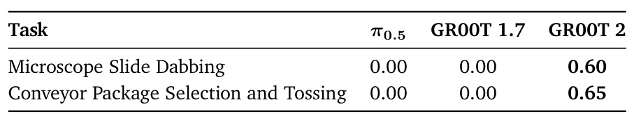

<!-- p.54 C036 · 表 T006 -->

Table 6: DexUMI →Tianji + Sharpa results. Fraction of real-robot trials that complete the whole task, over 20 trials per task. No training data contain a robot trajectory of either task.

表 6：DexUMI →Tianji + Sharpa 的结果。表中为每个任务在 20 次试次中，真机完整完成任务的比例。训练数据中没有任何一项任务的机器人轨迹。

<!-- p.54 S999 -->

reliably through teleoperation or kinematic retargeting. We introduce a human-to-sim-to-real pipeline that enables GR00T 2 to acquire these skills from a single human demonstration video per task.

这些行为很难通过遥操作或运动学重定向可靠地演示出来。我们提出一条人类到仿真再到现实（human-to-sim-to-real）的流程，使 GR00T 2 只需每个任务一段人类演示视频，就能习得这些技能。

<!-- p.54 S1000 -->

Building on NVIDIA’s Video to Data (V2D) (NVIDIA, 2026b) pipeline, we reconstruct 3D object assets, hand– object motion, and contacts from stereo video, then train a state-based RL expert using CHORD (Zhu et al., 2026). We collect expert demonstrations with native simulation rendering, physical and visual randomization, and state perturbations that broaden state coverage and elicit recovery behaviors beyond nominal trajectories. Fig. 16 illustrates the full pipeline.

基于 NVIDIA 的 Video to Data（V2D）（NVIDIA, 2026b）流程，我们从立体视频中重建三维物体资产、手-物体运动和接触，然后使用 CHORD（Zhu et al., 2026）训练一个基于状态的 RL 专家。我们借助原生仿真渲染、物理与视觉随机化，以及状态扰动来采集专家演示。这些状态扰动扩大了状态覆盖范围，并引发超出标称轨迹的恢复行为。Fig. 16 展示了完整流程。

<!-- p.54 S1001 -->

We fine-tune GR00T 2’s diffusion transformer (DiT) on 1.5K simulation episodes, incorporating training-time Real-Time Chunking (RTC) for continuous execution. The resulting policy is deployed zero-shot using RGB observations, robot state, and task instructions, without additional real-world robot data or scene-specific reconstruction or alignment. By expanding one human demonstration into diverse robot rollouts, this approach provides a scalable source of dexterous manipulation data. We hypothesize that GR00T 2’s pretrained priors support compositional generalization: fine-tuning combines simulation-learned contact-rich skills with the perceptual and behavioral knowledge acquired during large-scale pretraining.

我们在 1.5K 个仿真回合（episode）上微调 GR00T 2 的扩散 Transformer（DiT），并引入训练时实时分块（RTC）以实现连续执行。得到的策略以 RGB 观测、机器人状态和任务指令进行零样本部署，无需额外的真实机器人数据，也无需针对具体场景的重建或对齐。通过把一段人类演示扩展为多样的机器人 rollout（轨迹采样），该方法提供了一个可扩展的灵巧操作数据来源。我们假设 GR00T 2 的预训练先验支持组合泛化：微调把仿真中习得的富接触技能，与大规模预训练期间获得的感知和行为知识结合起来。

<!-- p.54 S1002 -->

We evaluate nail hammering, flask handover, and table sweeping, comparing GR00T 2 against GR00T 1.7 and 𝜋0.5. GR00T 2 demonstrates successful transfer of dexterous manipulation skills from simulation to the real world. Although 𝜋0.5 performs well in simulation, its real-world execution is limited to grasping and lifting, with no successful completion of the full tasks, which require subsequent reorientation and object interactions.

我们评测了钉钉子、递交烧瓶和桌面清扫三项任务，并将 GR00T 2 与 GR00T 1.7 和 π0.5 进行比较。GR00T 2 展示了灵巧操作技能从仿真到真实世界的成功迁移。尽管 π0.5 在仿真中表现良好，但其真机执行仅限于抓取和提起，没有一项能完整完成任务，而完整任务还需要后续的重定向和物体交互。

<!-- p.54 S1003 -->

Human and Object Reconstruction. Stable simulation and policy training require accurate, geometrically consistent reconstructions of hand motion, object trajectories, and their contacts. Independent estimates of hands and objects can be inconsistent, particularly when the supplied object mesh differs from the object observed in the video. We use V2D’s agentic pipeline for 4D hand-object reconstruction, coordinating tools such as SAM3 (Carion et al., 2025), FoundationPose (Wen et al., 2024), and GATOR (Wu et al., 2026) for segmentation, object tracking, and hand tracking. To resolve geometric inconsistencies, the reconstructed hands are refined against the supplied object mesh while keeping the mesh and reference object motion fixed. Contact-wrench objectives and geometric checks guide alignment, followed by penetration correction and finger repair. This formulation adapts hand configurations and contact locations to the supplied geometry while targeting the interaction’s mechanical effect on the object. These anchors provide persistent references for downstream robotic grounding. Evaluated on 15 stereo trajectories from SHOW3D (Rim et al., 2026), a dataset of hand-object interactions captured in the wild with annotated 3D hand and object poses, the reconstruction pipeline achieves an average hand reconstruction error of 17.5 mm and an object Chamfer distance of 3.0 mm.

人与物体重建。稳定的仿真与策略训练需要对手部运动、物体轨迹及其接触进行准确且几何一致的重建。手和物体的独立估计可能彼此不一致，尤其是在所给的物体网格与视频中观察到的物体不同时。我们使用 V2D 的智能体化（agentic）流程进行四维（4D）手-物体重建，协调 SAM3（Carion et al., 2025）、FoundationPose（Wen et al., 2024）和 GATOR（Wu et al., 2026）等工具，分别完成分割、物体跟踪和手部跟踪。为解决几何不一致问题，重建得到的手部在保持网格和参考物体运动固定的前提下，相对于所给物体网格进行细化。接触力旋量目标和几何检查引导对齐，随后进行穿透修正和手指修复。该公式使手部构型和接触位置适应所给几何，同时以交互对物体产生的力学效果为目标。这些锚点为下游机器人落地提供持续的参照。在 SHOW3D（Rim et al., 2026）的 15 条立体轨迹上评估（该数据集为真实场景中采集的手-物体交互，带有标注的三维手部与物体位姿），重建流程的平均手部重建误差为 17.5 mm，物体 Chamfer 距离为 3.0 mm。

<!-- p.54 S1004 -->

RL in Simulation. Using the reconstructed object assets and trajectories, we train a state-based RL expert to perform dexterous manipulation in simulation. The policy observes privileged robot and object states and outputs arm and hand joint targets. Training follows CHORD, with a warm-up procedure following SimToolReal (Kedia et al., 2026).

仿真中的强化学习（RL）。利用重建得到的物体资产和轨迹，我们在仿真中训练一个基于状态的 RL 专家来完成灵巧操作。该策略观测特权的机器人与物体状态，输出手臂和手部的关节目标。训练遵循 CHORD，并采用 SimToolReal（Kedia et al., 2026）的预热（warm-up）流程。

<!-- p.54 S1005 -->

We calibrate the simulated robot’s joint dynamics through system identification of stiffness, damping, armature, friction, and delay. To improve robustness to physical variation, we randomize robot dynamics, object properties, and scene geometry during training. We also vary initial robot and object configurations, fixture geometry, and table dimensions, while ensuring valid, collision-free initialization.

我们通过对刚度、阻尼、转子惯量（armature）、摩擦和延迟进行系统辨识，来标定仿真机器人的关节动力学。为提高对物理变化的鲁棒性，训练期间我们随机化机器人动力学、物体属性和场景几何。我们还改变机器人与物体的初始构型、夹具几何和桌面尺寸，同时保证初始化有效且无碰撞。

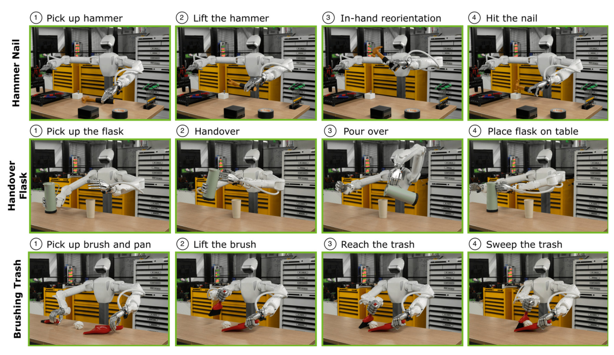

<!-- p.55 C037 · 图 F031 -->

Figure 31: GR00T 2 learns dexterous manipulation through human-to-sim-to-real transfer. Starting from a single human demonstration per task captured with an egocentric stereo camera, the Video-to-Data pipeline generates simulation data for SFT of GR00T 2. The resulting policies transfer zero-shot to the real world on Hammer Nail, Handover Flask, and Brushing Trash, demonstrating dexterous in-hand object reorientation, handover, tool use, and bimanual coordination.

GR00T 2 通过人类到仿真再到现实的迁移学习灵巧操作。每个任务从一段用第一人称视角立体相机（egocentric stereo camera）采集的人类演示出发，Video-to-Data 流程为 GR00T 2 的 SFT 生成仿真数据。所得策略以零样本方式迁移到真实世界，完成敲钉（Hammer Nail）、递交烧瓶（Handover Flask）和扫纸屑（Brushing Trash）三项任务，展示了灵巧的手内物体重定向、递交、工具使用以及双臂协调。

<!-- p.55 S1006 -->

The reward follows CHORD (Zhu et al., 2026) and combines task execution, motion regularization, and contact quality to encourage reliable, human-like tool interactions. Task rewards include keypoint-based tracking of the demonstrated object trajectory, subgoal completion, task progress, and terminal success. Joint-speed penalties regularize motion. Contact rewards use contact wrenches to encourage human-like grasps, improve grasp quality, and sustain object holding. We optimize the policy using a PPO-based SAPG (Singla et al., 2024).

奖励遵循 CHORD（Zhu et al., 2026），综合任务执行、运动正则化和接触质量，以鼓励可靠、类人的工具交互。任务奖励包括基于关键点跟踪演示物体轨迹的奖励、子目标完成、任务进度以及终止时的成功。关节速度惩罚用于正则化运动。接触奖励使用接触力旋量，以鼓励类人的抓取、提高抓取质量并维持对物体的持握。我们使用基于 PPO 的 SAPG（Singla et al., 2024）优化策略。

<!-- p.55 S1007 -->

Harvest Dexterity from Simulation. We convert the RL expert’s skills into demonstrations for supervised fine-tuning (SFT). Each rollout records RGB observations, robot states, expert actions, and task instructions. The privileged tool and goal keypoints available to the RL expert are excluded from GR00T 2’s inputs. We continue to randomize physical properties and scene configurations during collection to capture expert behavior across diverse conditions.

从仿真中获取灵巧性。我们把 RL 专家的技能转化为用于监督微调（SFT）的演示。每条 rollout（轨迹采样）记录 RGB 观测、机器人状态、专家动作和任务指令。RL 专家可用的特权工具关键点与目标关键点不纳入 GR00T 2 的输入。采集过程中，我们持续随机化物理属性和场景配置，以捕获专家在多样条件下的行为。

<!-- p.55 S1008 -->

To broaden state coverage and capture recovery behavior, we introduce random-action bursts, object teleports, and robot-joint teleports during data collection. These perturbations move the system away from nominal trajectories and elicit corrective behavior from the expert. The resulting demonstrations cover states that GR00T 2 may encounter when its own actions deviate, helping mitigate the narrow state coverage and compounding errors observed with naive expert-rollout collection.

为扩大状态覆盖并捕获恢复行为，我们在数据采集时引入随机动作脉冲、物体瞬移和机器人关节瞬移。这些扰动使系统偏离标称轨迹，并引发专家的纠正行为。由此得到的演示覆盖了 GR00T 2 自身动作发生偏差时可能遇到的状态，有助于缓解朴素专家 rollout 采集中观察到的状态覆盖面窄和误差累积问题。

<!-- p.55 S1009 -->

We also randomize visual appearance using native Isaac Lab (Mittal et al., 2025) rendering, without visual inpainting or style transfer models. Randomization covers object and scene colors, textures, material properties, illumination, environment lighting, and camera calibration. Small perturbations to camera poses and intrinsics model calibration uncertainty, while image noise models sensor variation.

我们还使用原生 Isaac Lab（Mittal et al., 2025）渲染对视觉外观进行随机化，未使用视觉补全（inpainting）或风格迁移模型。随机化涵盖物体与场景的颜色、纹理、材质属性、光照、环境照明和相机标定。相机位姿与内参的微小扰动用于模拟标定不确定性，图像噪声则用于模拟传感器差异。

<!-- p.55 S1010 -->

SFT with Simulation Data. We fine-tune GR00T 2 for each task using 1.5k simulation episodes, sourced from one human demonstration video. During SFT, we update the DiT, retain the pretrained action normalization statistics, and freeze the action decoder and video output projection. The fine-tuned policy is deployed zero-shot in the real world using RGB observations, robot state, and a task instruction, with no additional real-world robot data. To support continuous real-time execution of action chunks, we incorporate training-time Real-Time Chunking (RTC).

基于仿真数据的 SFT。我们为每个任务使用 1.5k 个仿真回合微调 GR00T 2，这些回合源自一段人类演示视频。SFT 期间，我们更新 DiT，保留预训练的动作归一化统计量，并冻结动作解码器和视频输出投影。微调后的策略以 RGB 观测、机器人状态和任务指令进行零样本的真实世界部署，不使用额外的真实机器人数据。为支持动作块的连续实时执行，我们引入了训练时实时分块（RTC）。

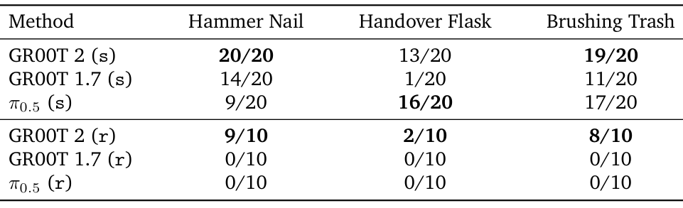

<!-- p.56 C038 · 表 T007 -->

Table 7: GR00T 2 learns dexterous manipulation skills from simulation demonstrations generated from human videos and transfers these skills zero-shot to the real world. Fine-tuned models are evaluated in simulation (s) and the real world (r).

表 7：GR00T 2 从人类视频生成的仿真演示中学习灵巧操作技能，并将这些技能零样本迁移到真实世界。微调后的模型分别在仿真（s）和真实世界（r）中评估。

<!-- p.56 S1014 -->

Learning Tasks with Human-to-Sim-to-Real. We evaluate GR00T 2 on three tasks requiring dexterous manipulation, with success defined as follows:

借助人类到仿真再到现实完成任务学习。我们在三项需要灵巧操作的任务上评估 GR00T 2，成功的定义如下：

<!-- p.56 S1015 -->

• Hammer Nail: The nail is driven into the fixture until its head contacts the fixture’s top surface. • Handover Flask: The flask is lifted off the table, handed over, and tilted to a pouring angle without being dropped. • Brushing Trash: Paper waste is swept into the red dustpan using the brush.

• 敲钉（Hammer Nail）：钉子被敲入夹具，直至钉头接触夹具的顶面。• 递交烧瓶（Handover Flask）：烧瓶被从桌面提起、递交，并倾斜至倾倒角度，且不能掉落。• 扫纸屑（Brushing Trash）：使用刷子将纸质废弃物扫入红色簸箕。

<!-- p.56 S1016 -->

GR00T 2 is deployed with 2 action 1 video denoising steps during inference with RTC enabled at 20 Hz. 𝜋0.5 is deployed with the settings recommended in the official implementation: each inference integrates the flow-matching action expert for 10 steps, and the robot executes the first 8 actions of each predicted 30-step chunk (0.4 s at 20 Hz) before synchronously querying the policy again, with 𝜋0.5 observing only the most recent frame of each camera view.

推理时，GR00T 2 以 2 个动作去噪步和 1 个视频去噪步进行部署，并以 20 Hz 启用 RTC。π0.5 按照官方实现推荐的设置进行部署：每次推理对流匹配动作专家积分 10 步，机器人执行每个预测的 30 步动作块中的前 8 个动作（在 20 Hz 下为 0.4 s），然后同步地再次查询策略；π0.5 仅观测每个相机视角的最新一帧。

<!-- p.56 S1017 -->

We compare against GR00T 1.7 and 𝜋0.5 in both simulation and the real world. Figure 31 shows execution rollouts for each task. Tab. 7 reports the number of successful episodes for each method. With simulation-only post-training, GR00T 2 achieves 20/20, 13/20, and 19/20 full-task successes in simulation on nail hammering, flask handover, and trash sweeping, respectively (Table 7). In real-world evaluation, it completes nail hammering in 9/10 trials and trash sweeping in 8/10 trials, demonstrating zero-shot transfer on both tasks. Both GR00T 1.7 and 𝜋0.5 achieve 0/10 full-task successes on every real-world task despite making intermediate progress. On nail hammering, GR00T 1.7 lifts the hammer in 10/10 trials and completes in-hand reorientation in 6/10 trials, but never drives the nail to the required depth. On trash sweeping, it lifts the brush in 7/10 trials but never completes the sweep. Similarly, 𝜋0.5 lifts the hammer, flask, and brush in 6/10, 4/10, and 9/10 trials, respectively, but completes none of the full tasks. These results distinguish successful grasp acquisition from full task execution, which requires subsequent reorientation and contact interactions. For the Handover Flask task, the high-frequency specialist policy succeeds in the real world. However, the handover requires precise spatiotemporal coordination and contact control, making it particularly sensitive to observation and inference delays.

我们在仿真和真实世界中都将 GR00T 2 与 GR00T 1.7 及 π0.5 进行比较。图 31 展示了每项任务的执行 rollout（轨迹采样）。Tab. 7 报告了每种方法成功的回合数。仅经过仿真后训练时，GR00T 2 在仿真中完成完整任务的成功次数分别为：敲钉 20/20、递交烧瓶 13/20、扫纸屑 19/20（Table 7）。在真实世界评估中，它完成敲钉的试次为 9/10，完成扫纸屑的试次为 8/10，证明了两项任务上的零样本迁移。尽管取得了中间进展，GR00T 1.7 和 π0.5 在每项真实世界任务上的完整任务成功率都是 0/10。在敲钉任务上，GR00T 1.7 在 10/10 次试次中举起了锤子，并在 6/10 次中完成了手内重定向，但从未将钉子敲到所需深度。在扫纸屑任务上，它在 7/10 次中举起了刷子，但从未完成清扫。类似地，π0.5 分别在 6/10、4/10 和 9/10 次试次中举起了锤子、烧瓶和刷子，但没有完成任何一项完整任务。这些结果区分了成功抓取与完整执行任务：后者还需要后续的重定向和接触交互。对于递交烧瓶任务，高频专用策略在真实世界中取得了成功。然而，递交需要精确的时空协调和接触控制，因此对观测和推理延迟尤为敏感。
