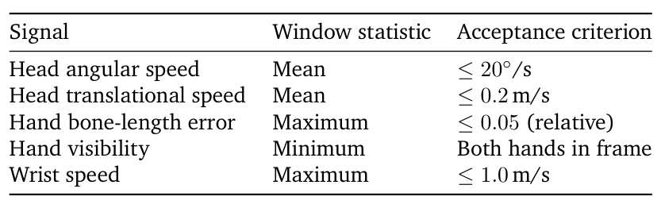
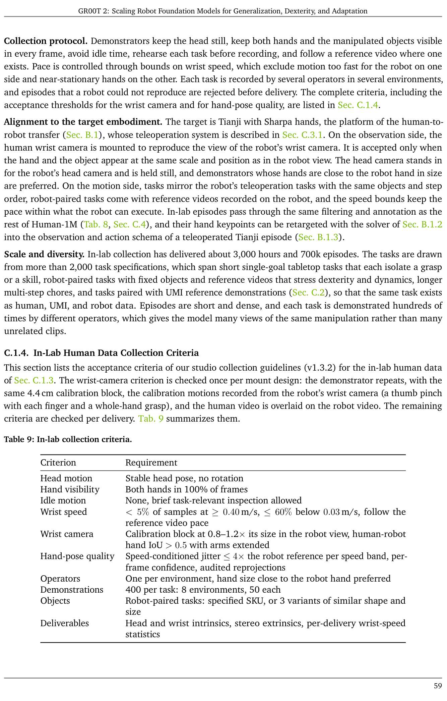
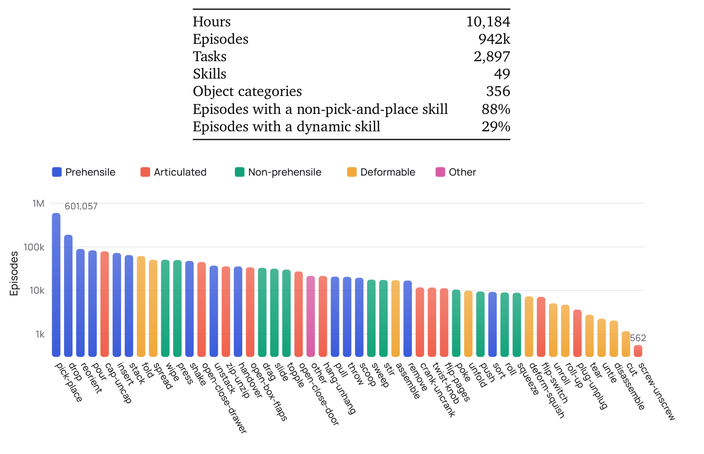
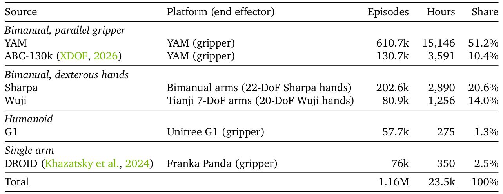
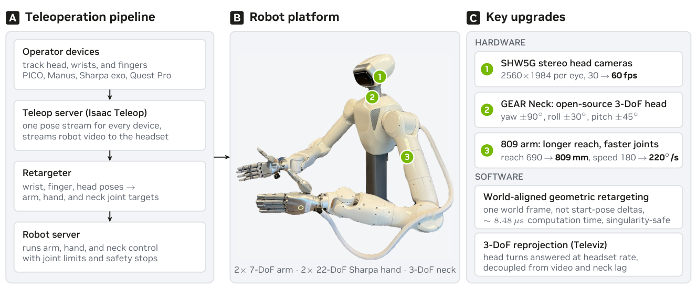

# 附录 C 数据

> **原文** C. Data for GR00T 2　·　起于 p.57　·　本页中英对照：英文段在前，中文段在后。

---

<!-- p.57 S1018 -->

This appendix details the sources and roles of data for GR00T 2 summarized in Sec. 4.2.

本附录详述 Sec. 4.2 概述的 GR00T 2 各数据来源及其作用。

## C.1. Human Data for GR00T 2 · C.1 GR00T 2 的人类数据

<!-- p.57 S1019 -->

Prior work in scaling data for robot learning has showcased emergent transfer and generalization through scaling egocentric data (Kareer et al., 2025; Punamiya et al., 2026; Zheng et al., 2026).

在机器人学习的数据规模化方面，既有工作已经展示了通过扩展第一人称数据而出现的迁移与泛化能力（Kareer et al., 2025; Punamiya et al., 2026; Zheng et al., 2026）。

<!-- p.57 S1020 -->

Human-1M is a large and diverse egocentric dataset curated by NVIDIA, which supplies the large scale human experience data in GR00T 2’s cross embodiment training mixture. Human-1M contains approximately 1 million hours of proficient human labor sensorized with egocentric cameras, dense language annotation, SLAM and hand pose estimation which are filtered down. The collection spans different environments and sensing configurations, including monocular and stereo head cameras and additional wrist views. We additionally incorporate capture setups that bring human observations closer to those of dexterous robots to examine the transfer of human data at various hierarchies.

Human-1M 是 NVIDIA 整理的一个大规模、多样化的第一人称数据集，为 GR00T 2 的跨本体训练配比提供大规模人类经验数据。Human-1M 包含约 100 万小时的熟练人类劳动，用第一人称相机做传感器化记录，并配有密集语言标注、SLAM 与手部位姿估计，随后经过过滤。采集覆盖不同环境与传感配置，包括单目与立体头戴相机，以及额外的腕部视角。我们还引入了使人类观测更接近灵巧机器人观测的采集装置，以考察人类数据在不同层级上的迁移。

<!-- p.57 S1021 -->

C.1.1. Dataset Composition

C.1.1 数据集构成

<!-- p.57 S1022 -->

The Human-1M inventory used within GR00T 2 contains 402,730 hours across approximately 13.75 million episodes, spanning over 51,500 unique collectors and 123,000 scenes.

GR00T 2 中实际使用的 Human-1M 库存包含 402,730 小时、约 1,375 万条 episode，覆盖 51,500 名以上不重复的采集者与 123,000 个场景。

<!-- p.57 S1023 -->

Collection Settings. We collect demonstrations in both natural “in-the-wild” and controlled studio environments. In-the-wild collection captures proficient laborers in economically valuable scenarios across households, industry workplaces, agriculture, commercial kitchens, service, retail, and logistics. Studio collection concentrates on tabletop manipulation under standardized protocols, resembling demonstration style robotics datasets. Studio data comprises of assembly tasks that involve assembling various kits, curated tasks selected to cover target robot skills and task distributions. Within studio data, “in-lab” collection follows a stricter protocol where demonstrators keep both hands in view, avoid idle periods, and perform motions at speeds chosen to match the robot. Approximately 80,000 hours of the total mixture is studio data. These settings serve complementary purposes. Natural environments broaden the range of interactions observed during pretraining for the world-action model, while controlled collection makes it possible to target particular skills and capture them under more consistent conditions for better transfer to the downstream robot embodiments.

采集设置。我们在自然的"野外"环境与受控的影棚环境中都采集演示。野外采集记录熟练劳动者在具有经济价值的场景中的作业，涵盖家庭、工业工作场所、农业、商业厨房、服务业、零售与物流。影棚采集聚焦标准化协议下的桌面操作，形态类似演示风格的机器人数据集。影棚数据由装配任务构成，涉及组装各类套件，以及为覆盖目标机器人技能与任务分布而挑选的定制任务。在影棚数据中，"实验室内"（in-lab）采集遵循更严格的协议：演示者保持双手在视野内、避免空转时段，并以与机器人匹配的速度完成动作。整个配比中约 80,000 小时为影棚数据。这些设置互为补充：自然环境拓宽了世界-动作模型预训练时观察到的交互范围；受控采集则使针对特定技能、在更一致条件下采集成为可能，从而更好地迁移到下游机器人本体。

<!-- p.57 S1024 -->

Egocentric Cameras. The dataset includes monocular and stereo egocentric recordings. Monocular setups use a single head-mounted RGB camera. Stereo setups provide synchronized two camera RGB head views with optional additional multi-view cameras for better hand pose estimation.

第一人称相机。数据集包含单目与立体第一人称录制。单目配置使用单个头戴 RGB 相机。立体配置提供同步的双相机 RGB 头部视角，并可选用额外的多视角相机以改善手部位姿估计。

<!-- p.57 S1025 -->

Wrist Cameras. Approximately 90,000 hours of the collection also includes wrist cameras, which provide close-up views of manipulation and hand-object interactions to reduce partial observability during fine-grained manipulation. Additionally, a portion of the studio data contains robot-aligned wrist viewpoints to address the visual alignment gap.

腕部相机。约 90,000 小时的采集还包含腕部相机，提供操作与手-物交互的近景视角，以减少细粒度操作中的部分可观测性。此外，一部分影棚数据包含与机器人对齐的腕部视角，用以解决视觉对齐差距。

<!-- p.57 S1026 -->

Even when humans and robots perform the same grasp, wrist-camera placement can change the apparent size and orientation of the hand and object, as well as the visibility of their interaction. We studied this alignment process with the Sharpa platform. We screened 13 initial mount designs and conducted a controlled comparison of four mounts across four operators. The human and robot perform the same four thumb-finger grasps and their viewpoints are compared in a 640x480 image frame. The evaluation measured hand-object overlap, object scale, camera-to-object distance, and camera orientation. We further optimized image rotation and scaling for visual alignment, and used ChArUco (Garrido-Jurado et al., 2014) calibration together with directional motions to optimize angular alignment.

即使人与机器人执行同一个抓取，腕部相机的安装位置也会改变手与物体的表观尺寸和朝向，以及二者交互的可见程度。我们用 Sharpa 平台研究了这一对齐过程。我们筛选了 13 种初始安装设计，并在四名操作员上对四种安装座做了受控比较。人与机器人执行同样的四种拇指-手指抓取，并在 640×480 的图像帧中比较二者的视角。评测测量手-物重叠度、物体尺度、相机到物体的距离以及相机朝向。我们进一步优化图像旋转与缩放以实现视觉对齐，并使用 ChArUco（Garrido-Jurado et al., 2014）标定配合定向运动来优化角度对齐。

<!-- p.57 S1027 -->

Annotations. Each egocentric episode contains language annotations along with frame-aligned estimations of hand and head motion following prior work on learning from egocentric human experience (Kareer et al., 2025; Punamiya et al., 2026).

标注。每条第一人称 episode 都包含语言标注，以及与视频帧对齐的手部与头部运动估计，做法沿用从第一人称人类经验中学习的既有工作（Kareer et al., 2025; Punamiya et al., 2026）。

<!-- p.58 S1028 -->

Hand and Camera Pose. Hand motion is represented by 21 three-dimensional keypoints per hand: the wrist and four landmarks along each finger, including the fingertips. Keypoint positions are expressed in meters in the reference head-camera coordinate frame and aligned with the corresponding video frames. Head motion is represented by the six-degree-of-freedom pose of the head-mounted reference camera, estimated using simultaneous localization and mapping (SLAM) in a canonical per episode world frame.

手部与相机位姿。手部运动由每只手 21 个三维关键点表示：腕部，以及每根手指上的四个标志点（含指尖）。关键点位置以米为单位、在参考头戴相机坐标系中表达，并与对应视频帧对齐。头部运动由头戴参考相机的六自由度位姿表示，用同步定位与建图（SLAM）在每条 episode 各自的标准世界坐标系中估计。

<!-- p.58 S1029 -->

Language Annotation. Language describes demonstrations at two levels. Tier 1 (T1) annotations provide a one- to two-sentence episode summary identifying the primary goal, major actions, and key objects. Tier 2 (T2) annotations describe individual actions in contiguous, timestamped segments of 1-10 seconds. Each description is self-contained and specifies the relevant hand, action, and objects. These annotations support language-conditioned learning and task-based data curation. The language annotations are validated by human quality control checks. The highest quality annotations are used for the training mixture of Flora pipeline described in Sec. C.4. The Flora pipeline is then used to further enrich or provide T2 language annotations across the dataset.

语言标注。语言在两个层级上描述演示。第 1 层（T1）标注提供一到两句话的 episode 摘要，指明主要目标、主要动作与关键物体。第 2 层（T2）标注以 1–10 秒的连续、带时间戳的片段描述单个动作。每条描述自包含，并指明相关的手、动作与物体。这些标注支撑语言条件学习与基于任务的数据整理。语言标注经人工质量控制检查验证。质量最高的标注用于 Sec. C.4 所述 Flora 流程的训练配比。随后再用 Flora 流程在整个数据集上进一步丰富或补足 T2 语言标注。

<!-- p.58 S1030 -->

C.1.2. Data Filtering and Quality Control

C.1.2 数据过滤与质量控制

<!-- p.58 S1031 -->

The usefulness of a human demonstration for tabletop manipulation settings depends on both the interaction it contains and the reliability of its recorded motion. We therefore apply quality control at two levels. Batch-level review checks the content and annotations of a delivery, while quantitative filtering selects timesteps with sufficiently stable observations and hand trajectories. Additional details about the quality control are in the accompanying Human-1M dataset release.

一条人类演示对桌面操作场景是否有用，既取决于它包含的交互，也取决于其记录运动的可靠性。因此我们在两个层级上做质量控制。批次级审核检查一次交付的内容与标注；定量过滤则挑选观测与手部轨迹足够稳定的时间步。关于质量控制的更多细节见随 Human-1M 数据集发布的说明。

<!-- p.58 S1032 -->

Human review. Human auditors check language-annotation validity, task quality and idle time as per our collection specs at a 95% per episode pass rate. These criteria screen deliveries before individual training timesteps are selected by the quantitative filters.

人工审核。人工审核员按我们的采集规范检查语言标注有效性、任务质量与空转时间，要求每条 episode 通过率 95%。这些准则在定量过滤器挑选单个训练时间步之前，先对交付批次做筛选。

<!-- p.58 S1033 -->

Quantitative Filtering. At each candidate training timestep, we evaluate a window extending 24 frames into the past and 48 frames into the future. We retain the timestep only if all quality criteria pass over this window. The checks constrain head rotation and translation, hand visibility, consistency of reconstructed bone lengths, and wrist speed (Tab. 8). The bone-length error of a hand in a frame is the median absolute deviation of its 20 finger-bone lengths from their per-episode medians, divided by the mean of those medians, so the threshold of 0.05 corresponds to 5% of the mean bone length.

定量过滤。对每个候选训练时间步，我们评估一个向前 24 帧、向后 48 帧的窗口。只有当全部质量准则在该窗口上都通过时，我们才保留该时间步。检查项约束头部旋转与平移、手部可见性、重建骨长的一致性以及腕部速度（Tab. 8）。某帧中某只手的骨长误差定义为：20 根手指骨长相对其本 episode 中位数的中位绝对偏差，除以这些中位数的均值；因此阈值 0.05 对应平均骨长的 5%。

<!-- p.58 C039 · 表 T008 -->

Table 8: Quantitative criteria for selecting training timesteps.

表 8：用于挑选训练时间步的定量准则。

<!-- p.58 S1036 -->

C.1.3. In-Lab Human Data

C.1.3 实验室人类数据

<!-- p.58 S1037 -->

In-lab data is the part of human data that transfers most directly to a robot policy. Two gaps separate a human demonstration from a robot rollout, and both can be narrowed at collection time rather than left to the model. The observation gap: in-the-wild wrist cameras are not placed with reference to any robot, so the hand appears at a different angle, scale, and position than in the robot’s wrist view, and the model must imagine across this viewpoint change before it can imagine across embodiments (Sec. B.1.5). The motion gap: natural human execution is faster than teleoperated robot execution, interleaves pauses and task-irrelevant gestures, and uses motions the robot hand cannot reproduce. In-lab collection follows our studio collection guidelines, which fix camera placement, motion, and task protocol with the target robot in mind.

实验室数据是人类数据中向机器人策略迁移最直接的那一部分。人类演示与机器人 rollout 之间存在两道差距，而这两道差距都可以在采集时收窄，而不必留给模型。观测差距：野外腕部相机并不是参照某台机器人摆放的，因此手在画面中出现的角度、尺度与位置都与机器人腕部视角不同，模型必须先跨越这一视角变化去想象，然后才能跨越本体去想象（Sec. B.1.5）。运动差距：自然的人类执行比遥操作的机器人执行更快，其间夹杂停顿与与任务无关的手势，并使用机器手无法复现的运动。实验室采集遵循我们的影棚采集指南，该指南在摆放相机、规定动作与任务协议时都以目标机器人为参照。

<!-- p.59 S1038 -->

Collection protocol. Demonstrators keep the head still, keep both hands and the manipulated objects visible in every frame, avoid idle time, rehearse each task before recording, and follow a reference video where one exists. Pace is controlled through bounds on wrist speed, which exclude motion too fast for the robot on one side and near-stationary hands on the other. Each task is recorded by several operators in several environments, and episodes that a robot could not reproduce are rejected before delivery. The complete criteria, including the acceptance thresholds for the wrist camera and for hand-pose quality, are listed in Sec. C.1.4.

采集协议。演示者保持头部静止，使双手与被操作物体在每一帧中都可见，避免空转时间，录制前先排练每个任务，并在存在参考视频时照着参考视频做。节奏通过腕部速度上下界来控制：一端排除对机器人而言过快的运动，另一端排除近乎静止的手。每个任务由多名操作员在多个环境中录制，机器人无法复现的 episode 在交付前即被剔除。完整准则（含腕部相机与手部位姿质量的验收阈值）见 Sec. C.1.4。

<!-- p.59 S1039 -->

Alignment to the target embodiment. The target is Tianji with Sharpa hands, the platform of the human-torobot transfer (Sec. B.1), whose teleoperation system is described in Sec. C.3.1. On the observation side, the human wrist camera is mounted to reproduce the view of the robot’s wrist camera. It is accepted only when the hand and the object appear at the same scale and position as in the robot view. The head camera stands in for the robot’s head camera and is held still, and demonstrators whose hands are close to the robot hand in size are preferred. On the motion side, tasks mirror the robot’s teleoperation tasks with the same objects and step order, robot-paired tasks come with reference videos recorded on the robot, and the speed bounds keep the pace within what the robot can execute. In-lab episodes pass through the same filtering and annotation as the rest of Human-1M (Tab. 8, Sec. C.4), and their hand keypoints can be retargeted with the solver of Sec. B.1.2 into the observation and action schema of a teleoperated Tianji episode (Sec. B.1.3).

与目标本体对齐。目标平台是配 Sharpa 手的 Tianji，即人→机器人迁移所用的平台（Sec. B.1），其遥操作系统见 Sec. C.3.1。在观测方面，人类腕部相机的安装方式被设计成复现机器人腕部相机的视角；只有当手与物体以与机器人视角相同的尺度和位置出现时才被接受。头戴相机代替机器人的头部相机并保持静止，且优先选用手部尺寸接近机器手的演示者。在运动方面，任务镜像机器人的遥操作任务，使用相同物体与相同步骤顺序；与机器人配对的任务附带在机器人上录制的参考视频；速度上下界把节奏限制在机器人可执行的范围内。实验室 episode 与 Human-1M 其余部分一样经过相同的过滤与标注（Tab. 8、Sec. C.4），其手部关键点可用 Sec. B.1.2 的求解器重定向成一条遥操作 Tianji episode 的观测与动作 schema（Sec. B.1.3）。

<!-- p.59 S1040 -->

Scale and diversity. In-lab collection has delivered about 3,000 hours and 700k episodes. The tasks are drawn from more than 2,000 task specifications, which span short single-goal tabletop tasks that each isolate a grasp or a skill, robot-paired tasks with fixed objects and reference videos that stress dexterity and dynamics, longer multi-step chores, and tasks paired with UMI reference demonstrations (Sec. C.2), so that the same task exists as human, UMI, and robot data. Episodes are short and dense, and each task is demonstrated hundreds of times by different operators, which gives the model many views of the same manipulation rather than many unrelated clips.

规模与多样性。实验室采集已交付约 3,000 小时、70 万条 episode。任务取自 2,000 余份任务规范，覆盖：短的单一目标桌面任务（每个只隔离一项抓取或一项技能）；带固定物体与参考视频、施加灵巧性与动力学压力的机器人配对任务；较长的多步骤杂务；以及配有 UMI 参考演示的任务（Sec. C.2），使同一任务同时以人类、UMI 与机器人数据的形式存在。episode 短而密集，每项任务由不同操作员演示数百次，这给模型提供的是同一操作的大量视角，而不是大量互不相关的片段。

<!-- p.59 S1042 -->

This section lists the acceptance criteria of our studio collection guidelines (v1.3.2) for the in-lab human data of Sec. C.1.3. The wrist-camera criterion is checked once per mount design: the demonstrator repeats, with the same 4.4 cm calibration block, the calibration motions recorded from the robot’s wrist camera (a thumb pinch with each finger and a whole-hand grasp), and the human video is overlaid on the robot video. The remaining criteria are checked per delivery. Tab. 9 summarizes them.

本节列出我们影棚采集指南（v1.3.2）中针对 Sec. C.1.3 实验室人类数据的验收准则。腕部相机准则对每种安装设计检查一次：演示者用同一块 4.4 cm 标定块，重复从机器人腕部相机录制的标定动作（与每根手指做拇指捏合，以及整手握持），并把人类视频叠加到机器人视频上。其余准则按每次交付检查。Tab. 9 对其作了汇总。

<!-- p.59 C040 · 表 T009 -->

Table 9: In-lab collection criteria.

表 9：实验室采集准则。

<!-- p.59 S1044 -->

Head motion Stable head pose, no rotation Hand visibility Both hands in 100% of frames Idle motion None, brief task-relevant inspection allowed Wrist speed < 5% of samples at ≥0.40 m/s, ≤60% below 0.03 m/s, follow the reference video pace Wrist camera Calibration block at 0.8–1.2× its size in the robot view, human-robot hand IoU > 0.5 with arms extended Hand-pose quality Speed-conditioned jitter ≤4× the robot reference per speed band, perframe confidence, audited reprojections Operators One per environment, hand size close to the robot hand preferred Demonstrations 400 per task: 8 environments, 50 each Objects Robot-paired tasks: specified SKU, or 3 variants of similar shape and size Deliverables Head and wrist intrinsics, stereo extrinsics, per-delivery wrist-speed statistics

头部运动：头部位姿稳定、无旋转。手部可见性：双手在 100% 的帧中可见。空转动作：无；允许简短的、与任务相关的查看。腕部速度：速度 ≥0.40 m/s 的样本占比 < 5%，速度低于 0.03 m/s 的样本占比 ≤ 60%，并遵循参考视频节奏。腕部相机：标定块在机器人视角中为其尺寸的 0.8–1.2 倍；双臂伸展时人-机器人手部 IoU > 0.5。手部位姿质量：按速度分段的抖动 ≤ 机器人参考的 4 倍；逐帧置信度；重投影经审核。操作员：每个环境一名，优先选择手部尺寸接近机器手者。演示数量：每项任务 400 条，即 8 个环境、每个 50 条。物体：机器人配对任务使用指定 SKU，或 3 个形状与尺寸相近的变体。交付物：头部与腕部内参、立体外参、每次交付的腕部速度统计。

<!-- p.60 S1045 -->

C.1.5. Scaling Human Video

C.1.5 人类视频的规模化

<!-- p.60 S1046 -->

GR00T 2 pretrains on egocentric human video from Human-1M as well as on robot data. To measure how much the human video contributes to robot performance, we train four models that differ in how much human video they see. We test each one on new tasks on Dexter, a bimanual robot with two 7-DoF arms and two 22-DoF Sharpa hands, and on the video rollouts each model generates for the same tasks.

GR00T 2 既在机器人数据上预训练，也在来自 Human-1M 的第一人称人类视频上预训练。为衡量人类视频对机器人性能的贡献有多大，我们训练了四个只在"看到多少人类视频"上不同的模型。我们在 Dexter（一台配两条 7-DoF 手臂和两只 22-DoF Sharpa 手的双臂机器人）的新任务上测试每一个模型，也测试各模型为相同任务生成的视频 rollout。

<!-- p.60 S1047 -->

Setup. The four models share the GR00T 2 architecture and train on the same Dexter teleoperation data with the same recipe. They differ only in the human video they see. The 0% model sees none. The other three start from a common human-video pretraining checkpoint, then continue on 1%, 10%, or 100% of the tasks in the multi-view human video of Human-1M (0.87k, 8.1k, and 84.4k hours after the timestep filters of Tab. 8) and co-train on it with the Dexter data. The 0% model does not have this shared stage, so comparisons with it measure the shared stage and the human share together, whereas the 1%, 10%, and 100% models differ only in the share and the matching training length. Training length is matched in epochs. Each human share is pretrained for about 0.5 epoch of that share, so the larger shares also take more steps, and every model, including the 0% model, is then trained for 3 epochs of the Dexter data, where one epoch passes once over every step of every 30 Hz trajectory. During this stage, the 1%, 10%, and 100% models draw 45% of their training samples from Dexter and 55% from human video, while the 0% model trains on the Dexter data alone. Multi-view human video is recorded with wrist cameras as well as a head camera, like the robot. GR00T 2 itself pretrains on 403k hours of Human-1M. We pick each model’s checkpoint offline with the same rule for all four, without robot evaluation.

设置。四个模型共享 GR00T 2 架构，用相同配方在同一批 Dexter 遥操作数据上训练，只在所看到的人类视频上不同。0% 模型完全看不到人类视频。另外三个从同一个人类视频预训练检查点出发，随后在 Human-1M 多视角人类视频中 1%、10% 或 100% 的任务上继续训练（经 Tab. 8 的时间步过滤后分别为 0.87k、8.1k 与 84.4k 小时），并与 Dexter 数据联合训练。0% 模型没有这个共享阶段，因此与它的比较同时衡量了共享阶段与人类数据份额；而 1%、10%、100% 三个模型只在份额与相应训练长度上不同。训练长度按 epoch 对齐。每个人类份额预训练约 0.5 个该份额的 epoch，因此份额越大步数也越多；随后每个模型（包括 0% 模型）都在 Dexter 数据上训练 3 个 epoch，其中一个 epoch 指把每条 30 Hz 轨迹的每个时间步过一遍。此阶段中，1%、10%、100% 模型的训练样本 45% 来自 Dexter、55% 来自人类视频，而 0% 模型只在 Dexter 数据上训练。多视角人类视频与机器人一样，既有腕部相机也有头部相机。GR00T 2 本身在 403k 小时的 Human-1M 上预训练。四个模型的检查点都用同一规则离线挑选，不做机器人评测。

<!-- p.60 S1048 -->

We test on 72 Dexter tasks, giving each model only the task instruction. 22 of them are out-of-distribution (OOD) tasks. They use objects and pick-and-place skills from Dexter’s training data, with new kinds of instructions such as color, negation, size, order, count, and spatial relations. The other 50 never appear in Dexter’s training data, and 47 of them are in Dexter-50. Each model runs 3 episodes per task, for 864 episodes in total. On each task, the four models run back to back on the same station and scene, in the order 0%, 1%, 10%, 100%. One operator grades all of them on whether the task’s end state is reached. We also score task progress, the fraction of the task completed, with a vision-language model on the real robot rollout video from the head and both wrist cameras.

我们在 72 项 Dexter 任务上测试，只给每个模型任务指令。其中 22 项是分布外（OOD）任务：它们使用 Dexter 训练数据中的物体与抓取-放置技能，但指令类型是新的，例如颜色、否定、尺寸、顺序、计数与空间关系。另外 50 项从未出现在 Dexter 的训练数据中，其中 47 项属于 Dexter-50。每个模型在每项任务上运行 3 条 episode，共 864 条。每项任务上，四个模型在同一工位、同一场景上按 0%、1%、10%、100% 的顺序背靠背运行。由同一名操作员判定它们是否达到任务的终止状态。我们还用视觉语言模型基于头部与双腕相机的真机 rollout 视频，给任务进度（任务完成的比例）打分。

<!-- p.60 S1049 -->

GR00T 2 also predicts video, so we evaluate the same 72 tasks without a robot as well. From 3 recorded start scenes per task, each model generates video rollouts for the task instruction with 10 generation seeds, for 2,160 videos per model. The same vision-language model judges whether a rollout performs the commanded action on the target object (video success) and scores its task progress with the same prompt as the real episodes.

GR00T 2 还会预测视频，因此我们也在没有机器人的情况下评测同样的 72 项任务。从每项任务 3 个录制的起始场景出发，每个模型针对任务指令以 10 个生成种子生成视频 rollout，每个模型共 2,160 段视频。同一个视觉语言模型判定某段 rollout 是否对目标物体执行了被指令的动作（视频成功），并用与真机 episode 相同的提示词为其任务进度打分。

<!-- p.60 S1050 -->

Results. All four metrics rise with the amount of human video (Fig. 10). On the robot, success goes from 18% without human video to 27%, 28%, and 41% with 1%, 10%, and 100%, and task progress from 50% to 58%, 61%, and 70%. In video rollouts, success goes from 30% to 33%, 38%, and 51%, and task progress from 64% to 66%, 72%, and 77%. Using all of the multi-view human video instead of none raises success on the robot by 23.1 points (95% confidence interval 13.4 to 33.3, paired over tasks) and task progress by 20.1 points (12.3 to 27.9). In video rollouts it raises success by 21.3 points (14.3 to 28.2) and task progress by 12.4 points (7.8 to 17.1).

结果。四项指标都随人类视频量上升（Fig. 10）。真机上，成功率从无人类视频时的 18% 升到 1%、10%、100% 时的 27%、28%、41%，任务进度从 50% 升到 58%、61%、70%。在视频 rollout 中，成功率从 30% 升到 33%、38%、51%，任务进度从 64% 升到 66%、72%、77%。使用全部多视角人类视频（而非完全不用）使真机成功率提高 23.1 个百分点（95% 置信区间 13.4 至 33.3，按任务配对），任务进度提高 20.1 个百分点（12.3 至 27.9）。在视频 rollout 中，成功率提高 21.3 个百分点（14.3 至 28.2），任务进度提高 12.4 个百分点（7.8 至 17.1）。

<!-- p.60 S1051 -->

From 1% to 100%, task progress on the robot gains about 6 points for each tenfold increase in human video (2.5 to 9.6), and video success about 9 points (5.9 to 12.0). The step from 10% to 100% is clear on every metric. On the robot, success gains 12.5 points (4.2 to 21.3). The step from 1% to 10% is within noise on the robot (success +0.9 and progress +3.2 points), but shows in video rollouts (success +4.7 points, 0.1 to 9.4, and progress +6.2 points, 2.6 to 9.9), which average 30 rollouts per task instead of 3. None of the metrics levels off at 100%, which suggests that more human video would help further. Each data share is a single training run, so the error bars show how much the results vary across repeated rollouts, not across training runs.

从 1% 到 100%，人类视频每增加十倍，真机任务进度约提升 6 个点（2.5 至 9.6），视频成功率约提升 9 个点（5.9 至 12.0）。从 10% 到 100% 这一步在每一项指标上都清晰可见：真机成功率提升 12.5 个点（4.2 至 21.3）。从 1% 到 10% 这一步在真机上处于噪声范围内（成功率 +0.9、任务进度 +3.2 个点），但在视频 rollout 中显现出来（成功率 +4.7 个点，0.1 至 9.4；任务进度 +6.2 个点，2.6 至 9.9）——视频 rollout 每项任务平均有 30 条，而真机只有 3 条。没有任何指标在 100% 处趋于饱和，这提示更多人类视频还会带来进一步收益。每个数据份额只对应一次训练运行，因此误差棒反映的是重复 rollout 之间的波动，而不是训练运行之间的波动。

<!-- p.61 C041 · 表 T010 -->

Table 10: UMI-10K for GR00T 2. Gripper UMI episodes in the pretraining corpus.

表 10：供 GR00T 2 使用的 UMI-10K。预训练语料中的夹爪 UMI episode。

<!-- p.61 C042 · 图 F032 -->

Figure 32: Skill distribution of the Gripper UMI corpus. Episodes per skill on a logarithmic scale, colored by skill group. An episode counts toward every skill its instruction exercises. Pick-and-place is the most common skill, but 88% of episodes also exercise at least one other skill.

图 32：夹爪 UMI 语料的技能分布。每项技能的 episode 数（对数刻度），按技能组着色。一条 episode 计入其指令所涉及的每一项技能。抓取-放置是最常见的技能，但 88% 的 episode 还涉及至少一项其他技能。

## C.2. UMI-10K for GR00T 2 · 面向 GR00T 2 的 UMI-10K 数据

<!-- p.61 S1110 -->

Scale. The Gripper UMI corpus (App. E) contributes 942k quality-controlled episodes and 10,184 hours of bimanual parallel-gripper demonstrations across 2,897 tasks to GR00T 2 pretraining (Tab. 10). The corpus is built for breadth, focusing on short to mid-horizon tasks with wide behavior coverage, rather than depth on a few specialized tasks: no task accounts for more than 1.2% of the hours, and the instructions span 356 object categories and 49 skills in our manipulation vocabulary.

规模。Gripper UMI 语料（App. E）为 GR00T 2 预训练贡献了 942k 条经质量控制的片段（episode），共 10,184 小时的双臂平行夹爪演示数据，覆盖 2,897 项任务（Tab. 10）。该语料以广度为目标，重点是覆盖多种行为的短到中等时序任务，而非深耕少数专门任务：没有任何一项任务占比超过总时长的 1.2%，指令涵盖 356 个物体类别，以及我们操作词表中的 49 项技能。

<!-- p.61 S1111 -->

Task distribution. We characterize the corpus by tagging every task instruction with a 49-skill vocabulary organized in four groups by manipulation and object type: prehensile, non-prehensile, articulated, and deformable, the same vocabulary that drives task generation (below). The skill distribution is shown in (Fig. 32): pick-and-place appears in 64% of episodes, while 88% of episodes also exercise at least one other skill to ensure diversity and complexity of actions captured. 29% of episodes involve a dynamic skill such as throwing, toppling, shaking, or sweeping, and 17% involve a precision skill such as insertion or capping. Articulated-object skills, drawers, lids, zippers, box flaps, doors, knobs, and cranks, appear in 29% of episodes, and deformable-object skills, folding, spreading, rolling, tearing, and tying, in 15%. Tasks are graded into three difficulty tiers along two axes, the number of sequential subgoals and the share of more complex motion beyond pick-and-place, which both increase with difficulty tier. By hours, 41% of the corpus is simple (two or more subgoals, any motion), 38% moderate (three or more state-dependent subgoals with at least one non-pickand-place skill), and 21% complex (four or more state-dependent subgoals dominated by non-pick-and-place skills).

任务分布。我们用一个 49 项技能词表为每条任务指令打标签，该词表按操作方式和物体类型分为四组：可抓取型（prehensile）、非抓取型（non-prehensile）、铰接型（articulated）和可变形型（deformable），与下文驱动任务生成的词表相同。技能分布见（Fig. 32）：抓放（pick-and-place）出现在 64% 的片段中，同时 88% 的片段还至少包含另一项技能，以保证所采集动作的多样性与复杂度。29% 的片段涉及投掷、推倒、摇晃或扫动等动态技能；17% 涉及插入或盖帽等精密技能。铰接物体技能（抽屉、盖子、拉链、箱盖、门、旋钮和摇柄）出现在 29% 的片段中，可变形物体技能（折叠、铺展、卷起、撕扯和打结）出现在 15% 的片段中。任务按两个维度分为三个难度等级：连续子目标的数量，以及超出抓放的更复杂运动所占的比例，二者均随难度等级递增。按时长计，语料中 41% 为简单任务（两个或以上子目标，任意运动），38% 为中等任务（三个或以上依赖状态的子目标，且至少包含一项非抓放技能），21% 为复杂任务（四个或以上依赖状态的子目标，以非抓放技能为主）。[存疑：原文 “non-pickand-place” 疑为 “non-pick-and-place” 的断行抽取错误，中文按原意译出。]

<!-- p.61 S1113 -->

Task design. Tasks are generated using a language-model based agent which pairs skills from the vocabulary

任务设计。任务由基于语言模型的智能体生成，该智能体从词表中配对技能。[存疑：原文在此处截断，句子在 S1120 续接。]

<!-- p.62 C043 · 表 T011 -->

Table 11: Robot teleoperation data in the GR00T 2 pretraining mixture. Share is the fraction of robot-data samples drawn from each source.

表 11：GR00T 2 预训练数据配比中的机器人遥操作数据。Share 为从各数据源抽取的机器人数据样本所占的比例。

<!-- p.62 S1120 -->

with objects from an object inventory into task templates, which are linted, deduplicated against every existing task. A human then inspects each task and manually accepts or rejects it. Each template is instantiated into concrete tasks by sampling different object, count, color, and position, which yields counterfactual pairs that share a scene but differ in one attribute of the instruction, and each generation round under-samples skills that are already common. The result is broad compositional coverage: 2,798 distinct skill-object pairs, with 70% of the top-24-skill by top-30-object grid populated.

将物体清单中的物体填入任务模板，这些模板经过规范检查，并与所有已有任务做去重。随后由人工逐条检查任务，并手动接受或拒绝。每个模板通过采样不同的物体、数量、颜色和位置被实例化为具体任务，由此得到的反事实对共享同一场景，但指令中只有一个属性不同；每一轮生成也会对已经常见的技能进行欠采样。最终形成了广泛的组合覆盖：共 2,798 种不同的技能-物体对，在由前 24 项技能与前 30 个物体构成的网格中，有 70% 的格子被填充。

<!-- p.62 S1121 -->

Quality control. Every episode passes a three-stage quality pipeline before it enters the corpus. First, an autonomous station-side check rejects recordings with uneven frame timing, dropped frames, or tracking and gripper faults at the point of capture. Second, an agentic QC pipeline reviews each remaining episode from its videos and instruction and scores four aspects: task completion (every step of the instruction is carried out on the objects, counts, and targets the instruction names, and the result is left in the specified state), motion quality (no micro-adjustments, jerky or abrupt movements, or idle hesitation), scene validity (a clean workspace without distracting or occluding objects or people), and view quality (both grippers and the task area visible in every camera); an episode is rejected on any critical failure or on a low aspect score. Third, human reviewers audit the agent’s verdicts on sampled and disputed episodes against a golden set, and their corrections feed back into the judge. Together these stages filter out roughly a quarter of recorded episodes (about 11% at the station and 16% at the agentic gate), so the corpus contains only clean, instruction-faithful demonstrations whose motion reflects natural human manipulation: the 95th-percentile gripper speed within an episode is 0.28 m/s on each arm, and peak speeds exceed 0.68 m/s in a tenth of the episodes.

质量控制。每条片段在进入语料前都要经过三阶段质量流水线。第一，工位端的自动检查会在采集时直接剔除帧时间不均匀、丢帧，或跟踪与夹爪故障的录制。第二，智能体化的 QC 流水线根据视频和指令审查每条剩余片段，并对四个方面打分：任务完成度（指令中的每一步都在指令所指定的物体、数量和目标上执行，且结果保持在指定状态）、动作质量（没有微调、抖动或突兀动作，也没有空闲迟疑）、场景有效性（工作区整洁，没有分散注意力或遮挡的物体或人员），以及视角质量（每个相机中都能看到两个夹爪和任务区域）。只要出现任何关键失败或某一方面得分过低，片段即被剔除。第三，人工审核员针对抽检和有争议的片段，对照黄金集（golden set）审核智能体的判定，其修正结果会反馈给判定器（judge）。这些阶段合计过滤掉约四分之一的录制片段（工位端约 11%，智能体关卡约 16%），因此语料中只保留干净、与指令一致的演示，其动作体现了人类自然的操作方式：片段内夹爪速度的第 95 百分位在每条手臂上为 0.28 m/s，十分之一的片段峰值速度超过 0.68 m/s。

## C.3. Teleoperation Data for GR00T 2 · 面向 GR00T 2 的遥操作数据

<!-- p.62 S1123 -->

GR00T 2 pretrains on about 23.5k hours and 1.16M episodes of teleoperation from six sources. They span bimanual parallel-gripper arms, bimanual arms with dexterous hands, a humanoid, and a single-arm manipulator (Tab. 11).

GR00T 2 在来自六个数据源的约 23.5k 小时、1.16M 条遥操作片段上进行预训练。这些数据涵盖双臂平行夹爪机械臂、带灵巧手的双臂机械臂、一台人形机器人，以及一台单臂操作器（Tab. 11）。

<!-- p.62 S1124 -->

Embodiments and sources. Bimanual parallel-gripper data come from YAM arms and make up the largest block: 18.7k hours covering a broad range of household and tabletop tasks, including 3.6k hours from ABC- 130k (XDOF, 2026). Dexterous data come from bimanual arms with multi-fingered hands. The Sharpa data (22-DoF Sharpa hands) cover 2.9k hours, and Wuji (20-DoF Wuji hands on 7-DoF Tianji arms) adds 1.3k hours. Humanoid data come from the Unitree G1 (App. H), and DROID (Khazatsky et al., 2024) contributes single-arm Franka data from 564 scenes. Every bimanual platform records a head or top-down view and two wrist views.

本体与数据来源。双臂平行夹爪数据来自 YAM 机械臂，是占比最大的部分：18.7k 小时，覆盖广泛的家庭与桌面任务，其中包括来自 ABC-130k（XDOF, 2026）的 3.6k 小时。灵巧数据来自配备多指手的双臂机械臂。Sharpa 数据（22-DoF Sharpa 手）覆盖 2.9k 小时，Wuji（7-DoF Tianji 机械臂上装配的 20-DoF Wuji 手）增加了 1.3k 小时。人形机器人数据来自 Unitree G1（App. H），DROID（Khazatsky et al., 2024）则提供来自 564 个场景的单臂 Franka 数据。每个双臂平台都记录一路头部或俯视视角，以及两路腕部视角。

<!-- p.63 C044 · 图 F033 -->

Figure 33: Teleoperation system for Tianji + Sharpa. (A) Teleoperation pipeline from operator devices to the robot. The retargeter is the solver used for human-data conversion. (B) Robot platform: Tianji arms, Sharpa hands, and the GEAR Neck. (C) Key upgrades: hardware, numbered at their location in (B), and software.

图 33：Tianji + Sharpa 的遥操作系统。（A）从操作员设备到机器人的遥操作流水线。重定向器（retargeter）是用于人类数据转换的求解器。（B）机器人平台：Tianji 机械臂、Sharpa 手和 GEAR Neck。（C）关键升级：硬件（编号位置对应（B）中的位置）和软件。

<!-- p.63 S1140 -->

Mixture. Sampling shares are set per source rather than in proportion to hours (Tab. 11). YAM holds 64% of robot hours but receives 51% of samples. The dexterous Sharpa and Wuji data together hold 18% of hours and receive 35% of samples.

数据配比。采样占比按数据源分别设定，而非按时长比例分配（Tab. 11）。YAM 占机器人时长的 64%，却只获得 51% 的样本。灵巧类的 Sharpa 与 Wuji 数据合计占时长的 18%，获得 35% 的样本。

<!-- p.63 S1141 -->

C.3.1. In-Lab Teleoperation System for Tianji + Sharpa

C.3.1. 实验室内 Tianji + Sharpa 遥操作系统

<!-- p.63 S1142 -->

The sources in Tab. 11 form the pretraining mixture. In addition, we collect robot data in our lab, mainly for post-training, with the Tianji + Sharpa teleoperation system in Fig. 33. It shares its devices and retargeting with the human-data pipeline (Sec. B.1.1 and B.1.2) and collects, for example, the task-agnostic play data used to learn new tasks without teleoperation (Sec. B.1.3) and the 1 or 10 target-task demonstrations added for comparison (Sec. B.1.4).

Tab. 11 中的数据源构成预训练数据配比。此外，我们主要为后训练在实验室中采集机器人数据，所用的是 Fig. 33 中的 Tianji + Sharpa 遥操作系统。该系统与人类数据流水线共享设备和重定向（Sec. B.1.1 和 B.1.2），例如采集用于在无需遥操作的情况下学习新任务的任务无关自由玩耍（play）数据（Sec. B.1.3），以及为对比而添加的 1 条或 10 条目标任务演示（Sec. B.1.4）。

<!-- p.63 S1143 -->

Platform and pipeline. Tianji + Sharpa pairs two 7-DoF Tianji arms with two 22-DoF Sharpa Wave hands. A longer upper arm (288 to 400 mm) recovers the workspace in front of the chest, and a 220 ∘/s joint limit keeps up with human wrist motion. A teleoperation server ingests all devices through Isaac Teleop, a retargeter maps them to arm and hand commands, and a robot server executes them.

平台与流水线。Tianji + Sharpa 将两台 7-DoF Tianji 机械臂与两只 22-DoF Sharpa Wave 手配对。更长的大臂（288 至 400 mm）可恢复胸前的工作空间，220 ∘/s 的关节限速则能跟上人手腕部的运动。遥操作服务器通过 Isaac Teleop 接入所有设备，重定向器将其映射为机械臂与手部指令，机器人服务器负责执行这些指令。

<!-- p.63 S1144 -->

Active head without motion sickness. The cameras ride on the GEAR Neck, our open-source 3-DoF neck that follows the headset, and stream at 60 fps for lower latency and less blur. A moving head camera normally causes motion sickness, because the image lags the operator’s head turn by the capture, transport, and neck delay. Our 3-DoF reprojection in Televiz renders each frame at its capture-time orientation and lets the headset re-render it against the current head pose at its own rate, so head rotation is answered locally and end-to-end latency no longer drives operator comfort.

无晕动症的主动头部。相机安装在 GEAR Neck 上，这是我们开源的 3-DoF 颈部，跟随头显运动，并以 60 fps 串流，以降低时延和模糊。移动的头部相机通常会引起晕动症，因为图像会因采集、传输和颈部延迟而落后于操作员的头部转动。我们在 Televiz 中的 3-DoF 重投影会以采集时的姿态渲染每一帧，并让头显以自身的速率、依据当前头部位姿重新渲染该帧，因此头部转动可以在本地响应，端到端时延不再决定操作员的舒适度。

## C.4. Data Annotations · C.4. 数据标注

<!-- p.63 S1145 -->

We built Flora (Leng et al., 2026), the data engine that annotates training data for GR00T 2 models. Flora consists of three models: Flora-TempSeg localizes actions in time, Flora-Captioner describes each localized action, and Flora-Rewarder produces outcome, dense, and rubric-based rewards. They are trained on opensource, licensed, and in-house data, where human annotators provide dense timestamped captions and action-quality labels under detailed labeling guidelines. The same models label human egocentric video and robot recordings from parallel-gripper and dexterous-hand embodiments, with one or more synchronized camera views.

我们构建了 Flora（Leng et al., 2026），这是为 GR00T 2 模型标注训练数据的数据引擎。Flora 由三个模型组成：Flora-TempSeg 在时间上定位动作，Flora-Captioner 为每个定位后的动作生成描述，Flora-Rewarder 产生结果奖励、稠密奖励以及基于评分量表的奖励。这些模型在开源数据、授权数据和内部数据上训练，其中人工标注员依据详细的标注指南，提供带时间戳的稠密字幕和动作质量标签。同一批模型还为来自平行夹爪本体和灵巧手本体、带有一个或多个同步相机视角的人类第一人称视角（egocentric）视频与机器人录制数据加注标签。

<!-- p.64 S1146 -->

Timestamped captions. Given an episode video, Flora outputs a set of time intervals, each paired with a caption of the action performed in it. Flora-TempSeg runs on overlapping windows and predicts the start and end time of each action in a window, together with flags that mark actions continuing past the window edges. These predictions are mapped to episode time and stitched into episode-level intervals, while concurrent actions, such as two hands doing different things, remain separate intervals. Flora-Captioner then captions each interval independently. In addition to the frames of the interval, it sees frames from the neighboring actions before and after it, which help resolve object identity and intent, while the caption describes only the target interval. Synchronized camera views are tiled into one image per time step. Each caption is a self-contained imperative instruction that names the intended action, the objects, the role of each hand or arm, and relevant spatial relations, for example “hold tea leaves with right hand, pass tea leaves to left hand”. Failed attempts are captioned with their intended goal, without implying success. Both models are first fine-tuned on human-annotated captions and then trained with GRPO (Shao et al., 2024) on verifiable rewards: temporal F1 and boundary accuracy for Flora-TempSeg, and reference-grounded coverage of caption requirements with a penalty for factual errors for Flora-Captioner.

带时间戳的字幕。给定一段片段视频，Flora 输出一组时间区间，每个区间配有一条对该区间内所执行动作的描述。Flora-TempSeg 在重叠的窗口上运行，预测窗口内每个动作的起止时间，并附带标记，指示动作是否延续到窗口边缘之外。这些预测被映射回片段时间，并拼接成片段级区间；同时发生的动作（例如双手分别做不同的事）仍保持为独立区间。随后，Flora-Captioner 独立地为每个区间生成描述。除该区间的帧之外，它还能看到其前后相邻动作的帧，这些帧有助于确定物体身份与意图，而描述只针对目标区间。同步的相机视角在每个时间步被拼接成一张图像。每条描述都是自包含的祈使句指令，写明预期动作、涉及的物体、每只手或手臂的角色以及相关的空间关系，例如“用右手拿茶叶，把茶叶递给左手”。失败的尝试会按其预期目标进行描述，且不暗示成功。两个模型都先在人工标注的字幕上进行微调，然后以可验证的奖励通过 GRPO（Shao et al., 2024）训练：Flora-TempSeg 的奖励为时序 F1 与边界精度，Flora-Captioner 的奖励为对字幕要求的参考对齐覆盖度，并对事实性错误施加惩罚。

<!-- p.64 S1147 -->

Quality and cost. On WGO-Bench (Macrodata Labs, 2026), Flora achieves the best temporal segmentation F1 of all evaluated models, 50.3 versus 46.0 for the next-best model, GPT-6 Astra (OpenAI, 2026). On our 300-episode in-house captioning benchmark, it leads all models on human episodes and ranks second to Astra on robot episodes.

质量与成本。在 WGO-Bench（Macrodata Labs, 2026）上，Flora 取得了所有被评测模型中最佳的时序分割 F1，为 50.3，而次优模型 GPT-6 Astra（OpenAI, 2026）为 46.0。在我们内部的 300 个片段字幕基准上，它在人类片段上领先所有模型，在机器人片段上仅次于 Astra，排名第二。

<!-- p.64 S1148 -->

Annotating GR00T 2 data. For GR00T 2, Flora turns raw episodes into training-ready supervision. These instructions provide fine-grained language conditioning for pretraining. At the production rate above, relabeling the roughly 400k hours of Human-1M data used by GR00T 2 takes about two days.

为 GR00T 2 标注数据。对于 GR00T 2，Flora 将原始片段转化为可直接用于训练的监督信号。这些指令为预训练提供细粒度的语言条件。按上文所述的生产速率，为 GR00T 2 重新标注其所用的约 400k 小时 Human-1M 数据，大约需要两天。
