# 附录 E UMIverse

> **原文** E. UMIverse for GR00T 2　·　起于 p.73　·　本页中英对照：英文段在前，中文段在后。

---

<!-- p.73 S1367 -->

UMIverse is our family of robot-free interfaces that record human demonstrations in a robot’s own sensory and action space. Gripper UMI is a handheld parallel gripper in the lineage of the Universal Manipulation Interface (Chi et al., 2024): it carries the robot’s wrist cameras and measures the gripper width that the robot later commands. DexUMI (Xu et al., 2025) is a wearable hand exoskeleton that replicates the kinematics, contact surfaces, and camera mount of a dexterous robot hand, so that every recorded finger joint, fingertip force, and camera view has a robot counterpart. Our GEAR DexUMI (NVIDIA GEAR Team, 2026) replicates the XHAND1 Pro-U (Sec. E.4). Unlike teleoperation, neither interface needs a robot during collection. Unlike human video, both record actions in robot coordinates and observations through robot cameras.

UMIverse 是我们的一族无需机器人的接口，用于在机器人自身的感知空间与动作空间中记录人类演示。Gripper UMI 是一款手持式平行夹爪，属于通用操作接口（Universal Manipulation Interface）（Chi et al., 2024）的谱系：它搭载机器人的腕部相机，并测量机器人随后要下达指令的夹爪宽度。DexUMI（Xu et al., 2025）是一种可穿戴的手部外骨骼，复现了灵巧机器人手的运动学、接触面与相机安装位置，因此每一个被记录的手指关节、指尖力与相机视角，在机器人侧都有对应量。我们的 GEAR DexUMI（NVIDIA GEAR Team, 2026）复现的是 XHAND1 Pro-U（Sec. E.4）。与遥操作不同，这两种接口在采集过程中都不需要机器人。与人类视频也不同，两者都以机器人坐标记录动作，并通过机器人相机记录观测。

<!-- p.73 S1368 -->

The two interfaces play complementary roles in GR00T 2. Gripper UMI provides scale: collection stations in three regions supply thousands of hours of bimanual pretraining demonstrations, and the resulting policies deploy directly onto a matching robot (Sec. E.2) or transfer across an embodiment gap to YAM (Sec. B.2), a test of the cross-embodiment imagination that GR00T 2 is built for. DexUMI provides depth: post-training data for complex, long-horizon, and dynamic dexterous tasks (Sec. B.3), which GR00T 2 learns with compliance labels derived from fingertip force (Eqs. (1) and (3)). For DexUMI, the visual gap between the exoskeleton and the robot hand is addressed inside the world-action model rather than by editing video (Sec. E.6). DexUMI demonstrations can also be retargeted to a hand that the exoskeleton does not replicate, such as the Sharpa hand (Sec. B.4). The UMI →YAM transfer and the DexUMI post-training results are presented in Sec. B.2 and B.3. This appendix describes the hardware of both interfaces (Sec. E.1 and E.4), UMI direct (Sec. E.2), the embodiment gaps and ablations of the UMI →YAM transfer (Sec. E.3), and DexUMI’s post-training recipe and WAM-native inpainting (Sec. E.5 and E.6).

这两种接口在 GR00T 2 中扮演互补的角色。Gripper UMI 提供规模：三个地区的采集工位提供了数千小时的双臂预训练演示，所得策略既可以直接部署到匹配的机器人上（Sec. E.2），也可以跨越本体差距迁移到 YAM 上（Sec. B.2），这是对 GR00T 2 所要实现的跨本体想象力（cross-embodiment imagination）的一项检验。DexUMI 提供深度：为复杂、长时序且动态的灵巧任务提供后训练数据（Sec. B.3），GR00T 2 利用由指尖力推导出的柔顺性标签（Eqs. (1) and (3)）学习这些数据。对于 DexUMI，外骨骼与机器人手之间的视觉差异是在世界-动作模型内部处理的，而不是通过编辑视频来解决（Sec. E.6）。DexUMI 的演示也可以重定向到外骨骼并未复现的手上，例如 Sharpa 手（Sec. B.4）。UMI →YAM 迁移与 DexUMI 后训练结果分别见 Sec. B.2 和 B.3。本附录描述两种接口的硬件（Sec. E.1 和 E.4）、UMI direct（Sec. E.2）、UMI →YAM 迁移的本体差距与消融实验（Sec. E.3），以及 DexUMI 的后训练方案与 WAM 原生补全（inpainting）（Sec. E.5 和 E.6）。

## E.1. Gripper UMI Hardware · E.1. Gripper UMI 硬件

<!-- p.73 S1369 -->

The handheld gripper mirrors its robot counterpart. Relative to the original UMI gripper (Chi et al., 2024), the main mechanical change is that the pin joints, bearings, and return springs of the finger-trigger linkage are replaced by a single compliant flexure linkage (Fig. 39) that is printed entirely on a desktop printer. This yields the following improvements over the previous design:

手持夹爪在结构上与其机器人版本保持一致。相较于原始的 UMI 夹爪（Chi et al., 2024），主要的机械改动在于：手指扳机连杆中原有的销轴关节、轴承与回位弹簧，被替换为一个完整的柔顺柔性铰链连杆（flexure linkage）（图 39），并且整体可直接用桌面打印机打印。相较于此前的设计，这带来以下改进：

<!-- p.73 S1370 -->

• Constant force scaling. The finger-to-jaw force scaling is constant over the gripper’s entire range of motion. In the original UMI gripper, the scaling is large when the gripper is fully open but varies nonlinearly with opening, and when the gripper is fully closed the fingertip force falls to roughly 20% of the force applied at the trigger. The constant scaling of the new design instead delivers substantially higher fingertip force at small openings, which is better suited to fine-grained dexterous manipulation. • Fewer parts and faster assembly. The flexure joints are printed directly into the links, so the linkage needs no pins, bearings, or return springs and only a few fasteners, which greatly reduces part count and assembly time. • Simpler linkage and less backlash. The complex multi-part linkage is replaced by a single compliant mechanism with no discrete sliding or pivoting interfaces, which significantly reduces backlash. • Encoder-based width sensing. An encoder measures the gripper opening directly, which avoids the visual occlusion that can affect a camera-and-marker approach to width sensing.

• 恒定的力放大比。在夹爪的整个运动范围内，从手指到钳口的力放大比都是恒定的。在原始 UMI 夹爪中，夹爪完全张开时放大比很大，并且会随开合度非线性变化；夹爪完全闭合时，指尖力降至扳机处所施力的约 20%。新设计的恒定放大比则在小开合度下提供明显更大的指尖力，更适合精细的灵巧操作。• 更少的零件与更快的装配。柔性铰链直接打印在连杆之中，因此连杆无需销轴、轴承或回位弹簧，只需少量紧固件，这大幅减少了零件数量和装配时间。• 更简单的连杆与更小的回差（backlash）。复杂的多零件连杆被替换为单一的柔顺机构，不存在离散的滑动或枢转界面，从而显著降低了回差。• 基于编码器的宽度感知。编码器直接测量夹爪开合度，避免了基于相机与标记的宽度感知方法可能受到的视觉遮挡。

<!-- p.73 S1371 -->

Flexure linkage. The linkage is mirror-symmetric and rides on a 150 mm linear rail (MGN9). Rigid links and finger mounts are printed in PLA, and four TPU 90A flexure joints are printed directly into them. Each joint is a short, thin strip with a T-shaped head embedded in a pocket of the PLA part, so load transfers without additional fasteners. The operator’s finger pinch acts on the long links, and the bottom joint is guided along the symmetry plane, so pinch maps to jaw motion through a fixed lever ratio: the jaws move about 2.9× as far as the fingertips and, ideally, carry about 0.35× the finger force. Because the rigid links meet the flexures directly, the operator’s input reaches the jaws through a short, stiff load path with little lost motion.

柔性铰链连杆。连杆呈镜像对称，安装在一条 150 mm 直线导轨（MGN9）上。刚性连杆与手指安装件采用 PLA 打印，四个 TPU 90A 柔性铰链直接打印在其中。每个铰链是一段短而薄的条带，其一端带有 T 形头部，嵌入 PLA 零件的凹槽中，因此载荷传递无需额外紧固件。操作员的手指捏合作用于长连杆，底部铰链沿对称面导向，因此捏合动作通过固定的杠杆比转换为钳口运动：钳口的移动距离约为指尖的 2.9 倍，理想情况下所承受的手指力约为手指力的 0.35 倍。由于刚性连杆直接与柔性铰链相接，操作员的输入经由一条短而刚的载荷路径传递到钳口，几乎没有运动损耗。

<!-- p.73 S1372 -->

Design rules from rapid prototyping.

快速原型制作中的设计规则。

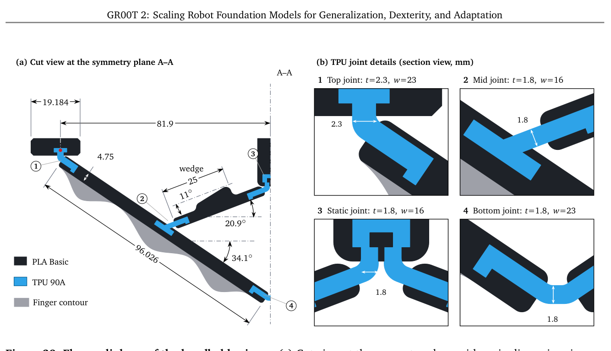

<!-- p.74 C053 · 图 F039 -->

Figure 39: Flexure linkage of the handheld gripper. (a) Cut view at the symmetry plane with main dimensions in mm: black parts are PLA, blue parts are TPU 90A, the gray shape is the operator’s finger contour, and the four TPU joints are numbered 1 to 4 (top, mid, static, bottom). (b) Section views of joints 1 to 4: T-shaped TPU anchors sit in pockets of the PLA parts, and the short exposed strip between them forms the flexure (strip thickness 𝑡and out-of-plane width 𝑤in mm).

图 39：手持夹爪的柔性铰链连杆。(a) 对称面处的剖视图，主要尺寸单位为 mm：黑色零件为 PLA，蓝色零件为 TPU 90A，灰色轮廓为操作员手指的轮廓，四个 TPU 铰链编号为 1 至 4（顶部、中部、静态、底部）。(b) 铰链 1 至 4 的截面视图：T 形 TPU 锚固件嵌在 PLA 零件的凹槽中，二者之间裸露的短条带构成柔性铰链（条带厚度 𝑡and、面外宽度 𝑤in，单位为 mm）[公式原文见 p.74]。

<!-- p.74 S1391 -->

• Thin strips: strip thickness is set by print accuracy, 1.8 mm (2.3 mm at the top joint), about four extrusion lines, so it prints reliably yet still bends. • Short necks: each exposed neck is kept short so the flexure behaves like a rotary joint, with bending concentrated at one location instead of along a long leaf spring. • Width: links and joints are 23 mm wide out of plane (16 mm for the short link and inner joints). Narrower variants twisted under side loads, while wider ones needed a firm grip to close. • Compliance: the finite compliance of TPU absorbs small mismatches between rail, mounts, and link lengths that a rigid pin-jointed version would not tolerate.

• 薄条带：条带厚度由打印精度决定，为 1.8 mm（顶部铰链为 2.3 mm），约等于四条挤出线，因此既能可靠打印，又仍然能够弯曲。• 短颈部：每个裸露的颈部都保持较短，使柔性铰链表现得像一个转动关节，弯曲集中在一处，而不是沿着长片簧分布。• 宽度：连杆与铰链的面外宽度为 23 mm（短连杆与内侧铰链为 16 mm）。较窄的变体在侧向载荷下会扭转，而较宽的变体需要用力抓握才能闭合。• 柔顺性：TPU 有限的柔顺性能够吸收导轨、安装件与连杆长度之间的微小失配，而刚性销接版本无法承受这些失配。

<!-- p.74 S1392 -->

Pre-strained open state. The linkage is printed wider than the rail allows (163.8 mm relaxed pivot span versus 118.1 mm at the rail stops), so the TPU joints are pre-strained at the open stop (Fig. 40). This provides a passive restoring force that returns the gripper to its open state and replaces separate return springs.

预应变张开状态。连杆的打印宽度大于导轨所允许的范围（松弛状态下的枢转跨距为 163.8 mm，而在导轨限位处为 118.1 mm），因此 TPU 铰链在张开限位处处于预应变状态（图 40）。这提供了一个被动的恢复力，使夹爪回到张开状态，并取代了单独的回位弹簧。

<!-- p.74 S1393 -->

End effector. Apart from the added width encoder, sensor placement is kept consistent with the existing UMI configuration, which preserves compatibility with established data-collection pipelines. Further end-effector details, including sensing and assembly, are available in our open-source documentation (NVIDIA GEAR Team, 2026).

末端执行器。除新增的宽度编码器外，传感器布置与现有 UMI 配置保持一致，从而保留了与既有数据采集流程的兼容性。关于末端执行器的更多细节（包括传感与装配），请参阅我们的开源文档（NVIDIA GEAR Team, 2026）。

## E.2. UMI Direct · UMI 直接部署

<!-- p.74 S1394 -->

UMI direct means deploying a UMI-trained policy on the corresponding UMI robot gripper, the robot counterpart of the handheld: the same sensors (the same camera board with its fisheye wrist camera and trigger camera), the same gripper kinematics (two soft-fingered carriages driven symmetrically along a rail), and the same gripper fingers. Observations and actions therefore carry over without translation: the policy sees the scene through the cameras it was trained on and commands the finger width the handheld measured, so the camera and gripper gaps are removed by construction (Sec. E.1). The robot side exchanges poses in the handheld’s wrist frame, which a per-robot hand-eye calibration maps onto the robot, and gripper widths in millimetres, the quantity the handheld measured. A policy trained on grasp-point poses and normalized widths (Sec. B.2) is wrapped so that its outputs are converted back to these quantities. On the deployment robot, the policy

UMI 直接部署是指将基于 UMI 训练的策略部署到对应的 UMI 机器人夹爪上，该夹爪是手持设备的机器人版本：传感器相同（同一块相机板，包括鱼眼腕部相机和触发相机），夹爪运动学相同（两个软指滑块沿导轨对称驱动），夹爪手指也相同。因此，观测和动作无需转换即可直接迁移：策略通过训练时所用的相机观察场景，并下达手持设备所测得的手指宽度指令，所以相机和夹爪方面的差距在构造上即已消除（Sec. E.1）。机器人一侧以手持设备的腕部坐标系交换位姿，再经由每台机器人各自的手眼标定映射到机器人上；夹爪宽度以毫米为单位，即手持设备所测量的量。基于抓取点位姿和归一化宽度训练的策略（Sec. B.2）会被包装，使其输出换算回这些量。在部署机器人上，该策略

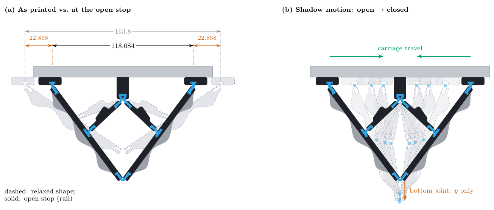

<!-- p.75 C054 · 图 F040 -->

Figure 40: Pre-strain and motion of the flexure linkage. (a) Relaxed (printed) shape (dashed) and its pose at the open stop (solid). The 22.858 mm difference per side pre-strains the TPU joints. (b) Shadows of the linkage closing from the open stop to the closed pose: the finger mounts slide inward along the rail and the bottom joint moves along the symmetry plane.

柔性铰链机构的预应变与运动。(a) 松弛（打印）形状（虚线）及其在张开限位处的姿态（实线）。每侧 22.858 mm 的差值会对 TPU 关节施加预应变。(b) 连杆从张开限位闭合到闭合姿态的阴影图：手指安装座沿导轨向内滑动，底部关节沿对称平面移动。

<!-- p.75 S1402 -->

predicts 48-step action chunks, of which 30 are executed, at 30 Hz inside a 60 Hz control loop. Fig. 41 shows rollouts of UMI-direct policies on four assembly tasks.

策略在 60 Hz 控制循环中以 30 Hz 运行，预测 48 步动作块，其中 30 步被执行。Fig. 41 展示了 UMI 直接部署策略在四项装配任务上的 rollout（轨迹采样）。

<!-- p.75 S1403 -->

Training. We post-train GR00T 2 on the Gripper UMI demonstrations of each target task alone. UMI uses the grasp-point representation on the action-head row it shares with YAM (the shared-head design of Sec. B.2), even though no YAM data enter these mixtures, and it observes four views: the head camera, the two fisheye wrist views re-projected stereographically to 320 × 240 as in pretraining, and the bottom camera.

训练。我们仅使用每项目标任务的 Gripper UMI 演示数据对 GR00T 2 进行后训练。UMI 在其与 YAM 共享的动作头行上采用抓取点表示（即 Sec. B.2 中的共享头设计），尽管这些数据配比中没有任何 YAM 数据。它观察四路视角：头部相机、两路鱼眼腕部视图（与预训练时相同，经立体投影重投影到 320 × 240），以及底部相机。

<!-- p.75 S1404 -->

Ablation: UMI-10K in pretraining. To test whether UMI-10K data in pretraining help UMI direct, we post-train the same UMI-only recipe from two GR00T 2 pretraining checkpoints (Tab. 15): the default checkpoint, whose pretraining mixture includes UMI-10K, and a checkpoint pretrained without any UMI-10K data, the same GR00T 2 w/o UMI pretraining baseline as in Tab. 4. This checkpoint comes from an earlier pretraining run, with fewer pretraining samples, a different robot mixture, and small model differences, so part of the gap may come from these differences rather than from UMI data alone. It is not the GR00T 2 w/o cross-embodiment pretraining baseline of Sec. B.1.5, which is pretrained on target-robot data alone. The difference is large and consistent. With UMI-10K in pretraining, the four assembly tasks reach 30%, 50%, 10%, and 50% end-to-end success (average 35%) with progress scores of 79 to 94. Without it, the same post-training yields 0%, 10%, 0%, and 0% (average 2.5%) with progress scores of 60 to 75. The gap in progress is smaller than the gap in success: the policy without UMI pretraining still performs most coarse steps but fails the precision steps, screw insertion and part seating, that an assembly must chain to completion. We read this as the handheld observation domain being in-distribution for the pretrained backbone, so that post-training can spend its few hours of demonstrations on the task rather than on learning to see a handheld gripper through fisheye cameras. One caveat bounds the claim: because UMI-direct post-training places UMI on the action-head row it shares with YAM rather than on the row it was pretrained on, any benefit reaches the policy through the shared transformer, not through the pretrained action head.

消融实验：预训练中的 UMI-10K。为检验预训练中的 UMI-10K 数据是否有助于 UMI 直接部署，我们从两个 GR00T 2 预训练检查点（Tab. 15）出发，对同一套仅使用 UMI 的配方进行后训练：一个是默认检查点，其预训练数据配比包含 UMI-10K；另一个是未使用任何 UMI-10K 数据预训练的检查点，即与 Tab. 4 中相同的 GR00T 2 w/o UMI pretraining 基线。该检查点来自更早的预训练运行，预训练样本更少，机器人数据配比不同，模型也有细微差异，因此部分差距可能来自这些差异，而不只来自 UMI 数据。它也不同于 Sec. B.1.5 中的 GR00T 2 w/o cross-embodiment pretraining 基线（后者仅在目标机器人数据上预训练）。差距很大且一致。预训练中包含 UMI-10K 时，四项装配任务的端到端成功率分别为 30%、50%、10% 和 50%（平均 35%），任务进度分数为 79 至 94。没有 UMI-10K 时，相同的后训练得到的成功率分别为 0%、10%、0% 和 0%（平均 2.5%），任务进度分数为 60 至 75。任务进度上的差距小于成功率上的差距：未经 UMI 预训练的策略仍能完成大部分粗略步骤，但在装配必须连贯完成的精细步骤（螺钉插入和零件就位）上失败。我们认为，这是因为手持设备的观测域对预训练主干而言属于分布内，因此后训练可以把有限的几小时演示用于任务本身，而不必去学习通过鱼眼相机识别手持夹爪。有一项限定条件约束了这一论断：由于 UMI 直接部署的后训练把 UMI 放在与 YAM 共享的动作头行上，而非其预训练时所在的行，任何收益都是通过共享的 Transformer 传递给策略的，而不是通过预训练的动作头。

## E.3. UMI →YAM Transfer: Embodiment Gaps and Ablations · UMI→YAM 迁移：本体差距与消融实验

<!-- p.75 S1405 -->

As described in Sec. 3.2 and Sec. B.2, GR00T 2 can be adapted to a bimanual gripper robot from handheld Gripper UMI demonstrations alone, with no teleoperation of the target robot. In this section, we present the details behind that result: how co-training lets the model absorb the appearance difference on its own (Fig. 14),

如 Sec. 3.2 和 Sec. B.2 所述，GR00T 2 仅凭手持 Gripper UMI 演示即可适配到双臂夹爪机器人，无需对目标机器人进行遥操作。本节给出该结果背后的细节：联合训练如何让模型自行吸收外观差异（Fig. 14），

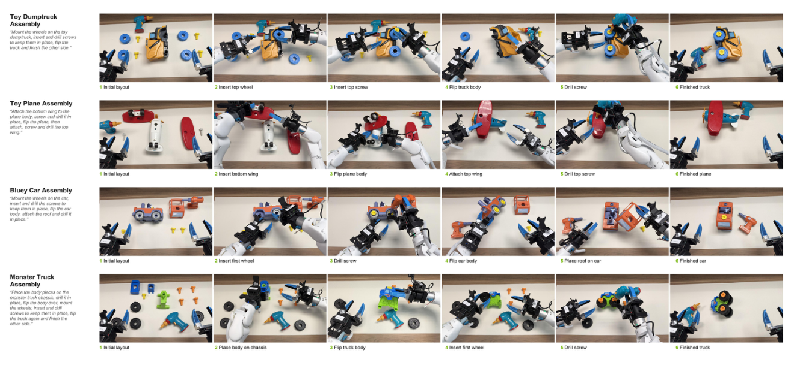

<!-- p.76 C055 · 图 F041 -->

Figure 41: UMI direct rollouts. Each row shows one task with its instruction and six keyframes of a GR00T 2 policy post-trained on Gripper UMI demonstrations alone and deployed on the UMI robot gripper, numbered by stage: Toy Dumptruck Assembly, Toy Plane Assembly, Bluey Car Assembly, and Monster Truck Assembly. Each task requires placing parts, driving screws, and reorienting the body of the toy.

UMI 直接部署的 rollout。每行展示一项任务，包括其指令以及一个 GR00T 2 策略的六个关键帧。该策略仅在 Gripper UMI 演示上进行后训练，并部署在 UMI 机器人夹爪上，关键帧按阶段编号。任务包括 Toy Dumptruck Assembly、Toy Plane Assembly、Bluey Car Assembly 和 Monster Truck Assembly。每项任务都需要放置零件、拧入螺钉，并调整玩具主体的朝向。

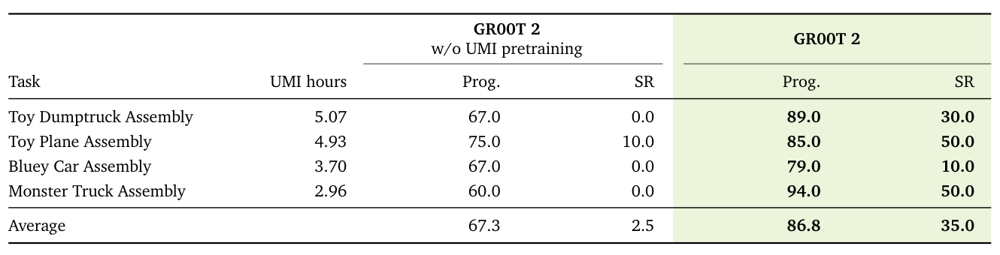

<!-- p.76 C056 · 表 T015 -->

Table 15: UMI direct. Prog. is the average substage score and SR the end-to-end success rate on the UMI robot gripper, both on a 0 to 100 scale, of GR00T 2 post-trained on Gripper UMI demonstrations alone. GR00T 2 w/o UMI pretraining starts from an earlier pretraining checkpoint whose mixture contains no UMI-10K data, while GR00T 2 starts from the default checkpoint, whose pretraining mixture includes UMI-10K. Each task uses 10 trials, and the last row averages the four tasks. Bold marks the best Prog. and SR in each row.

UMI 直接部署。任务进度（Prog.）为各子阶段分数的平均值，成功率（SR）为 UMI 机器人夹爪上的端到端成功率，两者均为 0 到 100 的刻度，对象是仅在 Gripper UMI 演示上后训练的 GR00T 2。GR00T 2 w/o UMI pretraining 从一个更早的预训练检查点出发，其数据配比不含 UMI-10K；GR00T 2 则从默认检查点出发，其预训练数据配比包含 UMI-10K。每项任务使用 10 次试次，最后一行为四项任务的平均值。每行中最优的 Prog. 和 SR 以粗体标出。

<!-- p.76 S1410 -->

the three gaps that remain in sensing, actuation, and environment and the quantities that define them (Tab. 16), and four ablations that isolate the design choices on which the transfer depends (Tab. 17).

仍然存在的三类差距（感知、驱动和环境）以及定义这些差距的量（Tab. 16），还有四项消融实验，用于隔离迁移所依赖的设计选择（Tab. 17）。

<!-- p.76 S1411 -->

E.3.1. Setup

E.3.1. 实验设置

<!-- p.76 S1412 -->

The UMI head, wrist, and bottom cameras fill YAM’s top, wrist, and bottom view slots (Fig. 42). The benchmark comprises Toy Dumptruck Assembly, NIST Board Disassembly, and Conveyor Belt Sorting and Tossing (Fig. 29 and Tab. 4). The UMI cohorts comprise 75 episodes for Toy Dumptruck Assembly, 74 for NIST Board Disassembly, and 41 for Conveyor Belt Sorting and Tossing. None of the YAM co-training sources contains a demonstration of any benchmark task. As in UMI direct, the policy predicts 48-step action chunks, of which 30 are executed.

UMI 的头部、腕部和底部相机分别填充 YAM 的顶部、腕部和底部视角槽位（Fig. 42）。基准测试包括 Toy Dumptruck Assembly、NIST Board Disassembly，以及 Conveyor Belt Sorting and Tossing（Fig. 29 和 Tab. 4）。UMI 数据组分别包含 Toy Dumptruck Assembly 的 75 个片段、NIST Board Disassembly 的 74 个片段，以及 Conveyor Belt Sorting and Tossing 的 41 个片段。YAM 联合训练数据源中没有任何一个包含基准测试任务的演示。与 UMI 直接部署相同，策略预测 48 步动作块，其中 30 步被执行。

<!-- p.76 S1413 -->

E.3.2. What Co-Training Absorbs

E.3.2. 联合训练吸收了什么

<!-- p.76 S1414 -->

The model imagines the robot. The UMI demonstrations show a human’s arms and the blue-fingered handheld gripper, whereas the deployed policy sees YAM’s own arms and gripper. GR00T 2 bridges this appearance difference natively rather than by editing the training videos. Because it predicts future frames jointly with actions, the task-agnostic YAM data teach it what YAM looks like and the UMI data teach it what the task

模型会想象机器人本身。UMI 演示中呈现的是人的手臂和蓝色手指的手持夹爪，而部署时的策略看到的是 YAM 自身的手臂和夹爪。GR00T 2 原生地弥合了这种外观差异，而不是通过编辑训练视频来实现。由于它与动作联合预测未来帧，与任务无关的 YAM 数据教会它 YAM 长什么样，UMI 数据教会它任务长什么样

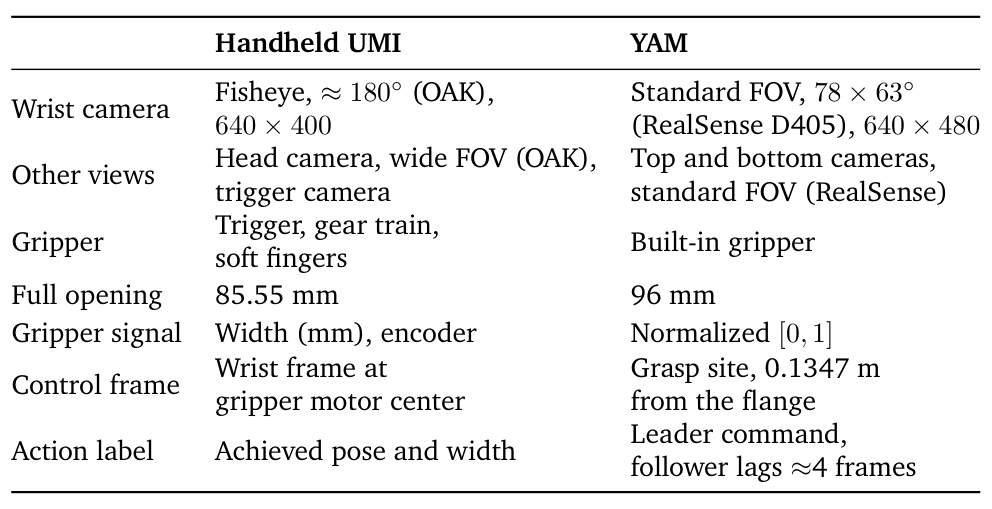

<!-- p.77 C057 · 表 T016 -->

Table 16: Gripper UMI versus YAM. YAM differs from the handheld gripper in its cameras, its gripper interface, and its control frame.

Gripper UMI 与 YAM 的对比。YAM 在相机、夹爪接口和控制坐标系上与手持夹爪不同。

<!-- p.77 S1425 -->

looks like, and at deployment the two combine in the model’s imagined future. Fig. 14 shows this directly: conditioned on the same YAM top-camera frame, a model post-trained on UMI data alone predicts human arms and UMI fingers entering the scene, whereas the co-trained model predicts YAM’s arms performing the assembly. The co-training data therefore supply more than action statistics. They give the world model the robot’s body, so that a task seen only in human hands is imagined, and then executed, on the robot.

长什么样，并在部署时两者会在模型想象的未来中结合。Fig. 14 直接展示了这一点：以同一张 YAM 顶部相机帧为条件，仅在 UMI 数据上后训练的模型预测人的手臂和 UMI 手指进入画面，而联合训练的模型则预测 YAM 的手臂执行装配。因此，联合训练数据提供的不只是动作统计量。它们给世界模型提供了机器人的身体，使得一项只在人手中见过的任务，能够在机器人上被想象并随后执行。

<!-- p.77 S1426 -->

E.3.3. What Remains: Three Embodiment Gaps

E.3.3. 尚存的问题：三类本体差距

<!-- p.77 S1427 -->

Co-training absorbs the visual appearance of the robot, but it does not by itself close the embodiment gap. Three gaps remain, in sensing, actuation, and environment, and each requires a deliberate design choice. We quantify them in turn (Tab. 16) and then ablate the choices that close them.

联合训练可以吸收机器人的视觉外观，但它本身并不能消除本体差距。仍有三类差距，分别在感知、驱动和环境方面，每一类都需要有意识的设计选择。我们依次对它们进行量化（Tab. 16），然后对能够消除它们的设计选择进行消融。

<!-- p.77 S1428 -->

• Sensing gap. The two embodiments observe the scene through cameras with substantially different fields of view (Tab. 16 and Fig. 42). UMI pairs a wide-FOV head camera with fisheye wrist cameras of about 180∘(OAK), whereas YAM uses a standard-FOV top camera and pinhole wrist cameras of 78 × 63∘ (RealSense D405). The two wrist cameras also differ in orientation and in where they sit relative to the fingers. As a result, even the stereographic re-projection of the wrist fisheye used in pretraining places the scene 74 to 94 px from where YAM’s camera shows it at 320 × 240 (Fig. 43). The lens centers are also 4.9 cm apart, so a re-projection can align the scene but not the fingers, which stay smaller in the UMI view than in YAM’s. Beyond geometry, the UMI frames show the operator’s arms and the handheld gripper, whereas YAM’s frames show its own arms and gripper (Fig. 42). • Actuation gap. Beyond sensing, the two embodiments differ in how actions relate to states and in the space in which actions are expressed (Tab. 16). First is action versus state. A UMI demonstration only records the pose the handheld gripper reached, so action and state coincide and the data assume zero tracking error. On YAM, the action is the command of a teleoperation leader arm and the state is where the follower arrives, and the two differ because the follower is a low-stiffness position-controlled arm (brushless motors with 40:1 shoulder and 10:1 wrist reductions under a PD controller with joint stiffness from 80 down to 10 N m/rad). It lags the leader by about four frames (133 ms at 30 Hz) and settles at a load-dependent offset from the command. YAM data thus teach the policy to command ahead of, and offset from, the observed state, whereas UMI data teach it to command the state itself. Second is the control space. UMI acts in end-effector space, with gripper widths as labels. YAM’s action row holds the end-effector pose and width plus the six joint positions of each arm, 32 dimensions in all. Handheld data supply only the 20 end-effector dimensions, and the 12 joint dimensions have no counterpart. Even the shared dimensions use different conventions: UMI poses refer to a wrist frame at the gripper motor center

• 感知差距。两种本体通过视场差异显著的相机观察场景（Tab. 16 和 Fig. 42）。UMI 配有宽视场头部相机和约 180∘（OAK）的鱼眼腕部相机，而 YAM 使用标准视场顶部相机和 78 × 63∘（RealSense D405）的针孔腕部相机。两路腕部相机的朝向不同，相对于手指的位置也不同。因此，即使对预训练中所用的腕部鱼眼进行立体投影重投影，场景在 320 × 240 图像中的位置，与 YAM 相机中的位置仍相差 74 至 94 px（Fig. 43）。两个镜头的中心相距 4.9 cm，所以重投影可以让场景对齐，但无法让手指对齐，手指在 UMI 视图中仍比在 YAM 视图中显得更小。除几何差异外，UMI 画面中可以看到操作者的手臂和手持夹爪，而 YAM 画面中看到的是它自身的手臂和夹爪（Fig. 42）。• 驱动差距。除感知外，两种本体在动作与状态的关系以及动作所处的空间上也不同（Tab. 16）。首先是动作与状态。UMI 演示只记录手持夹爪到达的位姿，因此动作与状态重合，数据隐含了零跟踪误差的假设。在 YAM 上，动作是遥操作主臂的指令，状态是从臂实际到达的位置。两者之所以不同，是因为从臂是低刚度的位置控制机械臂（无刷电机，肩部减速比 40:1、腕部减速比 10:1，在 PD 控制器下关节刚度从 80 降至 10 N m/rad）。它比主臂滞后约四帧（30 Hz 下为 133 ms），并稳定在与指令相差的、随负载变化的偏移量上。因此，YAM 数据教会策略提前于并偏离观测到的状态发出指令，而 UMI 数据则教会它直接对状态本身发出指令。其次是控制空间。UMI 在末端执行器空间中动作，以夹爪宽度作为标签。YAM 的动作行包含末端执行器位姿和宽度，以及每条机械臂的六个关节位置，共 32 维。手持数据只提供其中的 20 维末端执行器维度，12 维关节维度在 UMI 中没有对应项。即使是共享的维度，两者的约定也不同：UMI 位姿参照位于夹爪电机中心的腕部坐标系 [存疑：抽取文本在此截断]

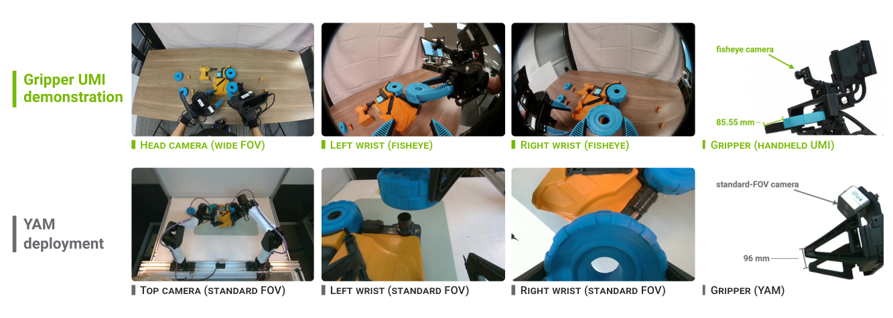

<!-- p.78 C058 · 图 F042 -->

Figure 42: Gripper UMI versus YAM, same task, same camera slots. Top: a Gripper UMI demonstration of Toy Dumptruck Assembly seen through its wide-FOV head camera and two fisheye wrist cameras, recorded in the wild. Bottom: the YAM robot performing the task in its cell, seen through the standard-FOV top camera and two wrist RealSense cameras that fill the same observation slots. Right: the handheld UMI gripper and the YAM gripper, each with its wrist camera. The lines mark the full opening between the fingertips (85.55 mm and 96 mm). Both frames show the same step: the left gripper holds the truck while the right gripper brings the second wheel to the axle.

Gripper UMI 与 YAM 对比，同一任务，同样的相机槽位。上方：Gripper UMI 演示 Toy Dumptruck Assembly，通过宽视场头部相机和两路鱼眼腕部相机在野外采集。下方：YAM 机器人在其工作单元中执行同一任务，通过标准视场顶部相机和两路 RealSense 腕部相机观察，这些相机占据相同的观测槽位。右侧：手持 UMI 夹爪与 YAM 夹爪，各自带有腕部相机。线条标出指尖之间的完整开口（85.55 mm 和 96 mm）。两帧展示的是同一步骤：左侧夹爪夹住卡车，右侧夹爪将第二个车轮送到车轴上。

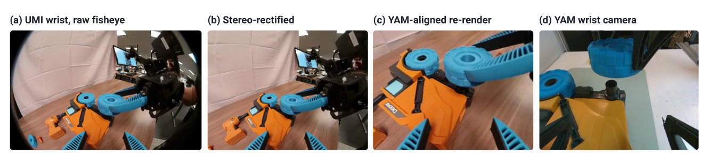

<!-- p.78 C059 · 图 F043 -->

Figure 43: Wrist views for UMI →YAM transfer. The same UMI wrist frame as (a) the raw fisheye, (b) the stereographic view used in pretraining, and (c) the YAM-aligned re-render that imitates YAM’s wrist camera. (d) The real YAM wrist camera at the same step.

UMI→YAM 迁移的腕部视图。同一 UMI 腕部画面的 (a) 原始鱼眼图像、(b) 预训练中使用的立体投影视图，以及 (c) 模仿 YAM 腕部相机的 YAM 对齐重渲染。(d) 同一步骤下真实的 YAM 腕部相机画面。

<!-- p.79 S1446 -->

and YAM poses to a grasp site 0.1347 m from the flange, and UMI records the width in millimetres against an 85.55 mm opening whereas YAM takes a normalized [0, 1] command against 96 mm. In training, we move the UMI wrist frame 0.1347 m along its approach axis to the grasp site and normalize the widths to match YAM. • Environment gap. Finally, the UMI demonstrations are recorded in the wild, whereas the policy is evaluated in a YAM cell whose workspace, lighting, and background never appear in the demonstrations (Fig. 42). The YAM co-training data show the cell but contain no demonstration of the target tasks, so they provide observations of the evaluation scene but no evidence of the target tasks.

并将 YAM 的位姿对应到距法兰 0.1347 m 处的抓取点；UMI 以毫米记录宽度，对应 85.55 mm 的开口，而 YAM 以归一化的 [0, 1] 指令对应 96 mm 的开口。训练时，我们将 UMI 腕部坐标系沿其接近轴移动 0.1347 m 到抓取点，并对宽度进行归一化以匹配 YAM。• 环境差距。最后，UMI 演示是在野外采集的，而策略是在 YAM 工作单元中评测的，该工作单元的工作空间、光照和背景从未出现在演示中（Fig. 42）。YAM 联合训练数据展示了该工作单元，但不包含目标任务的演示，因此它们提供了评测场景的观测，却没有目标任务的证据。

<!-- p.79 S1447 -->

E.3.4. Ablations

E.3.4. 消融实验

<!-- p.79 S1448 -->

The default recipe uses a shared action head, YAM-aligned wrist views, all UMI episodes, and a pretrained checkpoint that includes UMI-10K data. Four ablations each change one of these choices and report the result in Tab. 17: whether UMI shares YAM’s action head (actuation gap), whether the UMI wrist views are aligned to YAM’s camera (sensing gap), how many UMI demonstrations are needed, and whether UMI data in pretraining matter.

默认配方使用共享动作头、与 YAM 对齐的腕部视图、全部 UMI 片段，以及包含 UMI-10K 数据的预训练检查点。四项消融实验各自改变其中一项选择，并在 Tab. 17 中报告结果：UMI 是否与 YAM 共享动作头（驱动差距）、UMI 腕部视图是否与 YAM 相机对齐（感知差距）、需要多少条 UMI 演示，以及预训练中的 UMI 数据是否重要。

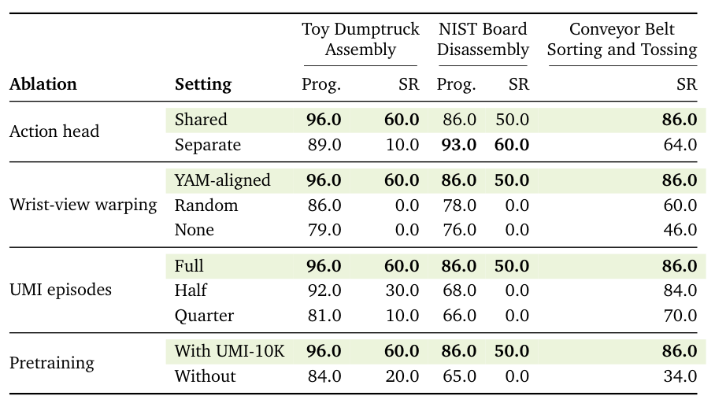

<!-- p.79 C060 · 表 T017 -->

Table 17: UMI →YAM ablations. Prog. is the average substage score and SR the end-to-end success rate on YAM, both on a 0 to 100 scale, as in Tab. 4. The shaded row in each block is the default configuration (shared action head, YAM-aligned wrist-view warping, all UMI episodes, pretraining with UMI-10K data), and the other rows change that one choice. For Conveyor Belt Sorting and Tossing, SR is the share of 50 items sorted, and there is no separate progress score. Bold marks the best value in each block.

UMI→YAM 消融实验。任务进度（Prog.）为 YAM 上各子阶段分数的平均值，成功率（SR）为端到端成功率，两者均为 0 到 100 的刻度，与 Tab. 4 相同。每个区块中的阴影行为默认配置（共享动作头、YAM 对齐的腕部视图扭曲、全部 UMI 片段、包含 UMI-10K 数据的预训练），其他行则只改变其中一项选择。对于 Conveyor Belt Sorting and Tossing，SR 为 50 件物品中被分拣的占比，没有单独的进度分数。每个区块中的最佳值以粗体标出。

<!-- p.79 S1460 -->

Ablation 1: shared versus separate action head. GR00T 2 shares its diffusion transformer across embodiments but keeps one row of action-encoder, state-encoder, and action-decoder weights per embodiment. The sharedhead arm re-expresses UMI in YAM’s semantics and places it on YAM’s row: grasp-site poses, absolute widths normalized by the 85.55 mm full opening, the first 20 of YAM’s 32 action dimensions, and YAM’s normalization statistics. The separate-head arm keeps UMI on the row it was pretrained on, with wrist-frame relative poses, relative widths in millimetres, and its own statistics. The separate arm therefore changes the action representation as well as the head, so the comparison is not a single-variable change. The two arms trade embodiment grounding against skill coverage, and the results in Tab. 17 split along that line. The shared head is clearly stronger on Toy Dumptruck Assembly (60% versus 10%) and Conveyor Belt Sorting and Tossing (86% versus 64%), whereas the separate head is slightly better on NIST Board Disassembly (60% versus 50%, progress 93 versus 86). The NIST margin is concentrated in the hex-nut subtask, which the separate head completes in 7 of 10 trials and the shared head in 5 of 10. This is also the subtask on which the demonstrations are most specific: the UMI demonstrators slide the nut off its post without rotating the wrist, and the YAM co-training data do not contain this way of removing a nut. With the shared head, UMI actions are decoded by the same weights as the YAM data, so the decoder’s prior follows YAM’s motion statistics, and a strategy that appears only in the demonstrations is reproduced less reliably. The separate head keeps UMI on the row it was pretrained on and preserves the demonstrators’ strategy. The same mechanism explains the reverse outcome on the other two tasks: where the demonstrated motions are ones the YAM data already perform, placing UMI on YAM’s row grounds the task evidence directly in YAM’s action statistics and controller, whereas the separate head must rely on the transformer to map YAM observations onto a row it has never seen paired with them. The shared head is therefore the better default, while the separate head helps only where the demonstrations rely on a motion strategy that the co-training data do not share.

消融实验 1：共享动作头与独立动作头。GR00T 2 在各本体之间共享其扩散 Transformer，但为每个本体保留一组动作编码器、状态编码器和动作解码器权重。共享头方案[存疑：原文 "sharedhead" 疑为漏空格]将 UMI 重新表达为 YAM 的语义，并放在 YAM 的动作行上：抓取点位姿、以 85.55 mm 全开口归一化的绝对宽度、YAM 32 个动作维度中的前 20 维，以及 YAM 的归一化统计量。独立头方案则让 UMI 保留在其预训练时所在的行上，使用腕部坐标系下的相对位姿、以毫米为单位的相对宽度以及其自身的统计量。因此，独立方案同时改变了动作表示和动作头，两者的对比并非单变量改变。两种方案是在本体锚定与技能覆盖之间做取舍，Tab. 17 中的结果恰好沿此方向分化。共享头在 Toy Dumptruck Assembly（60% 对 10%）和 Conveyor Belt Sorting and Tossing（86% 对 64%）上明显更强，而独立头在 NIST Board Disassembly（60% 对 50%，进度 93 对 86）上略胜一筹。NIST 上的优势集中在六角螺母子任务上：独立头在 10 次试次中完成了 7 次，共享头则完成了 5 次。这也是演示最具特殊性的子任务：UMI 演示者不转动手腕，而是将螺母从其柱子上滑下来，而 YAM 联合训练数据中不包含这种取出螺母的方式。使用共享头时，UMI 动作由与 YAM 数据相同的权重解码，因此解码器的先验遵循 YAM 的运动统计，而仅出现在演示中的策略则被复现得不够可靠。独立头使 UMI 保留在其预训练所在的行上，从而保留了演示者的策略。同样的机制也解释了另外两项任务上的相反结果：当演示的运动正是 YAM 数据已经执行过的动作时，把 UMI 放在 YAM 的行上可以将任务证据直接锚定到 YAM 的动作统计量和控制器上，而独立头则必须依靠 Transformer 将 YAM 观测映射到一个从未与之配对过的行上。因此，共享头是更好的默认选择，而独立头只在演示依赖于联合训练数据并不共享的运动策略时才有帮助。

<!-- p.80 S1463 -->

Ablation 2: wrist-view alignment. We re-render the native UMI fisheye (≈180∘) as a virtual standard-FOV pinhole camera at the same optical center that imitates YAM’s 78 × 63∘wrist view (Tab. 16 and Fig. 43): a 202.96 px focal length at 320 × 240 (76.5 × 61.2∘), pitched about 27.1∘down, with rotation and focal length fitted in Isaac Sim on 112 same-scene UMI/YAM render pairs. On held-out pairs, the scene error is 8 px for objects closer than 30 cm and 11 px beyond, versus 74 and 94 px for the stereographic view, and the grasp zone is resolved at 12.5 rather than 6.9 px/cm for the raw fisheye. Identical maps back-fill the training data and run at deployment. We stress that this alignment is approximate. It matches the field of view and the viewing direction of YAM’s wrist camera, but not the lens, the stereo baseline, the offset of the optical center from the gripper, or the appearance of the arm and fingers in the frame, and the residual discrepancy is visible in Fig. 43. We compare three training views for the UMI wrist cameras: the stereographic view used in pretraining, the YAM-aligned view, and a random choice between the two on every training sample. Only the aligned view transfers on the two long-horizon tasks (Tab. 17). With the stereographic view, end-to-end success is 0% on both long-horizon tasks, and 46% of the items are sorted on Conveyor Belt Sorting and Tossing. The random mixture recovers 60% on tossing but still 0% on the long-horizon tasks, while the aligned view reaches 60%, 50%, and 86%. The progress scores tell a more specific story. They fall only moderately without alignment (96 to 79 on Toy Dumptruck Assembly, 86 to 76 on NIST Board Disassembly), so the policy still performs most steps. What it loses is the precision steps, in which the gripper must meet a screw hole or a nut within a few millimetres. A view mismatch moves the grasp zone in the image and changes its pixel scale (12.5 versus 6.9 px/cm), which corrupts exactly the image-to-action mapping those steps depend on, while leaving coarse transport intact. The random mixture helps only on tossing (60% versus 46%), where coarse transport suffices, and not on the precision steps, because it asks the policy to be invariant to a viewpoint change that is informative for those steps. The policy averages over two geometries and is sharp in neither. We draw two conclusions. First, the video model absorbs the appearance gap, since human arms and a handheld gripper in training versus robot arms in deployment do not prevent transfer, but it does not absorb a geometric gap. Second, the geometry need only be roughly matched: coarse agreement in field of view and viewing direction is sufficient to recover most of the transfer, which makes the method practical for new target robots whose wrist cameras are known only from a datasheet.

消融实验 2：腕部视角对齐。我们将原生 UMI 鱼眼相机（≈180∘）重新渲染为一个虚拟的标准视场针孔相机，光心保持不变，使其模仿 YAM 的 78 × 63∘ 腕部视角（见表 16 与图 43）：焦距为 202.96 px，分辨率为 320 × 240（视场 76.5 × 61.2∘），并向下俯仰约 27.1∘。旋转与焦距在 Isaac Sim 中，依据 112 组同一场景的 UMI/YAM 渲染图像对拟合得到。在留出的图像对上，距离小于 30 cm 的物体场景误差为 8 px，更远处为 11 px；相比之下，立体投影视图的误差分别为 74 px 和 94 px。抓取区域在对齐后的分辨率为 12.5 px/cm，而原始鱼眼图像仅为 6.9 px/cm。相同的映射既用于回填训练数据，也用于部署运行。我们强调，这种对齐只是近似的。它匹配了 YAM 腕部相机的视场与观察方向，但没有匹配镜头、立体基线、光心相对夹爪的偏移，也没有匹配画面中手臂与手指的外观；剩余的差异在图 43 中清晰可见。我们为 UMI 腕部相机比较了三种训练视图：预训练中使用的立体投影视图（stereographic）、YAM 对齐视图，以及对每个训练样本在两者之间随机选择。只有对齐视图能在两个长时序任务上实现迁移（见表 17）。使用立体投影视图时，两个长时序任务的端到端成功率均为 0%，而在 Conveyor Belt Sorting and Tossing 任务中，有 46% 的物品被分拣。随机混合在抛掷任务上达到 60%，但在两个长时序任务上仍为 0%；对齐视图则分别达到 60%、50% 和 86%。任务进度分数呈现的情况更为具体。在不对齐的情况下，它们只是适度下降（Toy Dumptruck Assembly 从 96 降到 79，NIST Board Disassembly 从 86 降到 76），因此策略仍能完成大部分步骤。它丢失的是精细步骤：此时夹爪必须在数毫米内对准螺丝孔或螺母。视图失配会使抓取区域在图像中移位，并改变其像素尺度（12.5 对 6.9 px/cm），这恰恰破坏了这些步骤所依赖的图像到动作映射，而粗略的搬运则基本不受影响。随机混合仅在抛掷任务上有帮助（60% 对 46%），因为粗略搬运已经足够；但在精细步骤上它没有帮助，因为它要求策略对视角变化保持不变，而这种视角变化恰恰对这些步骤有信息价值。策略在两种几何结构之间取平均，结果在两者上都不够精确。我们得出两个结论。第一，视频模型能够吸收外观差异：训练中是人手臂与手持夹爪、部署中是机器人手臂，这并不妨碍迁移；但它无法吸收几何差异。第二，几何只需大致匹配：视场与观察方向的粗略一致就足以恢复大部分迁移效果，这使得该方法适用于仅能从数据手册获知腕部相机参数的新目标机器人。

<!-- p.80 S1465 -->

Ablation 3: amount of UMI data. The UMI demonstrations are the only source of the target task, so their number bounds how much task evidence post-training can draw on. We shrink each cohort to about half and a quarter of its episodes at a fixed 0.6 : 0.4 UMI : YAM sampling ratio (Tab. 17). The three tasks degrade very differently. Conveyor Belt Sorting and Tossing is nearly flat (86%, 84%, 70%): it is a short-horizon dynamic skill with one decisive event, and 20 episodes already cover it. Toy Dumptruck Assembly degrades gradually in end-to-end success (60%, 30%, 10%) while its progress score stays high (96, 92, 81), the signature of a long horizon in which small per-step losses compound multiplicatively. Notably, the policy trained on only 20 demonstrations still completes the full four-stage assembly end to end in 1 of 10 trials and 81% of its individual steps, on a robot that has never been teleoperated for the task. NIST Board Disassembly collapses at the first halving (50% to 0%), and the substage table shows why: the nut subtask goes from 5 of 10 to 0 of 10 while the other four subtasks barely move. The data requirement of a task is therefore set not by its length but by its hardest subskill, the one with the least support in both the pretraining and the co-training data. That subskill is the first to disappear as demonstrations are removed, and in a sequential task its loss zeroes the end-to-end rate. In practice, 41 to 75 handheld demonstrations sufficed for every task here, and half of that sufficed whenever the task contained no such rare subskill.

消融实验 3：UMI 数据量。UMI 演示是目标任务的唯一来源，因此其数量限定了后训练能够利用的任务证据规模。我们在固定的 0.6 : 0.4 UMI : YAM 采样比例下，将每个数据队列缩减至约一半和四分之一的回合数（见表 17）。三项任务的退化方式差异很大。Conveyor Belt Sorting and Tossing 几乎保持不变（86%、84%、70%）：它是一项短时序的动态技能，只包含一个决定性事件，20 个回合即足以覆盖它。Toy Dumptruck Assembly 的端到端成功率逐步下降（60%、30%、10%），而其任务进度分数仍保持较高水平（96、92、81），这是长时序任务的典型特征：每一步的微小损失会以乘法方式累积。值得注意的是，仅用 20 条演示训练的策略，仍能在 10 次试次中有 1 次端到端地完整完成四阶段装配，并完成 81% 的单个步骤，而该机器人从未针对此任务接受过遥操作。NIST Board Disassembly 在第一次减半时即崩溃（50% 到 0%），子阶段表格说明了原因：螺母子任务从 10 次中成功 5 次降为 0 次，而其余四个子任务几乎没有变化。因此，一项任务所需的数据量并非由其长度决定，而是由其最困难的子技能决定，即在预训练与联合训练数据中支持最少的那项子技能。随着演示数据被移除，这项子技能会最先消失；在顺序任务中，它的缺失会使端到端成功率归零。实际上，这里每项任务只需 41 至 75 条手持演示即可满足；只要任务中不包含此类稀有子技能，所需数量约为其一半。

<!-- p.81 S1467 -->

Ablation 4: UMI-10K in pretraining. The main result (Tab. 4) already shows that starting from a checkpoint pretrained without UMI data reduces transfer success to 20% and 0% on the long-horizon tasks and the share of conveyor items sorted to 34%. We repeat the row in Tab. 17 and examine what pretraining contributes. Both models see the same post-training data and the same number of steps, so the difference lies entirely in what the pretrained weights already encode. The checkpoint without UMI also differs in pretraining length, robot mixture, and small model details (Sec. E.2), so not all of the gap need come from UMI data. We identify two contributions. First, with UMI-10 data in pretraining, UMI’s observation domain, a handheld gripper and human arms seen through fisheye wrist views, is already in-distribution for the video backbone, so post-training does not have to learn to see the demonstrations. Second, and more important for transfer, pretraining on UMI alongside YAM and the other robot corpora aligns UMI’s actions with the other embodiments inside the shared transformer: the model has already learned that a UMI grasp and a YAM grasp are the same event. Post-training then only needs to attach task evidence to an alignment that exists, whereas without UMI in pretraining the same 41 to 75 episodes must simultaneously teach the observation domain, bind it to YAM’s action semantics, and teach the task. The few-shot budget is spent on the embodiment rather than on the task. The progress scores are consistent with this reading. Without UMI pretraining the policy still performs most coarse steps (84 and 65), so it does learn the task structure. It fails at the precision steps, where an imprecise embodiment alignment turns into a missed hole or a dropped part. UMI data in cross-embodiment pretraining are thus not a convenience but the mechanism that makes a few dozen demonstrations sufficient.

消融实验 4：预训练中的 UMI-10K。主要结果（表 4）已经表明，若从未使用 UMI 数据预训练的检查点出发，迁移成功率在长时序任务上降至 20% 和 0%，传送带分拣的物品比例降至 34%。我们在表 17 中重复了该行，并考察预训练究竟贡献了什么。两个模型使用相同的后训练数据和相同的步数，因此差异完全来自预训练权重已经编码的内容。未使用 UMI 的检查点在预训练时长、机器人混合比例以及一些细小的模型细节（见第 E.2 节）上也有所不同，因此并非所有差距都必然来自 UMI 数据。我们识别出两项贡献。第一，预训练中包含 UMI-10 数据[存疑：原文为 UMI-10，疑为 UMI-10K 的抽取截断]后，UMI 的观测域（手持夹爪以及通过鱼眼腕部视角看到的人类手臂）已经属于视频骨干网络的分布内数据，因此后训练无需再学习看懂这些演示。第二，也是对迁移更重要的一点：在预训练中，UMI 与 YAM 及其他机器人语料一同训练，会在共享的 Transformer 中将 UMI 动作与其他本体对齐：模型已经学会，UMI 的抓取与 YAM 的抓取是同一事件。此时后训练只需将任务证据附着到已经存在的对齐关系上；而若预训练中没有 UMI，同样的 41 至 75 个回合就必须同时教会观测域、将其与 YAM 的动作语义绑定，并教会任务本身。少样本的预算因此被用于本体适配，而非任务学习。任务进度分数与这一解读一致。没有 UMI 预训练时，策略仍能完成大部分粗略步骤（84 与 65），因此它确实学会了任务结构。它在精细步骤上失败，此时不精确的本体对齐会转化为漏插或掉落零件。因此，跨本体预训练中的 UMI 数据并非锦上添花，而是使几十条演示就足以奏效的机制。

## E.4. DexUMI Exoskeleton Hardware · E.4. DexUMI 外骨骼硬件

<!-- p.81 S1468 -->

The GEAR DexUMI exoskeleton (NVIDIA GEAR Team, 2026) replicates the kinematics of the target robot hand (XHAND1 Pro-U) joint for joint and reproduces its fingertip and palm contact surfaces, which keeps the visual and physical gap to the robot small for policy training. It is also designed for wearability, so that operators can comfortably collect high-quality data across long, dexterous tasks. Compared with the original DexUMI, it offers the following improvements:

GEAR DexUMI 外骨骼（NVIDIA GEAR Team, 2026）逐关节复刻了目标机器人手（XHAND1 Pro-U）的运动学，并还原了其指尖与手掌的接触表面，使策略训练时人手采集环境与机器人之间的视觉和物理差距保持较小。该外骨骼还考虑了穿戴性，使操作员能够舒适地在长时序、灵巧的任务中采集高质量数据。与原始 DexUMI 相比，它有以下改进：

<!-- p.81 S1470 -->

• More degrees of freedom. The exoskeleton captures 16 degrees of freedom, using 20 joints of which four pairs are coupled. • Higher precision and durability. Machined parts give higher precision and durability. • No over-constraint, better tracking and wearability. Removing non-essential contact surfaces and adopting a remote-center-of-motion (RCM) linkage resolves the over-constraint of the original structure. The structure flexes less, which improves tracking precision and wearability. • Daisy-chained encoders. The joint encoders are daisy-chained, which simplifies cable management. • Left and right hands. Both left- and right-hand versions are available, enabling bimanual tasks.

• 更多自由度。该外骨骼可采集 16 个自由度，使用 20 个关节，其中四对关节存在耦合。• 更高的精度与耐久性。机加工零件带来更高的精度与耐久性。• 消除过约束，跟踪与穿戴性更好。去除非必要的接触表面，并采用远程运动中心（RCM）连杆机构，解决了原结构的过约束问题。结构形变更小，从而提升了跟踪精度与穿戴性。• 编码器串联。各关节编码器采用串联连接，简化了线缆管理。• 左手与右手版本。左右手版本均可提供，支持双臂任务。

<!-- p.81 S1471 -->

Remote-center-of-motion joints. Matching the robot hand’s abduction/adduction (AB/AD) and flexion joints is a packaging problem, since those joint centers lie where the operator’s finger is. We replicate them with an RCM linkage that creates a virtual joint at the robot hand’s joint center without placing hardware in the operator’s workspace (Fig. 44a). The RCM is a parallel four-bar linkage. To avoid over-constraining it, only two of the four holes at the top joint are used. Leaving the other two unused reduces binding from manufacturing tolerances and keeps motion smooth.

远程运动中心关节。要匹配机器人手的外展/内收（AB/AD）关节与屈曲关节，是一个封装问题，因为这些关节中心恰好位于操作员手指所在的位置。我们用 RCM 连杆机构来复刻它们：该机构在机器人手的关节中心处形成一个虚拟关节，同时不在操作员的工作空间内放置硬件（Fig. 44a）。RCM 是一个平行四连杆机构。为避免对它造成过约束，顶部关节的四个孔中只使用其中两个。保留另外两个孔不用，可以减少制造公差造成的卡滞，并使运动更顺滑。

<!-- p.81 S1472 -->

Thumb. The thumb linkages use a “kicked-out” geometry that preserves the robot hand’s thumb kinematics while clearing space for the operator’s own thumb, so its range of motion is unobstructed during dexterous manipulation (Fig. 44b).

拇指。拇指连杆采用“外撇式”几何结构，在保留机器人手拇指运动学的同时，为操作员自己的拇指留出空间，使其在灵巧操作过程中的运动范围不受阻碍（Fig. 44b）。

<!-- p.81 S1473 -->

Rigid, compact joints. Every joint is supported on both sides to prevent deflection and improve measurement precision. Custom pins keep joint bulk low while forming secure connections, and a variant with a direct keying interface mates to the joint encoders, reducing backlash and improving sensor accuracy (Fig. 45a).

刚性紧凑的关节。每个关节两侧均有支撑，以防止形变并提高测量精度。定制销钉在形成可靠连接的同时保持关节体积较小；另一种带有直接键连接接口的版本与关节编码器配合，可以减小回差并提高传感器精度（Fig. 45a）。

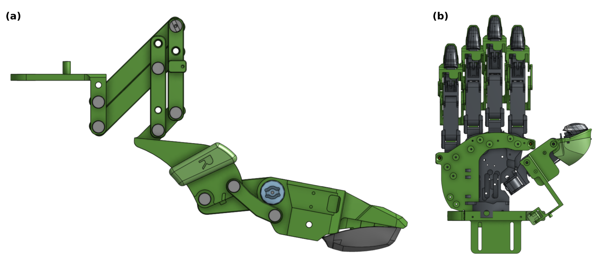

<!-- p.82 C061 · 图 F044 -->

Figure 44: GEAR DexUMI kinematic design. (a) A remote-center-of-motion linkage places a virtual joint at the robot hand’s AB/AD and flexion joint centers. (b) The kicked-out thumb linkage keeps the robot hand’s thumb kinematics while clearing the operator’s thumb.

图 44：GEAR DexUMI 运动学设计。(a) 远程运动中心连杆机构在机器人手的 AB/AD 关节与屈曲关节中心处设置虚拟关节。(b) 外撇式拇指连杆在保留机器人手拇指运动学的同时，为操作员的拇指留出空间。

<!-- p.82 S1476 -->

Contact surfaces and camera. The fingertip and palm tactile-sensor contact surfaces match the robot hand’s, and the fingertip geometry is reproduced on the exoskeleton to reduce the visual gap between human collection and robot execution (Fig. 45b). Non-essential contact surfaces are removed to improve wearability. The camera mounting angle and alignment are carried over to the robot hand’s mount, so the collected images match the deployed field of view (Fig. 45c). Finally, the chassis is anodized green so that a color threshold can segment it for the masked-video augmentation (Sec. E.6).

接触表面与相机。指尖与手掌的触觉传感器接触表面与机器人手保持一致，外骨骼上还原了指尖几何形状，以减小人工采集与机器人执行之间的视觉差距（Fig. 45b）。为提高穿戴性，去除了非必要的接触表面。相机的安装角度与对准方式沿用到机器人手的安装座上，因此采集的图像与部署时的视场一致（Fig. 45c）。最后，外壳采用阳极氧化的绿色，使颜色阈值能够将其分割出来，用于掩码视频增广（Sec. E.6）。

<!-- p.82 S1477 -->

Sensing. The exoskeleton fingertips report force in the robot hand’s own tactile format: five fingertip sensors with two pads and three force axes each, 30 channels per hand. Per hand, an iPhone tracks a wrist frame 12.6 cm from its lens, which a per-arm hand-eye calibration maps onto the robot, and the same 640 × 400, 45 fps wrist and head cameras serve collection and deployment.

传感。外骨骼指尖以机器人手自身的触觉格式回传力信息：每个指尖配有五个传感器，每个传感器包含两个触点和三个力分量，每只手共 30 个通道。每只手通过一部 iPhone 跟踪腕部坐标系，该坐标系位于其镜头前方 12.6 cm 处，并由每条手臂的手眼标定映射到机器人上。同一套 640 × 400、45 fps 的腕部相机与头部相机同时用于采集与部署。

## E.5. DexUMI Post-Training Recipe · DexUMI 后训练方案

<!-- p.82 S1478 -->

For the DexUMI results of Sec. B.3, we post-train the 2B GR00T 2 model from the GR00T 2 pretraining checkpoint for 60,000 steps at a learning rate of 3 × 10−5, with 224 × 320 images from the wrist cameras and, optionally, the head camera. The policy predicts 40-step action chunks at stride 2 on the 45 fps data: relative end-effector poses for each arm and, for each hand, either absolute joint positions with joint torques or offset joint positions in their place (Eqs. (1) and (3)).

对于 Sec. B.3 中的 DexUMI 结果，我们从 GR00T 2 预训练检查点出发，对 2B 的 GR00T 2 模型进行后训练，训练 60,000 步，学习率为 3 × 10−5，输入为腕部相机的 224 × 320 图像，并可选地加入头部相机图像。策略在 45 fps 数据上以步长 2 预测 40 步动作块：各手臂的相对末端执行器位姿，以及各只手的一组量，二者择一，即绝对关节位置加关节力矩，或以偏移关节位置代替之（Eqs. (1) and (3)）。

## E.6. DexUMI WAM-Native Inpainting · DexUMI 的 WAM 原生补全（inpainting）

<!-- p.82 S1479 -->

GR00T 2 addresses the visual gap between the exoskeleton and the robot hand inside training rather than by editing video: it corrupts the exoskeleton region so that the model cannot rely on exoskeleton-specific appearance. By WAM-native inpainting we mean this in-model treatment, in place of offline video editing. Our earlier pipeline, following the original DexUMI (Xu et al., 2025), filmed each demonstration replayed on a real robot hand, segmented the exoskeleton from manually picked keypoints, inpainted it with ProPainter, and composited the robot hand back in, at the cost of robot time, manual input, and GPU-heavy segmentation and inpainting.

GR00T 2 在训练过程中处理外骨骼与机器人手之间的视觉差距，而不是通过编辑视频来解决。它会对外骨骼区域施加扰动，使模型无法依赖外骨骼特有的外观。这里的“WAM 原生补全”指的正是这种模型内部的处理方式，用以替代离线视频编辑。我们早期的流程沿用原始 DexUMI（Xu et al., 2025）：每段演示在真实机器人手上回放并拍摄，然后根据人工选取的关键点分割出外骨骼，用 ProPainter 进行补全，再把机器人手合成回画面中。这一流程需要付出机器人时间、人工输入，以及计算开销较大的分割与补全工作。

<!-- p.82 S1480 -->

Exoskeleton masks. We segment the green regions in every camera video with HSV color bands, morphological cleanup, and a ±2-frame temporal majority vote, and store each mask as a lossless binary video beside its RGB stream.

外骨骼掩码。我们对每个相机视频中的绿色区域进行分割：先用 HSV 颜色阈值，再做形态学清理，并结合 ±2 帧的时间多数投票。每个掩码以无损二值视频的形式，与其 RGB 视频流一同存储。

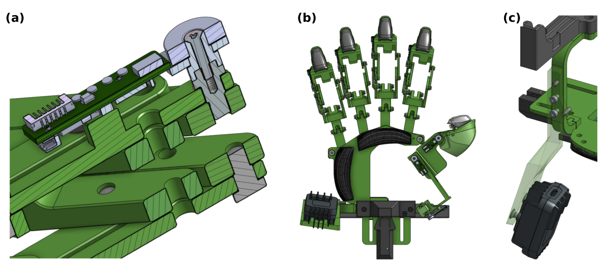

<!-- p.83 C062 · 图 F045 -->

Figure 45: GEAR DexUMI joints, contact surfaces, and camera. (a) Double-sided joint support and a custom pin with a direct keying interface to the joint encoder. (b) Fingertip and palm contact surfaces replicate the robot hand’s tactile sensors. (c) The camera mount matches the robot hand’s mounting angle and alignment.

图 45：GEAR DexUMI 的关节、接触表面与相机。(a) 双面关节支撑，以及带有直接键连接接口、与关节编码器相连的定制销钉。(b) 指尖与手掌的接触表面复现了机器人手的触觉传感器。(c) 相机支架的安装角度与对准方式与机器人手一致。

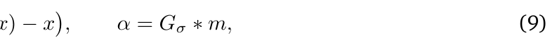

<!-- p.83 S1484 -->

Masked-video augmentation. During training only, GR00T 2 corrupts the masked region before cropping and resizing, with one draw of corruption parameters per sample shared across frames and views, blended in through a feathered mask:

掩码视频增广。仅在训练时，GR00T 2 会在裁剪和缩放之前对掩码区域施加扰动。每个样本只抽取一次扰动参数，并在所有帧与所有视角之间共享，再通过羽化掩码混合回原图：

<!-- p.83 E004 -->

, 𝛼= 𝐺𝜎* 𝑚, (9)

该式定义混合权重 α：先对二值掩码 𝑚 施加高斯模糊 𝐺𝜎，得到随掩码边界平滑衰减的权重。式中 (9) 为公式编号。$$, 𝛼= 𝐺𝜎* 𝑚, (9)$$ [公式原文见 p.83]

<!-- p.83 S1489 -->

where 𝑚is the binary mask and 𝐺𝜎a Gaussian blur with 𝜎= 6 px at 640 px width, so the corruption fades out over a narrow band around the mask and pixels farther from it stay bit-identical. The default corruption 𝑐rotates hue over the full color wheel, scales saturation by 𝑈[0.1, 1.2] and value by 𝑈[0.2, 1.15], and adds luminance noise. The saturation and value ranges deliberately reach dark, desaturated colors because the deployed robot hand is largely black. Masks are dropped from the deployed model’s inputs, so a checkpoint needs only RGB and inference frames pass through unchanged.

其中 𝑚 为二值掩码，𝐺𝜎 为高斯模糊，𝜎 = 6 px（以 640 px 宽度计），因此扰动会在掩码周围的一条窄带内逐渐衰减，远离掩码的像素保持逐位一致。默认扰动 𝑐 在整个色轮上旋转色相，按 𝑈[0.1, 1.2] 缩放饱和度，按 𝑈[0.2, 1.15] 缩放明度，并加入亮度噪声。饱和度与明度的取值范围特意覆盖暗色与低饱和度颜色，因为部署的机器人手大部分是黑色的。掩码不进入已部署模型的输入，因此检查点只需要 RGB 输入，推理帧则原样通过。[公式原文见 p.83]
