# 附录 F RL 后训练

> **原文** F. RL Post-Training　·　起于 p.84　·　本页中英对照：英文段在前，中文段在后。

---

<!-- p.84 S1490 -->

Pretraining equips GR00T 2 with broad visual and motor priors, but reliable real-world manipulation often requires adaptation to precise alignment, contact dynamics, and physical interaction. Reinforcement learning (RL) provides a complementary approach to supervised fine-tuning (SFT), enabling policies to improve through robot experience and task-level feedback.

预训练为 GR00T 2 提供了广泛的视觉与运动先验，但可靠的真实世界操作往往还需要适应精确对齐、接触动力学和物理交互。强化学习（RL）是监督微调（SFT）的一种补充方法，使策略能够借助机器人经验和任务层面的反馈不断改进。

<!-- p.84 S1492 -->

Applying RL to GR00T 2 introduces unique challenges. Unlike action-only policies, GR00T 2 jointly generates actions and predicted visual futures through iterative denoising. Policy optimization must therefore accommodate joint video-action computation while enabling effective exploration. Furthermore, physical interaction is expensive, requiring efficient algorithms and infrastructure to make iterative post-training practical.

将 RL 应用于 GR00T 2 带来了独特的挑战。与仅输出动作的策略不同，GR00T 2 通过迭代去噪同时生成动作与预测的视觉未来。因此，策略优化必须既能适应视频-动作的联合计算，又能支持有效的探索。此外，物理交互代价高昂，需要高效的算法与基础设施，才能使迭代式后训练切实可行。

<!-- p.84 S1493 -->

We address these challenges through three complementary components. First, we develop direct GR00T 2 posttraining methods, including GRPO-based optimization (Shao et al., 2024) and self-imitation from successful RL exploration, alongside residual RL for localized corrections (Sec. F.1). Second, we leverage AutoRL, an autonomous research system that discovers and improves RL post-training algorithms through closed-loop experimentation in simulation (Sec. F.2). Third, we develop scalable infrastructure that coordinates robot interaction, training, and evaluation while preserving experience and minimizing iteration overhead (Sec. F.3). We demonstrate these capabilities on four real-world precision manipulation tasks (Sec. F.4). We also investigate RL post-training through interaction with a learned neural simulator. We adapt DreamDojo (Gao et al., 2026) to recorded policy rollouts, then demonstrate that GR00T 2 can improve through world-model-based RL (Sec. F.5).

我们通过三个互补的部分应对这些挑战。第一，我们开发直接的 GR00T 2 后训练方法，包括基于 GRPO 的优化（Shao et al., 2024）、来自成功 RL 探索的自模仿（self-imitation），以及用于局部修正的残差强化学习（residual RL）（Sec. F.1）。第二，我们利用 AutoRL，这是一个自主研究系统，通过仿真中的闭环实验发现并改进 RL 后训练算法（Sec. F.2）。第三，我们开发了可扩展的基础设施，用于协调机器人交互、训练与评测，同时保存经验并尽量减少迭代开销（Sec. F.3）。我们在四项真实世界的精确操作任务上展示了这些能力（Sec. F.4）。我们还通过与一个学习得到的神经仿真器交互，研究 RL 后训练。我们将 DreamDojo（Gao et al., 2026）适配到录制的策略 rollout（轨迹采样）上，然后证明 GR00T 2 可以通过基于世界模型的强化学习（world-model-based RL）得到改进（Sec. F.5）。

## F.1. RL-Based Adaptation of World-Action Models · 基于强化学习的世界-动作模型适配

<!-- p.84 S1494 -->

We investigate two complementary strategies for adapting GR00T 2. Direct GR00T 2 post-training updates the pretrained model through RL or self-imitation, while residual RL freezes GR00T 2 and learns a lightweight corrective policy. The former improves the underlying generative policy, whereas the latter targets precisioncritical stages where GR00T 2 already produces approximately correct behaviors.

我们研究两种互补的 GR00T 2 适配策略。直接对 GR00T 2 进行后训练，会通过强化学习（RL）或自模仿（self-imitation）更新预训练模型本身；残差强化学习（residual RL）则冻结 GR00T 2，只学习一个轻量级的纠正策略。前者改进底层的生成式策略，后者针对精度关键阶段，即 GR00T 2 已经能给出近似正确行为的阶段。

<!-- p.84 S1495 -->

F.1.1. Direct GR00T 2 Post-Training

F.1.1. 直接 GR00T 2 后训练

<!-- p.84 S1496 -->

Stochastic Exploration with CPS. To enable exploration and likelihood-based policy optimization (Liu et al., 2025; Lei et al., 2026), we replace GR00T 2’s deterministic Euler action updates with Coefficients-Preserving Sampling (CPS) (Wang and Yu, 2025) during rollout. Noise is injected only into the action denoising process. Video denoising remains deterministic given its initial latent, while video features continue to condition action generation.

基于 CPS 的随机探索。为了实现探索以及基于似然的策略优化（Liu et al., 2025; Lei et al., 2026），我们在 rollout（轨迹采样）时，把 GR00T 2 确定性的欧拉动作更新替换为保系数采样（CPS）（Wang and Yu, 2025）。噪声只注入动作去噪过程。给定初始潜变量，视频去噪仍是确定性的，而视频特征继续为动作生成提供条件。

<!-- p.84 S1497 -->

Following DPPO (Ren et al., 2025) and RL-100 (Lei et al., 2026), we optimize GR00T 2 through its action denoising process. Let 𝑡index environment decisions and 𝑘index action-denoising events. GR00T 2 uses four such events: joint passes (𝑘= 0, 2) update video and action latents through a shared DiT, while cached passes (𝑘= 1, 3) update action tokens using video and state keys and values from the preceding joint pass (Fig. 46).

沿用 DPPO（Ren et al., 2025）与 RL-100（Lei et al., 2026）的做法，我们通过动作去噪过程优化 GR00T 2。令 𝑡 为环境决策的索引，𝑘 为动作去噪事件的索引。GR00T 2 共有四个这样的事件：联合前向传播（joint pass，𝑘= 0, 2）通过共享的 DiT 同时更新视频潜变量与动作潜变量；缓存前向传播（cached pass，𝑘= 1, 3）则利用前一次联合前向传播得到的视频与状态的键（key）和值（value）更新动作 token（Fig. 46）。

<!-- p.84 S1498 -->

After denoising, the first 𝐻𝑒actions are executed, where 𝐻𝑒is the executed action horizon.

去噪完成后，执行前 𝐻𝑒 个动作，其中 𝐻𝑒 为执行动作时域（executed action horizon）。

<!-- p.84 S1500 -->

𝑡 the intermediate action latent at environment decision 𝑡and denoising event 𝑘, and v(𝑘)

[存疑：抽取残片，句首主语缺失] 𝑡 为环境决策 𝑡 与去噪事件 𝑘 处的中间动作潜变量，v(𝑘)。[公式原文见 p.84]

<!-- p.84 S1501 -->

𝜃,𝑡the corresponding action velocity in the noise-minus-data convention. The noise schedule 𝜎𝑘decreases from 𝜎0 = 1 to 𝜎4 = 0. The clean-action and noise estimates are

𝜃,𝑡 为对应的动作速度，采用“噪声减数据”约定。噪声调度 𝜎𝑘 从 𝜎0 = 1 递减至 𝜎4 = 0。干净动作估计与噪声估计为 [存疑：此处公式未抽取] [公式原文见 p.84]

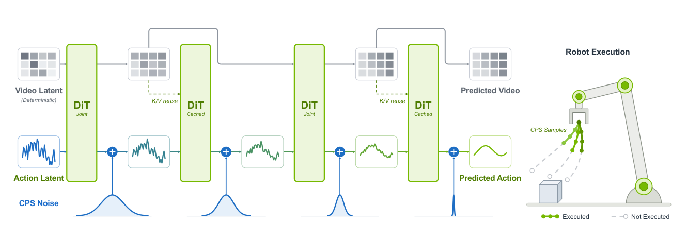

<!-- p.85 C063 · 图 F046 -->

Figure 46: Joint video-action denoising with CPS exploration. Four action-denoising events alternate between joint and cached passes. CPS adds fresh noise only to executed action coordinates. Video denoising is deterministic given its initial latent. GRPO scores joint action transitions and backpropagates through their joint forward passes, with carried latents detached.

图 46：采用 CPS 探索的联合视频-动作去噪。四个动作去噪事件在联合前向传播与缓存前向传播之间交替。CPS 只向可执行的动作坐标加入新噪声。给定初始潜变量，视频去噪是确定性的。GRPO 对联合动作转移打分，并通过其联合前向传播反向传播，其中携带的潜变量被分离（detach）。

<!-- p.85 S1524 -->

Using clipped transition standard deviations (Lei et al., 2026), we sample

利用截断后的转移标准差（Lei et al., 2026），我们按以下方式采样 [存疑：此处采样公式未抽取]

<!-- p.85 S1533 -->

Here 𝜂controls stochastic exploration, 𝜇𝜃,𝑡,𝑘is the CPS transition mean, and 𝑠𝑘is its standard deviation, bounded by 𝑠min > 0 and 𝑠max. The subscript exec denotes active coordinates in the first 𝐻𝑒action rows. Noise injection and likelihood evaluation are restricted to these coordinates, excluding padding. CPS provides explicit Gaussian transition densities for subsequent policy optimization.

其中 𝜂 控制随机探索，𝜇𝜃,𝑡,𝑘 为 CPS 转移均值，𝑠𝑘 为其标准差，并受 𝑠min > 0 与 𝑠max 约束。下标 exec 表示前 𝐻𝑒 个动作行中的有效坐标。噪声注入与似然评估仅限于这些坐标，并排除填充部分。CPS 为后续策略优化提供了显式的高斯转移密度。

<!-- p.85 S1534 -->

Online RL with GRPO. We optimize GR00T 2 from its own successful and failed rollouts with a GRPO-style algorithm developed through AutoRL (Sec. F.2). A training round collects 𝑁𝑔attempts for each selected reset context 𝑔(a task paired with a scene layout) under a fixed behavior policy. Attempt 𝑖of context 𝑔receives a binary return 𝑅𝑔,𝑖∈{0, 1}.

基于 GRPO 的在线 RL。我们使用通过 AutoRL 开发的类 GRPO 算法（Sec. F.2），基于 GR00T 2 自身成功与失败的 rollout 对其进行优化。每一轮训练在固定的行为策略下，为每个选定的重置上下文（reset context，即一个任务与一个场景布局的组合）收集 𝑁𝑔 次尝试。上下文 𝑔 的第 𝑖 次尝试获得二值回报 𝑅𝑔,𝑖∈{0, 1}。

<!-- p.85 S1535 -->

Leave-one-out advantages with a context memory. With a baseline computed solely from the current group, uniform outcomes yield zero reward-based advantages. We incorporate a historical per-context mean to retain a learning signal when current outcomes differ from past performance. The baseline for attempt 𝑖pools the other 𝑁𝑔−1 returns of its context with ℎ𝑔pseudo-returns fixed at the context’s historical mean 𝑚𝑔:

带上下文记忆的留一优势。若基线仅由当前组计算，则结果一致时基于奖励的优势为零。我们引入每个上下文的历史均值，使当前结果与过去表现不同时仍能保留学习信号。第 𝑖 次尝试的基线，汇集了其上下文中其余 𝑁𝑔−1 个回报，以及 ℎ𝑔 个伪回报，这些伪回报固定为该上下文的历史均值 𝑚𝑔：

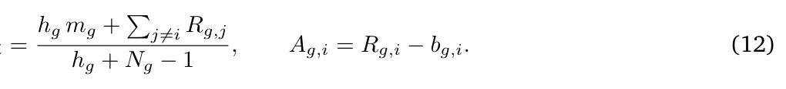

<!-- p.85 E005 -->

𝑗̸=𝑖𝑅𝑔,𝑗 ℎ𝑔+ 𝑁𝑔−1 , 𝐴𝑔,𝑖= 𝑅𝑔,𝑖−𝑏𝑔,𝑖. (12)

式 (12) 给出基线 𝑏𝑔,𝑖：它是同一上下文中其余 𝑁𝑔−1 次尝试的回报与 ℎ𝑔 个固定为历史均值 𝑚𝑔 的伪回报的平均；优势 𝐴𝑔,𝑖 为 𝑅𝑔,𝑖 减去 𝑏𝑔,𝑖。

$$𝑗̸=𝑖𝑅𝑔,𝑗 ℎ𝑔+ 𝑁𝑔−1 , 𝐴𝑔,𝑖= 𝑅𝑔,𝑖−𝑏𝑔,𝑖. (12)$$ [公式原文见 p.85]

<!-- p.85 S1538 -->

With ℎ𝑔= 0 this is the leave-one-out baseline of RLOO (Ahmadian et al., 2024). We use ℎ𝑔= 0 only on a context’s first visit and ℎ𝑔= ℎ= 2 afterwards. A uniform failure in a context that used to succeed at rate 𝑚𝑔 now yields a negative advantage of magnitude ℎ𝑚𝑔/(ℎ+ 𝑁𝑔−1), and a uniform success in a historically weak context yields the mirror image.

当 ℎ𝑔= 0 时，上式即 RLOO（Ahmadian et al., 2024）的留一基线。我们仅在上下文首次访问时使用 ℎ𝑔= 0，之后取 ℎ𝑔= ℎ= 2。若某上下文过去以成功率 𝑚𝑔 成功，而现在结果一致地失败，则其优势为负，幅度为 ℎ𝑚𝑔/(ℎ+ 𝑁𝑔−1)；若某个历史上表现较弱的上下文结果一致地成功，则得到镜像结果。

<!-- p.85 S1539 -->

Let 𝑇𝑔,𝑖be the number of environment decisions in an attempt. The attempt’s advantage is spread evenly over its decisions and rescaled once per batch, so that long attempts do not dominate merely by containing more decisions, and 𝑐is applied only when the batch has nonzero advantage mass. The sums defining 𝑐run over the collected attempts.

设 𝑇𝑔,𝑖 为一次尝试中的环境决策数。该次尝试的优势被均匀分摊到其每个决策上，并在每个批次中统一重新缩放，使长尝试不会仅因包含更多决策而占据主导。仅当批次的优势总量非零时才应用 𝑐。定义 𝑐 的求和遍历所有已收集的尝试。

<!-- p.86 S1548 -->

Persistent context table. The historical means 𝑚𝑔live in a global table indexed by context. The table persists across rounds and, through checkpointing, across training segments, so it records how well the policy has done in every context so far. Once a round’s advantages have been computed, each visited context is updated by an exponential moving average of its round mean, with 𝛼EMA = 0.25 and 𝑚𝑔= 𝜇𝑔on the first visit. Unvisited contexts are left untouched. Updating the table after advantage computation ensures that the historical term uses only preceding rounds.

持久化的上下文表。历史均值 𝑚𝑔 存放在一个按上下文索引的全局表中。该表跨轮次保留，并通过检查点跨越训练片段持续存在，因此它记录了策略迄今在每个上下文中的表现。每轮优势计算完成后，每个被访问的上下文都以其本轮均值的指数滑动平均（EMA）进行更新，其中 𝛼EMA = 0.25，首次访问时取 𝑚𝑔= 𝜇𝑔。未被访问的上下文保持不变。在优势计算之后再更新该表，可确保历史项只使用此前的轮次。

<!-- p.86 S1555 -->

Clipped transition-level objective for a denoising policy. GR00T 2 produces actions by iterative denoising, so the exact action log-likelihood that GRPO would compare between policies is not available. CPS, however, gives a Gaussian density for every action-denoising transition, and we score the policy on those transitions instead. On the selected joint denoising events 𝒦= {0, 2} we maximize the clipped surrogate (Liu et al., 2025; Lei et al., 2026; Schulman et al., 2017)

面向去噪策略的截断转移级目标。GR00T 2 通过迭代去噪生成动作，因此 GRPO 在策略之间比较时所需的精确动作对数似然不可得。然而，CPS 为每个动作去噪转移提供了高斯密度，因此我们改为在这些转移上对策略打分。在选定的联合去噪事件 𝒦= {0, 2} 上，我们最大化截断代理目标（clipped surrogate）（Liu et al., 2025; Lei et al., 2026; Schulman et al., 2017）。

<!-- p.86 S1558 -->

𝑟𝑔,𝑖,𝑡,𝑘ˆ𝐴𝑔,𝑖,𝑡, clip(𝑟𝑔,𝑖,𝑡,𝑘, 1 −𝜖clip, 1 + 𝜖clip) ˆ𝐴𝑔,𝑖,𝑡 min where ℬis the batch of recorded decisions, 𝜖clip is the clipping threshold, and 𝑟= exp(ℓ𝜃−ℓold) is the current-tobehavior likelihood ratio for one recorded transition. Gaussian log densities condition on the observation context and input action latent at event 𝑘and sum over executed coordinates. Ratios are not multiplied across events or decisions. In practice, rather than sampling 𝑘, each minibatch scores one joint event, alternating between 𝑘= 0 and 𝑘= 2. Recorded action latents are teacher-forced, while video computation is reconstructed under the current parameters. Gradients flow through the selected joint pass, including the shared DiT, state/action encoders, and action decoder. Carried latents are detached, yielding a local surrogate without backpropagation through the full denoising chain.

截断目标式的抽取残缺（残留片段为 `𝑟𝑔,𝑖,𝑡,𝑘ˆ𝐴𝑔,𝑖,𝑡, clip(…) ˆ𝐴𝑔,𝑖,𝑡 min`），[公式原文见 p.86]。其中 ℬ 为已记录决策的批次，𝜖clip 为截断阈值，𝑟= exp(ℓ𝜃−ℓold) 为单个已记录转移上，当前策略相对行为策略的似然比。高斯对数密度以观测上下文及事件 𝑘 处的输入动作潜变量为条件，并对可执行坐标求和。比值不会跨事件或跨决策相乘。实践中，并不对 𝑘 进行采样，而是每个小批次对一个联合事件打分，并在 𝑘= 0 与 𝑘= 2 之间交替。已记录的动作潜变量采用教师强制，而视频计算则在当前参数下重新构建。梯度经所选的联合前向传播回传，包括共享的 DiT、状态/动作编码器与动作解码器。携带的潜变量被分离（detach），从而得到一个局部代理目标，无需反向传播穿过完整的去噪链。

<!-- p.86 S1564 -->

GRPO-Induced Self-Imitation. Online RL enables GR00T 2 to discover successful behaviors through exploration, while supervised learning provides a potentially more stable optimization approach for consolidating these behaviors. We investigate GRPO-induced self-imitation, combining the exploration capabilities of RL with the optimization stability of supervised fine-tuning.

GRPO 诱导的自模仿。在线 RL 使 GR00T 2 能够通过探索发现成功行为，而监督学习则可能提供一种更稳定的优化方式，用于巩固这些行为。我们研究 GRPO 诱导的自模仿，将 RL 的探索能力与监督微调（SFT）的优化稳定性相结合。

<!-- p.86 S1565 -->

We retain successful episodes from the full set of rollouts used to train the best-performing GRPO checkpoint, forming 𝒟succ. Starting from the same SFT initialization as GRPO, we perform one round of fine-tuning using GR00T 2’s original joint video-action objective:

我们从用于训练表现最佳的 GRPO 检查点的全部 rollout 中保留成功的回合，构成 𝒟succ。从与 GRPO 相同的 SFT 初始化出发，我们使用 GR00T 2 原始的联合视频-动作目标进行一轮微调：

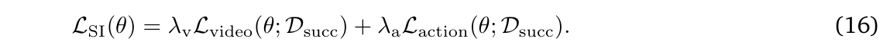

<!-- p.86 E006 -->

ℒSI(𝜃) = 𝜆vℒvideo(𝜃; 𝒟succ) + 𝜆aℒaction(𝜃; 𝒟succ). (16)

式 (16) 为自模仿的训练目标：以成功回合集合 𝒟succ 为数据，对视频损失与动作损失分别按权重 𝜆v、𝜆a 加权求和。

$$ℒSI(𝜃) = 𝜆vℒvideo(𝜃; 𝒟succ) + 𝜆aℒaction(𝜃; 𝒟succ). (16)$$

<!-- p.86 S1566 -->

Here ℒvideo and ℒaction denote GR00T 2’s original video and action denoising objectives, and 𝜆v and 𝜆a control their relative weights.

其中 ℒvideo 与 ℒaction 分别表示 GR00T 2 原始的视频去噪目标与动作去噪目标，𝜆v 与 𝜆a 控制二者的相对权重。

<!-- p.86 S1567 -->

Task success determines which trajectories are selected, while the learning signal comes from the original video and action supervision. This enables GR00T 2 to benefit from RL-discovered successful behaviors while optimizing a standard supervised objective, without additional robot rollouts, demonstrations, or human corrective actions.

任务成功与否决定选取哪些轨迹，而学习信号则来自原始的视频与动作监督。这使 GR00T 2 能够在优化标准监督目标的同时，利用 RL 发现的成功行为，且无需额外的机器人 rollout、演示数据或人工纠正动作。

<!-- p.87 S1569 -->

F.1.2. Residual Reinforcement Learning

F.1.2. 残差强化学习（Residual Reinforcement Learning）

<!-- p.87 S1570 -->

Direct GR00T 2 post-training updates the generative policy itself. A complementary approach is to retain GR00T 2’s pretrained capabilities and learn targeted corrections for precision-critical stages, where approximately correct trajectories can still fail because of small alignment or contact errors.

直接对 GR00T 2 进行后训练，会更新生成式策略本身。另一种互补的做法是保留 GR00T 2 的预训练能力，并针对精度关键阶段学习有针对性的纠正。在这些阶段，即使轨迹大致正确，仍可能因微小的对齐或接触误差而失败。

<!-- p.87 S1571 -->

We keep GR00T 2 frozen and train a lightweight residual policy to correct its actions online. Unlike direct GR00T 2 training, residual RL does not use CPS. Instead, it relies on the stochastic residual actor for exploration.

我们冻结 GR00T 2，并在线训练一个轻量级的残差策略来修正其动作。与直接训练 GR00T 2 不同，残差 RL 不使用 CPS，而是依靠随机残差 actor 进行探索。

<!-- p.87 S1572 -->

The residual operates within designated task stages. At each decision 𝑗, a tanh-squashed Gaussian actor 𝜋𝜑 receives observations z𝑗comprising camera images, proprioception, GR00T 2’s forecast end-effector targets, and the current correction offset. The actor produces a bounded residual action a𝑗over the next control horizon.

残差在指定的任务阶段内运行。在每个决策 𝑗 处，tanh 压缩的高斯 actor 𝜋𝜑 接收观测 z𝑗，包括相机图像、本体感知、GR00T 2 预测的末端执行器目标以及当前的修正偏移。该 actor 在接下来的控制时域内输出一个有界的残差动作 a𝑗。

<!-- p.87 S1573 -->

Per-tick corrections are accumulated into bounded offsets and composed with GR00T 2’s targets:

逐 tick 的修正被累加为有界偏移，并与 GR00T 2 的目标合成：

<!-- p.87 S1576 -->

xcmd

[存疑：抽取失败，此处仅残留 xcmd，对应公式未能抽取] [公式原文见 p.87]

<!-- p.87 S1579 -->

Here o𝑗is the accumulated correction offset, 𝛿is the per-tick correction scale, 𝛾is the correction gain, and B denotes axis-wise offset bounds. The operator ⊕composes the correction offset with GR00T 2’s end-effector target. Zero residual action leaves the current offset unchanged, while zero offset recovers the base policy.

其中 o𝑗 为累积的修正偏移，𝛿 为逐 tick 修正尺度，𝛾 为修正增益，B 表示逐轴的偏移界。算子 ⊕ 将修正偏移与 GR00T 2 的末端执行器目标合成。零残差动作使当前偏移保持不变，而零偏移则恢复为基础策略。

<!-- p.87 S1580 -->

Following HIL-SERL (Luo et al., 2025), we train the residual actor using Soft Actor-Critic (SAC) (Haarnoja et al., 2018) with prior demonstrations and online interaction, including occasional human corrections. Evaluation episodes are manually scored using binary task-specific success criteria.

沿用 HIL-SERL（Luo et al., 2025）的做法，我们使用软演员-评论家算法（Soft Actor-Critic, SAC）（Haarnoja et al., 2018）训练残差 actor，训练数据包括先验演示数据、在线交互，以及偶尔出现的人工纠正。评测回合依据任务相关的二值成功标准进行人工评分。

<!-- p.87 S1581 -->

We draw half of each critic batch from online data and half from demonstrations, and train an ensemble of critics using bootstrapped returns. The actor objective combines entropy-regularized policy improvement with a zero-residual prior and imitation of successful residual actions:

每个评论家（critic）批次的一半取自在线数据，另一半取自演示数据，并使用自举回报训练评论家集成。actor 目标结合了熵正则化的策略改进、零残差先验，以及对成功残差动作的模仿：

<!-- p.87 S1589 -->

Here 𝜑and 𝜓denote the residual actor and critic parameters, respectively. The distribution 𝒟RL represents observations sampled from the training replay buffer. The function ¯𝑄𝜓is the ensemble critic mean, 𝜇𝜑is the actor mean, and 𝒟+ contains successful residual experience. The entropy coefficient 𝛼controls exploration, while 𝜆𝑄, 𝜆0, and 𝜆bc weight the critic, zero-residual regularization, and behavior-cloning terms, respectively.

其中 𝜑 与 𝜓 分别为残差 actor 与 critic 的参数。分布 𝒟RL 表示从训练回放缓冲区中采样的观测。函数 ¯𝑄𝜓 为评论家集成的均值，𝜇𝜑 为 actor 均值，𝒟+ 包含成功的残差经验。熵系数 𝛼 控制探索，而 𝜆𝑄、𝜆0 与 𝜆bc 分别为评论家项、零残差正则项与行为克隆项的权重。[存疑：紧邻的 actor 目标式未抽取]

<!-- p.87 S1590 -->

The zero-residual prior discourages unnecessary corrections, while successful experience reinforces effective behavior. Residual RL thus enables targeted adaptation without modifying pretrained GR00T 2 weights.

零残差先验抑制不必要的修正，而成功经验则强化有效行为。因此，残差 RL 能够在不修改预训练 GR00T 2 权重的前提下，实现有针对性的适配。

## F.2. Automated Discovery of RL Post-Training Algorithms · 强化学习后训练算法的自动发现

<!-- p.87 S1591 -->

Developing effective RL post-training algorithms for robot foundation models involves choices across objectives, exploration, credit assignment, reward design, and rollout horizons. These decisions interact with task characteristics and model architectures, making algorithm development an iterative process of experimentation and refinement.

为机器人基础模型开发有效的强化学习后训练算法，需要在目标函数、探索、信用分配、奖励设计以及 rollout（轨迹采样）时域等方面作出选择。这些决策与任务特性和模型架构相互影响，因此算法开发是一个通过实验与改进不断迭代的过程。

<!-- p.87 S1592 -->

We leverage AutoRL, an autonomous research framework for closed-loop experimentation, to systematically improve RL post-training algorithms for GR00T 2. The research agent analyzes training failures, proposes hypotheses, modifies code, and evaluates candidate algorithms under fixed protocols. We ran AutoRL for

我们利用 AutoRL（一个用于闭环实验的自主研究框架），系统性地改进 GR00T 2 的强化学习后训练算法。研究智能体分析训练失败、提出假设、修改代码，并在固定协议下评估候选算法。我们将 AutoRL 运行了

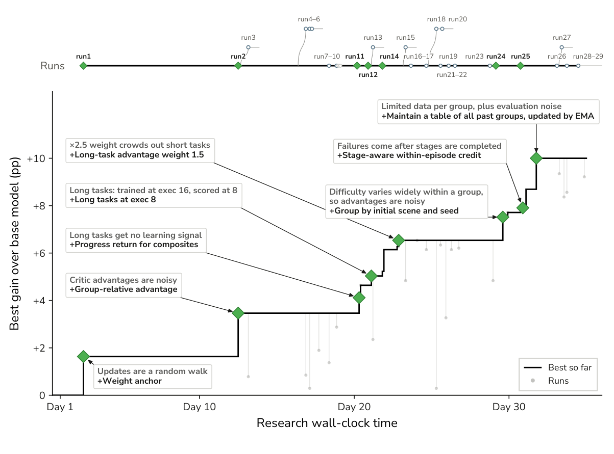

<!-- p.88 C064 · 图 F047 -->

Figure 47: Autonomous RL recipe discovery with AutoRL. Hill-climbing performance on RoboCasa365 across successive agent-driven experiments. The curve shows the best evaluation performance achieved.

图 47：基于 AutoRL 的自主强化学习配方发现。在 RoboCasa365 上，相继由智能体驱动的实验中的爬山式性能变化。曲线表示所达到的最佳评测性能。

<!-- p.88 S1616 -->

approximately 35 days on RoboCasa365 (Nasiriany et al., 2026), using an early developmental GR00T 2 checkpoint and the Atomic-Seen and Composite-Seen tasks.

约 35 天，在 RoboCasa365（Nasiriany et al., 2026）上进行，使用了早期开发版 GR00T 2 检查点以及 Atomic-Seen 与 Composite-Seen 任务。

<!-- p.88 S1617 -->

F.2.1. Autonomous Experimentation Harness

F.2.1. 自主实验框架

<!-- p.88 S1618 -->

Each AutoRL discovery round follows four stages. First, the agent analyzes previous experiments, diagnostic metrics, and failure modes to identify bottlenecks. Second, it proposes up to four mutually orthogonal hypotheses, each specifying an isolated mechanism, expected outcome, and falsification criterion. A critic filters out redundant or insufficiently testable proposals. Third, valid hypotheses are implemented in independent branches, locally tested, and submitted for cluster training and evaluation. Finally, candidates are compared with the current best baseline and promoted only when improvements exceed a predefined margin. At most one candidate is promoted per round, while rejected hypotheses remain available as negative evidence.

每一轮 AutoRL 发现包含四个阶段。第一，智能体分析之前的实验、诊断指标和失败模式，以找出瓶颈。第二，它最多提出四个相互正交的假设，每个假设都需说明一个孤立的机制、预期结果和证伪准则。一个评审器（critic）会过滤掉冗余或可检验性不足的提议。第三，有效的假设在独立分支中实现，经过局部测试后提交到集群上进行训练与评测。最后，候选方案与当前最佳基线进行比较，只有当改进超过预定义裕度时才会被晋升。每一轮至多晋升一个候选方案，而被拒绝的假设仍作为负面证据保留可用。

<!-- p.88 S1619 -->

This harness enables systematic exploration of algorithmic modifications beyond conventional hyperparameter tuning.

该实验框架使得对算法改动的系统性探索得以超越常规的超参数调优。

<!-- p.88 S1620 -->

F.2.2. Discovering RL Recipes

F.2.2. 强化学习配方的发现

<!-- p.88 S1621 -->

AutoRL starts from a standard PPO implementation and iteratively improves the post-training recipe through successive experiments (Fig. 47). Below, we summarize the eight changes marked in Fig. 47 by the component they affect, each with the best gain over the base model reached after it.

AutoRL 从标准的 PPO 实现出发，通过相继的实验迭代改进后训练配方（Fig. 47）。下文按所影响的组件，归纳图 47 中标出的八处改动，并给出每处改动之后相对基础模型所达到的最佳增益。

<!-- p.88 S1622 -->

Weight anchoring and longer rollouts. Early runs showed the actor drifting rapidly from the pretrained weights, losing existing skills before any useful RL gradient appeared, and rollouts on the long-horizon RoboCasa365 tasks ending before the task could be completed. The agent added an 𝐿2 penalty toward the pretrained weights and extended the rollout horizon. Together these give 1.6 percentage points.

权重锚定与更长的 rollout 时域。早期实验显示，actor（策略网络）迅速偏离预训练权重，在出现任何有用的强化学习梯度之前就丢失了已有技能；同时，在长时序的 RoboCasa365 任务上，rollout 在任务完成之前就已结束。智能体加入了一项朝向预训练权重的 𝐿2 惩罚项，并延长了 rollout 时域。二者合计带来 1.6 个百分点的提升。

<!-- p.89 S1623 -->

Replacing the critic (group-relative baseline). The critic’s explained variance stayed near zero, so its advantages were noise. More capacity and warm-up did not help. The agent removed it in favor of a grouprelative baseline in the style of GRPO (Shao et al., 2024), the ℎ𝑔= 0 case of Eq. (12), and extended the horizon further. Cumulative gain: 3.5 percentage points.

替换评判器（组相对基线）。评判器的解释方差始终接近于零，因此其给出的优势估计只是噪声。增加容量与预热也没有帮助。智能体移除了评判器，转而采用仿照 GRPO（Shao et al., 2024）方式的组相对基线，即式 (12) 中 ℎ𝑔= 0 的情形 [公式原文见 p.89]，并进一步延长了时域。累计增益：3.5 个百分点。

<!-- p.89 S1624 -->

Shaping the return (stage progress). Six long-horizon composite tasks still did not move: with binary success every attempt in a group failed identically, leaving no relative signal. For these simulation experiments, the agent introduced stage-progress returns in [0, 1], assigning partial credit according to the furthest subgoal milestone reached. The real-robot experiments instead use binary task-success returns, as defined in Sec. F.1.1. Cumulative gain: 4.1 percentage points.

塑造回报（阶段进度）。六个长时序组合任务仍然没有改善：在二值成功信号下，组内每次尝试都以相同方式失败，因而没有相对信号。对于这些仿真实验，智能体引入了取值在 [0, 1] 之间的阶段进度回报，按照所达到的最远子目标里程碑给予部分得分。真实机器人实验则改用二值任务成功回报，其定义见 Sec. F.1.1。累计增益：4.1 个百分点。

<!-- p.89 S1625 -->

Balancing long and short tasks. Long tasks were trained with an execution horizon of 16 but scored with 8, and training them at 8 as well raised the cumulative gain to 5.0 percentage points. An advantage weight of 2.5 on long tasks crowded out the short ones, and lowering it to 1.5 gave 6.5 percentage points.

平衡长短任务。长任务以执行时域 16 进行训练，却以 8 进行评分；若同样以 8 进行训练，累计增益提升至 5.0 个百分点。长任务上 2.5 的优势权重挤占了短任务，将其降至 1.5 后，累计增益达到 6.5 个百分点。

<!-- p.89 S1626 -->

Less noisy advantages (grouping and stage credit). Task difficulty varied widely within a group, which made the group-relative advantages noisy. Grouping rollouts by initial scene and seed raised the cumulative gain to 7.5 percentage points. Failures often came after some stages had already been completed, so the agent added stage-aware credit within each episode, which gave 7.9 percentage points.

降低优势估计的噪声（分组与阶段信用）。组内任务难度差异很大，使得组相对优势噪声较大。按初始场景和随机种子对 rollout 进行分组后，累计增益提升至 7.5 个百分点。失败往往发生在部分阶段已经完成之后，因此智能体在每个回合内加入了阶段感知的信用分配，带来 7.9 个百分点的累计增益。

<!-- p.89 S1627 -->

Remembering each context (persistent baseline). Progress rewards do not help contexts the policy already solves every time or never advances at all. Their groups stay uniform and a current-group baseline gives them zero advantage, and on RoboCasa365 such contexts are most of the data. The agent gave every context a memory of its past returns, an exponential moving average across rounds (Eq. (14)), folded into the leave-oneout baseline as a small number of pseudo-observations (Eq. (12)). This baseline retains a learning signal for uniform-outcome groups when their current returns differ from past performance. The same context statistics also guide rollout allocation away from consistently solved contexts. Cumulative gain: 10.0 percentage points.

记住每个上下文（持久基线）。对于策略每次都已解决或始终无法推进的上下文，进度奖励并无帮助。这些上下文所在的组结果始终一致，而当前组基线会给它们零优势；在 RoboCasa365 上，此类上下文占据了大部分数据。智能体为每个上下文记录了其过去回报的记忆，即跨轮次的指数移动平均（式 (14)），并以少量伪观测的形式并入留一法基线（式 (12)）。当结果一致的组其当前回报与过去表现不同时，该基线仍能为其保留学习信号。同样的上下文统计量还用于指导 rollout 分配，使其避开持续被解决的上下文。累计增益：10.0 个百分点。

<!-- p.89 S1628 -->

These experiments demonstrate how AutoRL systematically discovers effective post-training strategies: stabilizing policy optimization, replacing an uninformative critic, balancing long and short tasks, improving credit assignment, and keeping a learning signal alive on saturated and unsolved tasks. The resulting algorithm forms the foundation of our direct GR00T 2 post-training approach, which we further adapt to GR00T 2’s joint video-action architecture and real-world robot interaction. As demonstrated in Sec. F.4, this approach achieves substantial improvements on contact-rich manipulation tasks.

这些实验展示了 AutoRL 如何系统性地发现有效的后训练策略：稳定策略优化、替换无信息量的评判器、平衡长短任务、改进信用分配，以及在已饱和和未解决的任务上保持学习信号。由此得到的算法构成了我们直接进行 GR00T 2 后训练方法的基础，我们进一步使其适配 GR00T 2 的视频-动作联合架构以及真实机器人交互。如 Sec. F.4 所示，该方法在富接触操作任务上取得了显著提升。

## F.3. Online RL Post-Training Infrastructure · 在线强化学习后训练基础设施

<!-- p.89 S1629 -->

Real-robot RL requires repeated coordination among data collection, reward annotation, policy optimization, and evaluation. These stages have different resource requirements and execution rates, while physical interaction and scene resets constrain collection throughput. We develop shared infrastructure that supports heterogeneous learning algorithms, reduces iteration overhead, and preserves experience across failures (Fig. 48).

真实机器人强化学习需要在数据采集、奖励标注、策略优化与评测之间反复协调。这些阶段的资源需求与执行速率各不相同，而物理交互与场景复位限制了采集的吞吐量。我们开发了共享基础设施，用以支持异构的学习算法、降低迭代开销，并在故障之后保留经验（Fig. 48）。

<!-- p.89 S1630 -->

Shared Experience Buffer. Our infrastructure uses a shared experience buffer backed by Lance (Pace et al., 2025). Experience records are constructed incrementally as collection, scoring, and batch preparation produce their outputs. Workers can selectively access relevant fields, while training updates use pinned table versions to ensure stable inputs (Lance Contributors, 2026). Common record identities and policy provenance associate observations, rewards, and updates, and algorithm-defined schemas support different post-training methods within the same data infrastructure.

共享经验缓冲区。我们的基础设施使用由 Lance 支撑的共享经验缓冲区（Pace et al., 2025）。经验记录随采集、评分与批次准备的输出而逐步构建。工作节点可以有选择地访问相关字段，而训练更新则使用固定的表版本以保证输入稳定（Lance Contributors, 2026）。统一的记录标识与策略溯源将观测、奖励和更新关联起来，由算法定义的 schema 则使同一数据基础设施能够支持不同的后训练方法。

<!-- p.89 S1631 -->

Resource-Efficient Execution. Collection, training, and evaluation use independently configurable resource pools. Compatible GPU resources can be reassigned according to workload dependencies, accommodating both on-policy and off-policy learning. Incremental uploads and prefetching overlap collection, data transfer, scoring, decoding, and training preparation, reducing idle time between iterations.

资源高效执行。采集、训练与评测分别使用可独立配置的资源池。兼容的 GPU 资源可根据工作负载的依赖关系重新分配，同时支持同策略与异策略学习。增量上传与预取使采集、数据传输、评分、解码和训练准备相互重叠，减少迭代之间的空闲时间。

<!-- p.90 S1632 -->

A Algorithm interface Control Experience / policy

A 算法接口 控制 经验 / 策略 [存疑：图内标签抽取顺序混乱]

<!-- p.90 S1633 -->

Experience schema / Reward computation / Batch preparation / Optimization rules

经验 schema / 奖励计算 / 批次准备 / 优化规则

<!-- p.90 S1634 -->

Policy updates Coordination

策略更新 协调

<!-- p.90 S1635 -->

Assign work

分配任务

<!-- p.90 S1636 -->

Collection Scoring Training Evaluation

采集 评分 训练 评测

<!-- p.90 S1637 -->

Advance phases

推进阶段

<!-- p.90 S1638 -->

Sync policies

同步策略

<!-- p.90 S1639 -->

Monitor workers

监控工作节点

<!-- p.90 S1640 -->

Shared experience buffer Training checkpoints

共享经验缓冲区 训练检查点

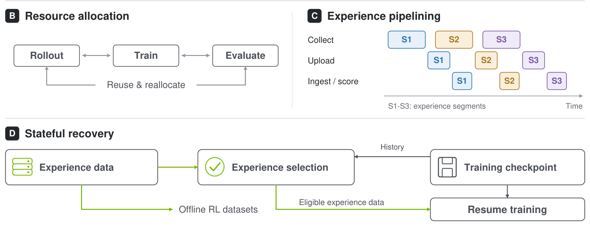

<!-- p.90 C065 · 图 F048 -->

Figure 48: Online post-training infrastructure. (A) Algorithm interfaces, worker groups, and shared services. (B) Resource allocation across execution roles. (C) Experience pipelining. (D) Stateful recovery. Execution patterns are illustrative.

图 48：在线后训练基础设施。(A) 算法接口、工作组与共享服务。(B) 跨执行角色的资源分配。(C) 经验流水线。(D) 有状态恢复。执行模式仅作示意。

<!-- p.90 S1656 -->

Stateful Recovery. Physical experience is expensive to reproduce, making robustness to interrupted training essential. Our infrastructure retains experience data and feedback alongside model and optimizer checkpoints. Recovery distinguishes experience already reflected in a restored checkpoint, data associated with discarded updates, and unused data. Compatible experience can subsequently be reused for resumed training or offline learning, reducing redundant physical interaction. This complements prior work on distributed RL execution and durable robot experience data (Yu et al., 2026a; Zang et al., 2026a,b; Wang et al., 2026; Chen et al., 2026c).

有状态恢复。物理经验的复现成本高昂，因此对中断训练的鲁棒性至关重要。我们的基础设施将经验数据和反馈与模型及优化器检查点一并保存。恢复过程会区分三类数据：已体现在所恢复检查点中的经验、与被丢弃更新相关的数据，以及未使用的数据。兼容的经验随后可用于恢复训练或离线学习，从而减少重复的物理交互。这补充了已有关于分布式强化学习执行与持久化机器人经验数据的工作（Yu et al., 2026a; Zang et al., 2026a,b; Wang et al., 2026; Chen et al., 2026c）。

<!-- p.90 S1657 -->

Execution Efficiency. We evaluate infrastructure efficiency in simulation and real-robot training.

执行效率。我们在仿真与真实机器人训练中评估基础设施的效率。

<!-- p.90 S1658 -->

In RoboCasa365 GRPO, rollout and training alternate on a shared 40-GPU pool while evaluation retains 40 GPUs. This reduces total allocation from 120 to 80 GPUs and enables evaluation to overlap training. Across eight rounds and nine evaluations, execution time decreases from 14.1 to 8.8 hours, corresponding to approximately 1.6× improvement in update throughput.

在 RoboCasa365 GRPO 中，rollout 与训练交替使用一个共享的 40 块 GPU 资源池，而评测保留 40 块 GPU。这将总分配量从 120 块 GPU 减少到 80 块，并使评测能够与训练重叠进行。在八轮训练与九次评测中，执行时间从 14.1 小时减少到 8.8 小时，对应更新吞吐量提升约 1.6×。

<!-- p.90 S1659 -->

For single-robot GRPO (Tab. 18), experience pipelining and trainer-ready records reduce upload and conversion time from approximately 50 minutes to one minute, while transferring only tuned weights reduces policy download time from approximately 30 minutes to one minute. Total iteration time decreases from between 140 and 160 minutes to between 62 and 72 minutes, yielding approximately 2.2× iteration throughput. Incremental uploads overlap data transfer with physical collection, leaving only a short data-handling delay at the end of each round. These mechanisms reduce overhead without requiring faster robot execution, allowing more

对于单机器人 GRPO（Tab. 18），经验流水线与可直接供训练器使用的记录将上传与转换时间从约 50 分钟缩短至 1 分钟，而仅传输调优后的权重则将策略下载时间从约 30 分钟缩短至 1 分钟。总迭代时间从 140 至 160 分钟减少到 62 至 72 分钟，迭代吞吐量约提升 2.2×。增量上传使数据传输与物理采集相互重叠，每轮结束时只剩下很短的数据处理延迟。这些机制在不要求机器人执行更快的前提下降低了开销，使得

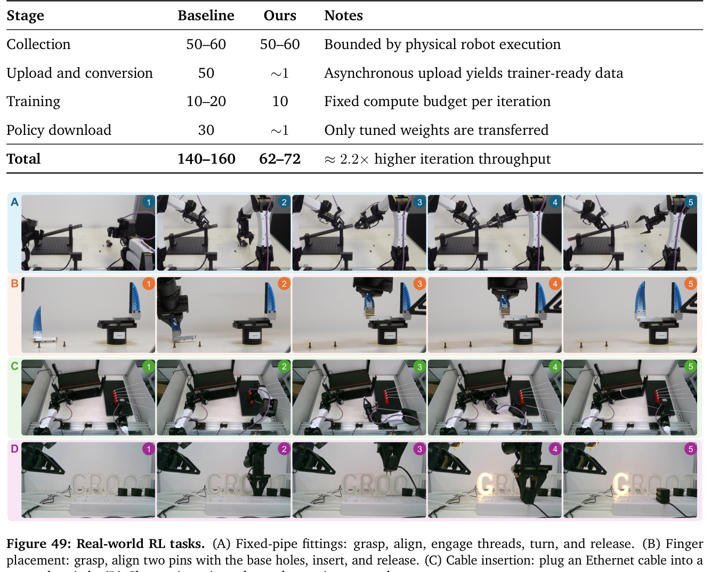

<!-- p.91 C066 · 表 T018 -->

Table 18: Per-iteration time breakdown for single-robot GRPO. All times are reported in minutes.

表 18：单机器人 GRPO 每次迭代的时间分解。所有时间均以分钟为单位。

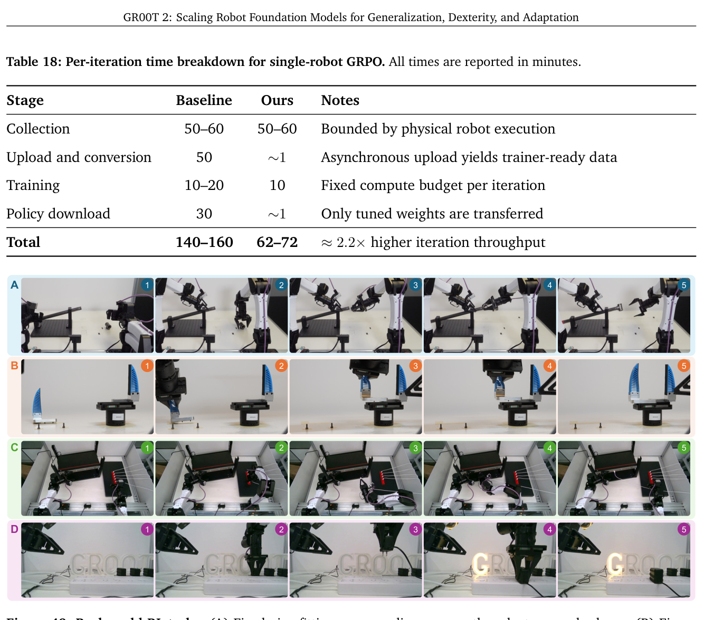

<!-- p.91 C067 · 图 F049 -->

Figure 49: Real-world RL tasks. (A) Fixed-pipe fittings: grasp, align, engage threads, turn, and release. (B) Finger placement: grasp, align two pins with the base holes, insert, and release. (C) Cable insertion: plug an Ethernet cable into a network switch. (D) Charger insertion: plug a charger into an outlet.

图 49：真实世界强化学习任务。(A) 固定管件：抓取、对准、啮合螺纹、旋转并释放。(B) 手指放置：抓取、将两根销钉对准底座孔位、插入并释放。(C) 线缆插入：将以太网线插入网络交换机。(D) 充电器插入：将充电器插入插座。

<!-- p.91 S1674 -->

efficient use of limited physical interaction resources.

更高效地利用有限的物理交互资源。

## F.4. Precision Manipulation through RL Post-Training · 通过 RL 后训练实现精密操作

<!-- p.91 S1675 -->

We evaluate three complementary post-training approaches on four real-world contact-rich manipulation tasks, demonstrating how GR00T 2 improves through RL-based learning and targeted policy adaptation.

我们在四个真实世界的富接触操作任务上评估了三种互补的后训练方法，展示 GR00T 2 如何通过基于强化学习（RL）的学习和有针对性的策略适配获得提升。

<!-- p.91 S1676 -->

Tasks. Our evaluation includes four precision manipulation tasks (Fig. 49). In fixed-pipe fittings, the robot grasps a threaded tee fitting, aligns it with a horizontally mounted pipe, engages the threads, and completes one full turn. This is the Fixed-Pipe Fittings task of Tab. 1a, but each RL trial starts from a fitting pose that the post-trained policy struggles with. In finger placement, the robot inserts two 3 mm pins on a gripper finger into matching holes on a fixed base, requiring accurate position and yaw alignment.

任务。我们的评估包含四个精密操作任务（Fig. 49）。在固定管件（fixed-pipe fittings）任务中，机器人抓取一个带螺纹的三通管件，将其与水平安装的管道对齐，咬合螺纹，并完整旋转一圈。这就是 Tab. 1a 中的 Fixed-Pipe Fittings 任务，但每次 RL 试次都从一个后训练策略难以应对的管件位姿开始。在手指放置（finger placement）任务中，机器人需要把夹爪手指上的两根 3 mm 销钉插入固定底座上对应的孔中，这要求准确的位置对齐和偏航（yaw）对齐。

<!-- p.91 S1677 -->

In cable insertion, the robot inserts an Ethernet connector into a designated network-switch port, with success determined by network-link connectivity. In charger insertion, the robot inserts a two-prong charger into a specified outlet within a 2 × 6 grid. These tasks involve tight geometric tolerances, partial occlusion, and contact-sensitive execution.

在线缆插入（cable insertion）任务中，机器人将以太网接头插入指定的网络交换机端口，成功与否以网络链路是否连通为准。在充电器插入（charger insertion）任务中，机器人需要把两极插头的充电器插入 2 × 6 网格中指定的插座。这些任务涉及严格的几何公差、部分遮挡以及对接触敏感的执行过程。

<!-- p.91 S1678 -->

Evaluation Protocol. All evaluated methods build on the same SFT-initialized GR00T 2 checkpoint, either as an initialization or as a frozen base. GRPO directly updates GR00T 2 using both successful and failed trajectories. Self-imitation reuses successful GRPO rollouts without additional collection. Residual RL instead learns a separate controller on top of the frozen base, using human-assisted training experience.

评估协议。所有被评估的方法都以同一个经监督微调（SFT）初始化的 GR00T 2 检查点为基础，它要么作为初始化，要么作为冻结的基座。GRPO 直接使用成功和失败的轨迹来更新 GR00T 2。自模仿（self-imitation）复用成功的 GRPO rollout，不需要额外采集。残差强化学习（Residual RL）则相反，它在冻结的基座之上学习一个独立的控制器，并使用人工辅助的训练经验。

<!-- p.92 S1680 -->

For each task, evaluations use the same target distribution, reset conditions, and time limits, with no human intervention during evaluation. Trials are independent of training rollouts, and we report per-task success rates. An episode is considered a failure if misalignment prevents the policy from recovering or if the insertion exceeds the time limit.

对每个任务，评估都使用相同的目标分布、重置条件和时间限制，评估期间不进行人工干预。试次与训练 rollout 相互独立，我们报告各任务的成功率。若错位使策略无法恢复，或插入过程超过时间限制，则该回合记为失败。

<!-- p.92 S1681 -->

Real-World Results. Direct RL on GR00T 2 improves precision manipulation. GRPO increases success rates on all four tasks (Fig. 5), raising fixed-pipe fittings from 66% to 86%, finger placement from 58% to 72%, cable insertion from 76% to 92%, and charger insertion from 40% to 94%. With 50 trials per task, the gains on charger insertion and fixed-pipe fittings are significant at the 5% level (two-sided Fisher exact test), whereas those on cable insertion (38 to 46 successes) and finger placement (29 to 36) are not conclusive at this sample size.

真实世界结果。对 GR00T 2 直接进行 RL 可以提升精密操作能力。GRPO 在全部四个任务上都提高了成功率（Fig. 5），固定管件从 66% 提高到 86%，手指放置从 58% 提高到 72%，线缆插入从 76% 提高到 92%，充电器插入从 40% 提高到 94%。每个任务进行 50 次试次时，充电器插入和固定管件的提升在双侧 Fisher 精确检验下达到 5% 显著性水平；而线缆插入（成功次数从 38 增至 46）和手指放置（从 29 增至 36）的提升在此样本量下尚无定论。

<!-- p.92 S1682 -->

Self-imitation consolidates successful RL exploration. Self-imitation reaches 88% on fixed-pipe fittings, 98% on finger placement, 94% on cable insertion, and 96% on charger insertion, matching or exceeding GRPO on all four tasks. The gain is most pronounced on finger placement, where success rises from 72% to 98%.

自模仿巩固了成功的 RL 探索。自模仿在固定管件上达到 88%，在手指放置上达到 98%，在线缆插入上达到 94%，在充电器插入上达到 96%，在全部四个任务上都与 GRPO 持平或超过 GRPO。提升最明显的是手指放置任务，其成功率从 72% 升至 98%。

<!-- p.92 S1683 -->

These results highlight the potential of combining RL exploration with supervised policy optimization. RL discovers successful behaviors through interaction, while self-imitation consolidates them under a stable supervised objective. This offers a complementary route to improving GR00T 2 beyond direct policy-gradient optimization.

这些结果凸显了将 RL 探索与监督式策略优化相结合的潜力。RL 通过交互发现成功的行为，而自模仿则在稳定的监督目标下巩固这些行为。这为改进 GR00T 2 提供了一条补充途径，超越了直接的策略梯度优化。

<!-- p.92 S1684 -->

Residual RL enables targeted adaptation without updating GR00T 2. Residual RL reaches 76% on fixed-pipe fittings, 84% on finger placement, 82% on cable insertion, and 70% on charger insertion, with clear gains over supervised post-training on finger placement and charger insertion. These results show that lightweight corrective controllers can improve precision execution while leaving the pretrained GR00T 2 intact.

残差 RL 无需更新 GR00T 2 即可实现有针对性的适配。残差 RL 在固定管件上达到 76%，在手指放置上达到 84%，在线缆插入上达到 82%，在充电器插入上达到 70%，并且在手指放置和充电器插入上相对监督后训练有明显提升。这些结果表明，轻量级的纠正性控制器可以在保持预训练 GR00T 2 完整不变的同时，提升精密执行能力。

<!-- p.92 S1685 -->

These experiments show that direct RL, self-imitation, and residual RL can improve GR00T 2’s precision manipulation through complementary forms of post-training.

这些实验表明，直接 RL、自模仿和残差 RL 都能通过各自互补的后训练形式，提升 GR00T 2 的精密操作能力。

<!-- p.92 S1686 -->

The preceding experiments improve policies through physical interaction. We next investigate a complementary source of training experience: interaction with a learned environment constructed from recorded policy rollouts.

前面的实验是通过物理交互来改进策略的。接下来，我们研究另一种互补的训练经验来源：与一个由已录制的策略 rollout 构建而成的学习环境进行交互。

## F.5. Reinforcement Learning with Neural Simulation · 基于神经仿真的强化学习

<!-- p.92 S1687 -->

In neural-simulation RL, the policy interacts with a learned world model in place of the physical environment. This changes how training experience is generated while retaining reward-based optimization of the pretrained world-action policy.

在神经仿真 RL 中，策略与一个学习得到的世界模型交互，以代替物理环境。这改变了训练经验的生成方式，同时保留了对预训练世界-动作策略进行基于奖励的优化。

<!-- p.92 S1688 -->

We use DreamDojo (Gao et al., 2026), initialized from pretrained video priors, to turn recorded robot interactions into a learning environment. Successful and failed attempts provide supervision for task-specific adaptation. A pretrained GR00T 2 policy can then collect further training experience through interaction with the adapted model. Task rollouts are still required to construct this environment, while subsequent policy-learning rollouts are generated in neural simulation.

我们使用 DreamDojo（Gao et al., 2026），以预训练的视频先验进行初始化，将已录制的机器人交互转化为学习环境。成功和失败的尝试为面向具体任务的适配提供监督。随后，预训练的 GR00T 2 策略可以通过与适配后的模型交互，收集更多训练经验。构建该环境仍然需要任务 rollout，而之后的策略学习 rollout 则在神经仿真中生成。

<!-- p.92 S1689 -->

To support policy learning, the model’s predictions must provide usable inputs to GR00T 2 throughout an episode. We provide multi-view camera predictions, align them with executed action chunks, and approximate proprioceptive inputs using action targets. We also maintain visual history across successive world-model calls. We first describe world-model construction and the closed-loop policy interface, including support for long-horizon interaction. We then present the experimental setup, reward modeling and policy optimization, and results in RoboLab and on real-world tasks.

为支持策略学习，模型的预测在整个回合中都必须能为 GR00T 2 提供可用的输入。我们提供多视角相机预测，将其与已执行的动作块对齐，并使用动作目标近似本体感知输入。我们还在连续的世界模型调用之间维持视觉历史。我们首先介绍世界模型的构建以及闭环策略接口，包括对长时序交互的支持。随后介绍实验设置、奖励建模与策略优化，以及在 RoboLab 和真实世界任务上的结果。

<!-- p.92 S1690 -->

Training Data and Task Adaptation. We first mid-train DreamDojo on multi-view episodes, then adapt the resulting model to downstream tasks. The bimanual YAM corpus contains 8,310 four-view episodes from policy rollouts and DAgger collection, including failed attempts and recovery. These episodes total approximately 226.8 hours at 30 Hz. The DROID source corpus contains 57,773 episodes, approximately 273 hours at 15 Hz, with three synchronized camera views and recorded joint and gripper actions.

训练数据与任务适配。我们先在多视角回合上对 DreamDojo 进行中段训练（mid-training），然后将得到的模型适配到下游任务。双臂 YAM 数据集包含 8,310 个四视角回合，来自策略 rollout 和 DAgger 采集，其中包括失败尝试和恢复过程。这些回合合计约 226.8 小时，采样频率为 30 Hz。DROID 源数据集包含 57,773 个回合，约 273 小时，采样频率为 15 Hz，具有三个同步的相机视角，并记录了关节动作和夹爪动作。

<!-- p.93 S1692 -->

We tile synchronized camera views into one video canvas so that the model predicts them jointly using DreamDojo’s existing video backbone and causal variational autoencoder (VAE). YAM uses a 2 × 2 layout at 480 × 640 pixels. DROID concatenates three 180 × 320 views horizontally and pads the canvas vertically to 192 × 960 pixels.

我们把同步的相机视角平铺拼接成一张视频画布，使模型能够利用 DreamDojo 现有的视频主干网络和因果变分自编码器（VAE）对它们进行联合预测。YAM 采用 480 × 640 像素的 2 × 2 布局。DROID 将三个 180 × 320 的视角水平拼接，并在垂直方向上将画布填充至 192 × 960 像素。

<!-- p.93 S1693 -->

Video and action sampling are aligned separately. For YAM, we downsample video from 30 to 15 Hz while retaining fourteen-dimensional actions at 30 Hz. Each window contains five conditioning frames and twelve future frames, paired with 24 future actions. DROID video and eight-dimensional actions both remain at 15 Hz, and each window contains five conditioning frames and sixteen future frames. We precompute and cache VAE latents, which are the compressed video representations used by the world model. We sample temporally aligned training windows from this cache, avoiding repeated encoding of the same recorded videos.

视频采样与动作采样分别对齐。对于 YAM，我们将视频从 30 Hz 降采样到 15 Hz，同时保留 30 Hz 的十四维动作。每个窗口包含五个条件帧和十二个未来帧，并与 24 个未来动作配对。DROID 的视频和八维动作均保持在 15 Hz，每个窗口包含五个条件帧和十六个未来帧。我们预先计算并缓存 VAE 潜变量，它们是世界模型所使用的压缩视频表示。我们从该缓存中采样时间对齐的训练窗口，避免对相同的已录制视频重复编码。

<!-- p.93 S1694 -->

Task adaptation. We adapt the mid-trained world model to the scenes and action distributions encountered by the target policy. Successful and failed rollouts provide supervision on the states reached during execution, allowing the model to learn task-relevant visual changes and action effects. We fine-tune the model on these rollouts using the multi-view representation and temporal alignment used during policy interaction. Recorded robot actions and world-model inputs use consistent action coordinates and normalization.

任务适配。我们将中段训练后的世界模型适配到目标策略所遇到的场景和动作分布。成功和失败的 rollout 为执行过程中到达的状态提供监督，使模型能够学习与任务相关的视觉变化和动作效果。我们在策略交互时所用的多视角表示和时间对齐方式下，利用这些 rollout 对模型进行微调。已录制的机器人动作与世界模型输入使用一致的动作坐标和归一化方式。

<!-- p.93 S1695 -->

Closed-Loop Simulation Interface. To collect experience for policy optimization, we alternate GR00T 2 action prediction with world-model prediction throughout a task episode. A rollout starts from recorded multi-view observations. GR00T 2 predicts an action sequence, and the world model predicts the camera observations resulting from its executed prefix. These predicted images become the policy’s next visual input, allowing GR00T 2 to respond to the consequences of its own actions. Repeating this interaction produces a trajectory for reward evaluation and policy learning.

闭环仿真接口。为了收集策略优化所需的经验，我们在整个任务回合中交替进行 GR00T 2 的动作预测与世界模型预测。rollout 从已录制的多视角观测开始。GR00T 2 预测一段动作序列，世界模型则预测其已执行前缀所导致的相机观测。这些预测图像成为策略的下一个视觉输入，使 GR00T 2 能够对自身动作的后果作出响应。重复这一交互过程，即可得到用于奖励评估和策略学习的轨迹。

<!-- p.93 S1696 -->

At interaction round 𝑟, GR00T 2 samples an action plan from the current observation and task instruction. Let 𝐴𝑟denote its executed prefix of 𝐻actions and 𝐶𝑟the world model’s conditioning latents. Initially, 𝐶0 is obtained by encoding five recorded video frames into two latent frames. The mapping 𝑔converts actions into the world model’s action coordinates and normalization. Future latents and the next conditioning history are then given by

在第 𝑟 轮交互中，GR00T 2 从当前观测和任务指令中采样一个动作计划。记 𝐴𝑟 为其已执行的 𝐻 个动作前缀，𝐶𝑟 为世界模型的条件潜变量。初始时，𝐶0 通过将五个已录制视频帧编码为两个潜变量帧得到。映射 𝑔 将动作转换为世界模型的动作坐标和归一化方式。未来潜变量及下一个条件历史由下式给出：[存疑：抽取结果中缺少该公式] [公式原文见 p.93]

<!-- p.93 S1700 -->

Here, Tail2 retains the final two latent frames of the concatenated conditioning and predicted sequence. After decoding, we remove the overlapping conditioning prefix and append the newly predicted images to the policy’s visual history. The views and historical frames required by GR00T 2 form its next observation, closing the interaction loop.

这里，Tail2 保留拼接后的条件序列与预测序列中的最后两个潜变量帧。解码之后，我们去掉重叠的条件前缀，并将新预测的图像追加到策略的视觉历史中。GR00T 2 所需的视角和历史帧构成其下一步观测，从而闭合交互回路。

<!-- p.93 S1701 -->

The rollout preserves the video-action alignment used during training. For YAM, the world model predicts twelve new video frames at 15 Hz for 24 native actions at 30 Hz. For DROID/RoboLab, it predicts sixteen frames for sixteen actions, both at 15 Hz. We query the policy again after executing this action prefix and truncate the final round at the task horizon.

rollout 保持了训练时使用的视频-动作对齐方式。对于 YAM，世界模型以 15 Hz 预测 12 个新视频帧，对应 30 Hz 下的 24 个原生动作。对于 DROID/RoboLab，它预测 16 帧，对应 16 个动作，两者均以 15 Hz 运行。执行完该动作前缀后，我们会再次查询策略，并在任务时限处截断最后一轮。

<!-- p.93 S1702 -->

We exclude the five-frame conditioning prefix from the images returned to the policy. RoboLab decodes the complete latent window at each round. YAM retains the causal decoder cache and decodes only new latents after the first round. This decoder cache is separate from the latent history passed to the world model. For policies requiring proprioception, we initialize the state input from the recorded reset state. At each later policy query, we use the last executed action target as an approximation of the current robot state.

返回给策略的图像不包含五帧条件前缀。RoboLab 在每一轮都解码完整的潜变量窗口。YAM 则保留因果解码器缓存，仅在第一轮之后解码新的潜变量。该解码器缓存与传入世界模型的潜变量历史是分开的。对于需要本体感知的策略，我们从已录制的重置状态初始化状态输入。在之后的每次策略查询中，我们使用上一次已执行的动作目标作为当前机器人状态的近似。

<!-- p.94 S1703 -->

Long-Horizon Prediction. Policy learning requires multiple rounds of interaction, whereas the world model is trained on short video windows. We therefore generate successive segments autoregressively. After the first segment, the model conditions on its own predictions rather than recorded observations. Errors in this history can affect subsequent predictions and policy decisions.

长时序预测。策略学习需要多轮交互，而世界模型是在短视频窗口上训练的。因此，我们以自回归方式生成连续片段。在第一个片段之后，模型以自身的预测而非已录制的观测作为条件。该历史中的误差可能影响后续的预测和策略决策。

<!-- p.94 S1704 -->

For the DROID-derived model used in RoboLab, we perturb recorded conditioning latents during training to expose the model to imperfect visual histories, while keeping recorded future latents as prediction targets. For a clean conditioning tensor 𝐶, we use

对于 RoboLab 所用的 DROID 衍生模型，我们在训练时扰动已录制的条件潜变量，使模型接触到不完美的视觉历史，同时保留已录制的未来潜变量作为预测目标。对于干净的条件张量 𝐶，我们采用下式：

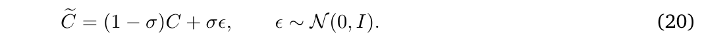

<!-- p.94 E007 -->

𝐶= (1 −𝜎)𝐶+ 𝜎𝜖, 𝜖∼𝒩(0, 𝐼). (20)

该式描述对条件张量加噪的方式：以噪声强度 𝜎 将 𝐶 与标准高斯噪声 𝜖 混合，式中原样保留为 $$𝐶= (1 −𝜎)𝐶+ 𝜎𝜖, 𝜖∼𝒩(0, 𝐼). (20)$$ [公式原文见 p.94] [存疑：左侧 𝐶 与右侧 𝐶 可能是不同符号，抽取未保留其区别]

<!-- p.94 S1705 -->

The noise strength 𝜎is sampled from 0, 0.0245, 0.0480, and 0.0925 with probabilities 0.2, 0.2, 0.4, and 0.2, respectively. We also explored replacing recorded history with a model-generated preceding segment, with gradients stopped through that history. These preliminary trials showed no clear additional benefit over noise augmentation, which we retain in the final training recipe.

噪声强度 𝜎 从 0、0.0245、0.0480 和 0.0925 中采样，对应概率分别为 0.2、0.2、0.4 和 0.2。我们也尝试过用模型生成的前序片段替代已录制的历史，并让梯度在该历史处截断。这些初步试验表明，它相对于噪声增广（noise augmentation）并没有明显的额外收益，因此我们在最终训练配方中保留了噪声增广。

<!-- p.94 S1706 -->

At rollout time, we pass the final two predicted latent frames to the next world-model segment as its conditioning history. This avoids decoding and re-encoding images to construct that history. We still decode predicted latents into images for GR00T 2: the world model carries its history in latent space, while the policy receives camera observations in pixel space.

在 rollout 时，我们将最后两个预测潜变量帧作为下一个世界模型片段的条件历史传入。这样就无需先解码再重新编码图像来构建该历史。不过，我们仍会将预测的潜变量解码为图像供 GR00T 2 使用：世界模型在潜空间中保存其历史，而策略则在像素空间中接收相机观测。

<!-- p.94 S1707 -->

Experimental Setup. Starting from SFT, GRPO updates GR00T 2 through interaction with the learned environment, while the world model and learned success detector remain fixed. Native RoboLab evaluation and real-world execution test whether these updates improve behavior outside the learned environment.

实验设置。以 SFT 为起点，GRPO 通过与学习得到的环境交互来更新 GR00T 2，同时世界模型和学习得到的成功检测器保持固定。原生 RoboLab 评测与真实世界执行用于检验这些更新能否在学习得到的环境之外改善行为。

<!-- p.94 S1708 -->

We collect rollouts from the initial GR00T 2 policy, retaining successful and failed attempts for world-model adaptation and reward supervision. The study covers ten RoboLab tasks and four families of physical manipulation: peg insertion, test-tube insertion into a specified rack hole, bun placement on yellow and white cups, and hardware sorting with nine instructions. Hardware sorting tests whether the policy selects the requested target object and destination from three target object categories and three colored trays in the presence of distractors. Fig. 52 illustrates the physical task setups.

我们从初始的 GR00T 2 策略采集 rollout，保留成功和失败的尝试，用于世界模型适配和奖励监督。该研究涵盖十个 RoboLab 任务，以及四类物理操作：插销插入（peg insertion）、将试管插入指定的试管架孔位、将小圆面包放置到黄色和白色杯子上，以及根据九条指令进行硬件分拣。硬件分拣用于检验策略在存在干扰物时，能否从三类目标物体和三个彩色托盘中选出所要求的目标物体与目的地。Fig. 52 展示了物理任务的设置。

<!-- p.94 S1709 -->

World-model adaptation uses 300 physical rollouts for each insertion task and each of the two bun-placement tasks, and approximately 300 rollouts in total for hardware sorting. The insertion and hardware tasks share a jointly adapted world model, while a separate model is adapted for bun placement. For RoboLab, we adapt one shared world model using 450 training trajectories per task across 64 tasks, with 50 trajectories per task held out. Joint policy RL uses ten tasks from this collection. Each RL run starts from its SFT baseline and keeps the world model and reward model fixed. RoboLab reward supervision uses 450 training and 50 validation trajectories per task. The test-tube success detector uses a separate set of 600 training and 120 validation videos labeled for insertion and release in the designated rack hole.

世界模型适配使用的物理 rollout 数量为：每个插入任务以及两个小圆面包放置任务各 300 条，硬件分拣总计约 300 条。插入任务与硬件分拣任务共享一个联合适配的世界模型，而小圆面包放置则单独适配一个模型。对于 RoboLab，我们使用 64 个任务、每个任务 450 条训练轨迹适配一个共享的世界模型，并且每个任务另留出 50 条轨迹。联合策略 RL 使用该集合中的十个任务。每次 RL 运行都从其 SFT 基线开始，并保持世界模型和奖励模型固定。RoboLab 奖励监督使用每个任务 450 条训练轨迹和 50 条验证轨迹。试管成功检测器使用另外一组 600 段训练视频和 120 段验证视频，这些视频标注了在指定试管架孔位中的插入与释放。

<!-- p.94 S1710 -->

Reward Modeling and Policy Optimization. Sparse rewards. Dense progress rewards are difficult to obtain consistently across manipulation tasks and expensive to annotate. They can also introduce reward hacking when a policy increases a proxy score without completing the requested goal. We therefore use sparse task-completion rewards, learning a binary success detector rather than a continuous progress score.

奖励建模与策略优化。稀疏奖励。稠密的进度奖励难以在各类操作任务中稳定获得，且标注成本高昂。当策略提升了代理分数却没有完成所要求的目标时，它们还可能引入奖励投机（reward hacking）。因此，我们采用稀疏的任务完成奖励，即学习一个二值成功检测器，而不是连续的进度分数。

<!-- p.94 S1711 -->

We train compact success detectors based on VideoMAE (Tong et al., 2022) to provide rewards during RL. For physical videos, a vision-language model (VLM) proposes outcome labels and supporting visual evidence, and targeted human review resolves ambiguous cases. These offline labels supervise the compact detectors, avoiding VLM queries during policy learning. For hardware sorting only, annotated world-model rollouts augment the recorded videos to cover observations encountered in neural simulation. The other reward models use recorded task data.

我们基于 VideoMAE（Tong et al., 2022）训练紧凑的成功检测器，在 RL 过程中提供奖励。对于物理视频，视觉语言模型（VLM）提出结果标签及支撑性的视觉证据，有针对性的人工复核则解决有歧义的情况。这些离线标签用于监督紧凑检测器，从而避免在策略学习过程中调用 VLM。仅针对硬件分拣，已标注的世界模型 rollout 会对已录制的视频进行增广，以覆盖神经仿真中遇到的观测。其他奖励模型使用已录制的任务数据。

<!-- p.94 S1712 -->

Success is defined by the requested instruction: choosing the wrong object or destination is a negative outcome.

成功由所请求的指令定义：选错物体或目的地属于负面结果。

<!-- p.95 S1713 -->

We use task-specific detectors, including instruction-specific outputs for joint hardware sorting. RoboLab provides native success labels, while physical-task labels use recorded outcomes and reviewed visual evidence. The detector and its task-specific decision rule remain fixed during RL. Final policy evaluation uses native RoboLab outcomes and physical execution, independently of the learned reward model.

我们使用面向具体任务的检测器，其中包括用于联合硬件分拣的指令特定输出。RoboLab 提供原生成功标签，物理任务的标签则使用已录制的结果及经复核的视觉证据。在 RL 过程中，检测器及其面向具体任务的判定规则保持固定。最终的策略评测使用 RoboLab 原生结果和物理执行结果，且与学习得到的奖励模型相互独立。

<!-- p.95 S1714 -->

Policy optimization. We apply the clipped transition-level policy optimization principle of Sec. F.1.1 to interaction with a fixed learned environment. We collect groups of attempts from the same recorded reset context and score them with the learned success detector. The neural-simulation experiments use Flow-SDE (Liu et al., 2025) for stochastic action denoising, while the physical-RL recipe uses CPS. Both provide tractable transition densities for likelihood-ratio updates.

策略优化。我们将 Sec. F.1.1 中的截断式转移级策略优化原则，应用于与固定学习环境的交互。我们从同一条已录制的重置上下文中采集多组尝试，并用学习得到的成功检测器对其打分。神经仿真实验使用 Flow-SDE（Liu et al., 2025）进行随机动作去噪，而物理 RL 配方使用保系数采样（CPS）。两者都为似然比更新提供了可计算的转移密度。

<!-- p.95 S1715 -->

We optimize a clipped likelihood-ratio objective on selected action-denoising transitions. For each selected transition, we store the sampled latent input and output, denoising index, conditioning inputs, and behaviorpolicy probability. During optimization, we replay the same transition and recompute its probability under the current parameters with gradients enabled. The sampled transition and noise schedule remain fixed, so the likelihood ratio compares the two policies on the same sampled event.

我们在选定的动作去噪转移上优化一个截断似然比目标。对于每个选定的转移，我们存储采样得到的潜变量输入与输出、去噪索引、条件输入以及行为策略概率。在优化过程中，我们重放同一转移，并在开启梯度的情况下，用当前参数重新计算其概率。采样得到的转移与噪声调度保持固定，因此似然比是在同一个采样事件上比较两个策略。

<!-- p.95 S1716 -->

Consistent replay is necessary because numerical differences can produce an apparent policy change before any update. We disable dropout, preserve positional-encoding precision, and check rollout and replay logprobabilities under unchanged weights before the first optimizer update. Activation checkpointing reduces memory use during backpropagation through the joint world-action model described in Sec. F.1.1. The likelihood ratio scores the selected action transition, with no separate video-likelihood objective or learned critic. In the physical-task recipe, we compute the actor loss using actions up to and including the first chunk in which success is confirmed. Later actions are excluded.

保持重放一致是必要的，因为数值差异可能在任何更新之前就产生看似存在的策略变化。我们关闭随机丢弃（dropout），保留位置编码的精度，并在第一次优化器更新之前，在权重不变的情况下检查 rollout 与重放的对数概率。激活值检查点（activation checkpointing）降低了在 Sec. F.1.1 中所述的联合世界-动作模型上进行反向传播时的内存占用。似然比只对所选的动作转移进行评分，不使用单独的视频似然目标，也不使用学习得到的评论者（critic）。在物理任务配方中，我们使用直到并包含首个确认成功的动作块为止的动作来计算 actor 损失，之后的动作则被排除在外。

<!-- p.95 S1717 -->

Policy Improvement in RoboLab. We evaluate task success using native RoboLab outcomes, independently of the learned world model and reward model. Fig. 50 compares the SFT policy with the policy obtained by joint RL from that initialization. Each policy is evaluated for 500 episodes per task, or 5,000 episodes in total, using matched observation and action settings and full task horizons. Mean success increases from 51.32% to 70.88%, a gain of 19.56 percentage points.

RoboLab 中的策略改进。我们使用 RoboLab 原生结果评估任务成功情况，且与学习得到的世界模型和奖励模型相互独立。Fig. 50 比较了 SFT 策略与从同一初始化出发经联合 RL 得到的策略。每个策略在每个任务上评估 500 个回合，总计 5,000 个回合，观测与动作设置一致，并使用完整的任务时限。平均成功率从 51.32% 提高到 70.88%，提升 19.56 个百分点。

<!-- p.95 S1718 -->

Batch and group size. Sparse rewards connect exploration to optimization: a larger group can reveal a return difference that a smaller group misses. In RoboLab, we compare (𝐵, 𝐺) = (512, 8) and (1536, 24), where 𝐵is the number of trajectories collected per round and 𝐺the number of attempts per reset group. Both recipes collect 64 groups and perform four optimizer updates per round.

批量与分组大小。稀疏奖励将探索与优化联系在一起：较大的分组可能揭示较小分组会遗漏的回报差异。在 RoboLab 中，我们比较了 (𝐵, 𝐺) = (512, 8) 与 (1536, 24)，其中 𝐵 为每轮采集的轨迹数，𝐺 为每个重置分组中的尝试次数。两种配方都采集 64 个分组，并在每轮执行四次优化器更新。

<!-- p.95 S1719 -->

[英文原文未复制，见 PDF p.95 · S1719]

图 51(a) 展示了 DreamDojo 中的 rollout（轨迹采样）成功率与原生 RoboLab 成功率，覆盖十二个策略检查点（包括 SFT）。在每个策略 100 个回合的评测中，原生 RoboLab 成功率达到 71%。单独的最终评测每个策略使用 5,000 个回合，成功率从 51.32% 提升到 70.88%。DreamDojo 的成功率由学习到的奖励在训练 rollout 上测得，而 RoboLab 的评测使用原生任务结果。由于采样流程和时间范围不同，这些曲线只能反映各自设定内的学习进程，不能用来衡量仿真器的校准程度。

<!-- p.95 S1720 -->

[英文原文未复制，见 PDF p.95 · S1720]

图 51(b) 比较了十一个匹配的数据采集预算下、共计 67,584 条轨迹的结果。较大的组合批次/分组配置在十个预算点上原生 RoboLab 成功率更高，在十一个预算上的平均成功率高出 11.1 个百分点。在最终预算下，成功率为 71% 对 54%，相差 17 个百分点。在 24,576 条轨迹时，两者分别为 68% 和 47%。

<!-- p.95 S1721 -->

[英文原文未复制，见 PDF p.95 · S1721]

这些单次运行的结果有利于较大的组合配方。两者在优化过程和重置布局上也有差异：在最终预算下，较小配方进行了 528 次优化器更新，较大配方进行了 176 次。较小配方后期的延续训练还去掉了一个数值上的对数比下界。这些差异使得无法把结果归因于任一规模参数，而且每种配置只运行一次，也无法说明结果在独立运行之间是否稳定。

<!-- p.95 S1722 -->

[英文原文未复制，见 PDF p.95 · S1722]

真实任务上的策略改进。我们在以下任务上部署固定策略：插销、将试管插入指定试管架孔位、把面包放到黄杯和白杯上，以及九条指令的硬件分拣。对于

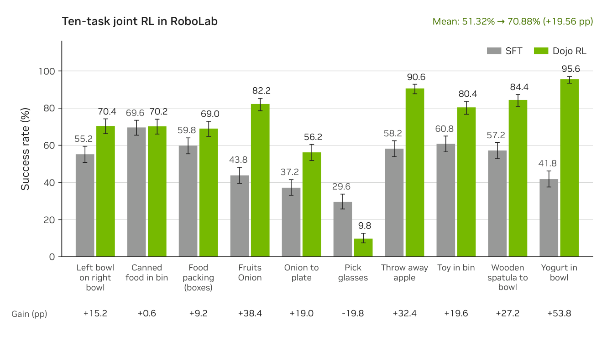

<!-- p.96 C068 · 图 F050 -->

[英文图注未复制，见 PDF p.96 · C068]

图 50：在十个 RoboLab 任务上的联合 RL。在 DreamDojo 中训练 GR00T 2 后，任务平均成功率从 51.32% 提升到 70.88%，每个任务和策略各评估 500 个回合。误差条表示 95% Wilson 置信区间。

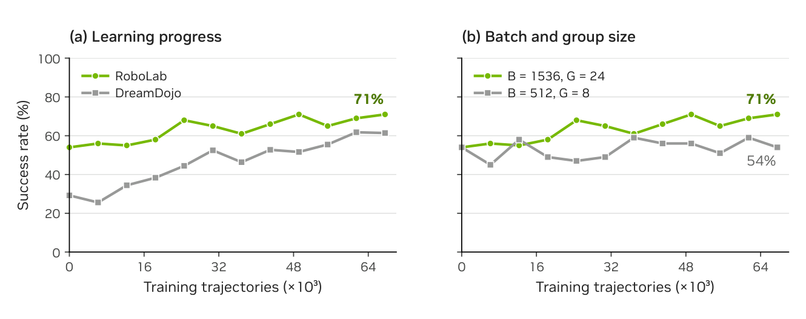

<!-- p.96 C069 · 图 F051 -->

[英文图注未复制，见 PDF p.96 · C069]

图 51：通过神经仿真进行的策略改进。(a) RL 过程中 DreamDojo 的 rollout 成功率与原生 RoboLab 成功率。(b) 两种批次/分组配置在匹配数据采集预算下的原生 RoboLab 成功率，分别达到 71% 和 54%。每种配置各有一次训练运行。批次和分组大小同时变化。

<!-- p.96 S1781 -->

[英文原文未复制，见 PDF p.96 · S1781]

插入类任务中，成功需要插入指定孔位并随后释放。对于面包放置，面包必须被释放到指定的杯子上。对于硬件分拣，目标物体必须被释放到指定的托盘中。结果以操作员记录为准，并在有的情况下采用经核对的人工复核标签。每个 RL 策略都与其 SFT 初始化进行比较。只有在确认使用相同参考场景时，硬件分拣的试次才会被纳入。

<!-- p.96 S1782 -->

[英文原文未复制，见 PDF p.96 · S1782]

图 52 比较了四个真实任务，每个策略和任务各 60 次试次。插销从 43.3% 提升到 81.7%，插入指定试管架孔位从 51.7% 提升到 73.3%。面包放置在黄杯上从 63.3% 提升到 76.7%，在白杯上从 11.7% 提升到 55.0%。四个任务等权平均的

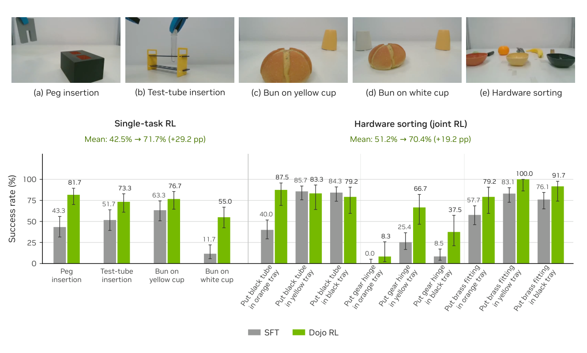

<!-- p.97 C070 · 图 F052 -->

[英文图注未复制，见 PDF p.97 · C070]

图 52：基于 DreamDojo 的真实世界策略改进。上排：双腿插销、将试管插入第五个试管架孔位、把面包放到黄杯和白杯上，以及硬件分拣。下排：RL 前后的任务成功率；九条硬件分拣指令由同一个 GR00T 2 策略联合训练。误差条表示 95% Wilson 置信区间。

<!-- p.97 S1829 -->

[英文原文未复制，见 PDF p.97 · S1829]

平均成功率从 42.5% 提升到 71.7%，增益为 29.2 个百分点。

<!-- p.97 S1830 -->

[英文原文未复制，见 PDF p.97 · S1830]

对于硬件分拣，一个 GR00T 2 策略在九条指令上与 RL 联合训练。这九条指令由三个目标物体（黑色管、齿轮铰链和黄铜接头）与三个目标托盘两两配对组成（图 52）。九条指令的成功率等权平均后，成功率从 51.2% 提升到 70.4%，增益为 19.2 个百分点。

<!-- p.97 S1831 -->

[英文原文未复制，见 PDF p.97 · S1831]

每条硬件指令有 70 或 71 次 SFT 试次和 24 次 RL 试次。RL 样本包括四次检查点选择试次，以及每条指令之后的 20 次重复评估试次。SFT 与 RL 在同一参考场景下、分别于不同批次中采集。

<!-- p.97 S1832 -->

[英文原文未复制，见 PDF p.97 · S1832]

讨论。这些结果表明，利用由世界模型产生的经验可以改进策略，而该世界模型已根据初始策略的 rollout 做过适配。GR00T 2 在此环境中学习，并在 RoboLab 以及真实机器人上接受评估。当前流程仍需要收集任务 rollout，并进行任务特定的世界模型适配。跨新任务复用已学习的环境，以及重复完整的世界模型与策略改进循环，仍是未来工作的方向。

<!-- p.97 S1833 -->

[英文原文未复制，见 PDF p.97 · S1833]

我们的实验聚焦于单项操作技能，这些技能是更复杂机器人行为的组成单元。这些技能可以整合进智能体式执行（第 G.1 节），由高层编排、进度监测和恢复机制协调跨更长任务时序的动作。因此，基于 RL 的适配与智能体式执行提供了互补的机制，共同提升机器人的可靠性，覆盖从精细的物理交互到长时序任务完成的范围。

<!-- p.97 S1834 -->

[英文原文未复制，见 PDF p.97 · S1834]

我们更长远的目标是开发可扩展的后训练方法，使世界-动作模型能够通过真实世界经验持续改进，并把能力扩展到日益困难的操作任务。
