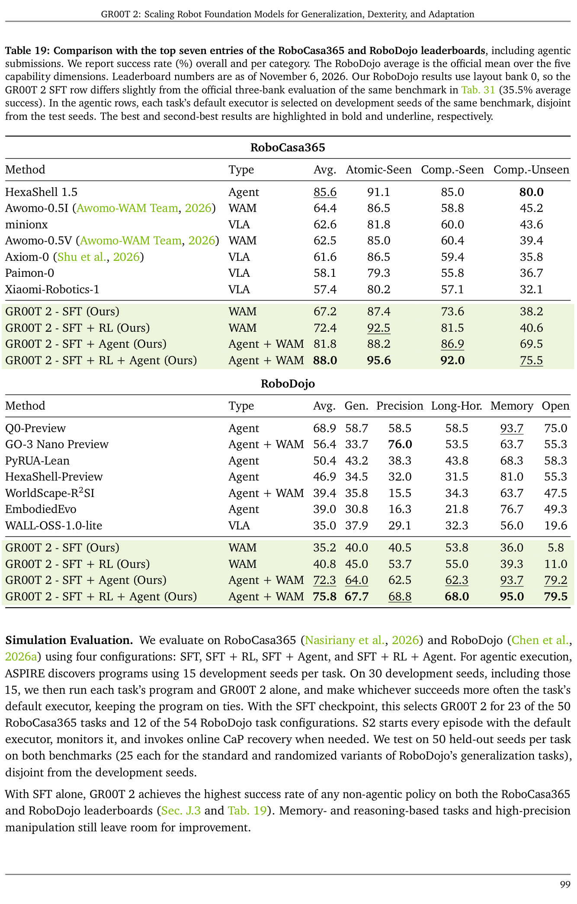
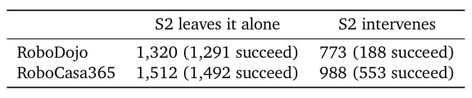
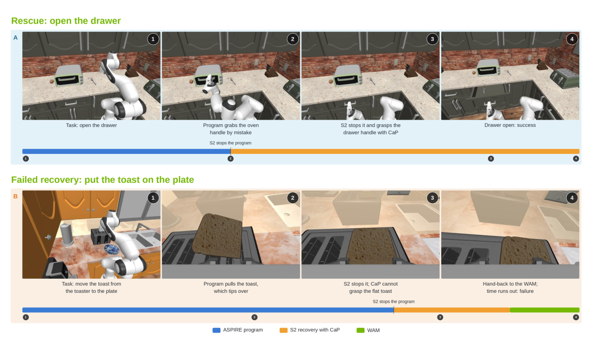
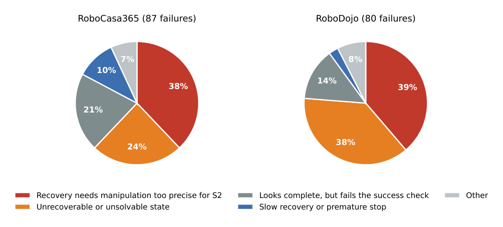
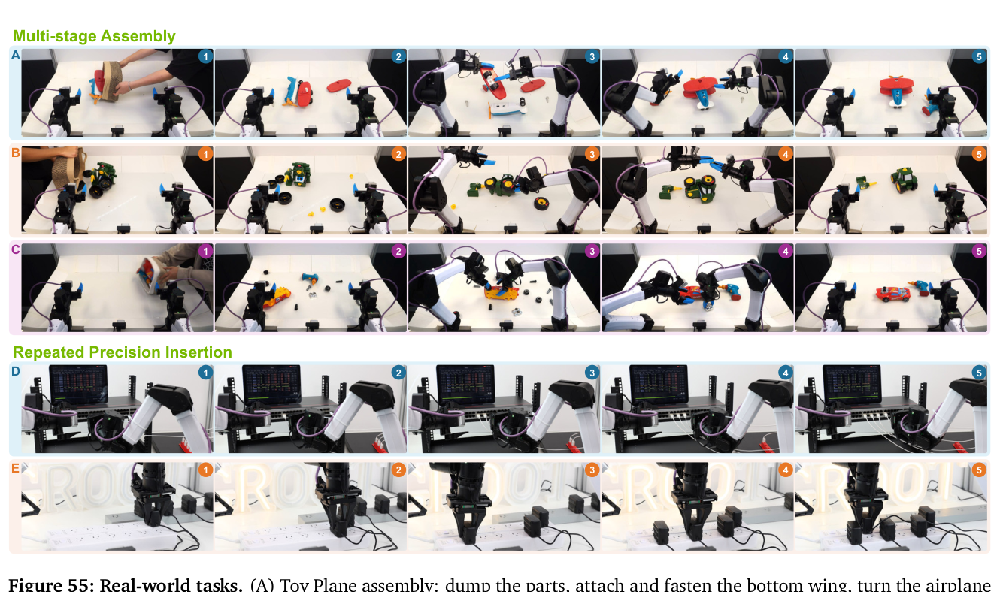
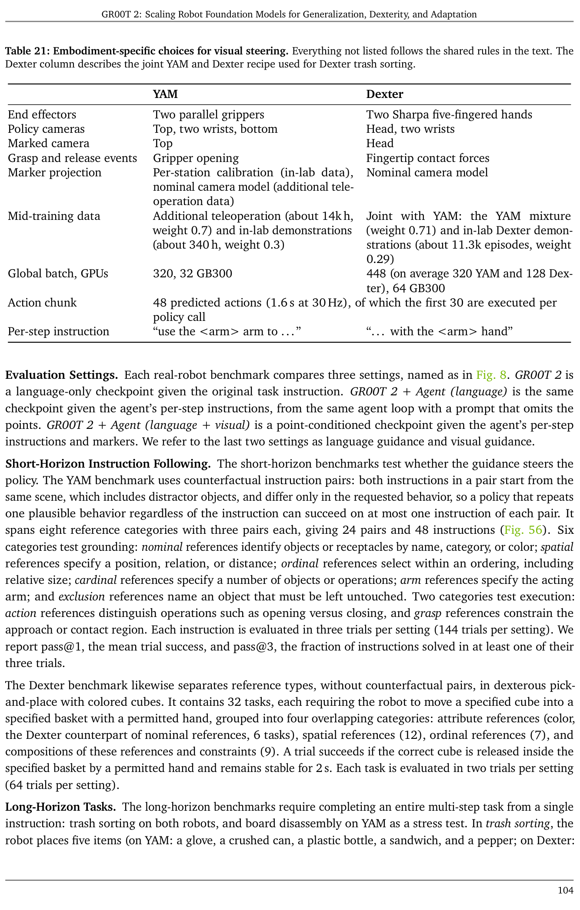
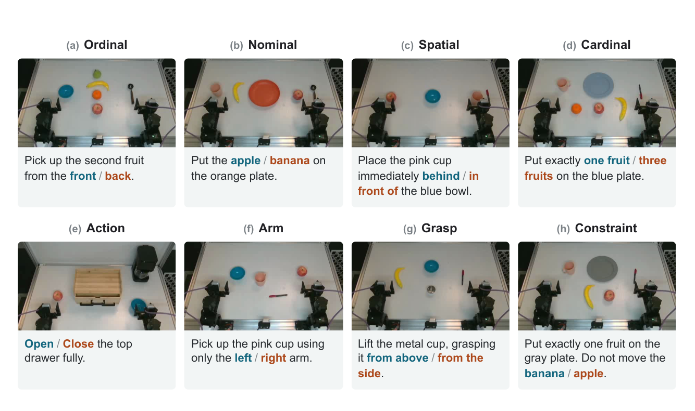
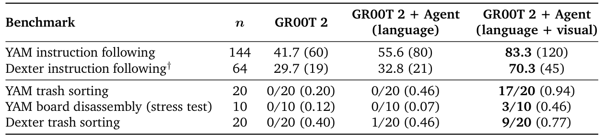
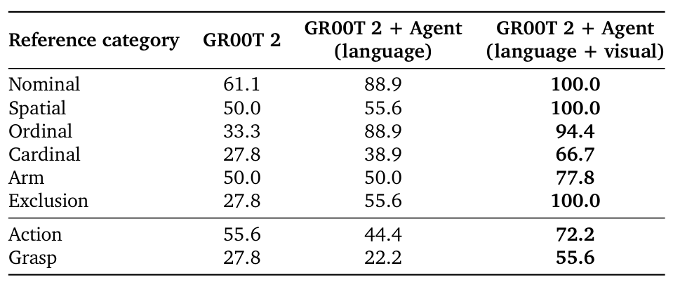
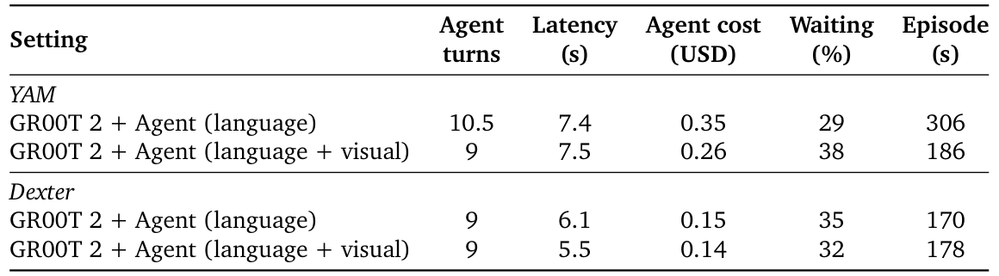

# 附录 G 智能体化

> **原文** G. Agentic GR00T 2　·　起于 p.98　·　本页中英对照：英文段在前，中文段在后。

---

<!-- p.98 S1835 -->

[英文原文未复制，见 PDF p.98 · S1835]

预训练和后训练为 GR00T 2 提供了越来越强的操作技能，但稳健的长时序执行需要的不只是一个强大的底层策略。复杂任务包含多个阶段、任务层面的决策以及意外故障，仅靠连续的策略执行很难解决这些问题。语言指令也可能让任务意图的重要方面没有说清，例如要操作哪个物体，或者应该把它放到哪里。

<!-- p.98 S1836 -->

[英文原文未复制，见 PDF p.98 · S1836]

我们探索了两种互补的智能体化操作方法。第一，智能体式技能组合与恢复将 GR00T 2 与 CaP 集成，使高层智能体能够组合操作技能、监测执行并从意外故障中恢复（第 G.1 节）。第二，可引导的世界-动作生成通过 WAM API 暴露 GR00T 2 习得的能力，使智能体能够利用视觉目标引导并组合机器人行为（第 G.2 节）。两者结合，使高层推理智能体能够借助 GR00T 2 完成复杂的长时序操作。

## G.1. Agentic Skill Composition and Recovery with Code-as-Policy · 基于代码即策略的智能体式技能组合与恢复

<!-- p.98 S1837 -->

[英文原文未复制，见 PDF p.98 · S1837]

即便经过后训练，长时序操作仍容易受到误差累积和未预见状态的影响（Ross et al., 2011）。我们提出一种智能体式执行框架，其中一个前沿多模态编码智能体担任系统 2（S2），组合 GR00T 2 与 CaP 工具，同时监测任务进度并从故障中恢复。智能体在恢复执行前会先核实每次干预，因此无需让 GR00T 2 学会每一种突发情况。

<!-- p.98 S1838 -->

[英文原文未复制，见 PDF p.98 · S1838]

同一框架支持互补的执行策略。在仿真中，我们使用 ASPIRE（Lu et al., 2026）发现把 GR00T 2 当作操作工具调用的任务级程序；每个任务要么运行其程序，要么以 GR00T 2 单独作为默认执行器，取两者中在开发种子上成功次数更多的一个。在真实机器人上，由于 GR00T 2 已能处理大多数操作，它仍作为默认控制器。两种情况下，S2 都提供监测以及基于 CaP 的恢复。关键区别在于两次干预之间由谁执行。

<!-- p.98 S1839 -->

[英文原文未复制，见 PDF p.98 · S1839]

智能体运行时架构。运行时通过模型上下文协议（MCP）暴露 GR00T 2 执行、机器人观测以及 CaP 原语。S2 以“观测-推理-行动-验证”循环使用这些工具（图 6）。

<!-- p.98 S1840 -->

[英文原文未复制，见 PDF p.98 · S1840]

wam_act 工具以任务提示执行 GR00T 2，并返回执行反馈。智能体可以通过专用观测工具访问相机观测和机器人状态，必要时还可以在执行过程中调整 GR00T 2 的语言提示。当恢复动作需要接管控制时，stop_wam 工具会终止 GR00T 2 的执行。CaP 动作原语通过逆运动学和运动规划下发末端执行器与夹爪指令，而观测原语则借助视觉基础模型获取物体定位和位姿估计等信息。CaP 程序将这些原语组合成可执行的技能，无需重新训练 GR00T 2 即可在测试时添加。单一控制工作进程负责协调执行，使 GR00T 2 与 CaP 不会同时下发相互冲突的机器人指令。

<!-- p.98 S1841 -->

[英文原文未复制，见 PDF p.98 · S1841]

智能体会收到操作指南（AGENTS.md）、技能文档以及任务上下文，其中描述了各阶段、成功标准和已知的失效模式。它会检查观测和工具反馈，看是否存在进度停滞或错误，并在需要时调用恢复动作。恢复可能包括重新抓取掉落的零件、调整部件朝向，或在恢复执行前把机器人带回有效构型。

<!-- p.98 S1842 -->

[英文原文未复制，见 PDF p.98 · S1842]

程序与技能获取。ASPIRE 学习与 GR00T 2 配合使用的可执行行为，但在不同场景下范围有所不同。在仿真中，它发现任务级 CaP 程序，把 GR00T 2 的调用与感知、几何推理和操作原语组合起来。在线执行期间，S2 可能会复用或改写这些程序中的代码用于恢复。在真实机器人上，ASPIRE 则获取有针对性的 CaP 技能，途径可以是直接的机器人交互，也可以是 CaP 仿真到现实的迁移，即在仿真中学习技能并将其适配到真实条件（第 J.2.4 节）。

<!-- p.99 C071 · 表 T019 -->

[英文表注未复制，见 PDF p.99 · C071]

表 19：与 RoboCasa365 和 RoboDojo 排行榜前七名（包括智能体提交）的比较。我们报告总体及各类别的成功率（%）。RoboDojo 平均值为五个能力维度上的官方均值。排行榜数据截至 2026 年 11 月 6 日。我们的 RoboDojo 结果使用布局库 0，因此 GR00T 2 SFT 行与同一基准在表 31 中的官方三库评测（平均成功率 35.5%）略有不同。在智能体行中，每个任务的默认执行器在同一基准的开发种子上选定，与测试种子不相交。最佳和次佳结果分别以粗体和下划线标出。

<!-- p.99 S1845 -->

[英文原文未复制，见 PDF p.99 · S1845]

表 19 数据行（数值顺序与原表一致，列名见原表）：HexaShell 1.5，Agent，85.6 / 91.1 / 85.0 / 80.0；Awomo-0.5I（Awomo-WAM Team, 2026），WAM，64.4 / 86.5 / 58.8 / 45.2；minionx，VLA，62.6 / 81.8 / 60.0 / 43.6；Awomo-0.5V（Awomo-WAM Team, 2026），WAM，62.5 / 85.0 / 60.4 / 39.4；Axiom-0（Shu et al., 2026），VLA，61.6 / 86.5 / 59.4 / 35.8；Paimon-0，VLA，58.1 / 79.3 / 55.8 / 36.7；Xiaomi-Robotics-1，VLA，57.4 / 80.2 / 57.1 / 32.1。

<!-- p.99 S1846 -->

[英文原文未复制，见 PDF p.99 · S1846]

表 19 数据行（本文结果）：GR00T 2 - SFT（Ours），WAM，67.2 / 87.4 / 73.6 / 38.2；GR00T 2 - SFT + RL（Ours），WAM，72.4 / 92.5 / 81.5 / 40.6；GR00T 2 - SFT + Agent（Ours），Agent + WAM，81.8 / 88.2 / 86.9 / 69.5；GR00T 2 - SFT + RL + Agent（Ours），Agent + WAM，88.0 / 95.6 / 92.0 / 75.5。

<!-- p.99 S1849 -->

[英文原文未复制，见 PDF p.99 · S1849]

表 19 数据行（RoboDojo 排行榜，数值顺序与原表一致）：Q0-Preview，Agent，68.9 / 58.7 / 58.5 / 58.5 / 93.7 / 75.0；GO-3 Nano Preview，Agent + WAM，56.4 / 33.7 / 76.0 / 53.5 / 63.7 / 55.3；PyRUA-Lean，Agent，50.4 / 43.2 / 38.3 / 43.8 / 68.3 / 58.3；HexaShell-Preview，Agent，46.9 / 34.5 / 32.0 / 31.5 / 81.0 / 55.3；WorldScape-R2SI，Agent + WAM，39.4 / 35.8 / 15.5 / 34.3 / 63.7 / 47.5；EmbodiedEvo，Agent，39.0 / 30.8 / 16.3 / 21.8 / 76.7 / 49.3；WALL-OSS-1.0-lite，VLA，35.0 / 37.9 / 29.1 / 32.3 / 56.0 / 19.6。

<!-- p.99 S1850 -->

[英文原文未复制，见 PDF p.99 · S1850]

表 19 数据行（本文结果，RoboDojo 布局库 0）：GR00T 2 - SFT（Ours），WAM，35.2 / 40.0 / 40.5 / 53.8 / 36.0 / 5.8；GR00T 2 - SFT + RL（Ours），WAM，40.8 / 45.0 / 53.7 / 55.0 / 39.3 / 11.0；GR00T 2 - SFT + Agent（Ours），Agent + WAM，72.3 / 64.0 / 62.5 / 62.3 / 93.7 / 79.2；GR00T 2 - SFT + RL + Agent（Ours），Agent + WAM，75.8 / 67.7 / 68.8 / 68.0 / 95.0 / 79.5。

<!-- p.99 S1851 -->

[英文原文未复制，见 PDF p.99 · S1851]

仿真评测。我们在 RoboCasa365（Nasiriany et al., 2026）和 RoboDojo（Chen et al., 2026a）上使用四种配置进行评测：SFT、SFT + RL、SFT + Agent 和 SFT + RL + Agent。对于智能体式执行，ASPIRE 使用每个任务 15 个开发种子发现程序。在包括这 15 个在内的 30 个开发种子上，我们随后分别运行每个任务的程序和单独的 GR00T 2，并将成功次数更多的一方设为该任务的默认执行器，平局时保留程序。使用 SFT 检查点时，这一规则在 RoboCasa365 的 50 个任务中选中 GR00T 2 的有 23 个，在 RoboDojo 的 54 个任务配置中有 12 个。S2 在每个回合开始时使用默认执行器，对其进行监测，并在需要时调用在线 CaP 恢复。我们在两个基准上各使用每个任务 50 个留出种子进行测试（RoboDojo 泛化任务的标准版本与随机化版本各 25 个），这些种子与开发种子不相交。

<!-- p.99 S1852 -->

[英文原文未复制，见 PDF p.99 · S1852]

仅使用 SFT 时，GR00T 2 在 RoboCasa365 和 RoboDojo 排行榜上取得了所有非智能体策略中最高的成功率（第 J.3 节和表 19）。基于记忆和推理的任务以及高精度操作仍有提升空间。

<!-- p.100 S1853 -->

[英文原文未复制，见 PDF p.100 · S1853]

借助 AutoRL 进行的 RL 后训练（第 F.2 节）主要提升精度：RoboDojo 精度任务（Precision）的成功率从 40.5% 提高到 53.7%；RoboCasa365 上的平均成功率从 67.2% 提高到 72.4%，RoboDojo 布局库 0 上从 35.2% 提高到 40.8%（表 19）。智能体式执行对以记忆和推理为主的任务帮助最大：ASPIRE 程序与 S2 将 RoboCasa365 Composite-Unseen 任务的成功率从 38.2% 提升到 69.5%，把 RoboDojo 记忆类任务从 36.0% 提升到 93.7%。总体而言，它使 RoboCasa365 的平均成功率达到 81.8%，RoboDojo 达到 72.3%；与 RL 结合后，两个基准上都取得了最佳结果。与两个公开排行榜前列（包括智能体提交）相比，SFT + RL + Agent 在 RoboCasa365 上排名第一（88.0% 对比 HexaShell 1.5 的 85.6%），在 RoboDojo 上也排名第一（我们仅评测布局库 0，75.8% 对比 Q0-Preview 的 68.9%）（表 19）。

<!-- p.100 C072 · 表 T020 -->

[英文表注未复制，见 PDF p.100 · C072]

表 20：按 S2 是否干预划分的回合结果（SFT + Agent）。每个单元格给出回合数及其中成功的数量，统计对象为 SFT + Agent 运行的全部回合（RoboDojo 为 2,093 个，RoboCasa365 为 2,500 个）。

<!-- p.100 S1856 -->

[英文原文未复制，见 PDF p.100 · S1856]

为刻画 SFT + Agent 设定下的在线恢复，我们按 S2 是否干预对回合进行划分（表 20）。S2 很少放过失败：在它未干预的回合中，RoboDojo 上 1,320 个中只有 29 个失败，RoboCasa365 上 1,512 个中有 20 个失败。在它干预的回合中，RoboDojo 的成功率为 24%（773 个中的 188 个），RoboCasa365 为 56%（988 个中的 553 个）。图 53 展示了一次成功挽救和一次失败的恢复。

<!-- p.100 S1857 -->

[英文原文未复制，见 PDF p.100 · S1857]

我们对两个基准上失败的 SFT + Agent 回合进行了人工复核（图 54），结果显示大部分失败落入两类：一类是恢复所需的操作精度超出了 S2 借助运动规划工具所能达到的水平（RoboCasa365 上占 38%，RoboDojo 上占 39%）；另一类是回合进入了无法再恢复的状态，例如物体掉到地上或剩余时间太少（分别为 24% 和 38%）。其余大多数失败看起来已经完成，但未满足基准的成功判定。

<!-- p.100 S1859 -->

[英文原文未复制，见 PDF p.100 · S1859]

真实世界长时序操作。我们以 GR00T 2 作为默认控制器评测智能体式执行，考察多阶段装配和重复精密插入任务，并观察 CaP 恢复如何与策略后训练互补。

<!-- p.100 S1860 -->

[英文原文未复制，见 PDF p.100 · S1860]

多阶段装配。我们考虑玩具飞机、玩具拖拉机和 Hot Wheels 玩具车的装配（图 55）。为了检验鲁棒性，每个回合开始时都会把零件倒在桌面上，形成杂乱的场景和多样的物体位姿。机器人必须按顺序装配零件，使用玩具电钻，并从执行错误中恢复。我们比较了 SFT、SFT + DAgger（Ross et al., 2011）以及 SFT + DAgger + Agent。

<!-- p.100 S1861 -->

[英文原文未复制，见 PDF p.100 · S1861]

玩具飞机任务需要用玩具电钻装配机身、两只机翼和两颗螺丝。它要求先装上并固定下机翼，然后把飞机翻转过来，再固定上机翼，过程中需要双臂交接并精确对齐螺丝孔。成功要求两只机翼都已固定，且电钻被放回原位。玩具拖拉机任务需要安装并固定两个小前轮和两个大后轮，在两侧之间翻转车身，最后将其扶正。Hot Wheels 任务需要安装正确的前后轮，并装上朝向正确的引擎盖，用电钻固定各部件。

<!-- p.100 S1862 -->

[英文原文未复制，见 PDF p.100 · S1862]

图 7a 给出了结果。DAgger 把玩具飞机装配、玩具拖拉机装配和 Hot Wheels 装配的成功率分别从 69%、51% 和 23% 提升到 84%、71% 和 78%。加入智能体式执行后，成功率进一步提升到 98%、97% 和 97%。这一提升来自 S2 检测并修复局部执行失败的能力，同时保留了 GR00T 2 习得的操作能力。由于每次试次都从随机倒入的零件开始，这些成功率衡量的是对未见初始构型的鲁棒性，与后训练基准（表 1a）并不直接可比，因为后者的试次从整齐排列的布局开始。以 Hot Wheels 装配为例，基准在固定布局下报告的成功率为 85%。

<!-- p.100 S1863 -->

[英文原文未复制，见 PDF p.100 · S1863]

重复精密插入。我们使用其中的精密技能，连续测试五次线缆和充电器插入，

<!-- p.101 C073 · 图 F053 -->

[英文图注未复制，见 PDF p.101 · C073]

图 53：RoboCasa365 上的在线恢复（SFT + Agent）。两个回合的关键帧。每一行下方的条形表示该回合中由谁控制机器人。(A) ASPIRE 程序抓取了烤箱把手而非抽屉把手。S2 将其停止，并用 CaP 抓取抽屉把手，抽屉随之打开。(B) 程序把吐司从烤面包机中拉出，但吐司平放落在了顶部。S2 停止程序，其对平放吐司的 CaP 抓取失败，交还给 GR00T 2 时已超时。

<!-- p.101 S1864 -->

[英文原文未复制，见 PDF p.101 · S1864]

参见第 F.4 节，在同一智能体系统内比较 SFT 与经过 RL 后训练的 GR00T 2（图 55）。

<!-- p.101 S1865 -->

For multi-cable insertion, five Ethernet (RJ45) cables stand upright beside a network switch. The robot must connect them in a fixed order to five designated ports. CaP first localizes all twelve candidate port faces using SAM 3 (Carion et al., 2025) and camera depth, then grasps each connector and transports it along a collision-free path to a pre-insertion pose. GR00T 2 performs the insertion, and S2 checks for an Ethernet link and verifies that the connector occupies the assigned port. If insertion stalls or exceeds 60 s, CaP retracts the connector and prepares another attempt, allowing up to three attempts per port. S2 can stop retries early if the connector has rotated in the gripper. The episode succeeds only if all five connectors are inserted, a setting that compounds insertion errors and introduces occlusion from previously inserted cables.

在多线缆插接任务中，五根以太网（RJ45）线缆竖立在网络交换机旁边。机器人必须按固定顺序，把它们分别接入五个指定端口。代码即策略（code-as-policy, CaP）首先利用 SAM 3（Carion et al., 2025）和相机深度信息，定位全部十二个候选端口面；随后抓取每根接头，并沿无碰撞路径将其运送至插接前位姿。GR00T 2 执行插接，系统 2（S2）检查是否建立了以太网链路，并核实接头是否位于分配的端口。若插接停滞或超过 60 s，CaP 会收回接头并准备再次尝试，每个端口最多允许三次尝试。若接头在夹爪中发生了旋转，S2 可以提前停止重试。只有五根接头全部插接成功，该回合才算成功；这一设定会累积插接误差，并且已插好的线缆会造成遮挡。

<!-- p.101 S1866 -->

For multi-charger insertion, a human specifies five target outlets by pointing to them in order among twelve visually identical outlets arranged as a 2 × 6 grid. S2 grounds the gestures to individual outlets, with SAM 3 providing an independent interpretation. CaP grasps and transports each charger from its holder to the selected pre-insertion pose, and GR00T 2 performs the insertion. S2 checks whether the corresponding letter of an illuminated sign turns on and verifies the final target. Stalled or timed-out attempts can trigger CaP recovery, with at most three attempts per outlet and a 90 s limit per attempt. The task requires both accurate grounding of nonverbal instructions and precise insertion as the scene grows more cluttered.

在多充电器插接任务中，由人类依次指向排成 2 × 6 网格的十二个外观完全相同的插座，从中指定五个目标插座。S2 将手势指代定位（grounding）到各个插座，同时 SAM 3 提供一种独立的解读作为对照。CaP 将每个充电器从其支架抓取并运送到所选的插接前位姿，GR00T 2 执行插接。S2 检查发光标牌上对应的字母是否亮起，并核实最终目标。停滞或超时的尝试可以触发 CaP 恢复，每个插座最多三次尝试，每次尝试限时 90 s。随着场景愈发杂乱，该任务既要求准确理解非语言指令，也要求精确插接。

<!-- p.101 S1867 -->

Fig. 7b shows that RL post-training improves long-horizon insertion reliability within the same agentic system. For multi-cable insertion, success rises from 12/20 to 19/20, and for multi-charger insertion, it rises from 2/20 to 20/20. The gains highlight the value of RL-trained precision skills within long-horizon agentic execution.

图 7b 表明，在同一智能体化系统内，RL 后训练提升了长时序插接的可靠性。多线缆插接的成功率从 12/20 升至 19/20，多充电器插接则从 2/20 升至 20/20。这些提升凸显了经 RL 训练的精确技能在长时序智能体化执行中的价值。

<!-- p.101 S1868 -->

Failure Analysis. Of the 300 SFT + DAgger + Agent assembly episodes, eight fail in three categories. Incomplete fastening accounts for three failures (two airplane, one Hot Wheels): a screw remains partially driven, but both

失败分析。在 300 个 SFT + DAgger + Agent 装配回合中，有八次失败，分为三类。紧固不完整造成三次失败（两次为飞机，一次为 Hot Wheels）：螺丝仍有一部分未拧到位，但两者 [存疑：原文在此截断，句子未完]

<!-- p.102 C074 · 图 F054 -->

Figure 54: Why SFT + Agent episodes fail. Primary cause of manually reviewed failed SFT + Agent episodes: 87 on RoboCasa365 and 80 on RoboDojo.

图 54：SFT + Agent 回合失败的原因。人工复核的失败 SFT + Agent 回合的主要原因：RoboCasa365 上 87 次，RoboDojo 上 80 次。

<!-- p.102 S1884 -->

GR00T 2 and S2 judge the step complete because the visual difference is subtle. Late intervention accounts for three failures (one tractor, two Hot Wheels): GR00T 2 mounts a small wheel on an incorrect rear hub before S2 stops it, and the available CaP skills cannot reliably reverse the operation. Physical limitations account for two tractor failures: one screw falls off the table, while another becomes mechanically jammed. Both of these episodes can be completed after brief human intervention, but are counted as failures under the autonomous evaluation protocol.

GR00T 2 和 S2 判定该步骤已完成，因为视觉差异很细微。较晚干预造成三次失败（一次为拖拉机，两次为 Hot Wheels）：GR00T 2 在 S2 叫停之前，把一个小轮子装到了错误的后轮轮毂上，而现有的 CaP 技能无法可靠地撤销该操作。物理限制造成两次拖拉机失败：一颗螺丝从桌上掉落，另一颗则机械卡死。这两个回合在人工简短干预后都可以完成，但按照自主评测协议仍计为失败。

<!-- p.102 S1885 -->

On repeated insertion, SFT + RL + Agent fails in only one of the 40 evaluated episodes, due to a timeout during multi-cable insertion. SAM 3 yields an imprecise connector grasp, leading to an offset pre-insertion pose. Although the RL-trained policy moves toward the port, alignment recovery requires small exploratory motions while maintaining forward pressure and supporting the connector against gravity, and the attempt exceeds the 60 s limit. This case illustrates how residual pose errors can still make recovery too slow under a fixed execution budget.

在重复插接中，SFT + RL + Agent 在 40 个评测回合中仅失败一次，原因是多线缆插接超时。SAM 3 给出的接头抓取不精确，导致插接前位姿发生偏移。尽管经 RL 训练的策略会朝端口移动，但对齐恢复需要小幅探索性运动，同时保持向前的压力并托住接头以抵抗重力，这次尝试超过了 60 s 的时限。该案例说明，即便残余位姿误差不大，在固定执行预算下恢复也可能过慢。

<!-- p.102 S1886 -->

Together, these evaluations demonstrate two complementary forms of agentic execution. In simulation, ASPIREgenerated programs provide the task structure that direct GR00T 2 execution may lack, with online CaP recovery addressing unexpected states. In the real world, GR00T 2 performs most manipulation directly, while S2 detects failures and invokes targeted CaP skills, including skills acquired through CaP sim-to-real transfer. Both strategies extend GR00T 2’s capabilities through programmable recovery without requiring every contingency to be absorbed into the foundation policy itself.

综合来看，这些评测展示了两种互补的智能体化执行形式。在仿真中，ASPIREgenerated 程序提供了直接执行 GR00T 2 可能缺乏的任务结构，在线 CaP 恢复则处理意外状态。在现实世界中，GR00T 2 直接完成大部分操作，而 S2 检测失败并调用有针对性的 CaP 技能，其中包括通过 CaP 仿真到现实（sim-to-real）迁移获得的技能。两种策略都通过可编程恢复扩展了 GR00T 2 的能力，而无需把每一种应急情形都内化到基础策略本身之中。

## G.2. Agentic Steering with Visual Guidance · 智能体化视觉引导

<!-- p.102 S1887 -->

Agentic skill composition and recovery (Sec. G.1) integrates GR00T 2 with external CaP programs and skills, whereas agentic steering keeps GR00T 2 as the only controller and lets the agent shape its behavior through the WAM API. We first describe the three parts of visual steering, in which the agent adds visual guidance to its language instructions: the interface, the agent loop, and the mid-training of GR00T 2. We then evaluate visual steering on short- and long-horizon benchmarks on YAM and Dexter.

智能体化技能组合与恢复（见 Sec. G.1）将 GR00T 2 与外部 CaP 程序和技能相结合，而智能体化引导（agentic steering）则让 GR00T 2 仍作为唯一控制器，由智能体通过 WAM API 塑造其行为。我们首先描述视觉引导的三个组成部分：智能体在语言指令之上叠加视觉引导的交互界面、智能体循环，以及 GR00T 2 的中期训练（mid-training）。随后，我们在 YAM 和 Dexter 上，分别于短时序与长时序基准中评估视觉引导。

<!-- p.102 S1888 -->

Visual Guidance Interface. The interface separates what and where from how. For each step, the agent names the acting arm and gives a grasp point and a release point as pixel coordinates in the image of one scene camera (Tab. 21), while GR00T 2 determines the grasp pose, the approach, and all motion in between. We observed that GR00T 2 conditions strongly on fine visual details in its conditioning frames, so we pass the points by drawing them as markers directly on the conditioning frame rather than through a separate input: a filled disc for the grasp point and a plus-shaped cross for the release point, in the acting arm’s color (magenta for the left arm, cyan for the right), as in Fig. 8a. Only the acting arm is marked, and only on the current frame of the scene camera. Alongside the markers, GR00T 2 receives the agent’s per-step instruction, which names the

视觉引导接口。该接口将“做什么、在哪里做”与“怎么做”分开。对于每一步，智能体指定执行动作的手臂，并以某一场景相机图像（Tab. 21）中的像素坐标给出抓取点和释放点，而 GR00T 2 负责决定抓取位姿、接近方式以及其间的全部运动。我们观察到，GR00T 2 对其条件帧中的精细视觉细节高度敏感，因此我们不通过单独的输入传递这些点，而是把它们直接画在条件帧上作为标记：抓取点用实心圆盘表示，释放点用加号形十字表示，颜色取执行动作手臂的颜色（左臂为品红色，右臂为青色），如图 8a 所示。只标记执行动作的手臂，并且只标记场景相机的当前帧。除标记外，GR00T 2 还接收智能体的逐步指令，该指令指明

<!-- p.103 C075 · 图 F055 -->

Figure 55: Real-world tasks. (A) Toy Plane assembly: dump the parts, attach and fasten the bottom wing, turn the airplane over, and fasten the top wing. (B) Toy Tractor assembly: dump the parts, fasten the wheels on one side, turn the body over, and complete the other side. (C) Hot Wheels assembly: dump the parts, mount and fasten four wheels, and install and fasten the hood. (D) Multi-cable insertion: plug five Ethernet cables into a network switch. (E) Multi-charger insertion: plug five chargers into a power strip.

图 55：真实世界任务。（A）玩具飞机装配：倒出零件，安装并拧紧下机翼，将飞机翻转，再拧紧上机翼。（B）玩具拖拉机装配：倒出零件，拧紧一侧的车轮，将车身翻转，并完成另一侧。（C）Hot Wheels 装配：倒出零件，安装并拧紧四个车轮，再安装并拧紧引擎盖。（D）多线缆插接：将五根以太网线缆插入网络交换机。（E）多充电器插接：将五个充电器插入排插。

<!-- p.103 S1902 -->

acting arm, in place of the task instruction.

执行动作的手臂，取代原任务指令。

<!-- p.103 S1903 -->

Agent Loop. The agent loop has three layers. System 2 is the agent, which plans the steps and judges whether each step is done and what comes next. System 1 is GR00T 2, which executes the current step from the agent’s instruction and points. The harness is the rule-based program between them, which passes the agent’s instruction and points to GR00T 2 and decides when to query the agent. We use GPT-6 Astra as the agent, zero-shot and with one conversation per episode. At the start of an episode, it receives the task instruction and the images from all of the policy’s cameras, plans the steps, and returns the acting arm and the two points for the first step. The harness queries the agent again when an arm releases an object, when a fast vision-language model, used as a completion checker reports the step done, or after 45 s without a step end. The agent then decides whether to advance to the next step, redo the current one, replan the remaining steps, or finish.

智能体循环。智能体循环包含三层。系统 2（S2）即智能体，负责规划步骤，判断每一步是否完成以及接下来该做什么。系统 1（S1）即 GR00T 2，依据智能体的指令和指点执行当前步骤。调度框架（harness）是二者之间基于规则的程序，负责把智能体的指令和指点传给 GR00T 2，并决定何时向智能体发起查询。我们以零样本方式使用 GPT-6 Astra 作为智能体，每个回合使用一段对话。回合开始时，它接收任务指令以及策略所有相机的图像，规划步骤，并返回第一步的执行手臂和两个点。当某只手臂释放物体时、当用作完成判定器的快速视觉语言模型（VLM）报告该步骤已完成时，或在 45 s 内没有步骤结束时，调度框架会再次查询智能体。随后，智能体决定推进到下一步、重做当前步骤、重新规划剩余步骤，还是结束任务。

<!-- p.103 S1904 -->

Mid-Training for Visual Guidance. Following the points requires mid-training, because pretraining never shows GR00T 2 markers on its observations. We generate the point labels automatically from existing demonstrations by detecting grasp and release events for each arm (Tab. 21). If an arm’s next event is a grasp, its grasp marker is placed at that grasp and its release marker at the following release. If the arm already holds an object, the grasp marker stays at the preceding grasp and the release marker is placed at the next release. Each marker is the end-effector position at the event, projected into the scene camera. Markers are drawn for the arm that acts next, and an arm is never marked alone while the other arm is the one that acts next, so an unmarked arm next to a marked one should not act, as at evaluation. Each sample is conditioned on its annotated sub-task instruction, or on the task instruction where none exists.

视觉引导的中期训练。要让 GR00T 2 遵循这些点，就需要中期训练，因为预训练时其观测中从未出现过标记。我们依据现有演示数据，通过检测每只手臂的抓取和释放事件，自动生成点标签（Tab. 21）。若某只手臂的下一个事件是抓取，则其抓取标记放在该次抓取处，释放标记放在随后的释放处。若手臂已经握着物体，则抓取标记保持在之前的抓取处，释放标记放在下一次释放处。每个标记都是事件发生时末端执行器的位置，并投影到场景相机中。标记针对下一步执行动作的手臂绘制；当另一只手臂是下一步的执行者时，不会单独标记某只手臂。因此，与有标记手臂相邻的未标记手臂不应动作，这与评测时的情况一致。每个样本以其标注的子任务指令为条件；若不存在子任务标注，则以任务指令为条件。

<!-- p.103 S1905 -->

Each point-conditioned checkpoint is mid-trained from the pretrained GR00T 2 checkpoint for 20k steps with AdamW (learning rate 5 × 10−5, warmup-stable-decay schedule). For each, we also train a languageonly checkpoint on the same data, cameras, schedule, and compute, without markers, which serves as the language-only baseline in the evaluation on YAM and on Dexter trash sorting.

每个点条件化检查点都从预训练的 GR00T 2 检查点出发，使用 AdamW 进行 20k 步中期训练（学习率 5 × 10−5，预热-稳定-衰减调度）。对于每个点条件化检查点，我们还在相同的数据、相机、调度和计算预算下训练一个仅语言的检查点（不含标记），它在 YAM 和 Dexter 垃圾分类的评测中作为纯语言基线。

<!-- p.104 C076 · 表 T021 -->

Table 21: Embodiment-specific choices for visual steering. Everything not listed follows the shared rules in the text. The Dexter column describes the joint YAM and Dexter recipe used for Dexter trash sorting.

表 21：视觉引导的本体专用设置。未列出的内容均遵循正文中的共享规则。Dexter 一列描述的是用于 Dexter 垃圾分类的 YAM 与 Dexter 联合配方。

<!-- p.104 S1907 -->

End effectors Two parallel grippers Two Sharpa five-fingered hands Policy cameras Top, two wrists, bottom Head, two wrists Marked camera Top Head Grasp and release events Gripper opening Fingertip contact forces Marker projection Per-station calibration (in-lab data), nominal camera model (additional teleoperation data)

末端执行器 两个平行夹爪 两只 Sharpa 五指手 策略相机 顶部、两个腕部、底部 头部、两个腕部 标记相机 顶部 头部 抓取与释放事件 夹爪开合度 指尖接触力 标记投影 每工位标定（实验室数据），标称相机模型（额外遥操作数据） [存疑：表格列在抽取中已展平，列与设备的对应关系不明]

<!-- p.104 S1911 -->

strations (about 11.3k episodes, weight 0.29) Global batch, GPUs 320, 32 GB300 448 (on average 320 YAM and 128 Dexter), 64 GB300 Action chunk 48 predicted actions (1.6 s at 30 Hz), of which the first 30 are executed per policy call Per-step instruction “use the <arm> arm to ...” “... with the <arm> hand”

[存疑：句首缺失，抽取文本以 “strations” 开头] 演示数据（约 11.3k 回合，权重 0.29）。全局批量，GPUs 320，32 GB300 448（平均 YAM 320、Dexter 128），64 GB300。动作块：48 个预测动作（30 Hz 下 1.6 s），其中每次策略调用执行前 30 个。逐步指令：“use the <arm> arm to ...”“... with the <arm> hand”。 [存疑：该单元格在抽取中已展平，数字归属不明]

<!-- p.104 S1912 -->

Evaluation Settings. Each real-robot benchmark compares three settings, named as in Fig. 8. GR00T 2 is a language-only checkpoint given the original task instruction. GR00T 2 + Agent (language) is the same checkpoint given the agent’s per-step instructions, from the same agent loop with a prompt that omits the points. GR00T 2 + Agent (language + visual) is a point-conditioned checkpoint given the agent’s per-step instructions and markers. We refer to the last two settings as language guidance and visual guidance.

评测设置。每个真实机器人基准比较三种设置，命名方式与图 8 相同。GR00T 2 是接收原始任务指令的纯语言检查点。GR00T 2 + Agent（language）是同一检查点，接收来自同一智能体循环的逐步指令，但提示中不含点。GR00T 2 + Agent（language + visual）是点条件化检查点，接收智能体的逐步指令和标记。我们将后两种设置分别称为语言引导和视觉引导。

<!-- p.104 S1913 -->

Short-Horizon Instruction Following. The short-horizon benchmarks test whether the guidance steers the policy. The YAM benchmark uses counterfactual instruction pairs: both instructions in a pair start from the same scene, which includes distractor objects, and differ only in the requested behavior, so a policy that repeats one plausible behavior regardless of the instruction can succeed on at most one instruction of each pair. It spans eight reference categories with three pairs each, giving 24 pairs and 48 instructions (Fig. 56). Six categories test grounding: nominal references identify objects or receptacles by name, category, or color; spatial references specify a position, relation, or distance; ordinal references select within an ordering, including relative size; cardinal references specify a number of objects or operations; arm references specify the acting arm; and exclusion references name an object that must be left untouched. Two categories test execution: action references distinguish operations such as opening versus closing, and grasp references constrain the approach or contact region. Each instruction is evaluated in three trials per setting (144 trials per setting). We report pass@1, the mean trial success, and pass@3, the fraction of instructions solved in at least one of their three trials.

短时序指令遵循。短时序基准检验引导是否能够改变策略的行为。YAM 基准采用反事实指令对：同一对中的两条指令从包含干扰物的同一场景出发，仅在所要求的行为上有所不同，因此无论指令如何都重复某一种合理行为的策略，在每对中至多只能成功完成一条指令。该基准涵盖八个参考类别，每类三对，共 24 对、48 条指令（图 56）。其中六类考察指代定位：名义参考通过名称、类别或颜色来识别物体或容器；空间参考指定位置、关系或距离；序数参考在某一排序中做选择，包括相对大小；基数参考指定物体数量或操作次数；手臂参考指定执行动作的手臂；排除参考指定一个必须保持不动的物体。另外两类考察执行能力：动作参考区分开启与关闭等不同操作，抓取参考约束接近方式或接触区域。每条指令在每种设置下评测三次试验（每种设置 144 次试验）。我们报告 pass@1（试验成功率的均值），以及 pass@3（其三次试验中至少有一次成功完成的指令所占比例）。

<!-- p.104 S1914 -->

The Dexter benchmark likewise separates reference types, without counterfactual pairs, in dexterous pickand-place with colored cubes. It contains 32 tasks, each requiring the robot to move a specified cube into a specified basket with a permitted hand, grouped into four overlapping categories: attribute references (color, the Dexter counterpart of nominal references, 6 tasks), spatial references (12), ordinal references (7), and compositions of these references and constraints (9). A trial succeeds if the correct cube is released inside the specified basket by a permitted hand and remains stable for 2 s. Each task is evaluated in two trials per setting (64 trials per setting).

Dexter 基准同样区分参考类型，但不使用反事实对，任务是用彩色方块进行灵巧抓放。它包含 32 个任务，每个任务都要求机器人使用许可的手，把指定方块移动到指定篮子中。任务分为四个相互重叠的类别：属性参考（颜色，即 Dexter 中对应名义参考的类别，6 个任务）、空间参考（12 个）、序数参考（7 个），以及这些参考与约束的组合（9 个）。只有当正确的方块被许可的手释放到指定篮子内，并保持稳定 2 s 时，试验才算成功。每个任务在每种设置下评测两次试验（每种设置 64 次试验）。

<!-- p.104 S1915 -->

Long-Horizon Tasks. The long-horizon benchmarks require completing an entire multi-step task from a single instruction: trash sorting on both robots, and board disassembly on YAM as a stress test. In trash sorting, the robot places five items (on YAM: a glove, a crushed can, a plastic bottle, a sandwich, and a pepper; on Dexter:

长时序任务。长时序基准要求机器人仅凭一条指令完成整个多步骤任务：两台机器人上的垃圾分类，以及 YAM 上作为压力测试的板件拆解。在垃圾分类中，机器人需要放置五件物品（YAM 上为：一只手套、一个压扁的易拉罐、一个塑料瓶、一个三明治和一个辣椒；Dexter 上为：

<!-- p.105 C077 · 图 F056 -->

Figure 56: Short-horizon instruction following benchmark on YAM. Eight reference categories, each illustrated by a shared starting scene and two contrasting instructions. Blue and orange text denote the alternatives, and all remaining wording is identical. The panel labeled Constraint shows an exclusion reference.

图 56：YAM 上的短时序指令遵循基准。八个参考类别各由一个共享的起始场景和两条对比指令加以说明。蓝色与橙色文字表示两种备选，其余措辞完全相同。标为 Constraint 的面板展示的是排除参考。

<!-- p.105 S1932 -->

a glove, a crushed can, a drink bottle, a sandwich, and a food scrap) into labeled compost, recycling, and trash bins whose order varies across 20 layouts per robot. Each item scores 0.2 if it ends in its correct bin. In board disassembly (Kimble et al., 2020), the robot removes the USB cable, two plugs, and two gears from a NIST task board and places the cable on a tray, the plugs in the right bin, and the gears in the left bin. Each item scores 0.1 for removal and 0.1 for correct placement. We report full-task success, in which all five items are completed, together with the mean rubric score. On YAM, the long-horizon runs were split between two stations with different operators, so the three settings were not all evaluated under the same station and operator.

一只手套、一个压扁的易拉罐、一个饮料瓶、一个三明治和一片食物残渣），并分别放入贴有标签的堆肥桶、回收桶和垃圾桶中，桶的顺序在每台机器人的 20 种布局中各不相同。若每件物品最终落入正确的桶，则该件计 0.2 分。在板件拆解（Kimble et al., 2020）中，机器人从 NIST 任务板上取下 USB 线缆、两个插头和两个齿轮，并把线缆放到托盘上，把插头放入右侧的桶，把齿轮放入左侧的桶。每件物品的取下计 0.1 分，正确放置计 0.1 分。我们报告全任务成功率（即五件物品全部完成），以及平均评分细则分数。在 YAM 上，长时序运行分配在两个工位进行，且操作员不同，因此三种设置并非全部在相同工位和相同操作员条件下评测。

<!-- p.105 S1933 -->

Results. Tab. 22 lists every benchmark behind Fig. 8. On short-horizon tasks, visual guidance gives the highest success on both robots. On YAM, pass@1 rises from 41.7% for GR00T 2 and 55.6% with language guidance to 83.3% with visual guidance, and the gap narrows but persists at pass@3 (64.6%, 79.2%, and 89.6%). On Dexter, success rises from 29.7% and 32.8% to 70.3%. On long-horizon tasks, visual guidance completes 17 of 20 YAM trash-sorting episodes and 3 of 10 episodes of the board-disassembly stress test, whereas neither GR00T 2 nor language guidance completes any episode of either task. On Dexter trash sorting, visual guidance completes 9 of 20 episodes, against none for GR00T 2 and 1 with language guidance. Paired by layout, it sorts more items correctly than language guidance on 15 of the 20 layouts and fewer on 3 (two-sided sign test, 𝑝= 0.008).

结果。表 22 列出了图 8 背后的全部基准。在短时序任务上，视觉引导在两台机器人上都取得了最高成功率。在 YAM 上，pass@1 由 GR00T 2 的 41.7% 和语言引导的 55.6% 升至视觉引导的 83.3%；在 pass@3 上差距有所缩小但依然存在（分别为 64.6%、79.2% 和 89.6%）。在 Dexter 上，成功率由 29.7% 和 32.8% 升至 70.3%。在长时序任务上，视觉引导完成了 YAM 垃圾分类 20 个回合中的 17 个，以及板件拆解压力测试 10 个回合中的 3 个；而 GR00T 2 和语言引导在这两项任务中均未完成任何一个回合。在 Dexter 垃圾分类中，视觉引导完成了 20 个回合中的 9 个，GR00T 2 为 0 个，语言引导为 1 个。按布局配对比较，视觉引导在 20 个布局中的 15 个上比语言引导正确分拣更多物品，在 3 个布局上则更少（双侧符号检验，𝑝= 0.008 [公式原文见 p.105]）。

<!-- p.105 S1934 -->

The YAM category breakdown (Tab. 23) shows where visual guidance helps. It reaches 100% pass@1 on nominal, spatial, and exclusion references and 94.4% on ordinal references. Language guidance alone already helps on nominal and ordinal references (88.9% each) but barely on spatial references (from 50.0% to 55.6%), where the marked grasp or release point resolves the relation directly. Gains are smaller on the two execution categories: relative to GR00T 2, success rises from 55.6% to 72.2% on action references and from 27.8% to 55.6% on grasp references. The markers do not specify the grasp approach, object orientation, or the motion required for operations such as flipping, pouring, and scooping. On Dexter, visual guidance gains most over GR00T 2 on spatial, ordinal, and compositional tasks (50.0, 57.1, and 50.0 points) and little on attribute tasks

YAM 按类别的细分（Tab. 23）显示了视觉引导在哪些地方起作用。在名义参考、空间参考和排除参考上，它的 pass@1 达到 100%，在序数参考上为 94.4%。仅有语言引导时，名义参考和序数参考已有所改善（各为 88.9%），但在空间参考上几乎没有作用（从 50.0% 升至 55.6%），而空间参考中，标记的抓取点或释放点可以直接解决该关系。两类执行类别的增益较小：相对于 GR00T 2，动作参考的成功率从 55.6% 升至 72.2%，抓取参考则从 27.8% 升至 55.6%。标记并不指定抓取方式、物体朝向，也不指定翻转、倾倒和舀取等操作所需的运动。在 Dexter 上，相对于 GR00T 2，视觉引导在空间、序数和组合任务上的增益最大，而在属性任务上增益很小

<!-- p.106 C078 · 表 T022 -->

Table 22: Visual steering results on every benchmark. Short horizon: success rate (%), with successful trials in parentheses (pass@1 on YAM). Long horizon: full-task successes over episodes, with the mean rubric score (0 to 1) in parentheses. 𝑛counts trials (short horizon) or episodes (long horizon). The success rates and full-task counts are the components averaged in Fig. 8. †Obtained with an earlier implementation of the model.

表 22：每个基准上的视觉引导结果。短时序：成功率（%），括号内为成功试验数（YAM 为 pass@1）。长时序：按回合计的全任务成功数，括号内为平均评分细则分数（0 至 1）。𝑛 表示试验数（短时序）或回合数（长时序）。成功率和全任务成功数即图 8 中取平均所用的组成部分。†由该模型的早期实现获得。

<!-- p.106 C079 · 表 T023 -->

Table 23: YAM short-horizon pass@1 (%) by reference category. Each category has six instructions and 18 scored trials per setting.

表 23：YAM 短时序 pass@1（%），按参考类别划分。每个类别包含六条指令，每种设置下计分的试验为 18 次。

<!-- p.106 S1945 -->

(8.3 points), where GR00T 2 already reaches 75.0%.

（8.3 个百分点），其中 GR00T 2 已达到 75.0%。

<!-- p.106 S1946 -->

Guidance Following. Success rates alone do not show that GR00T 2 follows the guidance, because a steerable policy should change its behavior when only the guidance changes (Chen et al., 2026d). The counterfactual pairs of the YAM short-horizon benchmark are designed to test a system-level version of this: within a pair, the scene is fixed and only the requested behavior changes. Counting a pair as solved if both of its instructions succeed in at least two of three trials, GR00T 2 solves 4 of the 24 pairs (16.7%), language guidance 10 (41.7%), and visual guidance 19 (79.2%). Conversely, 24 of the 60 successful trials of GR00T 2 (40.0%) come from instructions whose counterpart fails all three trials, as expected from a policy that repeats one behavior regardless of the instruction. This share falls to 12.5% (10 of 80) with language guidance and 5.8% (7 of 120) with visual guidance. On YAM trash sorting, GR00T 2 also follows the arm assignment: with visual guidance, the marked (and named) arm made 169 of 172 gripper closures (98.3%), against 164 of 181 (90.6%) for the named arm with language guidance, so wrong-arm closures fall from 9.4% to 1.7%. Its releases also follow the markers: with visual guidance, every release aimed at a bin landed in the marked bin, with one case unclear, whereas with language guidance, 21 items went into a wrong bin, or a different item was moved, after the agent had named the correct bin (see Failure Analysis).

指引遵循。仅看成功率并不能说明 GR00T 2 是否遵循了指引，因为一个可引导的策略应当在且仅在指引改变时改变其行为（Chen et al., 2026d）。YAM 短时序基准的反事实对正是为了从系统层面检验这一点而设计：在同一对中，场景固定，只有所要求的行为发生变化。若一对中的两条指令在三次试验中各自至少成功两次，则该对视为已解决。按此标准，GR00T 2 解决了 24 对中的 4 对（16.7%），语言引导解决了 10 对（41.7%），视觉引导解决了 19 对（79.2%）。反过来，GR00T 2 的 60 次成功试验中，有 24 次（40.0%）来自其对应指令三次试验全部失败的指令，这与一个无论指令如何都重复同一行为的策略的预期一致。语言引导下这一比例降至 12.5%（80 次中的 10 次），视觉引导下则降至 5.8%（120 次中的 7 次）。在 YAM 垃圾分类中，GR00T 2 也遵循了手臂分配：使用视觉引导时，被标记（并被命名）的手臂完成了 172 次夹爪闭合中的 169 次（98.3%），而语言引导下被命名手臂则为 181 次中的 164 次（90.6%），因此错误手臂的闭合率从 9.4% 降至 1.7%。它的释放也遵循标记：使用视觉引导时，每一次指向容器的释放都落入被标记的容器，仅有一例不明确；而使用语言引导时，在智能体已命名正确容器之后，仍有 21 件物品落入错误容器，或移动了另一件物品（见失败分析）。

<!-- p.106 S1948 -->

Agent Cost and Latency. Steering adds the agent’s cost and latency to every episode, which we measure on trash sorting on both robots (Tab. 24). With visual guidance, an episode takes a median of 9 agent turns and costs $0.26 on YAM and $0.14 on Dexter, and the robot waits for the agent during 38% and 32% of the episode. GR00T 2 was served without the accelerations of Sec. 4.6.1 on YAM (about 0.6 s per policy call) and with TensorRT on Dexter (about 0.14 s).

智能体成本与时延。引导会为每个回合（episode）增加智能体的成本和时延，我们在两台机器人上对垃圾分拣任务进行了测量（Tab. 24）。加入视觉引导后，一个回合的中位数为 9 次智能体轮次，智能体成本在 YAM 上为 0.26 美元，在 Dexter 上为 0.14 美元，机器人分别有 38% 和 32% 的回合时间在等待智能体。GR00T 2 在 YAM 上未使用 Sec. 4.6.1 中的加速手段（每次策略调用约 0.6 秒），在 Dexter 上则使用 TensorRT（约 0.14 秒）。

<!-- p.106 S1949 -->

Detecting Step Completion. The agent’s cost and the robot’s waiting also depend on when the harness queries the agent at the end of a step. In the YAM long-horizon runs, gripper events, which need no model call,

检测步骤完成。智能体的成本和机器人的等待时间，还取决于调度框架在步骤结束时何时查询智能体。在 YAM 长时序运行中，夹爪事件无需模型调用，

<!-- p.107 C080 · 表 T024 -->

Table 24: Agent cost and latency on trash sorting. Medians over the 20 episodes per setting. Latency is the per-episode median agent-turn time, agent cost is the charge for the agent’s turns (excluding the completion checks), and waiting is the share of the episode during which the robot holds still for the agent.

表 24：垃圾分拣任务上的智能体成本与时延。中位数基于每种设置下的 20 个回合（episode）。时延为每个回合的智能体轮次时间中位数；智能体成本为智能体轮次的费用（不含完成性检查）；等待占比为回合中机器人保持静止、等待智能体的时间比例。

<!-- p.107 S1962 -->

triggered 418 of the 435 step-end queries, and the 45 s limit triggered the remaining 17. The completion check is meant for steps that end without a release, such as closing a drawer, but replaying the logged requests shows that even an always-correct check would confirm a step a median of 3.9 to 6.7 s after it ends, against about 1.5 s for a gripper event. Polled throughout every step, the checks also account for 26 to 36% of the combined agent and check charge on YAM, so we keep the check as a backstop.

在 435 次步骤结束查询中触发了 418 次，其余 17 次由 45 秒的时限触发。完成性检查原本用于那些没有释放动作就结束的步骤，例如关闭抽屉，但重放记录的请求后可以看到，即使一个总是正确的检查，也只能在步骤结束后中位数 3.9 至 6.7 秒才确认该步骤，而夹爪事件约为 1.5 秒。若在每个步骤中全程轮询，这些检查在 YAM 上还会占智能体与检查合计费用的 26% 至 36%，因此我们保留该检查作为兜底。

<!-- p.107 S1963 -->

Failure Analysis. Failures on YAM trash sorting differ in kind between the two agent-guided settings. With visual guidance, 6 of 100 items are lost, in 3 episodes, and each of these episodes contains a failed hand-over, in which the agent asked one arm to stage an item at the center of the table for the other arm. By the agent’s step-end observations, every release aimed at a bin landed in the marked bin, with one case unclear. Of the 54 items lost with language guidance, 21 were released into a wrong bin, or a different item was moved, after the agent had named the correct bin, and 20 were never attempted because the agent spent the remaining steps retrieving misplaced items. On Dexter trash sorting, visual guidance leaves 11 items in a wrong bin, against 43 with language guidance and 56 for GR00T 2, while a similar share of pick-and-place attempts ends in some bin in every setting (72%, 65%, and 71%), so the settings differ mainly in choosing the right bin.

故障分析。在 YAM 垃圾分拣任务中，两种智能体引导设置下的失败类型并不相同。视觉引导下，100 件物品中有 6 件丢失，分布在 3 个回合中，而且这 3 个回合都包含一次失败的交接，即智能体要求一条手臂将物品暂放到桌面中央，供另一条手臂接取。根据智能体的步骤结束观察，每次指向垃圾桶的释放都落入了标记的垃圾桶，其中一次情况不明。语言引导下丢失的 54 件物品中，有 21 件被释放到错误的垃圾桶中，或者在智能体已说出正确垃圾桶之后移动了另一件物品；另有 20 件从未被尝试，因为智能体把剩余步数花在了找回错放的物品上。在 Dexter 的垃圾分拣任务上，视觉引导使 11 件物品落入错误的垃圾桶，语言引导为 43 件，GR00T 2 为 56 件；同时，各设置中抓放尝试最终落入某个垃圾桶的比例相近（分别为 72%、65% 和 71%），因此这些设置之间的差异主要在于能否选中正确的垃圾桶。

<!-- p.107 S1964 -->

Simulation Test of Steerability on LIBERO. Simulation lets us test steerability without the agent by computing the markers from the simulator state. We evaluate 45 tasks from LIBERO-PRO (Zhou et al., 2025), which perturbs the scenes and instructions of LIBERO (Liu et al., 2023), with 10 episodes per task (448 valid episodes), including spatial-instruction variants of a two-bowl scene on which an earlier language-only checkpoint failed, to test steering where language is weak. We compare a single-arm language-only checkpoint with a single-arm point-conditioned checkpoint, both mid-trained for 20k steps on RoboCasa365 (Nasiriany et al., 2026), LIBERO, and DROID (Khazatsky et al., 2024). This simulation checkpoint uses an earlier, richer form of the interface: a time-colored end-effector path with a disc at the next grasp or release point. The markers raise success from 69.6% (312 of 448) for the language-only checkpoint to 85.0% (381), while the same point-conditioned checkpoint with nothing drawn reaches 72.5% (325). On the two-bowl variants, the markers raise success from 18 of 70 for the language-only checkpoint (20 with nothing drawn) to 41 of 70. Across tasks, the marked checkpoint does better than the language-only checkpoint on 13, worse on 8, and ties on the other 24.

LIBERO 上的引导能力仿真测试。仿真让我们无需智能体即可测试引导能力，标记可以直接从仿真器状态计算得出。我们评测了 LIBERO-PRO（Zhou et al., 2025）中的 45 个任务，该基准对 LIBERO（Liu et al., 2023）的场景和指令进行了扰动。每个任务 10 个回合（共 448 个有效回合），其中包括双碗场景的空间指令变体，一个较早的仅语言检查点在该场景上失败过，这里用来测试语言较弱时的引导能力。我们比较了单臂仅语言检查点与单臂点条件检查点，二者都在 RoboCasa365（Nasiriany et al., 2026）、LIBERO 和 DROID（Khazatsky et al., 2024）上中期训练了 20k 步。该仿真检查点使用的是接口的早期、信息更丰富的形式：一条按时间着色的末端执行器轨迹，并在下一个抓取或释放点处画一个圆盘。标记将仅语言检查点的成功率从 69.6%（448 个中的 312 个）提升到 85.0%（381），而同一点条件检查点在不画任何标记时达到 72.5%（325）。在双碗变体上，标记将仅语言检查点的成功数从 70 中的 18 个（不画任何标记时为 20 个）提升到 70 中的 41 个。跨任务来看，加标记的检查点在 13 个任务上优于仅语言检查点，在 8 个任务上更差，其余 24 个任务持平。

<!-- p.107 S1965 -->

Limitations. Visual steering also has three limitations. The points specify spatial targets and the acting arm, not a manipulation strategy, which limits the gains on grasp and action references. Every step moves one arm, so coordinated two-arm motion is excluded, and a hand-over becomes two single-arm steps. On the real robots, generalization to new scenes and objects is not tested.

局限性。视觉引导还有三个局限。这些点指定的是空间目标和执行动作的手臂，而不是操作策略，因此限制了在抓取参考和动作参考上的收益。每个步骤只移动一条手臂，因此不包括双臂协调运动，交接也会被拆分为两个单臂步骤。在真实机器人上，尚未测试对新场景和新物体的泛化能力。

## G.3. Toward Robotic Self-Improvement · 迈向机器人自我改进

<!-- p.107 S1966 -->

Agentic learning, execution, and steering address complementary challenges in building autonomous robotic systems. AutoResearch investigates how learning algorithms can be improved through autonomous experimentation. CaP enables structured orchestration and specialized intervention during long-horizon execution.

智能体化学习、执行与引导，分别针对构建自主机器人系统中的互补挑战。AutoResearch 研究如何通过自主实验改进学习算法。代码即策略（code-as-policy, CaP）支持在长时序执行过程中进行结构化编排和专门化干预。

<!-- p.108 S1967 -->

Visual guidance allows a high-level reasoning model to steer the behavior of a foundation policy through richer interfaces beyond language.

视觉引导使高层推理模型能够通过语言之外更丰富的接口，引导基础策略的行为。

<!-- p.108 S1968 -->

A promising direction for future work is to integrate these capabilities into a unified self-improvement process. During deployment, agentic execution and steering could identify difficult states, generate corrective behaviors, and collect interaction experiences that expose limitations of the current foundation policy.

未来工作中一个有前景的方向，是把这些能力整合进统一的自我改进流程。在部署过程中，智能体化执行与引导可以识别困难状态、生成纠正行为，并收集能够暴露当前基础策略局限性的交互经验。

<!-- p.108 S1969 -->

These experiences could be incorporated into AutoResearch to discover better post-training strategies, while successful agentic behaviors could be distilled into the foundation policy to improve its generality and reduce the need for future intervention.

这些经验可以纳入 AutoResearch，以发现更好的后训练策略；而成功的智能体化行为则可以蒸馏到基础策略中，以提升其通用性，并减少未来对人工干预的需要。

<!-- p.108 S1970 -->

Such integration would create a feedback loop in which agentic systems improve not only how robots execute tasks, but also how their underlying policies are trained and adapted.

这样的整合将形成一个反馈回路，使智能体化系统不仅改进机器人执行任务的方式，也改进其底层策略的训练与适配方式。

<!-- p.108 S1971 -->

Although realizing this fully integrated loop remains a direction for future work, these three approaches illustrate complementary opportunities for building robotic systems that can autonomously learn, orchestrate, and adapt their behavior.

尽管完全整合的闭环仍是未来工作的方向，但这三种路径共同展示了构建机器人系统的互补机会，使其能够自主学习、编排并调整自身行为。
