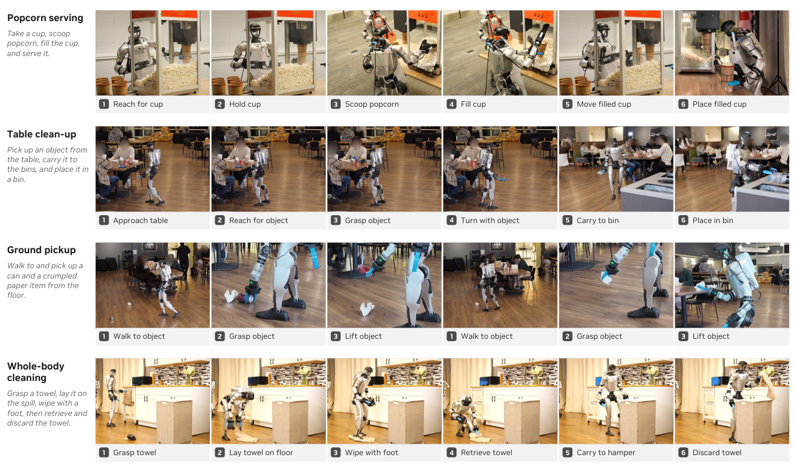
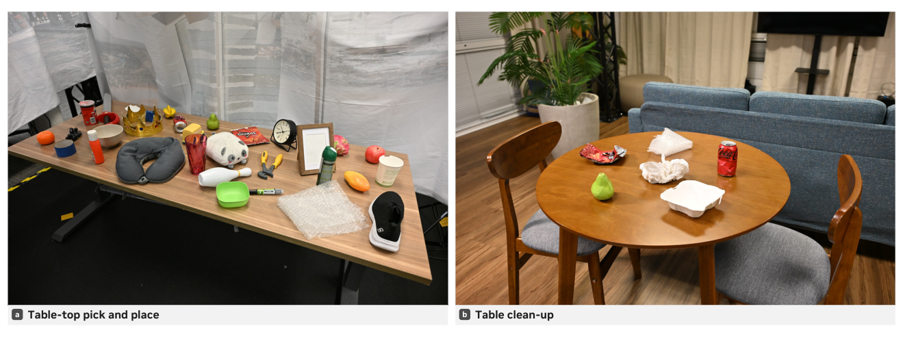
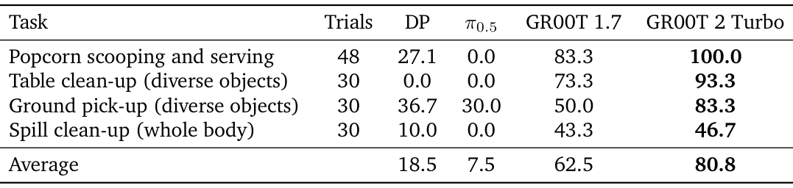
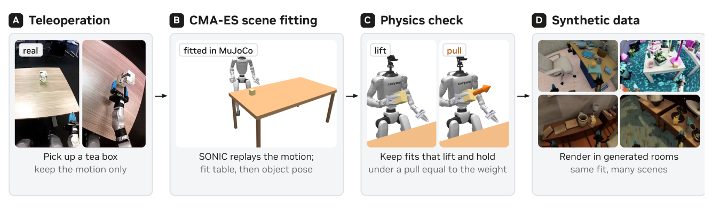
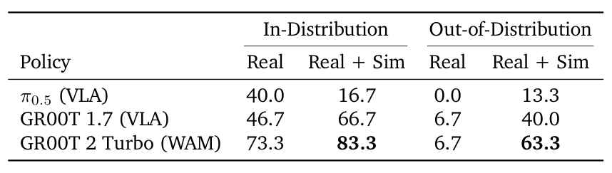

# 附录 H 人形移动操作

> **原文** H. Humanoid Loco-Manipulation　·　起于 p.109　·　本页中英对照：英文段在前，中文段在后。

---

<!-- p.109 S1972 -->

Loco-manipulation for bipedal humanoids poses additional challenges for robot foundation models, as humanoids must achieve precise end-effector control while maintaining balance under complex whole-body dynamics. Given these stringent requirements for reactive control, we turn to GR00T 2 Turbo, the lightweight variant of GR00T 2 suitable for deployment on edge devices (e.g. NVIDIA Jetson AGX Thor (Maheshwari et al., 2025)). We extend GR00T 2’s two-level architecture with SONIC (Luo et al., 2026) to form a three-level hierarchy (Fig. 9). A reasoning model, System 2 (S2), selects the task. Conditioned on this task and the current observations, GR00T 2 Turbo, System 1 (S1), generates short-horizon whole-body motion commands in SONIC’s compact latent action space. SONIC, System 0 (S0), translates these motion commands into joint-level commands while maintaining balance. Both S1 and S0 run onboard the robot, coupling task-directed motion generation with reactive whole-body control.

对双足人形机器人而言，移动操作带来了额外的挑战：人形机器人必须在复杂的全身动力学下保持平衡，同时实现精确的末端执行器控制。鉴于反应式控制的这些严格要求，我们采用 GR00T 2 Turbo，它是 GR00T 2 的轻量版本，适用于边缘设备部署（例如 NVIDIA Jetson AGX Thor（Maheshwari et al., 2025））。我们用 SONIC（Luo et al., 2026）扩展 GR00T 2 的两级架构，形成三级层级结构（Fig. 9）。推理模型系统 2（S2）负责选择任务。在该任务与当前观测的条件下，GR00T 2 Turbo 即系统 1（S1）在 SONIC 的紧凑潜变量动作空间中生成短时序的全身运动指令。SONIC 即系统 0（S0），在保持平衡的同时将这些运动指令转换为关节级指令。S1 与 S0 均在机器人本体上运行，将任务导向的运动生成与反应式全身控制耦合在一起。

<!-- p.109 S1973 -->

Our investigation shows that GR00T 2 Turbo achieves high success rates across four task settings that highlight complementary aspects of whole-body loco-manipulation: scooping and serving popcorn, which requires precise bimanual tool use while standing; clearing diverse objects from a table into bins, which requires long-horizon coordination of walking, reaching, grasping, and carrying; and floor-level tasks, such as wiping spills with the feet and picking up objects while squatting or kneeling, which require coordinated upper- and lower-body motion.

我们的考察表明，GR00T 2 Turbo 在四类任务设置上取得了较高的成功率，这些设置分别突出了全身移动操作的不同方面：舀取并盛放爆米花，需要在站立时进行精确的双臂工具使用；将桌面上的各类物品清入垃圾桶，需要长时序协调行走、伸手、抓取和搬运；地面任务，例如用脚擦拭洒落物，以及下蹲或跪地拾取物品，需要上下肢协调运动。

<!-- p.109 S1974 -->

All post-training data for whole-body loco-manipulation comes from whole-body teleoperation, which is expensive to collect and hard to scale. We therefore augment it with a large amount of synthetic data from a real-to-sim pipeline: teleoperated pick-and-place motions are fitted to the S0 controller and rolled out in simulation, so the synthetic demonstrations share the action space of the real data. GR00T 2 Turbo makes better use of this simulated data than the GR00T 1.7 VLA baseline, especially on out-of-distribution tabletop pick-and-place: starting from the same 6.7% success with real data alone, co-training raises GR00T 2 Turbo to 63.3%, compared with 40.0% for GR00T 1.7 (Tab. 26).

全身移动操作的全部后训练数据都来自全身遥操作，采集成本高，也难以扩展。因此，我们用大量来自现实到仿真（real-to-sim）流程的合成数据对其进行扩充：遥操作得到的抓放动作被拟合到 S0 控制器上并在仿真中展开，因此合成演示与真实数据共享同一动作空间。相比 GR00T 1.7 VLA 基线，GR00T 2 Turbo 更好地利用了这些仿真数据，尤其是在分布外的桌面抓放任务上：在仅使用真实数据、同为 6.7% 的成功率基础上，联合训练将 GR00T 2 Turbo 提升至 63.3%，而 GR00T 1.7 为 40.0%（Tab. 26）。

## H.1. GR00T 2 Turbo on Whole-Body Latent Actions · 基于全身潜在动作的 GR00T 2 Turbo

<!-- p.109 S1975 -->

The architecture of GR00T 2 Turbo is described in Sec. 2. To use GR00T 2 Turbo on a humanoid, which requires high-frequency control to remain balanced, we use the latent token interface of SONIC (Luo et al., 2026) as its action space. At a frequency of 1 Hz, GR00T 2 Turbo predicts action chunks containing the desired SONIC motion tokens and gripper width commands for the next 1.6 s. Each chunk is sampled at 50 Hz, so that at each 20 ms control step the SONIC controller receives the corresponding low-dimensional motion token together with the current robot state and outputs joint position targets for the humanoid. Gripper widths are not passed through the SONIC controller. The same token space is used for data collection, simulation, and deployment. In teleoperation, the operator’s motion is encoded into tokens and executed by SONIC, so demonstrations are recorded directly in the action space of the policy. Simulated demonstrations are generated by running the same controller in simulation.

GR00T 2 Turbo 的架构见 Sec. 2。要在人形机器人上使用 GR00T 2 Turbo，需要高频控制才能保持平衡，因此我们采用 SONIC（Luo et al., 2026）的潜 token 接口作为其动作空间。GR00T 2 Turbo 以 1 Hz 的频率预测动作块，每个动作块包含未来 1.6 s 内期望的 SONIC 运动 token 与夹爪宽度指令。每个动作块以 50 Hz 采样，因此在每个 20 ms 控制步，SONIC 控制器会接收对应的低维运动 token 以及当前机器人状态，并为人形机器人输出关节位置目标。夹爪宽度不经过 SONIC 控制器。数据采集、仿真与部署使用同一套 token 空间。在遥操作中，操作员的动作被编码为 token 并由 SONIC 执行，因此演示数据直接记录在策略的动作空间中。仿真演示则通过在仿真中运行同一控制器生成。

## H.2. Real-World Whole-Body Loco-Manipulation · 真实世界全身移动操作

<!-- p.109 S1976 -->

Tasks. We evaluate four task families that focus on different aspects of whole-body loco-manipulation (Fig. 57). In popcorn serving, the robot stands in front of a popcorn machine, takes a cup from a dispenser, scoops the popcorn, fills the cup, and places it for a customer. The task requires bimanual tool use and precise placement while standing. In table clean-up, objects such as bottles, food containers, fruit, and wrappers are spread over a table, and the robot picks them up one at a time and puts them into trash bins, walking between the table and the bins. This task tests walking, reaching across a table, grasping diverse objects, and carrying. The ground pick-up task asks the humanoid to pick up diverse objects from the ground by bending down. The whole-body cleaning task combines floor pick-up with cleaning a spill: the robot takes a towel from a counter, picks up a cup, drops the towel on the spill, wipes with its feet, and discards the towel and the cup into the bins. These

任务。我们评估了四类任务，它们分别侧重全身移动操作的不同方面（图 57）。在爆米花供应任务中，机器人站在爆米花机前，从分配器取出一个杯子，舀取爆米花，将杯子装满后放好，供顾客取用。该任务要求机器人在站立状态下完成双臂工具使用与精确放置。在桌面清理任务中，瓶子、食品盒、水果和包装纸等物品散落在桌面上，机器人逐个拾取并放入垃圾桶，过程中需要在桌面与垃圾桶之间行走。该任务考察行走、跨越桌面伸手、抓取多样物体以及搬运能力。地面拾取任务要求人形机器人弯腰从地面拾取多种物体。全身清洁任务则将地面拾取与清理溢出物结合起来：机器人从台面取下毛巾，拿起一个杯子，将毛巾铺在溢出物上，用脚擦拭，最后把毛巾和杯子丢入垃圾桶。这些

<!-- p.110 C081 · 图 F057 -->

Figure 57: Autonomous real-world whole-body loco-manipulation. Representative task sequences executed autonomously by post-trained GR00T 2 Turbo policies, with time progressing from left to right. From top to bottom: popcorn serving requires precise bimanual tool use to scoop, fill, and place a cup; table clean-up combines reaching and grasping with walking and carrying objects to bins; ground pick-up requires reaching to the floor and standing up with an object before carrying it away; and whole-body cleaning coordinates towel handling, foot-based wiping, and kneeling to retrieve the towel for disposal.

图 57：真实世界全身移动操作的自主执行。图中为经后训练的 GR00T 2 Turbo 策略自主执行的代表性任务序列，时间自左向右推进。自上而下依次为：爆米花供应需要精确的双臂工具使用，以舀取、装满并放置杯子；桌面清理将伸手抓取，以及行走并把物体搬运至垃圾桶相结合；地面拾取需要伸手够到地面，并在拿起物体后站起，再将其带走；全身清洁则协调毛巾操作、以脚擦拭以及屈膝拾起毛巾以便丢弃。

<!-- p.110 S2009 -->

tasks require deep reaches and coordinated use of the feet and arms, and they exercise the full capabilities of a bipedal humanoid. In addition, to study real and sim co-training, we use a tabletop pick-and-place task in which the humanoid starts at different positions relative to the table and picks up one of 30 diverse objects. The objects used for the table clean-up and tabletop pick-and-place tasks are shown in Fig. 58.

任务需要深度伸展，以及脚与手臂的协调配合，它们充分考验双足人形机器人的全部能力。此外，为研究真实与仿真的联合训练，我们使用一项桌面抓放任务：人形机器人从相对桌子的不同位置出发，拾取 30 种多样物体中的一件。桌面清理与桌面抓放任务所用的物体见图 58。

<!-- p.110 S2010 -->

Data collection. We train our policies on demonstrations collected via whole-body teleoperation and on synthetic demonstrations generated in simulation. During teleoperation, an operator wears a headset and body trackers. The operator’s motion is encoded into SONIC tokens, executed on the robot, and recorded together with the camera images. For the popcorn task, we collected 1,500 episodes for a total of 17 hours of data. Table clean-up was recorded as continuous episodes in which the operator clears several objects in a row. The robot starts facing the table at a random heading, picks up a piece of trash from the table, and then puts the object into the trash bin. For this task, we collected 3,995 episodes: 1,105 general, 375 room, and 2,515 ground episodes. For ground pick-up and tabletop pick-up, we collected 3,402 and 3,292 episodes, respectively. For the spill clean-up task, we used 292 episodes, totaling 3 hours of data. Every episode is reviewed and scored, and only episodes that pass review are used.

数据采集。我们的策略基于通过全身遥操作采集的演示数据以及在仿真中生成的合成演示数据进行训练。遥操作时，操作员佩戴头显和身体追踪器。操作员的动作被编码为 SONIC token，在机器人上执行，并与相机图像一同记录。对于爆米花任务，我们共采集了 1,500 个回合（episode），总计 17 小时数据。桌面清理以连续回合的形式记录，操作员在每个回合中接连清理多个物体。机器人以随机朝向面对桌子，从桌面上拾起一件垃圾，然后将其放入垃圾桶。该任务共采集 3,995 个回合：其中 1,105 个为通用回合，375 个为房间回合，2,515 个为地面回合。地面拾取与桌面拾取分别采集了 3,402 个和 3,292 个回合。对于溢出物清理任务，我们使用了 292 个回合，总计 3 小时数据。每个回合都经过审核并打分，只有通过审核的回合才会被使用。

<!-- p.110 S2011 -->

Training. Popcorn and spill clean-up are post-trained as single-task policies on their own demonstrations. Pick-and-place is post-trained as a multi-task policy that mixes tabletop pick-up, ground pick-up, placing into bins, and the clean-up segments, with a crosshair indicating the target. Object targets for the crosshair are labeled once per segment with a vision-language model and propagated through the video with a point tracker. For the comparison with GR00T 1.7, 𝜋0.5, and a diffusion policy (DP), we post-train each model on the same demonstrations with the same token action space and the same cameras.

训练。爆米花供应与溢出物清理任务各自仅使用自身的演示数据，以单任务策略的形式进行后训练。抓放任务则以多任务策略的形式进行后训练，混合了桌面拾取、地面拾取、放入垃圾桶以及清理片段，并以十字准星（crosshair）指示目标。十字准星的目标物体位置在每个片段中用视觉语言模型（VLM）标注一次，再通过点跟踪器沿视频传播。为与 GR00T 1.7、𝜋0.5 以及扩散策略（DP）进行比较，我们在相同的演示数据、相同的 token 动作空间和相同的相机条件下，对各模型进行后训练。

<!-- p.111 C082 · 图 F058 -->

Figure 58: Object sets for the tabletop pick-and-place and the table clean-up tasks.

图 58：桌面抓放任务与桌面清理任务所用的物体集合。

<!-- p.111 C083 · 表 T025 -->

Table 25: Real-world whole-body loco-manipulation on the Unitree G1. Success rate (%) using each listed model as S1, with the SONIC controller as S0. No partial credit is given (the reported success rate is the sum of the binary scores over all trials divided by the total number of trials). All policies are post-trained on the same demonstrations per task. DP: diffusion policy on latent tokens; 𝜋0.5 (VLA); GR00T 1.7 (VLA); GR00T 2 Turbo (WAM).

表 25：Unitree G1 上的真实世界全身移动操作。以所列各模型作为 S1、以 SONIC 控制器作为 S0 时的成功率（%）。不给部分分（报告的成功率为所有试次的二元得分之和除以试次总数）。所有策略在每个任务上均使用相同的演示数据进行后训练。DP：基于潜 token 的扩散策略；𝜋0.5（VLA）；GR00T 1.7（VLA）；GR00T 2 Turbo（WAM）。

<!-- p.111 S2017 -->

Evaluation and results. Popcorn serving is scored on a fixed suite of 48 runs, each requiring two full cups to be scooped and placed. The table clean-up task is scored on 30 trials; each trial involves picking up 6 diverse objects and putting all of them into the bin successfully. Failing to pick up an object or to drop it into the trash bin results in failure. Tabletop pick-and-place is scored on 30 trials with 30 household objects, 25 rigid and 5 soft, placed at ten positions on tables of three heights, with a 30 s limit per trial. Ground pick-up is scored on the same 30 household objects placed on the ground. For the spill clean-up task, we measure success over 30 trials of the full sequence: grabbing the towel, picking up the cup, wiping the spill with the feet, and dropping the towel and the cup into the bins. Tab. 25 reports the results. GR00T 2 Turbo completes 48 of 48 popcorn runs at about 41 s per two cups, while GR00T 1.7 trained on the same data completes 83% at about 48 s per two cups and is the best-performing baseline on this task. On table clean-up, GR00T 2 Turbo succeeds in 28 of 30 trials. Failures are flat objects such as a napkin or a chips bag that the gripper misses on, and objects knocked out of reach. Ground pick-up succeeds in 25 of 30 trials with the same failure modes. On the whole-body spill clean-up task, GR00T 2 Turbo succeeds in 14 of 30 trials, and GR00T 1.7 is again the second-best model with 13 of 30.

评测与结果。爆米花供应在一套固定的 48 次运行上进行评测，每次运行都需要舀取并放置两杯完整的爆米花。桌面清理任务基于 30 次试次进行评测，每次试次需拾取 6 件多样物体，并将它们全部成功放入垃圾桶。未能拾取物体，或未能将其投入垃圾桶，都会导致失败。桌面抓放在 30 次试次上评测，使用 30 件家用物体（其中 25 件为刚性物体，5 件为软性物体），放置在三种高度桌面上的十个位置，每次试次限时 30 s。地面拾取使用同样的 30 件家用物体，放置在地面上进行评测。对于溢出物清理任务，我们在 30 次完整流程试次上测量成功率：抓取毛巾、拾起杯子、用脚擦拭溢出物，并将毛巾和杯子丢入垃圾桶。表 25 给出了结果。GR00T 2 Turbo 完成了全部 48 次爆米花运行，每两杯约耗时 41 s；在相同数据上训练的 GR00T 1.7 完成率为 83%，每两杯约耗时 48 s，是该任务上表现最好的基线。在桌面清理任务中，GR00T 2 Turbo 在 30 次试次中成功 28 次。失败情形包括：夹爪抓空的扁平物体（如餐巾纸或薯片袋），以及被碰出可及范围的物体。地面拾取在 30 次试次中成功 25 次，失败模式相同。在全身溢出物清理任务中，GR00T 2 Turbo 在 30 次试次中成功 14 次，GR00T 1.7 再次位居第二，成功 13 次。

## H.3. WAMs Consume Simulation Data Better than VLAs · WAM 对仿真数据的利用优于 VLA

<!-- p.111 S2018 -->

Motion-centric Real-to-Sim Demonstrations. Real-world teleoperation data is costly to collect and limited in scene and object diversity. Our key insight is to reuse the whole-body motions recorded on the G1 by finding simulated scenes in which those motions successfully perform the task. Since teleoperated episodes contain motion and camera observations but not exact table and object poses, we initialize their simulated placements from the head-camera images and refine them using CMA-ES (Hansen et al., 2003). In MuJoCo (Todorov et al., 2012) or Isaac Lab (Mittal et al., 2025), we replay each motion through the same SONIC controller used on the

以运动为中心的现实到仿真演示。真实世界的遥操作数据采集成本高，且场景与物体的多样性有限。我们的核心思路是复用在 G1 上记录的全身运动，为这些运动寻找能让它们成功完成任务的仿真场景。由于遥操作片段包含运动和相机观测，却不包含精确的桌面与物体位姿，我们根据头部相机图像初始化它们在仿真中的摆放位置，并使用 CMA-ES（Hansen et al., 2003）进行优化。在 MuJoCo（Todorov et al., 2012）或 Isaac Lab（Mittal et al., 2025）中，我们使用与真实机器人相同的 SONIC 控制器回放每段运动，

<!-- p.112 C084 · 图 F059 -->

Figure 59: Motion-centric simulation data generation. (A) We use the recorded whole-body motion of a teleoperated episode. (B) SONIC replays the motion in simulation while CMA-ES fits the table and object placement. (C) A fit is kept only if the robot lifts the object and holds it under a pull equal to its weight. (D) The same accepted fit is rendered in many generated rooms.

图 59：以运动为中心的仿真数据生成。（A）使用一段遥操作片段中记录的全身运动。（B）SONIC 在仿真中回放该运动，同时 CMA-ES 拟合桌面与物体的摆放。（C）只有当机器人抬起物体，并在相当于物体重量的拉力下保持抓握时，拟合结果才会被保留。（D）同一个被接受的拟合结果会在大量生成的房间中渲染。

<!-- p.112 C085 · 表 T026 -->

Table 26: WAMs consume simulation data better than VLAs. Tabletop pick-and-place success rate (%) over 30 trials on the G1 when simulated demonstrations are mixed into the same real dataset.

表 26：WAM 对仿真数据的利用优于 VLA。当仿真演示与同一真实数据集混合时，G1 上桌面抓放任务的成功率（%），统计范围为 30 次试次。

<!-- p.112 S2036 -->

real robot, keeping the recorded motion fixed while optimizing the scene. The search evaluates 48 candidate scenes in parallel per generation and proceeds in two stages: fitting the table position, height, and yaw; then fitting the object type, position, and orientation on the table. A fit is accepted only if the final rollout grasps the object with both fingers, lifts it, and holds it through a 30-frame disturbance force equal to the object’s weight, followed by a 100-frame hold. We then render these fitted trajectories in procedurally generated environments with randomized lighting and camera placement, recording token sequences and rendered images in the same format as the real demonstrations. The resulting synthetic demonstrations preserve the real-data action space while expanding visual and object diversity. We use this procedure to generate 250,000 synthetic episodes totaling 1,000 hours. The generation procedure and examples are shown in Fig. 59.

真实机器人上运行，保持记录下来的运动不变，只优化场景。搜索过程中，每一代并行评估 48 个候选场景，分为两个阶段：先拟合桌面的位置、高度和偏航角；再拟合桌面上物体的类型、位置和朝向。只有当最终回放中物体被双指抓住、被抬起，并在相当于物体重量的 30 帧扰动力下保持住，随后再保持 100 帧时，该拟合才会被接受。随后，我们在随机化光照和相机位置的程序化生成环境中渲染这些拟合轨迹，所记录的 token 序列与渲染图像与真实演示的格式相同。由此生成的合成演示保留了真实数据的动作空间，同时扩大了视觉与物体的多样性。我们用该流程生成了 250,000 个合成片段，共计 1,000 小时。生成流程与示例见 Fig. 59。

<!-- p.112 S2037 -->

Results. In Tab. 26, we test each policy in distribution, in the environment where the real data were collected, and out of distribution, in unseen scenes and locations. The synthetic data improve the pick-and-place success rate of GR00T 1.7 and GR00T 2 Turbo in both settings, while 𝜋0.5 degrades in distribution. The gain is largest out of distribution, where both GR00T 1.7 and GR00T 2 Turbo start from 6.7% with real data alone. The WAM benefits more from the simulated data in this setting: co-training removes 61% of its failures, compared with 36% for GR00T 1.7, a difference of 25 percentage points. With 30 trials per cell, however, the difference between the two co-trained models (19 against 12 successes) is suggestive rather than conclusive (two-sided Fisher exact test, 𝑝≈0.12).

结果。在 Tab. 26 中，我们分别在分布内（即采集真实数据的环境）和分布外（未见过的场景与地点）两种设定下测试每个策略。合成数据在两种设定下都提升了 GR00T 1.7 和 GR00T 2 Turbo 的抓放成功率，而 𝜋0.5 在分布内出现了性能下降。增益在分布外最大：仅使用真实数据时，GR00T 1.7 和 GR00T 2 Turbo 的起点都是 6.7%。在这一设定下，WAM 从仿真数据中获益更多：联合训练使其失败数减少了 61%，而 GR00T 1.7 为 36%，两者相差 25 个百分点。不过，每个单元格只有 30 次试次，两个联合训练模型之间的差异（19 次成功对比 12 次成功）属于提示性结果，而非结论性结果（双侧 Fisher 精确检验，𝑝≈0.12）。

<!-- p.112 S2038 -->

Why. We hypothesize that this comes from the video prediction objective: the WAM’s more general video encoder maps rendered and camera frames into a shared latent space in which the model predicts how the scene evolves under its actions, a correspondence that is identical in simulation and reality, whereas a VLA maps appearance features tuned to real images directly to actions and treats rendered frames as out-of-distribution.

原因。我们推测这源于视频预测目标：WAM 更具通用性的视频编码器将渲染帧与相机帧映射到一个共享潜空间，模型在该空间中预测场景在其动作作用下如何演化，且这种对应关系在仿真与现实中是一致的。而 VLA 则将针对真实图像调校的外观特征直接映射为动作，并把渲染帧视为分布外输入。
