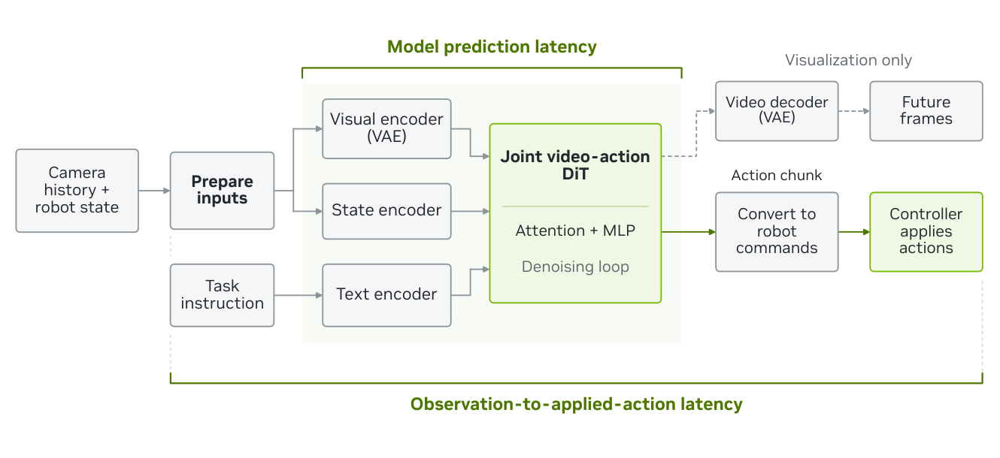
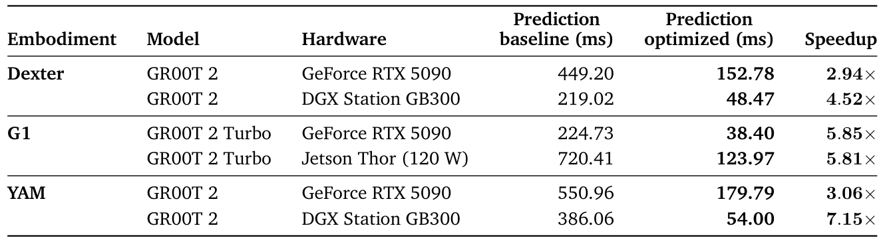
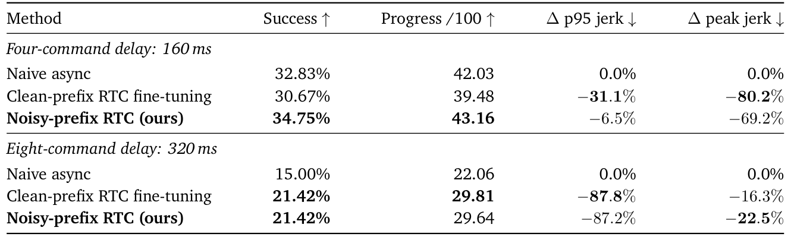
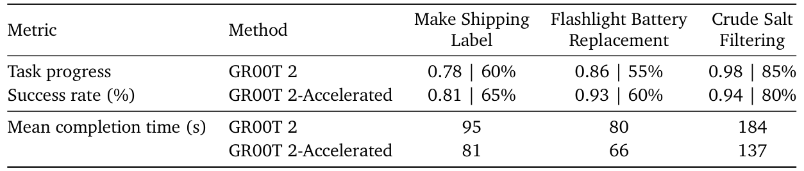
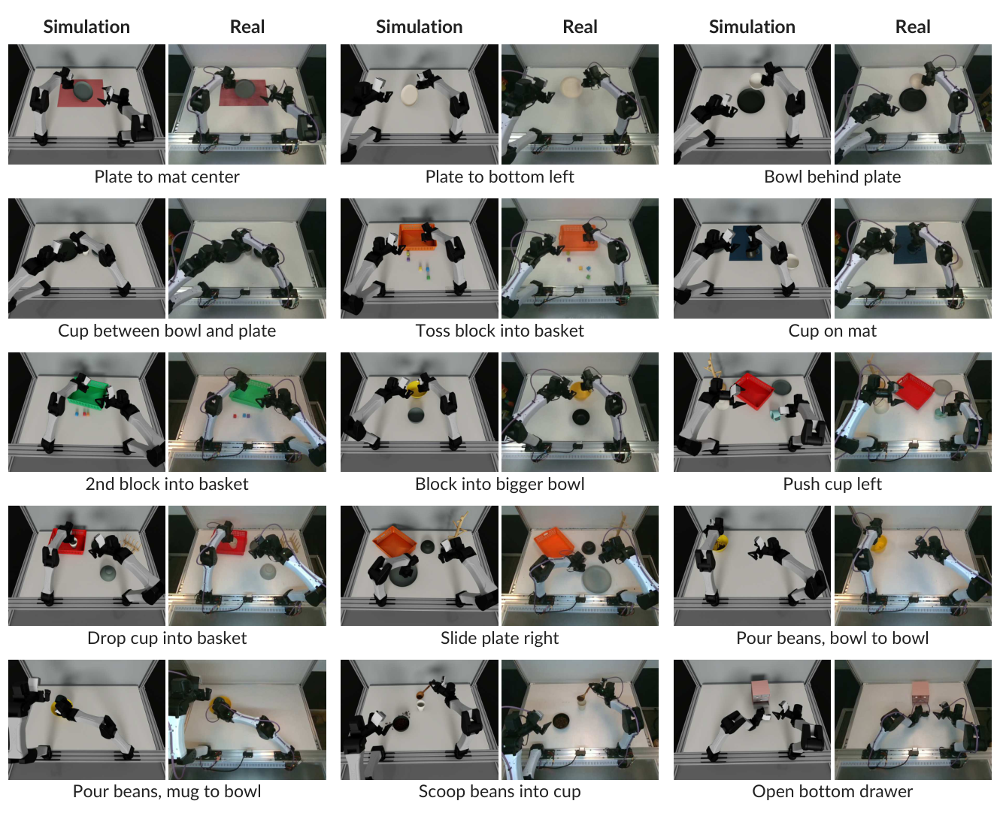

# 附录 I 加速

> **原文** I. Accelerating GR00T 2　·　起于 p.113　·　本页中英对照：英文段在前，中文段在后。

---

<!-- p.113 S2039 -->

Practical deployment of a generalist robotics foundation model requires timely predictions, continuous motion, and efficient task completion across tasks and embodiments. Deployment on edge hardware also imposes compute, memory, power, and thermal limits. We address these requirements through inference acceleration, training-time real-time chunking (RTC) (Black et al., 2025), and phase-conditioned action chunk retiming. We evaluate latency, task outcomes, and motion quality together.

通用机器人基础模型的实际部署需要及时的预测、连续的运动，以及跨任务和跨本体的高效任务完成。在边缘硬件上部署还会受到算力、内存、功耗和热学约束的限制。我们通过推理加速、训练时实时分块（RTC）（Black et al., 2025）以及相位条件化的动作块重定时来应对这些需求。我们同时评估时延、任务结果与运动质量。

<!-- p.113 S2040 -->

We first reduce inference latency within the deployment resource budget. WAMs in our setting incur higher inference latency than their VLA counterparts, motivating policy inference acceleration and system-level optimizations. Visual encoding and iterative video-action denoising contribute to model prediction latency, while observation processing and communication add delay around the model. We optimize both paths and distinguish model prediction latency from observation-to-applied-action latency. However, some delay remains even after optimization. Waiting for each prediction can interrupt execution, while naively executing predictions asynchronously can introduce discontinuities between successive action chunks. We therefore use training-time real-time chunking (RTC) to account for actions committed during inference and train the policy to produce compatible continuations.

我们首先在部署资源预算内降低推理时延。在我们的设定中，WAM 的推理时延高于其对应的 VLA，因此需要进行策略推理加速和系统级优化。视觉编码与迭代的视频-动作去噪会造成模型预测时延，而观测处理和通信会在模型前后引入额外延迟。我们同时优化这两条路径，并区分模型预测时延与观测到已应用动作的时延。然而，即使经过优化，仍会存在一定延迟。等待每次预测完成会打断执行，而简单地异步执行预测则会在相邻动作块之间引入不连续性。因此，我们使用训练时实时分块（RTC）来考虑推理期间已确定的动作，并训练策略生成与之兼容的后续动作。

<!-- p.113 S2041 -->

Continuity must also preserve the policy’s ability to correct its behavior using new observations. In our setting, standard training-time RTC improves continuity but may degrade task performance. We address this tradeoff with noisy-prefix, action-only RTC. Perturbing the conditioning prefix is intended to reduce reliance on the previous plan while retaining context for a smooth continuation. We further find that a small-scale fine-tuning stage applied to the post-trained base model captures most of the action-continuity benefits, making RTC adaptation practical without repeating the full training pipeline.

连续性还必须保留策略利用新观测修正自身行为的能力。在我们的设定中，标准的训练时 RTC 提高了连续性，但可能降低任务性能。我们通过带噪前缀、仅动作的 RTC 来处理这一权衡。对条件前缀施加扰动，旨在降低对先前计划的依赖，同时保留足够的上下文以实现平滑衔接。我们还发现，对后训练基础模型进行一个小规模微调阶段，就能获得大部分动作连续性收益，从而使 RTC 适配无需重复完整训练流程即可落地。

<!-- p.113 S2042 -->

Finally, continuous execution and low inference latency do not necessarily yield shorter task completion times. We introduce phase-dependent action-chunk acceleration to increase execution speed where the task permits it while retaining finer timing for precise interactions. Accelerated execution also changes the temporal relationship between successive chunks, requiring the continuity mechanism to account for the revised execution timeline. Temporal chunk alignment addresses this timing mismatch, while cross-chunk jerk optimization smooths the transition between successive commands. We evaluate the combined approach through inference latency, motion quality, task completion time, and success rate to establish whether faster execution preserves reliable task performance.

最后，持续执行与低推理时延并不一定意味着更短的任务完成时间。我们引入相位相关的动作块加速，在任务允许的地方提高执行速度，同时在精细交互处保留更精细的时序。加速执行也会改变相邻动作块之间的时间关系，因此连续性机制需要考虑修订后的执行时间线。时间动作块对齐用于解决这一时序失配，而跨块加加速度（jerk）优化则平滑相邻指令之间的过渡。我们通过推理时延、运动质量、任务完成时间和成功率来评估这一组合方法，以确定更快的执行是否仍能保持可靠的任务性能。

## I.1. Accelerating Model Inference · 加速模型推理

<!-- p.113 S2043 -->

Inference uses a client-server architecture: the robot client sends observations and executes returned action chunks through its controller, while the server runs the policy (Sec. K.5).

推理采用客户端-服务器架构：机器人客户端发送观测，并通过其控制器执行返回的动作块，服务器则运行策略（Sec. K.5）。

<!-- p.113 S2044 -->

GR00T 2 predicts action chunks by encoding camera observations, robot state, and task instructions, then iteratively denoising video and action latents. This computation adds delay to the control loop, while observation processing and communication introduce further overhead. We reduce these costs through computation reuse, optimized GPU execution, and a serving path that supports different embodiments and deployment hardware.

GR00T 2 通过编码相机观测、机器人状态和任务指令来预测动作块，然后对视频与动作潜变量进行迭代去噪。这一计算会给控制回路增加延迟，而观测处理和通信还会带来进一步的开销。我们通过计算复用、优化的 GPU 执行，以及支持不同本体和部署硬件的服务路径来降低这些成本。

<!-- p.113 S2045 -->

Timing boundaries. The environment continues to change while the policy computes, so prediction time is only part of the delay before a robot responds. We distinguish two intervals (Fig. 60). Model prediction latency covers encoding and iterative denoising performed within a prediction request. Observation-to-applied-action latency extends from observation preparation to controller application, including serialization, transport, and response handling. Streaming and prefetch can move encoding before the prediction request. We identify these configurations explicitly because their foreground prediction time excludes that encoding work.

时序边界。策略计算期间环境仍在变化，因此预测时间只是机器人作出响应前延迟的一部分。我们区分两段时间间隔（Fig. 60）。模型预测时延涵盖单次预测请求内部执行的编码与迭代去噪。观测到已应用动作的时延则从观测准备一直延伸到控制器应用，包括序列化、传输和响应处理。流式处理与预取可以将编码提前到预测请求之前。我们明确列出这些配置，是因为它们的前台预测时间不包含这部分编码工作。

<!-- p.113 S2046 -->

Optimizing model prediction. We first remove repeated computation. The policy reuses text features while the task instruction and model remain unchanged, and refreshes visual and state representations for new observations. For a fixed checkpoint and denoising schedule, timestep-dependent conditioning values are

优化模型预测。我们首先去除重复计算。只要任务指令和模型保持不变，策略就复用文本特征；对于新的观测，则刷新视觉与状态表示。对于固定的检查点和去噪调度，随时间步变化的条件值，

<!-- p.114 C086 · 图 F060 -->

Figure 60: Timing boundaries for GR00T 2 policy inference. Model prediction covers request-time encoding and iterative denoising. Observation-to-applied-action latency additionally includes observation preparation, communication, response handling, and controller scheduling. The diagram is schematic, and stage widths do not represent measured durations.

图 60：GR00T 2 策略推理的时序边界。模型预测涵盖请求时的编码与迭代去噪。观测到已应用动作的时延还包括观测准备、通信、响应处理和控制器调度。该示意图仅为示意性质，各阶段的宽度并不代表实测时长。

<!-- p.114 S2070 -->

computed in advance. Within the denoising loop, action-only updates reuse attention keys and values from the most recent video update. Persistent buffers reduce repeated cache preparation and copying.

可以预先计算。在去噪循环内，仅动作的更新会复用最近一次视频更新中的注意力键与值。持久缓冲区减少了重复的缓存准备与拷贝。

<!-- p.114 S2071 -->

We then accelerate the remaining computation. TensorRT compiles the video VAE encoder and transformer into specialized GPU engines, and CUDA graph replay reduces CPU dispatch and kernel-launch overhead. For supported checkpoints, we calibrate the BF16-trained model on representative robot observations and apply FP8 to selected projection and feed-forward layers in the joint transformer. Normalization layers and the action-only engine retain higher precision. Supported recipes also use FP8 for VAE encoding. Reducing denoising steps provides an additional tradeoff between latency, task success, and motion smoothness, which we assess for each checkpoint and task.

随后，我们加速剩余的计算。TensorRT 将视频 VAE 编码器和 Transformer 编译为专用的 GPU 引擎，CUDA graph 回放则降低了 CPU 调度和核函数启动的开销。对于支持的检查点，我们使用代表性的机器人观测对 BF16 训练的模型进行校准，并对联合 Transformer 中选定的投影层和前馈层应用 FP8。归一化层与仅动作引擎则保持更高精度。受支持的配方还会对 VAE 编码使用 FP8。减少去噪步数会在时延、任务成功率和运动平滑性之间带来额外的权衡，我们针对每个检查点和任务分别进行评估。

<!-- p.114 S2072 -->

Fig. 19 compares measured model-prediction latency for a GR00T 2 Turbo checkpoint deployed on G1 using RTX 5090 and Jetson Thor.

Fig. 19 比较了 GR00T 2 Turbo 检查点部署在 G1 上、分别使用 RTX 5090 与 Jetson Thor 时实测的模型预测时延。

<!-- p.114 S2073 -->

Tab. 27 reports median prediction latency for GR00T 2 and GR00T 2 Turbo across three embodiments and the evaluated hardware. Each baseline-optimized pair uses the same underlying checkpoint and input observations. The optimized configurations provide 2.94× to 7.15× speedup relative to eager BF16 execution. Each speedup applies to the complete configuration: the G1 comparison includes fewer denoising steps, while optimized Dexter and YAM use prefetched VAE representations. The timing boundaries and execution recipes are specified alongside the table.

Tab. 27 报告了 GR00T 2 与 GR00T 2 Turbo 在三种本体及所评估硬件上的模型预测中位时延。每个基线-优化配对都使用相同的底层检查点和输入观测。相对于即时 BF16 执行，优化配置实现了 2.94× 至 7.15× 的加速。每项加速都针对完整配置而言：G1 的对比包含了更少的去噪步数，而经过优化的 Dexter 和 YAM 则使用了预取的 VAE 表示。时序边界与执行配方与该表一并给出。

<!-- p.114 S2074 -->

We use one checkpoint per embodiment across hardware comparisons. All three use the 2B model configuration, with five history frames per camera at 224 × 320 pixels (height × width). Dexter uses three camera views in four model slots and a 48-action prediction horizon, YAM uses four views and a 48-action horizon, and the GR00T 2 Turbo checkpoint for G1 uses three views and an 80-action horizon. The notation 2v4a denotes two video and four action denoising steps. Dexter uses 2v2a and YAM uses 2v4a in both baseline and optimized execution. G1 changes from 2v4a to 1v2a, with the action horizon unchanged.

在硬件对比中，我们为每个本体使用一个检查点。三者都采用 2B 模型配置，每个相机保留五个历史帧，分辨率为 224 × 320 像素（高 × 宽）。Dexter 使用三个相机视角、四个模型槽位以及 48 个动作的预测时域；YAM 使用四个视角与 48 个动作的时域；用于 G1 的 GR00T 2 Turbo 检查点则使用三个视角与 80 个动作的时域。记号 2v4a 表示两个视频去噪步和四个动作去噪步。Dexter 在基线与优化执行中都使用 2v2a，YAM 都使用 2v4a。G1 从 2v4a 改为 1v2a，动作时域保持不变。

<!-- p.114 S2075 -->

All optimized configurations use TensorRT and CUDA graphs. Dexter uses FP16-mixed transformer engines with BF16 streaming VAE and prefetch, without codec roundtrip. G1 uses FP8 mixed precision, with VAE encoding included in prediction latency. YAM uses FP8 joint-transformer and VAE engines, a BF16 action engine, and whole-window VAE prefetch with MP4V. For Dexter and YAM, eager timings include VAE encoding, while optimized timings exclude encoding completed before the request.

所有优化配置都使用 TensorRT 与 CUDA graph。Dexter 使用 FP16 混合精度的 Transformer 引擎，配合 BF16 流式 VAE 与预取，且不包含编解码往返。G1 使用 FP8 混合精度，并将 VAE 编码计入预测时延。YAM 使用 FP8 的联合 Transformer 与 VAE 引擎、BF16 的动作引擎，以及使用 MP4V 的整窗口 VAE 预取。对于 Dexter 和 YAM，即时执行的时间包含 VAE 编码，而优化后的时间则不包含在请求前已完成的编码。

<!-- p.115 C087 · 表 T027 -->

Table 27: Median model-prediction latency (p50) for GR00T 2 and GR00T 2 Turbo across embodiments and hardware. Speedup is baseline latency divided by optimized latency.

表 27：GR00T 2 与 GR00T 2 Turbo 在各本体和硬件上的模型预测中位时延（p50）。加速比为基线时延除以优化后的时延。

<!-- p.115 S2083 -->

We evaluate embodiment-specific checkpoints. Each baseline-optimized pair uses the same underlying checkpoint and input profile. Baselines use unquantized BF16 PyTorch execution with checkpoint-default attention kernels. Baseline revisions are selected per checkpoint to preserve its required model behavior.

我们评估针对具体本体的检查点。每个基线-优化配对都使用相同的底层检查点和输入配置。基线采用未量化的 BF16 PyTorch 执行，并使用检查点默认的注意力核函数。基线版本按检查点单独选定，以保留其所需的模型行为。

<!-- p.115 S2084 -->

Optimizing the serving path. Multi-camera observations must be encoded, transferred, and prepared before the model can use them. We reduce this overhead with bounded CPU worker pools for camera-history processing, faster JPEG encoding and decoding, and fewer memory copies. Where supported, incremental streaming VAE reuses cached encoder state as camera frames arrive. VAE prefetch prepares the required visual latents before the next prediction request, moving encoding off the foreground prediction path. The benefit depends on the observation format, client implementation, and hardware. Deployment-level evaluation must also account for the age of the observations and the encoding work performed before the request.

优化服务路径。多相机观测必须先经过编码、传输和准备，模型才能使用。我们通过以下方式降低这部分开销：为相机历史处理设置有界的 CPU 工作池，采用更快的 JPEG 编解码，并减少内存拷贝。在支持的情况下，增量流式 VAE 会在相机帧到达时复用已缓存的编码器状态。VAE 预取会在下一次预测请求之前准备所需的视觉潜变量，从而将编码工作移出前台预测路径。其收益取决于观测格式、客户端实现和硬件。部署层面的评估还必须考虑观测的时效，以及请求前已完成的编码工作。

<!-- p.115 S2085 -->

Latency and action fidelity. Approximation-based inference acceleration can reduce latency at the cost of task success, our primary measure of robot policy quality. We therefore assess the effects of acceleration through numerical validation, simulation, and physical-robot evaluation. Numerical comparisons use the same checkpoint’s eager BF16 execution as a reference, holding observations, conditioning, denoising schedules, and initial noise fixed. We compute mean squared error over valid, newly generated actions, excluding padding and committed RTC prefixes, and inspect decoded errors by action group. Simulation and physical-robot tests evaluate whether accelerated execution preserves task success, alongside completion time and motion smoothness.

时延与动作保真度。基于近似的推理加速可以降低时延，但可能以任务成功率为代价，而任务成功率是我们衡量机器人策略质量的主要指标。因此，我们通过数值验证、仿真和实体机器人评估来考察加速的效果。数值比较以同一检查点的即时 BF16 执行作为参考，并固定观测、条件、去噪调度和初始噪声。我们计算有效的新生成动作上的均方误差，排除填充部分和已确定的 RTC 前缀，并按动作分组检查解码后的误差。仿真与实体机器人测试则评估加速执行是否保持任务成功率，同时考察完成时间与运动平滑性。

<!-- p.115 S2086 -->

During the remaining prediction delay, the robot must continue executing actions. The following subsection describes how training-time RTC conditions new predictions on actions already committed for execution, supporting continuity between action chunks.

在剩余的预测延迟期间，机器人必须继续执行动作。下一小节说明训练时 RTC 如何将新的预测条件化于已确定用于执行的动作之上，从而支持动作块之间的连续性。

## I.2. Policy Smoothness · 策略平滑性

<!-- p.115 S2087 -->

To account for inference latency, we build on training-time real-time chunking (RTC) (Black et al., 2025), which conditions each prediction on the committed action prefix from the previous prediction. We propose a simple extension of training-time RTC that we term noisy-prefix RTC. During fine-tuning, we perturb the conditioning action prefix with Gaussian noise. At inference, we condition on clean committed commands.

为了考虑推理时延，我们以训练时实时分块（RTC）（Black et al., 2025）为基础，让每次预测都以上一次预测中已提交的动作前缀为条件。我们对训练时实时分块提出了一个简单的扩展，称之为含噪前缀 RTC（noisy-prefix RTC）。在微调阶段，我们用高斯噪声扰动条件动作前缀；推理时，则以干净的已提交指令作为条件。

<!-- p.115 S2088 -->

Simulation experiments on training-time RTC schemes. We evaluate task performance and action smoothness for GR00T 2 under fixed simulated inference delays, comparing RTC-conditioned execution with naive asynchronous execution.

训练时 RTC 方案的仿真实验。我们在固定的仿真推理延迟下评测 GR00T 2 的任务性能与动作平滑性，并将 RTC 条件化执行与朴素异步执行进行比较。

<!-- p.115 S2089 -->

A simple noisy-prefix RTC adaptation. We initialize from a GR00T 2 policy post-trained for 30k steps on RoboDojo (Chen et al., 2026a) demonstrations without RTC. Our proposed adaptation applies 5k additional fine-tuning steps on 800 demonstrations spanning eight precision tasks, adding Gaussian noise with 𝜎= 0.1 to the conditioning action prefix during training. This trains the policy to generate continuations from perturbed prefixes. We compare against clean-prefix training-time RTC, which uses no prefix noise during fine-tuning.

一个简单的含噪前缀 RTC 适配。我们从一个 GR00T 2 策略出发，该策略在未使用 RTC 的 RoboDojo（Chen et al., 2026a）演示数据上完成了 30k 步后训练。我们提出的适配方法在覆盖八个精细操作任务的 800 条演示上额外进行 5k 步微调，训练时对条件动作前缀加入 𝜎= 0.1 的高斯噪声 [公式原文见 p.115]。这使策略学会从受扰动的前缀生成后续动作。我们与干净前缀的训练时实时分块进行比较，后者在微调时不对前缀加噪。

<!-- p.116 C088 · 表 T028 -->

Table 28: Evaluation of a simple noisy-prefix RTC extension under simulated inference latency. Success and progress use 1,200 matched episodes per condition, while jerk uses 120 matched diagnostic layouts. Jerk changes are relative to async execution of the noisy-prefix fine-tuned checkpoint at the same delay. Negative changes indicate lower jerk. Bold values indicate the best result within each delay setting.

Table 28：在仿真推理时延下对简单含噪前缀 RTC 扩展的评测。成功率与进度各使用每种条件下 1,200 个匹配回合，而加加速度（jerk）使用 120 个匹配诊断布局。jerk 的变化相对于同一延迟下含噪前缀微调检查点的异步执行计算。负值表示 jerk 更低。加粗数值表示每种延迟设置内的最佳结果。

<!-- p.116 S2095 -->

Both variants use clean committed prefixes during RTC inference. The naive async reference uses the same noisy-prefix fine-tuned checkpoint as the noisy RTC method, with prefix conditioning disabled at inference.

两种变体在 RTC 推理时都使用干净的已提交前缀。朴素异步参照使用与含噪 RTC 方法相同的含噪前缀微调检查点，但推理时禁用前缀条件化。

<!-- p.116 S2096 -->

Evaluation protocol. All conditions replan every eight commands at 25 Hz. Fixed delays of four and eight commands correspond to 160 ms and 320 ms, respectively. Delay is modeled through the action queue, without adding wall-clock sleeps to the simulator. Success rate and mean task progress are measured over 1,200 matched episodes per condition, comprising 150 layouts for each task. Jerk is measured in a separate diagnostic using 120 matched layouts per condition, with 15 layouts per task distributed across three layout banks.

评测协议。所有条件每 8 条指令以 25 Hz 重新规划一次。固定延迟 4 条与 8 条指令分别对应 160 ms 与 320 ms。延迟通过动作队列建模，不向仿真器添加挂钟睡眠。成功率（SR）与平均任务进度在每种条件的 1,200 个匹配回合上测量，其中每个任务包含 150 个布局。jerk 在单独的诊断中测量，每种条件使用 120 个匹配布局，每个任务 15 个布局，分布在三个布局库中。

<!-- p.116 S2097 -->

We compute commanded joint jerk using third finite differences at ∆𝑡= 0.04 s, excluding grippers and startup. Cross-chunk jerk includes all three four-sample stencils crossing each old-to-new prediction handoff. The p95 statistic gives equal weight to each episode. Peak jerk is the largest observed absolute sample. At an eight-command delay, the prediction handoff coincides with the next replanning boundary.

我们在 ∆𝑡= 0.04 s 处使用三阶有限差分计算指令关节 jerk，并排除夹爪与启动阶段 [公式原文见 p.116]。跨块 jerk 包括穿过每个从旧预测到新预测交接点的全部三个四采样模板。p95 统计对每个回合赋予相同权重。峰值 jerk 为观测到的最大绝对采样值。在八条指令延迟下，预测交接恰好与下一次重新规划的边界重合。

<!-- p.116 S2098 -->

Results. Table 28 reports performance and commanded-action smoothness relative to naive async execution. With identical noisy-prefix fine-tuned weights, RTC increases observed success from 32.83% to 34.75% at a four-command delay, while reducing p95 cross-chunk commanded jerk by 6.5% and peak jerk by 69.2%. At an eight-command delay, success increases from 15.00% to 21.42%, with reductions of 87.2% in p95 jerk and 22.5% in peak jerk.

结果。Table 28 报告了相对于朴素异步执行的性能与指令动作平滑性。在相同的含噪前缀微调权重下，四条指令延迟时 RTC 将观测成功率从 32.83% 提高到 34.75%，同时使 p95 跨块指令 jerk 降低 6.5%，峰值 jerk 降低 69.2%。八条指令延迟时，成功率从 15.00% 提高到 21.42%，p95 jerk 降低 87.2%，峰值 jerk 降低 22.5%。

<!-- p.116 S2099 -->

Clean-prefix fine-tuning produces smoother commands at the four-command delay, but achieves lower task success than noisy-prefix fine-tuning. At the eight-command delay, the two RTC variants achieve the same observed success rate. The clean-prefix variant has lower p95 commanded jerk, whereas the noisy-prefix variant has lower peak commanded jerk. For simulated joint states at the eight-command delay, noisy RTC reduces p95 jerk by 40.1% but increases the observed peak by 13.4% relative to async execution.

干净前缀微调在四条指令延迟下产生更平滑的指令，但任务成功率低于含噪前缀微调。在八条指令延迟下，两种 RTC 变体取得相同的观测成功率。干净前缀变体的 p95 指令 jerk 更低，而含噪前缀变体的峰值指令 jerk 更低。对于八条指令延迟下的仿真关节状态，相对于异步执行，含噪 RTC 使 p95 jerk 降低 40.1%，但使观测峰值升高 13.4%。

## I.3. Accelerating Task Throughput Beyond Demonstrations · 超越演示的任务吞吐加速

<!-- p.116 S2100 -->

We leverage an agentic task-throughput acceleration algorithm to enable GR00T 2 to complete tasks with higher task-completion throughput than the demonstration dataset. We decompose overall task execution into semantically meaningful phases, such as reaching, grasping, transporting, and screwing, which differ in their sensitivity to acceleration. An agent searches for a speed schedule over these phases by evaluating accelerated rollouts and refining the speed schedule based on observed failures. At deployment, a lightweight observationconditioned future subtask predictor predicts a sequence of future phases aligned with GR00T 2’s action-chunk horizon. Given the action chunk, predicted phases and a speed schedule, a trajectory transformation function produces a new action chunk for execution (see Fig 20). We train the predictor using temporally aligned phase annotations generated by an agent.

我们采用一种智能体化任务吞吐加速算法，使 GR00T 2 能以高于演示数据集的任务完成吞吐量完成任务。我们将整体任务执行分解为语义上有意义的阶段，例如抵达、抓取、搬运和拧螺丝，这些阶段对加速的敏感程度各不相同。智能体通过评估加速后的 rollout（轨迹采样），并根据观测到的失败修正速度调度方案，在这些阶段上搜索速度调度方案。部署时，一个轻量的、以观测为条件的未来子任务预测器会预测一串未来阶段，并与 GR00T 2 的动作块时域对齐。给定动作块、预测阶段和速度调度方案后，轨迹变换函数会生成一个新的动作块用于执行（见 Fig 20）。我们使用由智能体生成的、时间对齐的阶段标注来训练该预测器。

<!-- p.117 S2101 -->

Evaluation Tasks. We showcase GR00T 2-Accelerated across three tasks on the Tianji Sharpa robot from the Dexter post-training benchmark task (see Section A.1). We report task progress scores, success rates and mean completion times of successful episodes in Table 29. Our experiments indicate that GR00T 2-Accelerated consistently decreases task completion times while preserving success rates across the evaluated long-horizon dexterous tasks.

评测任务。我们在 Dexter 后训练基准任务（见 Section A.1）中的 Tianji Sharpa 机器人上，展示了 GR00T 2-Accelerated 在三个任务上的表现。Table 29 报告了任务进度分数、成功率以及成功回合的平均完成时间。我们的实验表明，在所评测的长时序灵巧任务上，GR00T 2-Accelerated 持续缩短任务完成时间，同时保持成功率。

<!-- p.117 C089 · 表 T029 -->

Table 29: Task success rate and completion time on Dexter post-training tasks. Completion time is averaged over successful trials only.

Table 29：Dexter 后训练任务上的任务成功率与完成时间。完成时间仅对成功的试次取平均。

<!-- p.118 C090 · 图 F061 -->

Figure 61: Subset of environments for Real-to-Sim Evaluation. Side-by-side of real-world tasks that are used to evaluate generalist capabilities of GR00T 2 and their simulation counterparts. Odd columns are the simulation environments and even columns are frames from the real-world robot workcell. Each task is evaluated five times in the real-world and ten times in simulation per checkpoint, with the results used to calculate the correlations between performance in simulation and the real-world.

Figure 61：用于现实到仿真评测的环境子集。并排展示了用于评测 GR00T 2 通用能力的真实世界任务及其仿真对应物。奇数列为仿真环境，偶数列为真实机器人工作单元中的帧画面。每个任务在每个检查点上于真实世界中评测五次、于仿真中评测十次，结果用于计算仿真表现与真实世界表现之间的相关性。
