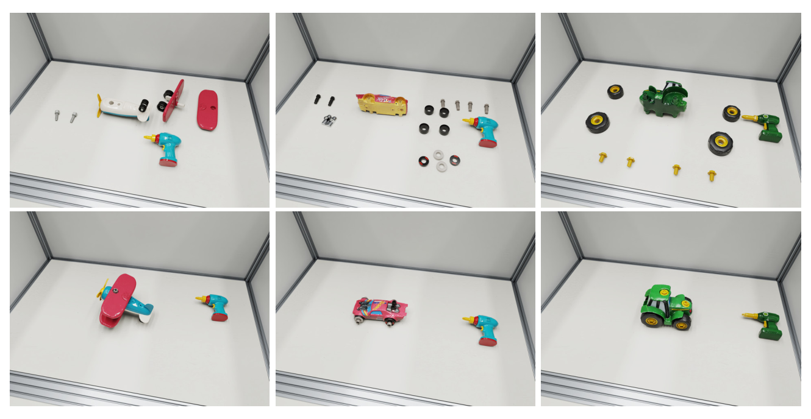
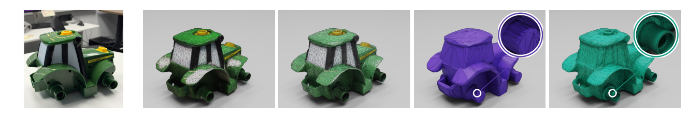
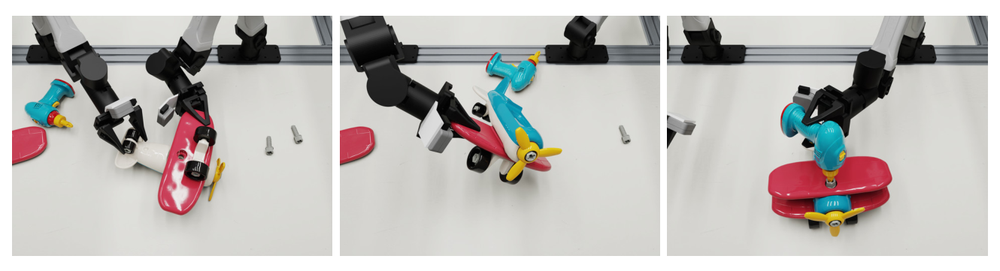
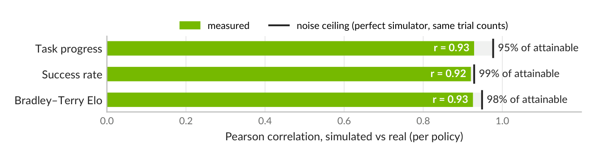
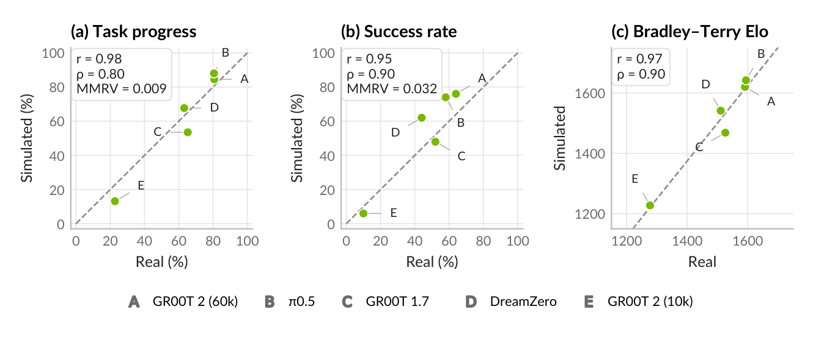
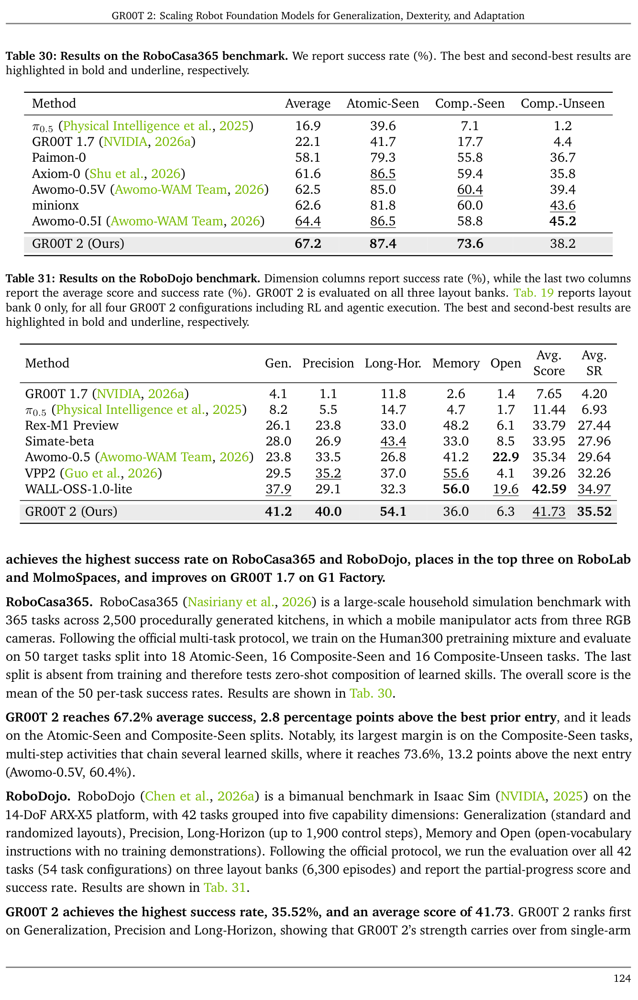
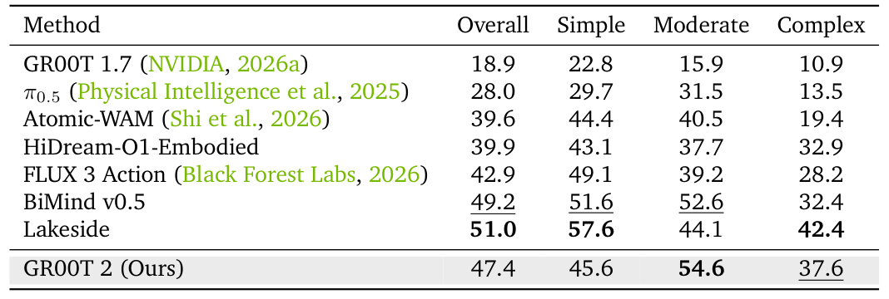
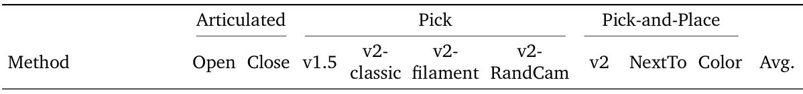
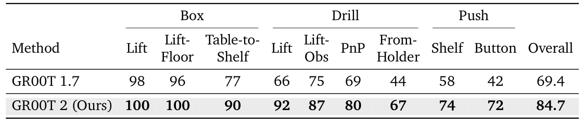

# 附录 J 仿真

> **原文** J. Simulations　·　起于 p.118　·　本页中英对照：英文段在前，中文段在后。

---

<!-- p.118 S2116 -->

In this section, we outline how simulation contributed to GR00T 2. We developed a real-to-sim workflow that recreates high-fidelity digital twins of real-world tasks used for evaluating GR00T 2 (Sec. J.1). Policy evaluations in these high-fidelity digital twins proved to have strong correlations with real-world evaluations, allowing them to accelerate GR00T 2 development (Sec. J.2). Finally, we showcase GR00T 2’s capabilities on standardized simulation environments, establishing new state-of-the-art results on several of the latest benchmarks (Sec. J.3).

本节概述仿真如何服务于 GR00T 2 的研发。我们开发了一套现实到仿真（real-to-sim）工作流，用于重建 GR00T 2 评测所用真实世界任务的高保真数字孪生（Sec. J.1）。事实证明，在这些高保真数字孪生中进行的策略评测与真实世界评测之间具有很强的相关性，从而使它们能够加速 GR00T 2 的开发（Sec. J.2）。最后，我们在标准化仿真环境中展示了 GR00T 2 的能力，并在若干最新基准测试上取得了新的最优结果（Sec. J.3）。

## J.1. Real-to-Sim Generation of High-Fidelity Tasks · 高保真任务的现实到仿真生成

<!-- p.118 S2117 -->

J.1.1. GR00T 2 Simulation Task Suite

J.1.1. GR00T 2 仿真任务套件

<!-- p.118 S2118 -->

We seek to recreate the real-world tasks used in GR00T 2 development, including general manipulation tasks that are evaluated zero-shot and multi-stage assembly tasks. The task set spans rigid and articulated objects, deformable materials, and particles with diverse interactions including, but not limited to, sliding, pushing and scooping. We aim to reproduce both the visual setup and the physical interactions that determine whether each task succeeds, so that the resulting environments are useful for policy evaluation and skill development. This modeling can be challenging for tasks involving complex interactions with particles or deformables, since physics stability and fidelity must be maintained while running fast enough for large-scale evaluation. To enable this, we agentically integrate and tune different solvers such as the Finite Element Method (FEM) (Sifakis and Barbic, 2012) for deformable bodies, Position-Based Dynamics (PBD) (Müller et al., 2007) for granular media, in addition to rigid-body and articulation dynamics. Contact-rich assembly provides another demanding example of real-to-sim reconstruction. Parts must fit together, remain attached during manipulation, and interact with robot grippers and tools. We reconstruct toy plane, Hot Wheels, and toy tractor assembly assets with separate components, fasteners, and handheld drills (Fig. 62). Their initial and assembled configurations illustrate the component structure and geometric relationships that these environments must represent.

我们力图重现 GR00T 2 开发中使用的真实世界任务，包括以零样本方式评测的通用操作任务，以及多阶段装配任务。任务集合涵盖刚体与关节物体、可形变材料以及颗粒，并包含多种交互，包括但不限于滑动、推动和铲取。我们希望同时重现决定每个任务能否成功的视觉布置与物理交互，使所得环境既可用于策略评测，也可用于技能开发。对于涉及颗粒或可形变体复杂交互的任务，这种建模可能很有挑战性，因为必须在保持物理稳定性与保真度的同时，保证运行速度足以支持大规模评测。为此，我们以智能体化的方式集成并调节多种求解器，包括用于可形变体的有限元法（FEM）（Sifakis and Barbic, 2012）、用于颗粒介质的基于位置的动力学（PBD）（Müller et al., 2007），此外还包括刚体与关节动力学。富接触装配是现实到仿真重建的另一个高难度示例。零件必须能够相互配合，在操作过程中保持连接，并与机器人夹爪和工具发生相互作用。我们重建了玩具飞机、Hot Wheels 和玩具拖拉机的装配资产，包含各自独立的部件、紧固件以及手持电钻（Fig. 62）。它们的初始构型与装配后构型，展示了这些环境必须表示的部件结构与几何关系。

<!-- p.119 S2120 -->

J.1.2. Agent-Guided Simulation Creation

J.1.2. 智能体引导的仿真构建

<!-- p.119 S2121 -->

We use complementary agent-assisted workflows to construct these environments. Tools from Sim- Foundry (Ranawaka et al., 2026) use real-world robot videos to guide scene reconstruction and refinement. We also use scans, photographs, and available physical measurements to reconstruct individual assets and their functional interfaces. Agents assist with geometry, appearance, collision modeling, and simulation setup, while human experts guide modeling decisions and review the resulting interactions.

我们采用互补的智能体辅助工作流来构建这些环境。Sim- Foundry（Ranawaka et al., 2026）中的工具利用真实世界机器人视频来引导场景重建与细化。我们还利用扫描数据、照片以及现有的物理测量，来重建单个资产及其功能接口。智能体协助处理几何、外观、碰撞建模与仿真设置，而人类专家负责指导建模决策，并审查最终的交互结果。

<!-- p.119 S2122 -->

Visual reconstruction is paired with collision geometry tailored to the intended contacts. Fig. 63 illustrates this process for the tractor body, from the physical object and input scan to the reconstructed visual asset and its collision representations. Coarse handling geometry captures the overall shape, while detailed fitting geometry retains features such as bores and reconstructed threaded interfaces. The wheel-shaft close-ups show the two levels of detail: a simplified shape is sufficient for grasping and large-scale handling, whereas high-precision operations such as threading and insertion require the full fitting geometry.

视觉重建与为预期接触量身定制的碰撞几何相配对。Fig. 63 以拖拉机车身为例展示了这一过程，从实物、输入扫描到重建的视觉资产及其碰撞表示。粗略的操作几何捕捉整体形状，而精细的装配几何则保留了孔洞及重建的螺纹接口等特征。车轮轴近景展示了两个细节层次：简化形状足以用于抓取和大范围搬运，而螺纹连接与插入等高精度操作则需要完整的装配几何。

<!-- p.119 S2123 -->

The toy plane and Hot Wheels assembly environments run in Isaac Lab Arena (NVIDIA Isaac Lab-Arena Contributors, 2025), using Newton (The Newton Contributors, 2025) with the MuJoCo Warp solver (Google DeepMind and NVIDIA, 2025). Each object has two sets of colliders: a coarse set for interactions such as grasping and contact with the worktable, and a detailed set for tight-fit insertion and threading bolts into nuts with a powered drill. We use convex and signed distance field (SDF) colliders for these representations. Collision masks determine which sets can interact, allowing larger-scale and fine-scale contacts to be simulated simultaneously. To support long-horizon, multi-stage assembly tasks, we developed an Isaac Lab extension for defining attachment points on individual parts. When a part reaches its intended assembly position within a predefined tolerance, the extension creates a joint between the corresponding rigid bodies, keeping the assembled parts connected during subsequent manipulation.

玩具飞机与 Hot Wheels 装配环境运行于 Isaac Lab Arena（NVIDIA Isaac Lab-Arena Contributors, 2025），使用 Newton（The Newton Contributors, 2025）以及 MuJoCo Warp 求解器（Google DeepMind and NVIDIA, 2025）。每个物体有两套碰撞体：粗略的一套用于抓取以及与工作台的接触等交互，精细的一套用于紧配合插入，以及用动力电钻将螺栓拧入螺母。我们对这些表示使用凸碰撞体和有向距离场（SDF）碰撞体。碰撞掩码决定哪些碰撞体集合可以相互作用，从而允许大尺度接触与精细尺度接触同时仿真。为支持长时序、多阶段装配任务，我们开发了一个 Isaac Lab 扩展，用于在单个零件上定义附着点。当某个零件在预定义容差范围内到达其预期装配位置时，该扩展会在对应的刚体之间创建一个关节，从而在后续操作中保持已装配零件的连接。

<!-- p.119 S2124 -->

We validate the environments and assets in several stages. First, we test assembly without a robot, applying forces directly to the parts and the drill. These tests follow the real-world sequence of inserting parts and driving bolts. We also perform grasping and drop tests to check the stability of individual assets and the overall scene. Finally, we replay real-world robot demonstrations in simulation (Fig. 64) to assess asset stability and interactions such as grasping, insertion, and fastening. The validated environments then support the GR00T 2 applications described in Sec. J.2.

我们分几个阶段验证环境与资产。首先，在没有机器人的情况下测试装配，直接对零件和电钻施加力，这些测试遵循真实世界中插入零件与拧紧螺栓的顺序。我们还进行抓取与跌落测试，以检查单个资产以及整个场景的稳定性。最后，我们在仿真中重放真实世界的机器人演示（Fig. 64），以评估资产稳定性以及抓取、插入和紧固等交互。经过验证的环境随后支持 Sec. J.2 中所述的 GR00T 2 应用。

## J.2. Accelerating GR00T 2 Development with Simulation · 借助仿真加速 GR00T 2 开发

<!-- p.119 S2125 -->

Once generated, the simulation environments can be used for many different applications. We first quantify the utility of our simulation suite by comparing the outcomes of GR00T 2 policy evaluations in sim and in real (Sec. J.2.1). We then highlight how these high-fidelity environments contributed to GR00T 2 development, including: optimization of GR00T 2 inference for deployment (Sec. J.2.2), faster iteration on the GR00T 2 pretraining process (Sec. J.2.3), and the development of agentic recovery skills in simulation that assist GR00T 2 during real-world deployment (Sec. J.2.4).

仿真环境生成之后，可以用于许多不同的应用。我们首先通过比较 GR00T 2 策略在仿真与真实环境中的评测结果，量化仿真套件的效用（Sec. J.2.1）。随后，我们说明这些高保真环境如何助力 GR00T 2 的开发，包括：面向部署的 GR00T 2 推理优化（Sec. J.2.2）、加快 GR00T 2 预训练过程的迭代（Sec. J.2.3），以及在仿真中开发智能体化恢复技能，以在真实部署中辅助 GR00T 2（Sec. J.2.4）。

<!-- p.120 C091 · 图 F062 -->

Figure 62: Reconstructed assembly tasks. Toy plane, Hot Wheels car, and toy tractor (left to right), shown in reset configurations (top) and assembled configurations (bottom). Camera and scale are held fixed within each column. The panels illustrate asset configurations rather than robot-policy success.

Figure 62：重建的装配任务。玩具飞机、Hot Wheels 小车和玩具拖拉机（从左到右），分别展示复位配置（上排）和装配完成配置（下排）。每一列内相机与比例尺保持固定。各面板展示的是资产配置，而非机器人策略的成功率。

<!-- p.120 C092 · 图 F063 -->

Figure 63: From physical objects to sim-ready assets. Source photograph, input scan, reconstructed visual asset, handling collision hulls (purple), and fitting signed-distance-field (SDF) source surfaces (teal) for the same tractor body, from left to right. Circular close-ups compare the same wheel shaft: a coarse solid handling shape and the fitting bore with reconstructed thread geometry.

Figure 63：从物理物体到仿真就绪资产。从左到右依次为同一拖拉机车身的原始照片、输入扫描、重建的视觉资产、用于处理的碰撞外壳（紫色），以及用于拟合的有符号距离场（SDF）源表面（青色）。圆形特写对比同一根车轮轴：左侧为粗略的实体处理形状，右侧为拟合用的孔，并带有重建的螺纹几何。

<!-- p.120 S2127 -->

J.2.1. Sim and Real Policy Evaluation Correlation Analysis

J.2.1. 仿真与真实策略评测的相关性分析

<!-- p.120 S2128 -->

In order for our simulation suite to be useful, it is important for simulation to be calibrated with the real world. In this section, we gauge our simulation quality by seeing if it can be used as convincing surrogate for real world evaluation (Ranawaka et al., 2026; Jain et al., 2025). We test our policies zero-shot in simulation, without additional fine-tuning or co-training with simulation data, and find that the simulation evaluations strongly correlate with real-world results. This enables the testing of policies at a scale, cadence, and level of reproducibility that would be intractable for real-world evals.

要让仿真套件真正有用，仿真就必须与真实世界相互校准。本节通过判断仿真能否作为真实世界评测的可信替代手段，来衡量仿真质量（Ranawaka et al., 2026; Jain et al., 2025）。我们在仿真中以零样本方式测试策略，不做额外微调，也不与仿真数据联合训练，结果发现仿真评测与真实世界结果高度相关。这使得策略测试能够达到真实世界评测难以企及的规模、节奏和可复现性水平。

<!-- p.120 S2129 -->

Setup. We evaluate 14 checkpoints in both simulation and the real world on matched setups across 25 tasks on the YAM embodiment. Additionally, we evaluate 10 tasks on the DROID (Khazatsky et al., 2024) embodiment with 5 generalist checkpoints. Each task is evaluated for 5 trials on the real robots, and 10 trials in simulation.

设置。我们在 YAM 本体上，以匹配的设置，在仿真与真实世界中分别评测了 14 个检查点，涵盖 25 项任务。此外，我们在 DROID（Khazatsky et al., 2024）本体上用 5 个通用检查点评测了 10 项任务。每项任务在真实机器人上评测 5 次试次，在仿真中评测 10 次试次。

<!-- p.120 S2130 -->

Metrics. We measure sim and real correlation using Pearson Correlation Coefficient (r), Spearman Rank Correlation Coefficient (𝜌) and the Mean Maximum Rank Violation (MMRV) proposed by Li et al. (2024). For a simulation that perfectly reflects real-world conditions, we would observe 𝑟→1, indicating that policy performance in simulation matches that in the real world, 𝜌→1, indicating that the relative rankings of policies are maintained between simulation and the real world, and MMRV →0, indicating that the number of policy ranking violations are minimized. These correlations are calculated for task progress, success rate and the

指标。我们使用 Pearson 相关系数（Pearson Correlation Coefficient, r）、Spearman 秩相关系数（𝜌），以及 Li et al. (2024) 提出的平均最大秩违例（MMRV）来衡量仿真与真实世界之间的相关性。对于完全反映真实世界条件的仿真，我们应观察到 𝑟→1，表明仿真中的策略表现与真实世界一致；𝜌→1，表明策略的相对排序在仿真与真实世界之间得以保持；MMRV →0，表明策略排序违例的数量被最小化。这些相关性分别针对任务进度、成功率以及 [公式原文见 p.120]

<!-- p.121 C093 · 图 F064 -->

Figure 64: Robot assembly of the toy plane. Wing insertion, reorientation, and fastening with a power drill, shown from left to right during a single continuous demonstration-guided execution.

Figure 64：玩具飞机的机器人装配。在一次连续的、由演示引导的执行过程中，从左到右依次展示机翼插入、调整朝向，以及使用电动钻紧固。

<!-- p.121 C094 · 图 F065 -->

Figure 65: Sim-real Pearson correlation per policy for three computed metrics, compared with the noise ceiling: the correlation a perfect simulator would reach given the same number of real and simulated trials.

Figure 65：每个策略在三项计算指标上的仿真-现实 Pearson 相关性，并与噪声上限进行比较。噪声上限是指在真实试次数与仿真试次数相同的情况下，完美仿真器所能达到的相关性。

<!-- p.121 S2142 -->

Bradley-Terry (BT) (Bradley and Terry, 1952) Elo ratings of the checkpoints. Task progress is the rubric score of a trial, a weighted sum of the completed sub-tasks between 0 and 1, and a trial is successful when the score is 1. Both are averaged within each task and then across tasks. MMRV is reported for task progress and success rate.

检查点的 Bradley-Terry（BT）（Bradley and Terry, 1952）Elo 评分。任务进度是某次试次的评分表（rubric）得分，即已完成子任务的加权和，取值在 0 到 1 之间；当得分为 1 时，该试次判定为成功。两者先在每项任务内取平均，再在所有任务之间取平均。MMRV 针对任务进度和成功率进行报告。

<!-- p.121 S2143 -->

Bradley-Terry Elo. Real-world evaluations use blinded A/B tests: in each trial, two or three checkpoints run in randomized order from the same initial setup (based on a corresponding simulation initialization), and every pair of checkpoints in the trial forms one comparison, won by the higher score (equal scores count as a tie). We fit BT ratings to these pairwise outcomes. In simulation, every checkpoint is evaluated on the same fixed initial layouts (10 per task), so any two checkpoints can be compared layout by layout without re-running them.

Bradley-Terry Elo。真实世界评测采用盲法 A/B 测试：在每次试次中，两个或三个检查点以随机顺序，从同一初始设置（基于对应的仿真初始化）出发运行；该试次中每一对检查点构成一次比较，得分较高者获胜（得分相同计为平局）。我们将 BT 评分拟合到这些成对结果上。在仿真中，每个检查点都在相同的固定初始布局（每项任务 10 个）上评测，因此任意两个检查点都可以逐布局比较，而无需重新运行。

<!-- p.121 S2144 -->

Results on YAM embodiment. We evaluate 14 GR00T 2 variants across 25 YAM tasks in the same simulator. We completed real-world trials with the A/B evaluation procedure defined earlier. For each trial, we aligned the object initialization with the simulation using projected overlays. We find that our simulator predicts policy performance with high correlations with the real world, with a Pearson 𝑟up to 0.93 for task progress and BT Elo score. Since evaluations in both the real world and simulation can be non-deterministic, and the number of trials per task is limited, there is an effective statistical ceiling to how high these correlations can be for even a perfect simulator. Following Lage-Castellanos et al. (2019), we estimate this ceiling by assuming a perfect simulator. For checkpoint 𝑐on task 𝑡, let ˆ𝑝𝑐𝑡= 𝑠𝑐𝑡/𝑛𝑐𝑡be its real-world success rate (𝑠𝑐𝑡successes in 𝑛𝑐𝑡trials), which we treat as its true success probability. In each repetition, we generate two independent evaluations from these true values, one standing in for the real robot and one for a perfect simulator, each with 𝑛𝑐𝑡trials:

YAM 本体上的结果。我们在同一仿真器中，于 25 项 YAM 任务上评测了 14 个 GR00T 2 变体。真实世界试次按照前文定义的 A/B 评测流程完成。对于每次试次，我们利用投影叠加图，使物体初始化与仿真保持对齐。我们发现，仿真器能够以较高相关性预测真实世界中的策略表现，任务进度与 BT Elo 评分的 Pearson 𝑟 最高可达 0.93。由于真实世界与仿真中的评测都可能是非确定性的，且每项任务的试次数有限，即使是完美的仿真器，这些相关性也存在一个有效的统计上限。沿用 Lage-Castellanos et al. (2019) 的做法，我们假设存在一个完美仿真器来估计该上限。对于任务 𝑡 上的检查点 𝑐，令 ˆ𝑝𝑐𝑡= 𝑠𝑐𝑡/𝑛𝑐𝑡 为其真实世界成功率（在 𝑛𝑐𝑡 次试次中有 𝑠𝑐𝑡 次成功），并将其视为真实成功概率。在每次重复中，我们依据这些真实值生成两组独立评测，一组代表真实机器人，另一组代表完美仿真器，每组各含 𝑛𝑐𝑡 次试次：[公式原文见 p.121]

<!-- p.121 S2158 -->

where 𝑇𝑐is the number of tasks for checkpoint 𝑐and the two binomial draws are independent. This gives one real and one perfect-simulator score per checkpoint, and we compute the Pearson correlation ˜𝑟= corr(˜x, ˜y)

其中 𝑇𝑐 为检查点 𝑐 的任务数，两次二项抽样相互独立。由此，每个检查点各得到一个真实得分和一个完美仿真器得分，并计算 Pearson 相关系数 ˜𝑟= corr(˜x, ˜y)。[公式原文见 p.121]

<!-- p.122 C095 · 图 F066 -->

Figure 66: Simulated vs. real-world performance per policy on DROID. We evaluate 5 generalist checkpoints on the DROID embodiment across 10 tasks, with 5 real-world and 10 simulated trials per task, on the same layouts for every checkpoint. Panels and metrics as in Fig. 18: (a) task progress and (b) success rate averaged over tasks (dashed: 𝑦= 𝑥), and (c) Bradley-Terry Elo (dashed: least-squares fit).

Figure 66：DROID 上每个策略的仿真与真实世界表现对比。我们在 DROID 本体上用 5 个通用检查点评测了 10 项任务，每项任务进行 5 次真实试次和 10 次仿真试次，且每个检查点使用相同布局。面板与指标同 Fig. 18：(a) 任务进度与 (b) 成功率（对任务取平均；虚线：𝑦= 𝑥），以及 (c) Bradley-Terry Elo（虚线：最小二乘拟合）。[公式原文见 p.122]

<!-- p.122 S2190 -->

across the 14 checkpoints. Since ˜x and ˜y share the same true values, they differ only because of the limited number of trials, so the median of ˜𝑟over 1,000 repetitions is the expected correlation any simulator could achieve with this evaluation budget. As shown in Fig. 65, our simulator produces correlations that are within 95% −99% of this ceiling.

跨 14 个检查点。由于 ˜x 与 ˜y 具有相同的真实值，二者之间的差异仅来自有限的试次数，因此 1,000 次重复中 ˜𝑟 的中位数，就是在该评测预算下任何仿真器都可能达到的期望相关性。如 Fig. 65 所示，我们的仿真器所得相关性处于该上限的 95% −99% 之内。[公式原文见 p.122]

<!-- p.122 S2191 -->

Results on DROID embodiment. Separately, we evaluate five generalist DROID checkpoints including GR00T 2 and publicly available models on environments reconstructed from real-world DROID setups. We use the same five layouts per task for each checkpoint in the real-world and the same ten layouts in simulation, to minimize variation in trial initializations. Once again, we see high Pearson r of 0.98, 0.95, 0.97 for task progress, success rate and BT Elo respectively. This demonstrates that our agentic real-to-sim reconstruction method is viable for different embodiments.

DROID 本体上的结果。此外，我们在根据真实世界 DROID 装置重建的环境中，评测了五个通用 DROID 检查点，包括 GR00T 2 和若干公开可用模型。为尽量减少试次初始化带来的差异，每个检查点在真实世界中使用每项任务相同的五种布局，在仿真中使用相同的十种布局。我们再次观察到较高的 Pearson r：任务进度、成功率和 BT Elo 分别为 0.98、0.95 和 0.97。这表明我们的智能体化现实到仿真重建方法适用于不同本体。

<!-- p.122 S2192 -->

J.2.2. GR00T 2 Inference Optimization through Simulation

J.2.2. 借助仿真优化 GR00T 2 推理

<!-- p.122 S2193 -->

Inference optimization aims to help GR00T 2 respond sooner to new observations while preserving task success and smooth motion. We optimize model execution and the processing and transfer of observations, and vary the number of steps used to refine video and action predictions (see Accelerating Model Inference). Simulation provides a repeatable setting for testing how these changes affect behavior. We can restart each trial from the same scene without repeatedly setting up a physical workcell, making it practical to screen settings before robot testing.

推理优化的目标，是让 GR00T 2 在保持任务成功率和动作平滑性的同时，更快地响应新的观测。我们优化模型执行，以及观测的处理与传输，并改变用于细化视频与动作预测的步数（参见 Accelerating Model Inference）。仿真为测试这些改动如何影响行为提供了可重复的环境。我们可以从同一场景重新开始每次试次，而无需反复搭建物理工作单元（workcell），因此在机器人测试之前筛选设置是切实可行的。

<!-- p.122 S2194 -->

Changes that reduce prediction time can also change action predictions, so task success and motion quality must be checked together. For each checkpoint, we keep the number of actions per prediction fixed while comparing original PyTorch execution with TensorRT and CUDA Graphs and testing different numbers of refinement steps. In a YAM cube-handover pilot, several settings completed the task but differed in motion smoothness. Follow-up trials of the same checkpoint and task on a physical YAM robot also showed this distinction. In separate runtime comparisons, the optimized implementation supported more frequent updates to the action plan with comparable task progress in simulation.

缩短预测时间的改动也可能改变动作预测，因此必须同时检验任务成功率与动作质量。对于每个检查点，我们在保持每次预测的动作数不变的前提下，比较原始 PyTorch 执行与 TensorRT 和 CUDA Graphs，并测试不同数量的细化步数。在 YAM 方块交接（cube-handover）先导实验中，若干设置都完成了任务，但在动作平滑性上存在差异。同一检查点和任务在物理 YAM 机器人上的后续试次也显示了这一差异。在单独的运行时对比中，经过优化的实现支持更频繁地更新动作计划，同时在仿真中保持了相当的任务进度。

<!-- p.122 S2195 -->

Simulation also helps us prototype real-time chunking (RTC), which connects new action predictions to actions already scheduled for execution. In separate simulation experiments (see Policy Smoothness), we compare RTC training with and without noise added to the previous action sequence. Repeated trials from matched scenes with controlled prediction delays help us assess whether smoother transitions between action sequences preserve task success, without testing every delay setting on physical robots.

仿真同样有助于我们原型化实时分块（RTC），它将新的动作预测与已排定执行的动作衔接起来。在单独的仿真实验中（参见 Policy Smoothness），我们比较了在先前动作序列上加入噪声与不加噪声两种情形下的 RTC 训练。来自匹配场景、且预测延迟可控的重复试次，帮助我们评估动作序列之间更平滑的过渡是否能保持任务成功率，而无需在物理机器人上测试每一种延迟设置。

<!-- p.123 S2197 -->

We measure prediction latency directly on the target hardware, separately from simulated task duration. Ordinary synchronous simulation pauses while waiting for predictions, so it does not reproduce the effect of inference delay on a moving robot. The RTC experiments explicitly model this delay, but physical-robot tests remain necessary to check behavior under actual deployment timing. Simulation narrows the settings taken to these tests, where we assess task success and motion quality on the target robot.

我们直接在目标硬件上测量预测时延，并与仿真中的任务时长分开计算。普通的同步仿真会在等待预测期间暂停，因此无法复现推理延迟对运动中机器人的影响。RTC 实验显式地建模了这一延迟，但物理机器人测试对于检验实际部署时序下的行为仍然必不可少。仿真将进入这些测试的设置范围缩小，而这些测试用于在目标机器人上评估任务成功率与动作质量。

<!-- p.123 S2198 -->

J.2.3. GR00T 2 Pretraining Acceleration with Simulation

J.2.3. 借助仿真加速 GR00T 2 预训练

<!-- p.123 S2199 -->

Simulation enabled faster iteration on GR00T 2 pretraining through many different means.

仿真通过多种途径，加快了 GR00T 2 预训练的迭代。

<!-- p.123 S2200 -->

Monitoring of pretraining progress and checkpoint selection. Evaluating a single pretraining checkpoint across a large set of real-world tasks can take hours. Simulation provides a faster way to compare policies across a diverse task set during model development. During GR00T 2 pretraining, we evaluated intermediate checkpoints on a set of tasks from our simulation suite to inspect their closed-loop behavior and compare model capabilities as training progressed. These comparisons help us identify overfitting as we iterate on the model, and assess the relative performance of our checkpoints and external baselines without running extensive real-world evaluations for every candidate.

预训练进度监控与检查点选择。在大量真实世界任务上评估单个预训练检查点，可能需要数小时。仿真提供了一种更快的方式，可在模型开发过程中，于多样化的任务集上比较策略。在 GR00T 2 预训练期间，我们在仿真套件的一组任务上评估了中间检查点，以考察其闭环行为，并随训练推进比较模型能力。这些比较帮助我们在迭代模型时识别过拟合，并评估我们的检查点与外部基线的相对表现，而无需对每个候选模型都进行大规模的真实世界评测。

<!-- p.123 S2201 -->

Simulation also guided checkpoint selection: we used a subset of our simulation suite (25 tasks) to determine which checkpoints showed promising closed-loop evaluation results. This provided a stable way to understand if checkpoints were worth physical robot evaluation. As a concrete example, we used this workflow to finalize our pretrained model: simulation results narrowed the candidates to three checkpoints, which we then evaluated on physical robots to select the final checkpoint. In this way, simulation was a tool to guide checkpoint analysis and development, but we still used physical-robot evaluation to validate conclusions about real-world performance.

仿真还指导了检查点选择：我们使用仿真套件中的一个子集（25 项任务），来判断哪些检查点在闭环评测中表现出良好前景。这为判断某个检查点是否值得进行物理机器人评测，提供了稳定的依据。作为具体例子，我们借助该流程确定了预训练模型的最终版本：仿真结果将候选检查点缩小到三个，随后我们在物理机器人上对它们进行评估，以选出最终检查点。由此，仿真是引导检查点分析与开发的工具，但我们仍以物理机器人评测来验证关于真实世界表现的结论。

<!-- p.123 S2202 -->

Optimizing the data pipeline. Changes to the data loading and processing pipeline are costly to assess through full-scale pretraining. We expect a new pipeline that processes the data correctly and preserves training dynamics to produce model performance comparable to the existing pipeline. We test this expectation with small-scale training and closed-loop simulation before adopting a new pipeline for pretraining.

优化数据流水线。对数据加载与处理流水线的改动，若要通过全规模预训练来评估，代价高昂。我们预期，一条能够正确处理数据并保持训练动态的新流水线，将产生与现有流水线相当的模型性能。在将新流水线用于预训练之前，我们先通过小规模训练和闭环仿真对这一预期进行检验。

<!-- p.123 S2203 -->

As an example, we compared five configurations that varied sequence packing, mixed-shard sampling, and text-token masking. For each configuration, we post-trained a model on real-robot teleoperation data from the YAM Scoop and Unscrew tasks, then evaluated it on simulated versions of those tasks. Simulation was used only for evaluation. The new data loading pipeline showed no observed regression in closed-loop simulation performance relative to the existing pipeline, giving us confidence to adopt it for pretraining.

举例来说，我们比较了五种配置，它们在序列打包（sequence packing）、混合分片采样（mixed-shard sampling）和文本 token 掩码（text-token masking）方面各有不同。对每种配置，我们都在 YAM Scoop 和 Unscrew 任务的真实机器人遥操作数据上进行后训练，随后在这些任务的仿真版本上进行评估。仿真仅用于评估。相对于现有流水线，新的数据加载流水线在闭环仿真性能上未观察到退化，这让我们有信心将其用于预训练。

<!-- p.123 S2204 -->

J.2.4. Agentic Skill Development in Simulation

J.2.4. 在仿真中开发智能体化技能

<!-- p.123 S2205 -->

Simulation also helps us develop specialized manipulation skills. As described in Sec. G.1, ASPIRE learns skills that code-as-policy (CaP) can invoke alongside GR00T 2 to carry out difficult steps or recover from failures. For example, the toy plane assembly task (Fig. 64) provided a repeatable setting for developing recovery skills that transferred to physical robots. In simulation, we could test candidate behaviors, inspect failures, and refine the skills before evaluating them on the physical system.

仿真同样帮助我们开发专门的操作技能。如 Sec. G.1 所述，ASPIRE 学习的技能可以与 GR00T 2 一同，由代码即策略（code-as-policy, CaP）调用，用于完成困难步骤或从故障中恢复。例如，玩具飞机装配任务（Fig. 64）提供了一个可重复的环境，用于开发能够迁移到物理机器人上的恢复技能。在仿真中，我们可以测试候选行为、检查故障，并在将技能用于实体系统之前加以改进。

## J.3. Simulation Benchmarking · 仿真基准测试

<!-- p.123 S2206 -->

We evaluate GR00T 2 on five simulation benchmarks that span single-arm mobile manipulation (RoboCasa365), bimanual manipulation (RoboDojo), zero-shot real-to-sim tabletop manipulation (RoboLab, MolmoSpaces) and humanoid loco-manipulation (G1 Factory). Unless stated otherwise, each GR00T 2 result is a single post-trained checkpoint initialized from the same pretrained GR00T 2 model, evaluated with the benchmark’s official task set, episode budget and success criterion. Among VLA and WAM policies on the public leaderboards,4 GR00T 2

我们在五个仿真基准上评测 GR00T 2，它们分别覆盖单臂移动操作（RoboCasa365）、双臂操作（RoboDojo）、零样本现实到仿真的桌面操作（RoboLab、MolmoSpaces）以及人形机器人移动操作（loco-manipulation，G1 Factory）。除非另有说明，每个 GR00T 2 结果都来自同一个预训练 GR00T 2 模型初始化后得到的单一后训练检查点，并按照基准官方任务集、回合预算和成功判定标准进行评测。在公开排行榜的 VLA 与 WAM 策略中，GR00T 2 [存疑：句子在此截断，原文后续内容未抽取]

<!-- p.123 S2207 -->

4Baselines are taken from the official leaderboards as of November 6, 2026 with the exception of GR00T 1.7 which we retrain and evaluate ourselves.

4 基线取自截至 2026 年 11 月 6 日的官方排行榜，GR00T 1.7 除外，该模型由我们自行重新训练和评测。

<!-- p.124 C096 · 表 T030 -->

Table 30: Results on the RoboCasa365 benchmark. We report success rate (%). The best and second-best results are highlighted in bold and underline, respectively.

RoboCasa365 基准测试结果。报告成功率（%）。最优与次优结果分别以粗体和下划线标出。

<!-- p.124 S2209 -->

𝜋0.5 (Physical Intelligence et al., 2025) 16.9 39.6 7.1 1.2 GR00T 1.7 (NVIDIA, 2026a) 22.1 41.7 17.7 4.4 Paimon-0 58.1 79.3 55.8 36.7 Axiom-0 (Shu et al., 2026) 61.6 86.5 59.4 35.8 Awomo-0.5V (Awomo-WAM Team, 2026) 62.5 85.0 60.4 39.4 minionx 62.6 81.8 60.0 43.6 Awomo-0.5I (Awomo-WAM Team, 2026) 64.4 86.5 58.8 45.2

[存疑：表 30 的数据行，抽取为连续文本，列结构未保留，数值按原文顺序列出] 𝜋0.5 (Physical Intelligence et al., 2025) 16.9 39.6 7.1 1.2 GR00T 1.7 (NVIDIA, 2026a) 22.1 41.7 17.7 4.4 Paimon-0 58.1 79.3 55.8 36.7 Axiom-0 (Shu et al., 2026) 61.6 86.5 59.4 35.8 Awomo-0.5V (Awomo-WAM Team, 2026) 62.5 85.0 60.4 39.4 minionx 62.6 81.8 60.0 43.6 Awomo-0.5I (Awomo-WAM Team, 2026) 64.4 86.5 58.8 45.2

<!-- p.124 C097 · 表 T031 -->

Table 31: Results on the RoboDojo benchmark. Dimension columns report success rate (%), while the last two columns report the average score and success rate (%). GR00T 2 is evaluated on all three layout banks. Tab. 19 reports layout bank 0 only, for all four GR00T 2 configurations including RL and agentic execution. The best and second-best results are highlighted in bold and underline, respectively.

RoboDojo 基准测试结果。各维度列报告成功率（%），最后两列分别报告平均得分和成功率（%）。GR00T 2 在全部三个布局库（layout bank）上评测。Tab. 19 仅报告布局库 0 的结果，涵盖 GR00T 2 的全部四种配置，包括强化学习（RL）和智能体化执行的配置。最优与次优结果分别以粗体和下划线标出。

<!-- p.124 S2214 -->

GR00T 1.7 (NVIDIA, 2026a) 4.1 1.1 11.8 2.6 1.4 7.65 4.20 𝜋0.5 (Physical Intelligence et al., 2025) 8.2 5.5 14.7 4.7 1.7 11.44 6.93 Rex-M1 Preview 26.1 23.8 33.0 48.2 6.1 33.79 27.44 Simate-beta 28.0 26.9 43.4 33.0 8.5 33.95 27.96 Awomo-0.5 (Awomo-WAM Team, 2026) 23.8 33.5 26.8 41.2 22.9 35.34 29.64 VPP2 (Guo et al., 2026) 29.5 35.2 37.0 55.6 4.1 39.26 32.26 WALL-OSS-1.0-lite 37.9 29.1 32.3 56.0 19.6 42.59 34.97

[存疑：表 31 的数据行，抽取为连续文本，列结构未保留，数值按原文顺序列出] GR00T 1.7 (NVIDIA, 2026a) 4.1 1.1 11.8 2.6 1.4 7.65 4.20 𝜋0.5 (Physical Intelligence et al., 2025) 8.2 5.5 14.7 4.7 1.7 11.44 6.93 Rex-M1 Preview 26.1 23.8 33.0 48.2 6.1 33.79 27.44 Simate-beta 28.0 26.9 43.4 33.0 8.5 33.95 27.96 Awomo-0.5 (Awomo-WAM Team, 2026) 23.8 33.5 26.8 41.2 22.9 35.34 29.64 VPP2 (Guo et al., 2026) 29.5 35.2 37.0 55.6 4.1 39.26 32.26 WALL-OSS-1.0-lite 37.9 29.1 32.3 56.0 19.6 42.59 34.97

<!-- p.124 S2217 -->

RoboCasa365. RoboCasa365 (Nasiriany et al., 2026) is a large-scale household simulation benchmark with 365 tasks across 2,500 procedurally generated kitchens, in which a mobile manipulator acts from three RGB cameras. Following the official multi-task protocol, we train on the Human300 pretraining mixture and evaluate on 50 target tasks split into 18 Atomic-Seen, 16 Composite-Seen and 16 Composite-Unseen tasks. The last split is absent from training and therefore tests zero-shot composition of learned skills. The overall score is the mean of the 50 per-task success rates. Results are shown in Tab. 30.

RoboCasa365（Nasiriany et al., 2026）是一个大规模家庭仿真基准，包含 365 个任务，分布在 2,500 个程序化生成的厨房中，移动操作机器人的动作决策依据三台 RGB 相机的图像。遵循官方多任务协议，我们在 Human300 预训练数据配比上训练，并在 50 个目标任务上评测。这些目标任务分为 18 个 Atomic-Seen、16 个 Composite-Seen 和 16 个 Composite-Unseen 任务。最后一个划分从未出现在训练中，因此用于检验已学技能的零样本组合能力。总分为 50 个任务各自成功率的平均值。结果见 Tab. 30。

<!-- p.124 S2218 -->

GR00T 2 reaches 67.2% average success, 2.8 percentage points above the best prior entry, and it leads on the Atomic-Seen and Composite-Seen splits. Notably, its largest margin is on the Composite-Seen tasks, multi-step activities that chain several learned skills, where it reaches 73.6%, 13.2 points above the next entry (Awomo-0.5V, 60.4%).

GR00T 2 的平均成功率达到 67.2%，比此前最优条目高 2.8 个百分点，并且在 Atomic-Seen 和 Composite-Seen 两个划分上领先。最显著的优势出现在 Composite-Seen 任务上，这类多步活动会串接多个已学技能。在这一划分上，GR00T 2 达到 73.6%，比次优条目（Awomo-0.5V，60.4%）高 13.2 个百分点。

<!-- p.124 S2219 -->

RoboDojo. RoboDojo (Chen et al., 2026a) is a bimanual benchmark in Isaac Sim (NVIDIA, 2025) on the 14-DoF ARX-X5 platform, with 42 tasks grouped into five capability dimensions: Generalization (standard and randomized layouts), Precision, Long-Horizon (up to 1,900 control steps), Memory and Open (open-vocabulary instructions with no training demonstrations). Following the official protocol, we run the evaluation over all 42 tasks (54 task configurations) on three layout banks (6,300 episodes) and report the partial-progress score and success rate. Results are shown in Tab. 31.

RoboDojo（Chen et al., 2026a）是一个在 Isaac Sim（NVIDIA，2025）中构建的双臂基准，运行在 14 自由度（DoF）的 ARX-X5 平台上，包含 42 个任务，分为五个能力维度：泛化（标准布局与随机布局）、精度、长时序（最多 1,900 个控制步）、记忆，以及开放（使用开放词汇指令且没有训练演示）。遵循官方协议，我们在三个布局库（共 6,300 个回合）上运行全部 42 个任务（共 54 种任务配置），并报告部分任务进度得分和成功率。结果见 Tab. 31。

<!-- p.125 C098 · 表 T032 -->

Table 32: Results on the RoboLab benchmark. We report success rate (%) overall and per difficulty tier. The best and second-best results are highlighted in bold and underline, respectively.

RoboLab 基准测试结果。报告总体成功率（%）以及各难度等级的成功率。最优与次优结果分别以粗体和下划线标出。

<!-- p.125 S2222 -->

GR00T 1.7 (NVIDIA, 2026a) 18.9 22.8 15.9 10.9 𝜋0.5 (Physical Intelligence et al., 2025) 28.0 29.7 31.5 13.5 Atomic-WAM (Shi et al., 2026) 39.6 44.4 40.5 19.4 HiDream-O1-Embodied 39.9 43.1 37.7 32.9 FLUX 3 Action (Black Forest Labs, 2026) 42.9 49.1 39.2 28.2 BiMind v0.5 49.2 51.6 52.6 32.4 Lakeside 51.0 57.6 44.1 42.4

[存疑：表 32 的数据行，抽取为连续文本，列结构未保留，数值按原文顺序列出] GR00T 1.7 (NVIDIA, 2026a) 18.9 22.8 15.9 10.9 𝜋0.5 (Physical Intelligence et al., 2025) 28.0 29.7 31.5 13.5 Atomic-WAM (Shi et al., 2026) 39.6 44.4 40.5 19.4 HiDream-O1-Embodied 39.9 43.1 37.7 32.9 FLUX 3 Action (Black Forest Labs, 2026) 42.9 49.1 39.2 28.2 BiMind v0.5 49.2 51.6 52.6 32.4 Lakeside 51.0 57.6 44.1 42.4

<!-- p.125 C099 · 表 T033 -->

Table 33: Results on the MolmoSpaces benchmark. We report success rate (%). The best and second-best results are highlighted in bold and underline, respectively. Baselines: 𝜋0.5-DROID (Physical Intelligence et al., 2025), GR00T 1.7 (NVIDIA, 2026a), MolmoAct2 DROID (Fang et al., 2026), PRTS-Droid (Zhang et al., 2026), WALL-OSS-0.5 (Yu et al., 2026b), and Cosmos3-Nano-Policy (NVIDIA Cosmos Team, 2026).

MolmoSpaces 基准测试结果。报告成功率（%）。最优与次优结果分别以粗体和下划线标出。基线包括：𝜋0.5-DROID (Physical Intelligence et al., 2025)、GR00T 1.7 (NVIDIA, 2026a)、MolmoAct2 DROID (Fang et al., 2026)、PRTS-Droid (Zhang et al., 2026)、WALL-OSS-0.5 (Yu et al., 2026b) 和 Cosmos3-Nano-Policy (NVIDIA Cosmos Team, 2026)。

<!-- p.125 S2228 -->

𝜋0.5-DROID 22.7 65.1 18.1 6.4 7.0 8.0 12.0 10.2 10.4 17.77 GR00T 1.7 11.9 68.0 35.3 11.7 12.5 7.8 9.4 12.9 11.6 20.12 MolmoAct2 DROID 11.7 71.3 43.4 20.5 21.9 11.1 15.6 18.5 19.3 25.92 PRTS-Droid 12.0 76.3 47.5 18.1 20.5 21.6 17.4 19.0 18.2 27.84 WALL-OSS-0.5 16.8 78.5 78.4 47.9 47.2 30.1 13.8 15.9 18.3 38.55 Cosmos3-Nano-Policy 32.0 79.1 66.5 32.3 32.2 25.7 26.0 22.9 34.3 39.00 ZoeInside-VLA 36.6 85.7 74.8 51.8 55.9 45.5 37.8 21.2 36.2 49.50

[存疑：表 33 的数据行，抽取为连续文本，列结构未保留，数值按原文顺序列出] 𝜋0.5-DROID 22.7 65.1 18.1 6.4 7.0 8.0 12.0 10.2 10.4 17.77 GR00T 1.7 11.9 68.0 35.3 11.7 12.5 7.8 9.4 12.9 11.6 20.12 MolmoAct2 DROID 11.7 71.3 43.4 20.5 21.9 11.1 15.6 18.5 19.3 25.92 PRTS-Droid 12.0 76.3 47.5 18.1 20.5 21.6 17.4 19.0 18.2 27.84 WALL-OSS-0.5 16.8 78.5 78.4 47.9 47.2 30.1 13.8 15.9 18.3 38.55 Cosmos3-Nano-Policy 32.0 79.1 66.5 32.3 32.2 25.7 26.0 22.9 34.3 39.00 ZoeInside-VLA 36.6 85.7 74.8 51.8 55.9 45.5 37.8 21.2 36.2 49.50

<!-- p.125 S2229 -->

GR00T 2 (Ours) 20.7 79.0 71.9 42.0 42.9 20.3 44.2 37.5 47.6 45.12 manipulation to coordinated bimanual control. On Precision it leads the strongest prior entry by 4.8 points in success rate (40.0% vs. 35.2%) and reaches the highest partial-progress score (47.7 vs. 43.0), meaning it advances further through fine-grained manipulation even when an episode does not finish.

GR00T 2（Ours）20.7 79.0 71.9 42.0 42.9 20.3 44.2 37.5 47.6 45.12 [存疑：句首为 “manipulation to coordinated bimanual control.” 的片段，与前文断开，对应中文应为“……从单臂操作到协同双臂控制”，抽取未保留前文] 在 Precision 维度上，GR00T 2 的成功率比最强的既有条目高 4.8 个百分点（40.0% 对 35.2%），并达到最高的部分任务进度得分（47.7 对 43.0）。这说明即使某个回合没有完成，GR00T 2 也能在精细操作中推进得更远。

<!-- p.125 S2231 -->

RoboLab. RoboLab (Yang et al., 2026) is a high-fidelity Isaac Lab benchmark of 120 tabletop tasks on the DROID (Khazatsky et al., 2024) Franka setup, grouped into 64 simple, 39 moderate and 17 complex tasks. Following the official protocol, we run 10 episodes per task (1,200 episodes) with the default instructions and report binary success rate. Our policy is post-trained only on real DROID data, so this evaluation is zero-shot real-to-sim transfer. Results are shown in Tab. 32.

RoboLab（Yang et al., 2026）是一个高保真的 Isaac Lab 基准，包含 120 个桌面任务，基于 DROID（Khazatsky et al., 2024）的 Franka 平台设置，任务分为 64 个简单任务、39 个中等任务和 17 个复杂任务。遵循官方协议，我们每个任务运行 10 个回合（共 1,200 个回合），使用默认指令，并报告二值成功率。我们的策略仅在真实 DROID 数据上进行后训练，因此该评测属于零样本的现实到仿真迁移。结果见 Tab. 32。

<!-- p.125 S2232 -->

GR00T 2 reaches 47.4% success, placing in the top three among non-agentic entries on the leaderboard. Since GR00T 2 is post-trained only on real-world DROID data, this result indicates GR00T 2’s robust zero-shot transfer to unseen simulated scenes and tasks.

GR00T 2 达到 47.4% 的成功率，在排行榜的非智能体化条目中位列前三。由于 GR00T 2 仅在真实世界 DROID 数据上进行后训练，这一结果表明 GR00T 2 能够稳健地零样本迁移到未见过的仿真场景和任务。

<!-- p.125 S2233 -->

MolmoSpaces. MolmoSpaces (Kim et al., 2026) evaluates a Franka DROID policy in procedurally generated MuJoCo houses populated with Objaverse (Deitke et al., 2023) objects. Following the leaderboard’s default view, we report success rate on nine suites: articulated Open and Close, four pick suites (Pick-v1.5 and Pick-v2 under the classic renderer, the filament renderer and randomized cameras) and three pick-and-place suites (plain, next-to and color-referred), 8,915 episodes in total. The overall score is the unweighted mean over the nine suites, with unsubmitted suites counted as zero. As with RoboLab, we evaluate the same real-DROID post-trained checkpoint zero-shot. Results are shown in Tab. 33.

MolmoSpaces（Kim et al., 2026）在程序化生成的 MuJoCo 房屋中评测 Franka DROID 策略，房屋内放置了 Objaverse（Deitke et al., 2023）物体。遵循排行榜的默认视图，我们报告九个子套件上的成功率：可动关节的 Open 与 Close 子套件、四个抓取（pick）子套件（Pick-v1.5 和 Pick-v2 分别在经典渲染器、Filament 渲染器和随机相机条件下的测试），以及三个抓放（pick-and-place）子套件（普通型、近邻型和颜色指代型），共计 8,915 个回合。总分为九个子套件的未加权平均值，未提交结果的子套件按零计。与 RoboLab 相同，我们对同一个真实 DROID 后训练检查点进行零样本评测。结果见 Tab. 33。

<!-- p.125 S2235 -->

GR00T 2 scores 45.12%, second only to ZoeInside-VLA (49.50%), and it has the best score on all three

GR00T 2 得分为 45.12%，仅次于 ZoeInside-VLA（49.50%），并且在全部三个 [存疑：句子在此截断，原文后续内容未抽取]

<!-- p.126 C100 · 表 T034 -->

Table 34: Results on G1 Factory. We report success rate (%) over 100 episodes per task. The best results are highlighted in bold. Baseline: GR00T 1.7 (NVIDIA, 2026a).

G1 Factory 结果。报告每个任务 100 个回合上的成功率（%）。最优结果以粗体标出。基线：GR00T 1.7 (NVIDIA, 2026a)。

<!-- p.126 S2243 -->

pick-and-place suites (44.2%, 37.5% and 47.6% on v2, NextTo and Color). Notably, it leads the spatially referred NextTo suite by 14.6 points (37.5% vs. 22.9% for Cosmos3-Nano-Policy), indicating strong grounding of spatial language. Its weakest suite is Pick-v2 with randomized cameras (20.3%), indicating sensitivity to camera viewpoint.

抓放（pick-and-place）子套件（v2、NextTo 和 Color 上分别为 44.2%、37.5% 和 47.6%）。值得注意的是，它在空间指代的 NextTo 子套件上领先 14.6 个百分点（37.5% 对 22.9%，后者为 Cosmos3-Nano-Policy），表明它对空间语言的落地（grounding）能力较强。其最弱的子套件是随机相机条件下的 Pick-v2（20.3%），说明它对相机视角较为敏感。

<!-- p.126 S2244 -->

G1 Factory. G1 Factory (NVIDIA, 2026c) adapts the nine Unitree G1 loco-manipulation tasks introduced in HumanoidMimicGen (Lin et al., 2026) to NVIDIA Isaac Lab-Arena. The tasks involve lifting and shelving boxes, retrieving and transferring drills, pressing buttons, and pushing a shelving cart with a 43-DoF G1 humanoid. The policy commands the arms, hands, and waist together with base-height and navigation commands that are executed by a lower-body controller. We train on 100 demonstrations per task from the released G1 Factory dataset and evaluate each policy over 100 episodes per task (900 episodes in total). We compare against GR00T 1.7 and report overall success rates in Tab. 34.

G1 Factory（NVIDIA，2026c）将 HumanoidMimicGen（Lin et al., 2026）中引入的九个 Unitree G1 移动操作任务适配到 NVIDIA Isaac Lab-Arena 中。任务包括搬运与上架箱子、取出并转移钻头、按压按钮，以及推动置物架推车，所用机器人为 43 自由度（DoF）的 G1 人形机器人。策略同时指令手臂、手部和腰部，并配合基座高度和导航指令，由下肢控制器负责执行。我们使用已发布的 G1 Factory 数据集，每个任务用 100 个演示进行训练，并在每个任务的 100 个回合上评测每个策略（共 900 个回合）。我们与 GR00T 1.7 进行比较，总体成功率见 Tab. 34。

<!-- p.126 S2245 -->

GR00T 2 achieves an overall success rate of 84.7%, outperforming GR00T 1.7 (69.4%) by 15.3 percentage points. It improves success rates on all nine tasks and achieves 100% success on box lifting from both the table and the floor. Remaining failures are concentrated in contact-rich tasks that require precise end-effector placement while the robot maintains balance: drill retrieval from the holder, shelf pushing, and button pressing.

GR00T 2 的总体成功率为 84.7%，比 GR00T 1.7（69.4%）高 15.3 个百分点。它在全部九个任务上都提高了成功率，并且在箱子分别位于桌面和地面时的搬运任务上均达到 100% 成功率。剩余的失败主要集中在富接触任务上，这类任务要求机器人在保持平衡的同时精确放置末端执行器，包括从支架上取出钻头、推动置物架和按压按钮。
