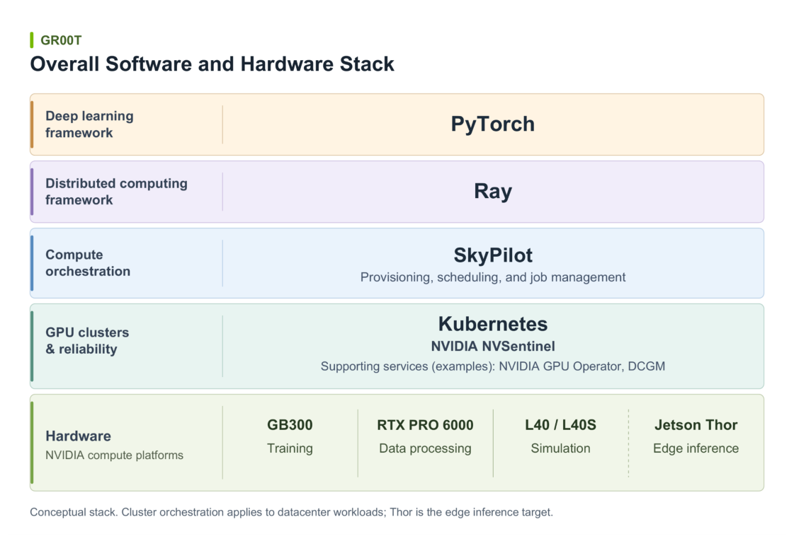
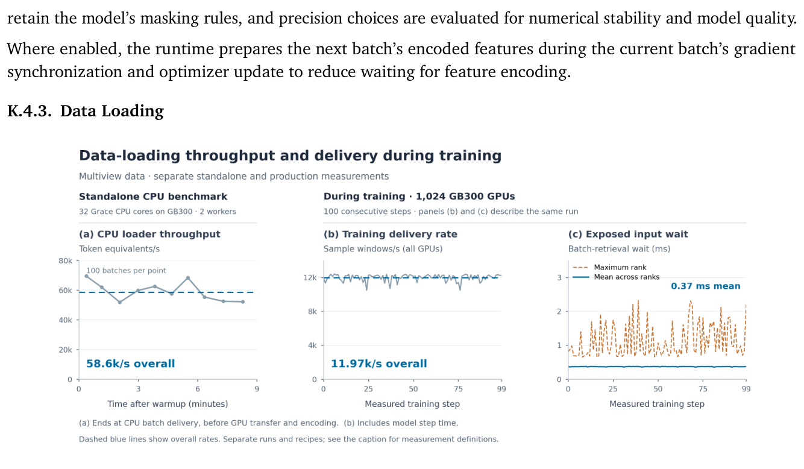
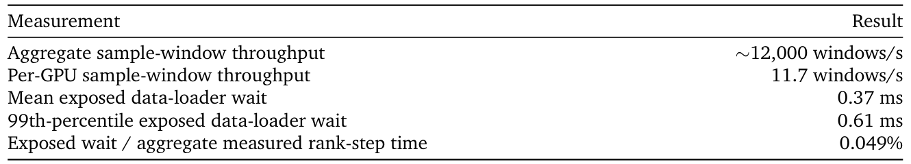
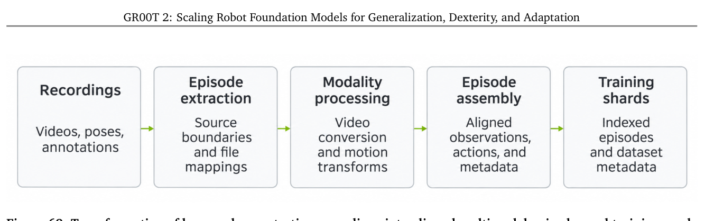
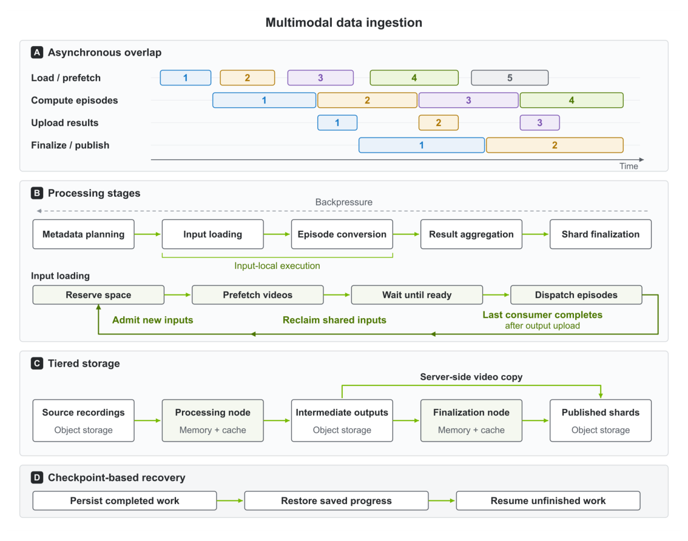
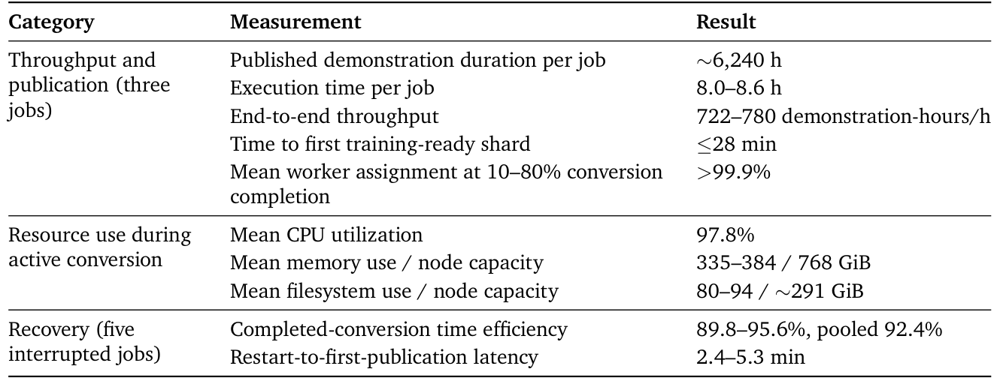

# 附录 K 基础设施

> **原文** K. Infrastructure　·　起于 p.127　·　本页中英对照：英文段在前，中文段在后。

---

<!-- p.127 S2246 -->

This section describes the compute, data, and research infrastructure used to develop GR00T 2.

本节介绍用于开发 GR00T 2 的计算、数据与研究基础设施。

## K.1. Overall Software and Hardware Stack · K.1. 整体软硬件栈

<!-- p.127 S2247 -->

Training a robotics foundation model like GR00T involves: (1) the ingestion and conversion of large volumes of multimodal recordings, such as video, motion, and language annotations, into training-ready datasets, (2) pretraining and post-training at scale on GPU clusters, and (3) the deployment and evaluation of the resulting policies in simulation and on robots. This section describes the infrastructure we built for these workloads and used to develop GR00T 2. At each layer of the stack we build on widely used open-source software, such as PyTorch, Ray, SkyPilot, and Kubernetes, improving it where needed and adding robotics-specific components on top. We describe the overall stack first and each component separately below.

训练 GR00T 这类机器人基础模型，需要完成三项工作：(1) 将大量多模态记录（如视频、动作和语言标注）摄取并转换为可用于训练的数据集；(2) 在 GPU 集群上大规模地进行预训练与后训练；(3) 在仿真环境和真实机器人上部署并评测所得的策略。本节介绍我们为这些工作负载构建、并用于开发 GR00T 2 的基础设施。软件栈的每一层都建立在 PyTorch、Ray、SkyPilot 和 Kubernetes 等广泛使用的开源软件之上，必要时对其加以改进，并在其上增加面向机器人的专用组件。下文先概述整个软件栈，再分别介绍各个组件。

<!-- p.127 C101 · 图 F067 -->

Figure 67: Overall software and hardware stack of GR00T 2.

图 67：GR00T 2 的整体软硬件栈。

<!-- p.127 S2248 -->

Fig. 67 shows the stack from the hardware up. Each workload runs on the NVIDIA platform suited to it: GB300 for training, RTX PRO 6000 for data processing, L40 and L40S for simulation and evaluation, and Jetson Thor for inference on the robot. Kubernetes manages the GPU clusters, with NVIDIA NVSentinel monitoring node health and services such as GPU Operator and DCGM alongside it. SkyPilot (Yang et al., 2023) provisions clusters and schedules and manages jobs across them. Ray (Moritz et al., 2018) distributes work within a job, for training workers and for data ingestion alike, and PyTorch is the deep learning framework.

Fig. 67 自硬件向上展示了整个软硬件栈。每类工作负载都运行在与之匹配的 NVIDIA 平台上：训练使用 GB300，数据处理使用 RTX PRO 6000，仿真与评测使用 L40 和 L40S，机器人上的推理使用 Jetson Thor。Kubernetes 管理 GPU 集群，NVIDIA NVSentinel 负责节点健康监控，并与 GPU Operator、DCGM 等服务协同工作。SkyPilot（Yang et al., 2023）负责为集群供给资源，并在集群之间调度和管理作业。Ray（Moritz et al., 2018）在作业内部分发工作，既用于训练 worker，也用于数据摄取；PyTorch 则是深度学习框架。

<!-- p.127 S2249 -->

The following subsections describe the hardware, cluster and job management, distributed training, inference, and data infrastructure. Reinforcement-learning post-training runs on the same stack, and its infrastructure is described in Sec. F.3.

以下各小节依次介绍硬件、集群与作业管理、分布式训练、推理和数据基础设施。强化学习后训练运行在同一套软件栈上，其基础设施见 Sec. F.3。

## K.2. Hardware · K.2. 硬件

<!-- p.127 S2250 -->

GR00T 2 has many workloads that span large-scale foundation-model pretraining, simulation and policy evaluation, online post-training, and latency-sensitive robot deployment. These stages place different demands on accelerator memory, interconnect bandwidth, storage throughput, scheduling, and end-to-end latency. As a result, each stage has different hardware and system requirements that need to be accounted for.

GR00T 2 涉及多种工作负载，涵盖大规模基础模型预训练、仿真与策略评测、在线后训练，以及对时延敏感的机器人部署。这些阶段对加速器显存、互连带宽、存储吞吐、调度和端到端时延提出了不同的要求。因此，每个阶段都有各自需要考虑的硬件与系统需求。

<!-- p.128 S2252 -->

K.2.1. Pretraining

K.2.1. 预训练

<!-- p.128 S2253 -->

GR00T 2 pretraining ran on NVIDIA GB300 NVL72 systems because the workload placed a premium on GPU memory capacity, Tensor Core throughput, and networking/collective communication acceleration. Each Blackwell Ultra GPU provides up to 288 GB of HBM3e with 8 TB/s of memory bandwidth and approximately 2.5 PFLOPS of dense BF16/FP16 Tensor Core compute. Because the GR00T 2 model was small enough to fit without pipeline parallelism, this memory capacity allowed the model parameters, each rank’s optimizer state, and activations for a per-device batch of 16 to remain in GPU memory. The larger per-device batch provided more matrix-multiplication work for the Tensor Cores and amortized kernel-launch overhead, improving compute utilization (Aubrey and Stam, 2025).

GR00T 2 的预训练运行在 NVIDIA GB300 NVL72 系统上，因为该工作负载对 GPU 显存容量、Tensor Core 吞吐，以及网络与集合通信加速有很高要求。每块 Blackwell Ultra GPU 提供最高 288 GB 的 HBM3e 显存，显存带宽为 8 TB/s，稠密 BF16/FP16 Tensor Core 算力约为 2.5 PFLOPS。由于 GR00T 2 模型足够小，无需流水线并行即可放下，因此这一显存容量使模型参数、每个 rank 的优化器状态，以及单设备批量为 16 时的激活值都能留在 GPU 显存中。更大的单设备批量为 Tensor Core 提供了更多矩阵乘法运算量，并分摊了 kernel 启动开销，从而提高了计算利用率（Aubrey and Stam, 2025）。

<!-- p.128 S2254 -->

For networking, each GB300 NVL72 rack contains 18 compute trays and 72 GPUs connected as one NVLink domain. Fifth-generation NVLink provides 1.8 TB/s of bidirectional bandwidth per GPU. Within each NVLink domain, NVLink SHARP (NVLS) offloaded reductions to the NVSwitch. East/West communication used the RoCE scale-out fabric, with one 800 Gb/s ConnectX-8 SuperNIC per GPU (NVIDIA, n.d.a,n).

在网络方面，每个 GB300 NVL72 机架包含 18 个计算托盘和 72 块 GPU，它们连接成一个 NVLink 域。第五代 NVLink 为每块 GPU 提供 1.8 TB/s 的双向带宽。在每个 NVLink 域内，NVLink SHARP（NVLS）将归约操作卸载到 NVSwitch 上完成。东西向通信使用 RoCE 横向扩展（scale-out）网络结构，每块 GPU 配备一块 800 Gb/s 的 ConnectX-8 SuperNIC（NVIDIA, n.d.a,n）。

<!-- p.128 S2255 -->

The full cluster contained 2,016 GPUs across 28 GB300 NVL72 racks. The GR00T 2 main pretraining run used 1,024 GPUs, while the remaining cluster capacity supported other training experiments concurrently.

整个集群共有 2,016 块 GPU，分布在 28 个 GB300 NVL72 机架中。GR00T 2 的主预训练运行使用了 1,024 块 GPU，其余集群容量则同时支持其他训练实验。

<!-- p.128 S2256 -->

K.2.2. Simulation and Policy Evaluation

K.2.2. 仿真与策略评测

<!-- p.128 S2257 -->

Simulation and policy evaluation ran on NVIDIA L40 and L40S clusters because these workloads required graphics, simulation compute, and policy inference on the same accelerator. Both GPUs use the Ada Lovelace architecture and provide 48 GB of GDDR6 memory with 864 GB/s of memory bandwidth, 142 third-generation RT Cores, and 568 fourth-generation Tensor Cores. The RT Cores accelerate hardware ray tracing for rendered observations, while the Tensor Cores accelerate low-precision policy inference. The L40S retains the L40’s memory capacity and graphics resources while providing approximately twice its peak low-precision Tensor Core throughput, allowing more inference work to accompany simulation (NVIDIA, 2023, n.d.c).

仿真与策略评测运行在 NVIDIA L40 和 L40S 集群上，因为这些工作负载需要在同一加速器上同时完成图形渲染、仿真计算和策略推理。两款 GPU 均采用 Ada Lovelace 架构，各配备 48 GB GDDR6 显存，显存带宽为 864 GB/s，并具有 142 个第三代 RT Core 和 568 个第四代 Tensor Core。RT Core 为渲染观测提供硬件光线追踪加速，Tensor Core 则加速低精度策略推理。L40S 保留了 L40 的显存容量和图形资源，同时其峰值低精度 Tensor Core 吞吐约为 L40 的两倍，从而能够在运行仿真的同时承载更多推理工作（NVIDIA, 2023, n.d.c）。

<!-- p.128 S2258 -->

The 48 GB memory capacity provides headroom to keep the policy checkpoint, simulator state, and rendering buffers resident while processing multiple environments, although achievable concurrency depends on the simulator and task. Unlike GB300 NVL72 systems, L40 and L40S are PCIe Gen4 GPUs without NVLink (NVIDIA, 2023, n.d.c). Evaluation therefore scales primarily by distributing independent environment, checkpoint, and random-seed shards across workers rather than through frequent cross-GPU collectives. Network and storage throughput remain important for staging checkpoints and collecting rollout artifacts, but the primary capacity metrics are environments per GPU, rollout throughput, and checkpoint-evaluation turnaround time.

48 GB 的显存容量为同时处理多个环境时保留策略检查点、仿真器状态和渲染缓冲区提供了余量，不过可实现的并发度取决于仿真器和任务。与 GB300 NVL72 系统不同，L40 和 L40S 是不带 NVLink 的 PCIe Gen4 GPU（NVIDIA, 2023, n.d.c）。因此，评测主要通过将独立的环境、检查点和随机种子分片分配给各个 worker 来扩展，而不是依赖频繁的跨 GPU 集合通信。网络和存储吞吐对于暂存检查点、收集 rollout（轨迹采样）产物依然重要，但主要的容量指标是每块 GPU 的环境数、rollout 吞吐量以及检查点评测的周转时间。

<!-- p.128 S2259 -->

K.2.3. Online Post-Training

K.2.3. 在线后训练

<!-- p.128 S2260 -->

Online post-training ran across heterogeneous H100, GB300, and L40/L40S pools because no single accelerator could satisfy every stage of the workflow. H100 and GB300 systems supported distributed policy optimization. L40 and L40S systems supported simulation-based collection and evaluation, where graphics capabilities were needed. Capacity was allocated independently to each stage and adjusted as workload bottlenecks shifted.

在线后训练运行在异构的 H100、GB300 以及 L40/L40S 资源池上，因为没有任何单一加速器能满足工作流中的每个阶段。H100 和 GB300 系统支持分布式策略优化。L40 和 L40S 系统支持基于仿真的数据收集与评测，这类工作需要图形能力。各阶段的资源容量独立分配，并随工作负载瓶颈的转移而调整。

## K.3. Cluster and Job Management · K.3. 集群与作业管理

<!-- p.128 S2261 -->

K.3.1. Kubernetes

K.3.1. Kubernetes

<!-- p.128 S2262 -->

Kubernetes provides the AI factory execution layer for GR00T 2, with the cluster software stack deployed through NVIDIA AI Cluster Runtime (AICR) (NVIDIA, n.d.d). This integrates NVIDIA DSX OS components for GPU enablement, high-performance networking, and infrastructure resilience. NVIDIA GPU Operator and Network Operator manage the GPU and networking software stacks, while KAI Scheduler and Kueue provide workload scheduling and admission control, priorities, resource quotas, and topology-aware placement for multi-node workloads.

Kubernetes 为 GR00T 2 提供 AI 工厂的执行层，集群软件栈通过 NVIDIA AI Cluster Runtime（AICR）部署（NVIDIA, n.d.d）。它集成了 NVIDIA DSX OS 组件，用于 GPU 启用、高性能网络和基础设施韧性。NVIDIA GPU Operator 和 Network Operator 负责管理 GPU 与网络软件栈；KAI Scheduler 和 Kueue 则为多节点工作负载提供调度与准入控制、优先级、资源配额，以及拓扑感知的放置。

<!-- p.129 S2263 -->

On GB300 NVL72 systems, NVIDIA’s Dynamic Resource Allocation (DRA) driver manages ComputeDomains, enabling secure multi-node NVLink access for workload pods. NCCL uses this fabric for collective communication within each NVLink domain and RoCE for communication across racks.

在 GB300 NVL72 系统上，NVIDIA 的动态资源分配（DRA）驱动程序负责管理 ComputeDomains，为工作负载 Pod 提供安全的多节点 NVLink 访问。NCCL 在每个 NVLink 域内使用该互连进行集合通信，并通过 RoCE 实现跨机架通信。

<!-- p.129 S2264 -->

NVSentinel, also part of NVIDIA DSX OS, monitors GPU and node health and supports policy-driven isolation and remediation of faulty nodes. Together with SkyPilot’s job recovery and the training runtime’s checkpoint-resume mechanisms, these components support reliable operation of the GR00T 2 AI factory.

NVSentinel 同样是 NVIDIA DSX OS 的组成部分，负责监控 GPU 与节点健康，并支持基于策略对故障节点进行隔离与修复。结合 SkyPilot 的作业恢复机制以及训练运行时的检查点续训机制，这些组件共同保障了 GR00T 2 AI 工厂的可靠运行。

<!-- p.129 S2265 -->

K.3.2. SkyPilot

K.3.2. SkyPilot

<!-- p.129 S2266 -->

GR00T 2 training uses SkyPilot (Yang et al., 2023) as the infrastructure orchestration layer for distributed GPU workloads. A shared SkyPilot API control plane provides a common interface for submitting experiments, provisioning workload clusters, monitoring execution, and managing cluster lifecycles. The platform connects this control plane to GPU infrastructure through configured Kubernetes contexts and workspace access controls. Infrastructure configuration and administrative policies are maintained separately from model code, allowing researchers to specify training requirements while platform operators manage credentials, storage integration, and infrastructure access.

GR00T 2 训练使用 SkyPilot（Yang et al., 2023）作为分布式 GPU 工作负载的基础设施编排层。共享的 SkyPilot API 控制平面提供统一接口，用于提交实验、供给工作负载集群、监控执行过程以及管理集群生命周期。平台通过已配置的 Kubernetes 上下文和工作区访问控制，将该控制平面与 GPU 基础设施相连。基础设施配置与管理策略独立于模型代码维护，使研究人员能够描述训练需求，而平台运维人员负责管理凭据、存储集成和基础设施访问。

<!-- p.129 S2267 -->

Each experiment runs as a SkyPilot managed job. Once resources are available, the workload containers form a Ray cluster, and the training driver creates a distributed worker for each GPU. SkyPilot manages infrastructure execution, Ray places training workers, and PyTorch, NCCL, and the optimizer implementation perform distributed model training.

每个实验都作为一个 SkyPilot 托管作业运行。资源就绪后，工作负载容器组成一个 Ray 集群，训练驱动程序为每块 GPU 创建一个分布式 worker。SkyPilot 负责基础设施执行，Ray 负责放置训练 worker，PyTorch、NCCL 以及优化器实现则共同完成分布式模型训练。

<!-- p.129 S2268 -->

The infrastructure accounts for the communication and data-access requirements of large-scale joint videoand-action training. Kubernetes and Kueue coordinate admission of multi-node workloads using GPU topology information, while the OCI workload configuration requests RDMA network attachments and placement within GPU clique topology domains. The training runtime additionally orders distributed ranks according to physical topology. Shared Lustre storage supplies datasets, pretrained assets, and persistent checkpoints, while node-local scratch supports temporary runtime files. These components connect resource allocation to the communication and storage requirements of the GR00T 2 training workload.

该基础设施考虑了大规模视频-动作联合训练（[存疑：原文抽取为 videoand-action，疑为 video-and-action]）在通信与数据访问方面的需求。Kubernetes 与 Kueue 利用 GPU 拓扑信息协调多节点工作负载的准入，而 OCI 工作负载配置则请求 RDMA 网络附件，并将 Pod 放置在 GPU clique 拓扑域内。训练运行时还会根据物理拓扑对分布式 rank 进行排序。共享的 Lustre 存储提供数据集、预训练资产和持久化检查点，节点本地的 scratch 存储则用于临时运行时文件。这些组件将资源分配与 GR00T 2 训练工作负载的通信和存储需求联系起来。

<!-- p.129 S2269 -->

Launch-time administrative policies validate infrastructure selections, preserve backend-specific placement settings, and configure centralized log forwarding. Workspace access controls govern access to the available compute environments. The platform also supports policies that derive queue assignments and scheduling priorities from administrator-managed workspace configuration. SkyPilot managed-job recovery works together with bounded retries and checkpoint resume in the training stack. This separation enables infrastructure recovery while retaining training state in persistent storage.

启动时的管理策略会校验基础设施选择、保留特定后端的放置设置，并配置集中式日志转发。工作区访问控制用于管理对可用计算环境的访问。平台还支持根据管理员维护的工作区配置推导队列分配和调度优先级的策略。SkyPilot 托管作业的恢复机制与训练栈中有上限次数的重试和检查点续训协同工作。这种分工使基础设施能够恢复，同时训练状态保存在持久存储中。

## K.4. Distributed Training · 分布式训练

<!-- p.129 S2270 -->

Distributed training of GR00T 2 requires coordinating multimodal input preparation with synchronous model updates. We design the runtime to reduce memory use, limit waiting between training stages, and preserve progress across interruptions.

GR00T 2 的分布式训练需要让多模态输入准备与同步的模型更新相互协调。我们设计该运行时，以降低内存占用、限制各训练阶段之间的等待时间，并在训练中断后保留训练进度。

<!-- p.129 S2271 -->

K.4.1. Parallelism and Memory Management

K.4.1. 并行与内存管理

<!-- p.129 S2272 -->

We use synchronous data parallelism with DeepSpeed ZeRO-2. Model weights are replicated on each GPU, while gradients and optimizer state are partitioned across ranks to reduce per-device memory use. BF16 gradient synchronization overlaps with model computation to reduce exposed communication time.

我们使用同步的数据并行（data parallelism）并结合 DeepSpeed ZeRO-2。模型权重在每块 GPU 上各保存一份副本，而梯度和优化器状态则在各 rank（分布式进程）之间切分，以降低单设备的内存占用。BF16 梯度同步与模型计算重叠进行，以减少暴露在外的通信时间。

<!-- p.129 S2273 -->

K.4.2. Efficient Multimodal Computation

K.4.2. 高效的多模态计算

<!-- p.129 S2274 -->

Multimodal training requires computation in both frozen feature encoders and the trainable model. Depending on the recipe, the runtime supports TensorRT video encoding, fused text-encoder operations, efficient attention kernels, and PyTorch compilation.

多模态训练既需要在冻结的特征编码器中进行计算，也需要在可训练模型中进行计算。根据训练配方的不同，运行时支持 TensorRT 视频编码、融合的文本编码器算子、高效的注意力算子（kernel），以及 PyTorch 编译。

<!-- p.129 S2275 -->

Activation recomputation reduces memory use at the cost of additional computation. Attention optimizations

激活重计算以额外计算为代价降低内存占用。注意力优化 [存疑：原文抽取在此截断]

<!-- p.130 C102 · 图 F068 -->

Figure 68: Data delivery during multi-view pretraining on 1,024 NVIDIA GB300 GPUs over 100 consecutive steadystate steps. (a) Delivered sample-window throughput. (b) Exposed batch-retrieval wait, showing the mean and maximum across ranks.

图 68：在 1,024 块 NVIDIA GB300 GPU 上、连续 100 个稳态步内的多视角预训练数据交付情况。(a) 已交付的样本窗口吞吐量。(b) 暴露的批次取回等待时间，显示各 rank 上的均值与最大值。

<!-- p.130 S2279 -->

GR00T 2’s data loader combines versioned multimodal storage, offline quality filtering, and asynchronous batch preparation. Training recipes specify the data snapshots to read and how samples are selected and interpreted across embodiments. The training mixture used for the measurements below comprises 25 versioned dataset stores, totaling 15.6 million episode records and 46.2 billion recorded time steps before applying the run’s sampling views. These totals aggregate the selected stores without deduplicating recording content across stores.

GR00T 2 的数据加载器结合了带版本的多模态存储、离线质量过滤和异步批次准备。训练配方规定了要读取的数据快照，以及样本如何在不同本体（embodiment）之间被选取和解释。下文测量所用的训练混合数据由 25 个带版本的数据集存储组成，在应用本次运行的采样视图之前，共计 1560 万条片段（episode）记录和 462 亿个记录的时间步。这些总数是对所选存储的汇总，未对各存储之间的记录内容去重。

<!-- p.130 S2280 -->

Versioned storage and schema. We store training data in LanceDS, built on the Lance columnar format (Pace et al., 2025; Lance Contributors, 2026). Each dataset contains a step table for state, action, annotations, and quality-control (QC) signals, an episode table, and a media table holding the original videos. Lance’s versioning preserves earlier snapshots when episodes are added or annotations or QC signals change, and new QC columns can be added without rewriting existing columns. A per-dataset commit record ties each snapshot’s table versions to its normalization statistics and metadata. A training run pins one snapshot per dataset, so data, statistics, and metadata are reproduced together. Snapshots are replicated to the object store and to training clusters in commit order, with the commit record copied last, so a replica serves a pinned snapshot completely or not at all.

版本化存储与模式（schema）。我们将训练数据存储在 LanceDS 中，它构建于 Lance 列式格式之上（Pace et al., 2025; Lance Contributors, 2026）。每个数据集包含一张用于存放状态、动作、标注和质量控制（QC）信号的步表（step table）、一张片段表（episode table），以及一张存放原始视频的媒体表（media table）。当新增片段，或标注、QC 信号发生变化时，Lance 的版本机制会保留较早的快照；新的 QC 列可以直接添加，无需重写已有列。每个数据集的提交记录（commit record）将每个快照的表版本与其归一化统计量和元数据关联起来。一次训练运行会为每个数据集固定一个快照，因此数据、统计量和元数据能够被一并复现。快照按提交顺序复制到对象存储和训练集群，提交记录最后复制，因此副本要么完整地提供固定的快照，要么完全不提供。

<!-- p.130 S2281 -->

Datasets share a schema in which state and action groups are packed into one state column and one action column. Group names and offsets are recorded in schema metadata, allowing the loader to select fields by name despite differences in their stored order. At read time, the recipe’s embodiment tag selects groups, cameras, annotations, normalization statistics pooled across datasets of that embodiment, and, for dexterous hands, fingertip force signals and deformation video. The same tag determines the model’s embodiment-specific projection layers. Datasets of the same embodiment can be merged with a common group order.

各数据集共享同一模式：状态组和动作组分别打包进一个状态列和一个动作列。组名和偏移量记录在模式元数据中，使加载器即便字段在存储中的顺序不同，仍能按名称选取字段。读取时，配方中的本体标签会选定组、相机、标注，以及在该本体所有数据集上汇总的归一化统计量；对于灵巧手，还会选定指尖力信号和形变视频。同一标签还决定了模型中本体相关的投影层。同一本体的数据集可以按统一的组顺序合并。

<!-- p.130 S2282 -->

Steps within each episode are stored contiguously, and the loader fetches episode ranges through batched reads. Step-table reads bypass filesystem readahead, which amplified per-shard step-table I/O by 28× to 60× in an earlier production benchmark.

每个片段内的步按连续方式存储，加载器通过批量读取获取片段范围。步表读取会绕过文件系统的预读（readahead），在早前的一次生产基准测试中，预读使每个分片的步表 I/O 放大了 28× 至 60×。

<!-- p.131 S2283 -->

Window-aware QC views. A view records the steps eligible to serve as training-sample starts. User-defined Python filters evaluate an episode’s columns over the temporal window consumed by each sample, so eligibility accounts for the observations and action targets that training will read. Filters can also select whole episodes by metadata such as task family, collection date, or data origin. Views are computed offline and stored as runs of consecutive eligible steps per episode. Training samples directly from these runs without evaluating the filters in the loading path.

感知窗口的 QC 视图（view）。一个视图记录可以作为训练样本起点的步。用户自定义的 Python 过滤器会在每个样本所消耗的时间窗口上计算片段的各列，因此资格判定会考虑训练将读取的观测和动作目标。过滤器还可以依据任务族、采集日期或数据来源等元数据，选取整段片段。视图离线计算，并以每个片段内连续合格步的游程形式存储。训练直接从这些游程中采样，加载路径中不再计算过滤器。

<!-- p.131 S2284 -->

Each view is identified by a hash of the dataset, filter code and arguments, and sample window. Cosmetic edits to a filter keep its hash. Views are tagged with the table versions they serve and can be shared by identifier across runs. A view is reused at a new version when the dataset’s rows and the columns its filters read are unchanged. Views are rebuilt automatically: each new snapshot triggers a build of every registered view in the same job that writes the snapshot, and the snapshot and its views are published together, so recipes can pin new snapshots without a manual build step.

每个视图由数据集、过滤器代码及参数和样本窗口的哈希值共同标识。对过滤器的外观性修改不会改变其哈希值。视图会标注其所服务的表版本，并可在不同运行之间通过标识符共享。当数据集的行以及过滤器所读取的列均未变化时，视图可在新版本下复用。视图会自动重建：每个新快照都会在写入该快照的同一作业中触发所有已注册视图的构建，快照与其视图同时发布，因此配方无需手动构建步骤即可固定到新快照。

<!-- p.131 S2285 -->

Views also carry normalization statistics (mean, standard deviation, minimum, maximum, and 1st and 99th percentiles) computed over the samples they keep. Each statistics entry is keyed to the training configuration it was computed under: the snapshot, embodiment, action horizon, and which actions are trained relative to state.

视图还携带归一化统计量（均值、标准差、最小值、最大值，以及第 1 和第 99 百分位数），这些统计量基于视图所保留的样本计算。每条统计量记录都与其计算时所处的训练配置相关联：快照、本体、动作时域，以及哪些动作是相对于状态进行训练的。

<!-- p.131 S2286 -->

For human demonstrations, QC filters check head and wrist motion, hand-pose plausibility, and keypoint visibility, excluding tracking failures such as frozen head poses and abrupt fingertip jumps. For robot demonstrations, filters exclude task-irrelevant motion, idle time, and annotated mistakes or failures. Storing these signals as step-table columns allows curation rules to evolve alongside the versioned dataset.

对于人类演示，QC 过滤器会检查头部和腕部运动、手部姿态的合理性以及关键点可见性，并剔除跟踪失效的片段，例如头部姿态冻结和指尖突然跳变。对于机器人演示，过滤器会剔除与任务无关的运动、空闲时间，以及已标注的错误或失败。将这些信号存储为步表的列，使数据筛选规则能够随带版本的数据集一同演进。

<!-- p.131 S2287 -->

Sampling and batch delivery. Sampling choices are generated on demand from deterministic per-rank step seeds, avoiding a precomputed sampling sequence. Samples are mixed across shards to target the recipe’s dataset proportions in each global step. Sampling without replacement accommodates datasets of different lengths without requiring aligned epoch boundaries.

采样与批次交付。采样选择按需由各 rank 上确定性的步级随机种子生成，无需预先计算采样序列。样本在各分片之间混合，使每个全局步中的数据集比例符合配方的设定。无放回采样可以适应长度不同的数据集，而无需对齐 epoch 边界。

<!-- p.131 S2288 -->

Batch preparation uses three asynchronous stages. The I/O stage prefetches video shards from shared storage into node-local NVMe. The decoding stage reads cached shards, decodes frames, and prepares trajectory metadata. In a representative three-view shard benchmark, decoding was estimated to account for about 90% of preparation time. A separate sequential-decoding microbenchmark measured approximately 7,000 frames/s with one decoding thread at 320×240. The loader stage applies augmentations (random crops retaining 95% of each spatial dimension, resizing to 224×320, and codec augmentation), collates samples, and prepares asynchronous transfers from pinned host memory to the GPU. Keeping prefetched video shards on NVMe reduces the host RAM required for buffering and allows a deeper prefetch window. Dedicated worker pools, SIMD-vectorized decoding, and C++ augmentation implementations reduce CPU processing overhead.

批次准备包含三个异步阶段。I/O 阶段将视频分片从共享存储预取到节点本地 NVMe。解码阶段读取已缓存的分片、解码帧并准备轨迹元数据。在一个具有代表性的三视角分片基准测试中，估计解码约占准备时间的 90%。另有一项单独的顺序解码微基准测试，在 320×240 分辨率、单解码线程下测得约 7,000 帧/秒（frames/s）。加载器阶段应用数据增广（随机裁剪保留每个空间维度的 95%、缩放至 224×320，以及编解码器增广），整理（collate）样本，并准备从锁页主机内存到 GPU 的异步传输。将预取的视频分片保存在 NVMe 上，可以减少缓冲所需的主机内存，并允许更深的预取窗口。专用的 worker 池、SIMD 向量化解码以及 C++ 增广实现，降低了 CPU 处理开销。

<!-- p.131 S2289 -->

On clusters with limited shared-storage capacity, the I/O stage instead stages upcoming shards’ source files on node-local NVMe through a cluster-lifetime object store. Each file is read from the data source once per cluster and forwarded between nodes, so source traffic does not grow with node count. A preloaded interposer serves data-loader reads from local NVMe at the files’ original paths, and a file that cannot be delivered is an error rather than a skipped episode.

在共享存储容量有限的集群上，I/O 阶段改为通过集群生命周期的对象存储，将即将使用的分片源文件预先暂存到节点本地 NVMe 上。每个文件在每个集群中只从数据源读取一次，并在节点之间转发，因此源端流量不会随节点数量增长。预加载的拦截层（interposer）以文件的原始路径，从本地 NVMe 为数据加载器的读取提供服务；无法交付的文件被视为错误，而不是被跳过的片段。

<!-- p.131 S2290 -->

Variable-length token packing reduces padding when samples differ in camera configuration or sequence length. In the measured training run, packed sequences occupied 94.5% of the available positions in 32,768-token rows.

当样本在相机配置或序列长度上有所不同时，变长 token 打包可以减少填充。在实测的训练运行中，打包后的序列占据了 32,768 token 行中 94.5% 的可用位置。

<!-- p.131 S2291 -->

Reproducibility and diagnostics. The loader controls random seeds for sampling and spatiotemporal augmentation. Training checkpoints record loader progress (including active shard offsets, sample indices, and worker state) together with the configuration, including each dataset’s pinned snapshot. The supported sharded pipeline restores sample-sequence progress when resuming with the same data configuration and rank/worker topology. Each sample carries a composite identifier comprising dataset ID, trajectory ID, and frame index, linking the training input to its source.

可复现性与诊断。加载器控制采样和时空增广所用的随机种子。训练检查点会与配置（包括每个数据集所固定的快照）一同记录加载器进度（包括活跃的分片偏移、样本索引和 worker 状态）。在数据配置及 rank/worker 拓扑保持一致的情况下续训时，所支持的分片流水线会恢复样本序列进度。每个样本都带有一个复合标识符，由数据集 ID、轨迹 ID 和帧索引组成，从而将训练输入与其来源相连。

<!-- p.132 S2293 -->

Structured events from each worker and distributed rank trace the batch-loading lifecycle. Correlating these events with sample identifiers helps investigate storage delays, worker starvation, and loss anomalies. A CPU-only benchmark harness uses Gloo and identity model stubs to profile the loading pipeline before GPU runs. Fig. 68 and Tab. 35 report the measured input-delivery performance.

来自每个 worker 和分布式 rank 的结构化事件，记录了批次加载的完整生命周期。将这些事件与样本标识符关联起来，有助于排查存储延迟、worker 饥饿和 loss 异常。一个仅使用 CPU 的基准测试框架，在 GPU 运行之前，使用 Gloo 和恒等模型桩（identity model stub）对加载流水线进行剖析。Fig. 68 和 Tab. 35 报告了实测的输入交付性能。

<!-- p.132 S2294 -->

K.4.4. Straggler Control and Communication

K.4.4. 掉队者控制与通信

<!-- p.132 S2295 -->

A rank delayed by input preparation or a CPU pause can hold up collective operations across the training job. We profile CPU activity, GPU execution, and collective timing together to distinguish late-arriving ranks from slow communication.

因输入准备或 CPU 停顿而延迟的 rank（掉队者，straggler），可能会阻塞整个训练作业中的集合通信操作。我们同时剖析 CPU 活动、GPU 执行和集合通信时序，以区分到达较晚的 rank 与通信缓慢。

<!-- p.132 S2296 -->

Depending on the configuration, the runtime coordinates garbage collection, controls CPU thread placement, balances loader concurrency, and reports metrics asynchronously to limit host delays that interrupt GPU work and synchronization.

根据配置不同，运行时会协调垃圾回收、控制 CPU 线程放置、平衡加载器并发度，并异步上报指标，以限制会打断 GPU 工作与同步的主机端延迟。

<!-- p.132 S2297 -->

K.4.5. Checkpointing and Recovery

K.4.5. 检查点保存与恢复

<!-- p.132 S2298 -->

Checkpointing coordinates a consistent foreground snapshot of training state, followed by background serialization and writes. Asynchronous saving reduces exposed I/O, and a checkpoint becomes available for continuation once all required writes complete.

检查点保存先协调一个一致的训练状态前台快照，随后进行后台序列化与写入。异步保存减少了暴露的 I/O；所有必需的写入完成后，检查点即可用于续训。

<!-- p.132 S2299 -->

Model artifacts provide weights for evaluation and downstream initialization. Continuation checkpoints additionally retain optimizer partitions, scheduler history, random-number-generator state, and supported loader progress. Restoring training requires compatibility between the saved state and the resumed runtime.

模型产物提供用于评测和下游初始化的权重。续训检查点还额外保存优化器分区、调度器历史、随机数生成器状态以及受支持的加载器进度。恢复训练要求所保存的状态与恢复时的运行时相互兼容。

<!-- p.132 S2300 -->

K.4.6. Training Efficiency

K.4.6. 训练效率

<!-- p.132 S2301 -->

We assess training efficiency across input retrieval, frozen feature encoding, model computation, gradient synchronization, and optimizer updates. Step time is interpreted alongside model quality, accounting for differences in active modalities, trainable components, and input shapes.

我们从输入读取、冻结特征编码、模型计算、梯度同步和优化器更新等方面评估训练效率。单步耗时需结合模型质量加以解读，并考虑活跃模态、可训练组件和输入形状的差异。

<!-- p.132 S2302 -->

Tab. 35 reports input-delivery performance over 100 steady-state pretraining steps on 1,024 NVIDIA GB300 GPUs. These measurements characterize the data pipeline. They do not measure whole-model FLOP utilization.

Tab. 35 报告了在 1,024 块 NVIDIA GB300 GPU 上、连续 100 个稳态预训练步中的输入交付性能。这些测量刻画的是数据流水线，并不测量整模型的 FLOP 利用率。

<!-- p.132 C103 · 表 T035 -->

Table 35: Measured training-input delivery over 100 steady-state steps on 1,024 NVIDIA GB300 GPUs. The wait-time share is relative to aggregate measured rank-step time.

表 35：在 1,024 块 NVIDIA GB300 GPU 上、100 个稳态步内实测的训练输入交付情况。等待时间占比相对于实测的 rank 步总耗时计算。

<!-- p.132 S2304 -->

Aggregate sample-window throughput ∼12,000 windows/s Per-GPU sample-window throughput 11.7 windows/s Mean exposed data-loader wait 0.37 ms 99th-percentile exposed data-loader wait 0.61 ms Exposed wait / aggregate measured rank-step time 0.049%

总体样本窗口吞吐量约为 12,000 windows/s；单 GPU 样本窗口吞吐量为 11.7 windows/s；平均暴露的数据加载器等待时间为 0.37 ms；第 99 百分位的暴露数据加载器等待时间为 0.61 ms；暴露等待时间占实测 rank 步总耗时的比例为 0.049%。[存疑：原文为表格的扁平抽取，行列结构已丢失]

<!-- p.132 S2305 -->

We monitor Overall FLOP Utilization (OFU), a hardware-counter-based complement to application-level Model FLOPs Utilization (MFU), alongside step time and task-level evaluation (Pedersen et al., 2026). DCGM provides GPU telemetry (NVIDIA, n.d.e), and Weights & Biases records step time. Utilization helps diagnose accelerator use, while elapsed time and model quality determine whether a change is useful. An optimization can reduce step time without changing the utilization signal. Assessment of a full training run also accounts for startup, compilation, checkpoint pauses, interruptions, and replayed work.

我们监控整体 FLOP 利用率（Overall FLOP Utilization, OFU）。它基于硬件计数器，是应用层模型 FLOP 利用率（MFU）的补充，与单步耗时和任务级评测一并使用（Pedersen et al., 2026）。DCGM 提供 GPU 遥测数据（NVIDIA, n.d.e），Weights & Biases 记录单步耗时。利用率有助于诊断加速器的使用情况，而耗时和模型质量则决定某项改动是否有用。一项优化可能在不改变利用率信号的情况下降低单步耗时。对完整训练运行的评估还需考虑启动、编译、检查点暂停、中断以及重放的工作。

## K.5. Inference Infrastructure · 推理基础设施

<!-- p.132 S2306 -->

We use a client-server architecture to deploy GR00T 2 across embodiments and execution backends. The server handles policy inference, while robot clients connect it to embodiment-specific sensing and control.

我们采用客户端-服务器架构，在不同的本体（embodiment）与执行后端上部署 GR00T 2。服务器负责策略推理，机器人客户端则把服务器与各本体特定的感知和控制连接起来。

<!-- p.133 S2307 -->

K.5.1. Policy Serving

K.5.1. 策略服务

<!-- p.133 S2308 -->

The robot client sends camera history, robot state, and task instructions through a shared request-reply interface. The server prepares inputs for the loaded model and returns predicted action chunks, which the client maps to the robot’s command format. Checkpoint configuration specifies the required history and embodiment-specific input and action representations. The interface supports PyTorch and optimized runtimes, with client and server running on the same host or separate hosts.

机器人客户端通过共享的请求-应答接口发送相机历史、机器人状态和任务指令。服务器为已加载的模型准备输入，并返回预测的动作块，客户端再将其映射为机器人的指令格式。检查点配置规定了所需的历史信息，以及各本体特定的输入和动作表示。该接口同时支持 PyTorch 与优化运行时，客户端与服务器既可以运行在同一台主机上，也可以分别运行在不同的主机上。

<!-- p.133 S2309 -->

For streaming or prefetched observations, the server verifies that prepared visual inputs match the camera history in the prediction request.

对于流式或预取的观测，服务器会核对已准备好的视觉输入是否与预测请求中的相机历史一致。

<!-- p.133 S2310 -->

K.5.2. Compatibility and Readiness

K.5.2. 兼容性与就绪状态

<!-- p.133 S2311 -->

Compiled runtime artifacts are specific to the checkpoint and execution environment. The server checks checkpoint identity, input shapes, numerical precision, software versions, and GPU target before use, rejecting incompatible artifacts. Backends that require warmup initialize execution with a representative observation from the client. Readiness indicates that the required checks and initialization have completed.

编译后的运行时产物与检查点及执行环境相绑定。服务器在使用前会检查检查点身份、输入形状、数值精度、软件版本和 GPU 目标，并拒绝不兼容的产物。需要预热的后端会用客户端提供的一个代表性观测来初始化执行。就绪状态表示所需的检查与初始化均已完成。

<!-- p.133 S2312 -->

On devices with limited GPU memory, the server can offload text-encoder weights to CPU memory, leaving more accelerator memory for policy execution.

在 GPU 显存有限的设备上，服务器可以把文本编码器权重卸载到 CPU 内存中，从而为策略执行留出更多加速器内存。

<!-- p.133 S2313 -->

K.5.3. Action Delivery

K.5.3. 动作下发

<!-- p.133 S2314 -->

The client buffers action chunks and schedules commands at the controller’s execution rate. With asynchronous prediction enabled, it requests the next chunk while the controller executes the current one. Clients using timestamped waypoints discard expired targets before sending commands to the controller. Inference acceleration and policy-quality validation are described in Sec. I.1. RTC and action-timing methods are described in Sec. I.2 and I.3.

客户端会缓存动作块，并按控制器的执行频率调度指令。启用异步预测后，客户端会在控制器执行当前动作块的同时请求下一个动作块。使用带时间戳路点的客户端，会在把指令发送给控制器之前丢弃已过期的目标。推理加速与策略质量验证见 Sec. I.1，实时分块（RTC）与动作时序方法见 Sec. I.2 和 Sec. I.3。

## K.6. Scalable Multi-Modal Data Processing · 可扩展的多模态数据处理

<!-- p.133 S2315 -->

Scaling GR00T 2 across tasks and environments requires turning increasingly large and diverse collections of human demonstrations into training-ready data. Our infrastructure processes petabyte-scale monthly input volumes, with individual production jobs using nearly 10,000 vCPUs. At this scale, preparation must sustain both massive data movement and heterogeneous computation: multi-camera video must be retrieved, decoded, and resized. Motion records must be transformed and, where needed, retargeted to the training hand representation, and observations, actions, and annotations must be aligned in time. Recording duration, resolution, encoding, and retargeting requirements vary across sources, so equal numbers of episodes can impose very different I/O and compute demands. The output is a consistent set of indexed multimodal episodes, packaged into training-ready shards (Fig. 69).

要让 GR00T 2 跨任务、跨环境扩展，就必须把规模日益庞大、类型日益多样的人类演示集合转化为可直接用于训练的数据。我们的基础设施每月处理的输入数据量达到 PB 级，单个生产作业使用的 vCPU 接近 10,000 个。在这一规模下，数据准备必须同时承受海量数据搬运与异构计算：多相机视频需要被检索、解码并缩放；运动记录需要被变换，并在需要时重定向到训练所用的手部表示；观测、动作与标注则需要在时间上对齐。录制时长、分辨率、编码方式和重定向需求在不同来源之间差异很大，因此数量相同的片段（episode）可能带来截然不同的 I/O 与算力需求。最终输出是一组一致的、带索引的多模态片段，并被打包成训练就绪分片（shard）（Fig. 69）。

<!-- p.133 S2316 -->

The central challenge is that these conversions share data and compete for limited working storage. A long video can contain many episodes, while one episode can depend on several camera files and separately stored motion records. Staging a shared file once avoids repeated downloads, but its slowest consumer determines when that storage can be reclaimed. A slow conversion or output upload can therefore retain local files, block retrieval of unrelated inputs, and leave compute workers idle. Interruptions compound the problem by adding repeated transfers and expensive recomputation. Sustained throughput requires coordinating data lifetime with execution progress across the entire pipeline.

核心挑战在于，这些转换既共享数据，又争夺有限的工作存储。一段长视频可以包含许多片段，而一个片段又可能依赖多个相机文件和单独存储的运动记录。把共享文件只暂存一次可以避免重复下载，但最慢的消费者决定了该存储何时可以被回收。因此，转换或输出上传变慢，可能导致本地文件被长期保留、阻塞无关输入的检索，并使计算工作节点空闲。中断会带来重复传输和高昂的重新计算，进一步加重这一问题。要维持持续的吞吐量，就需要在整个流水线中协调数据生命周期与执行进度。

<!-- p.133 S2317 -->

The ingestion pipeline coordinates execution with the lifetime of its shared inputs: new work is admitted according to committed storage, dispatched where its inputs reside, and releases capacity only after its outputs are safely uploaded. Active files move directly from object storage to processing nodes, allowing conversion to begin before the entire selected collection has been retrieved. This removes intermediate staging on a shared filesystem while making input placement, retention, and reconstruction explicit responsibilities. Fig. 70 shows the mechanisms supporting this lifecycle.

摄取流水线让执行与其共享输入的生命周期相协调：新工作会依据已承诺（committed）的存储进行准入，派发到其输入所在的位置，并且只有在输出被安全上传之后才释放容量。活跃文件直接从对象存储移动到处理节点，使转换可以在所选集合全部取回之前开始。这样就去掉了共享文件系统上的中间暂存，同时把输入的放置、保留与重建明确为各自的职责。Fig. 70 展示了支撑这一生命周期的机制。

<!-- p.134 C104 · 图 F069 -->

Figure 69: Transformation of human demonstration recordings into aligned multimodal episodes and training-ready dataset shards.

图 69：将人类演示录制数据转换为对齐的多模态片段与可直接用于训练的数据集分片的过程。

<!-- p.134 S2318 -->

Admit and place work (Fig. 70, panels B and C). Equal episode counts can imply very different file footprints and sharing patterns, so task limits alone cannot control storage demand. Before downloading an input group, admission accounts for resident files, pending transfers, and output headroom against the node’s budget. Required inputs must be ready before episode dispatch, and consumers execute on the node holding those inputs. Separate Ray worker pools (Moritz et al., 2018) give loading, conversion, and publication independent concurrency. Bounded queues limit outstanding work while storage admission limits the capacity committed to it.

准入并放置工作（Fig. 70，面板 B 与 C）。数量相同的片段可能对应截然不同的文件占用量和共享模式，因此仅靠任务数量限制无法控制存储需求。在下载某个输入组之前，准入会根据节点的预算核算驻留文件、待完成的传输以及输出余量。所需输入必须在片段派发之前就绪，消费者则在持有这些输入的节点上执行。独立的 Ray 工作进程池（Moritz et al., 2018）使加载、转换与发布各自拥有独立的并发度。有界队列限制未完成工作的数量，存储准入则限制分配给这些工作的容量。

<!-- p.134 S2319 -->

Retain inputs through completion, then release capacity (Fig. 70, panels A to C). A downloaded video may serve several episodes, including consumers still waiting for execution. The loader establishes their claims before handing off work, protecting shared inputs across queueing, conversion, and upload. An episode releases its claims only after its intermediate results have been uploaded and temporary outputs cleaned up, while other consumers continue to protect the same files. Once the last claim is released, cleanup can reclaim those files and make room for the next input group. Consumer completion thus governs admission of subsequent inputs. Retrieval, conversion, and shard publication advance asynchronously around this dependency: they overlap across workers without allowing prefetch to grow independently of the storage that unfinished consumers still hold.

在完成前保留输入，然后释放容量（Fig. 70，面板 A 至 C）。一个已下载的视频可能服务于多个片段，其中包括仍在等待执行的消费者。加载器在移交工作之前先为它们建立占用（claim），从而在排队、转换和上传的全过程中保护共享输入。一个片段只有在其中间结果已上传、临时输出已清理之后才释放自己的占用，而其他消费者仍会继续保护同一批文件。一旦最后一个占用被释放，清理程序即可回收这些文件，为下一个输入组腾出空间。因此，消费者的完成情况决定了后续输入的准入。检索、转换与分片发布围绕这一依赖关系异步推进：它们在各工作节点之间相互重叠，但预取不会脱离未完成消费者仍占用的存储而独自增长。

<!-- p.134 S2320 -->

Recover within the same capacity budget (Fig. 70, panel D). Recovery preserves this connection between execution and storage. Stopped attempts release obsolete claims, while lost inputs are reconstructed on an available node through the same admission path before affected episodes retry. Durable conversion-group and publication checkpoints separately identify completed results that job resumption can reuse. Input release after upload and cleanup, and checkpoint-based reuse after restart, are distinct boundaries: an uploaded artifact without recorded completion may still require repeated processing. These rules keep retries within the working-storage budget while preserving reusable progress.

在同一容量预算内恢复（Fig. 70，面板 D）。恢复过程保留了执行与存储之间的这一联系。被中止的尝试会释放已过时的占用，丢失的输入则会通过同一条准入路径在可用节点上重建，之后再重试受影响的片段。持久化的转换组检查点与发布检查点分别标识已完成的结果，作业恢复时可以复用这些结果。上传与清理之后的输入释放，以及重启之后基于检查点的复用，是两个不同的边界：已上传但未记录完成状态的产物，仍可能需要重复处理。这些规则使重试始终处于工作存储预算之内，同时保留可复用的进度。

<!-- p.134 S2321 -->

This coordination of shared-input lifetime, admission, and recovery complements prior work on video analysis, multimodal processing, and prefetching (Poms et al., 2018; Chen et al., 2025; Luan et al., 2026; Dryden et al., 2021).

这种对共享输入生命周期、准入与恢复的协调，与此前关于视频分析、多模态处理和预取的工作形成互补（Poms et al., 2018; Chen et al., 2025; Luan et al., 2026; Dryden et al., 2021）。

<!-- p.134 S2322 -->

Production evaluation. Tab. 36 summarizes throughput and resource use across three production jobs and recovery across five interrupted jobs. Each job uses 100 nodes with 96 vCPUs and 768 GiB of memory per node. The throughput workload covers 1.30 million episodes and about 18,700 demonstration-hours, with three camera views per episode.

生产环境评测。Tab. 36 汇总了三个生产作业的吞吐量与资源使用情况，以及五个被中断作业的恢复情况。每个作业使用 100 个节点，每个节点配备 96 个 vCPU 和 768 GiB 内存。吞吐量测试负载涵盖约 130 万个片段和约 18,700 演示小时，每个片段包含三个相机视角。

<!-- p.134 S2323 -->

Completed-conversion time efficiency is the share of completed conversion time spent on work that did not need to be repeated after interruption.

已完成转换时间的效率，指在已完成的转换时间中，用于中断后无需重复的工作所占的比例。

<!-- p.135 C105 · 图 F070 -->

Figure 70: Multimodal data ingestion: (A) asynchronous overlap, (B) processing stages and the feedback from input release to admission, (C) storage tiers, and (D) recovery. Numbers identify shards, and timings are illustrative. Compute/upload overlap occurs across workers.

图 70：多模态数据摄取：(A) 异步重叠，(B) 处理阶段，以及从输入释放到准入的反馈，(C) 存储层级，(D) 恢复。数字用于标识分片，时间数值仅为示意。计算与上传的重叠发生在各工作节点之间。

<!-- p.135 C106 · 表 T036 -->

Table 36: Production evaluation of the data ingestion system. Ranges span jobs. Memory and disk use are per-node means.

表 36：数据摄取系统的生产环境评测。范围取值跨作业统计。内存与磁盘使用量为各节点的均值。

<!-- p.135 S2326 -->

Published demonstration duration per job ∼6,240 h Execution time per job 8.0–8.6 h End-to-end throughput 722–780 demonstration-hours/h Time to first training-ready shard ≤28 min Mean worker assignment at 10–80% conversion completion

[存疑：表格内容被抽取为单行文本，行列对应关系不明，且最后一项缺少数值，请对照 p.135 核实] 每个作业发布的演示时长 ∼6,240 h；每个作业的执行时间 8.0–8.6 h；端到端吞吐量 722–780 演示小时/小时；首个训练就绪分片的耗时 ≤28 min；转换完成 10–80% 时的平均工作进程分配。

---

## 术语表（全篇统一）

见 `GLOSSARY.md`。核心对照：world-action model（WAM）= 世界-动作模型；embodiment = 本体；
x-adapt = 跨本体适配；loco-manipulation = 移动操作；teleoperation = 遥操作；
post-training = 后训练；action chunk = 动作块；code-as-policy（CaP）= 代码即策略。

## 阅读提示（读完正文后再看）

1. 这份报告的主张不是"更大的 VLA"，而是**把动作预测与世界模型绑在同一个去噪过程里**：动作 token 可以 attend 到模型正在生成的未来帧，因此动作能"跟着想象走"。判断其价值时，重点看 Sec. 2 的注意力结构与 Sec. 4.1 的联合流匹配目标是否真的支撑了 Sec. 3.2 的跨本体结论。
2. "X-Adapt"是全文最强的概念主张，也是最需要警惕的一处：它用人类/UMI 数据替代目标机器人遥操作数据。附录 B 给出的每个数字都绑定特定任务集与特定本体，读时务必确认"零样本"到底相对于什么分布。
3. 评测部分是这份报告最反常规的地方（附录 D 的 GearArena）。它用 A/B 配对比较与 Elo 而不是单一成功率，理由在 D.1。若你关心"如何可信地比较机器人策略"，D 章比正文更有价值。
4. 附录 F（RL 后训练）与附录 J（仿真）是工程含量最高的两章；附录 K 的分布式训练细节对复现最有参考价值。
5. 全文未给出模型参数量以外的训练细节（数据规模、算力总量、训练步数）时，不要假设它可复现——把它当作能力报告而非方法论文来读。
